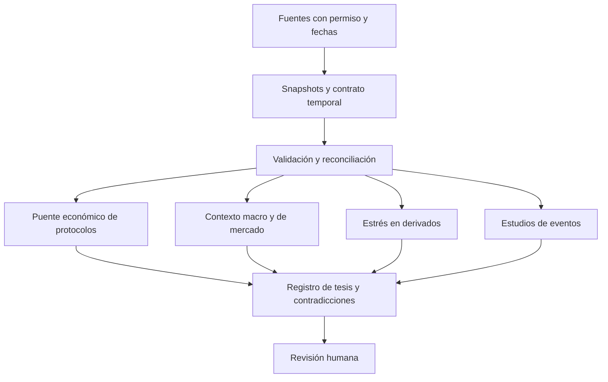

# Combinaciones con hipótesis comprobable

Son propuestas derivadas de la revisión, no afirmaciones de novedad mundial ni productos implementados. Cada combinación debe mejorar una tarea frente a una base simple. Los costes son relativos; no se contrataron servicios ni se cotizan tarifas no verificadas.

| Combinación | Componentes y datos | Hipótesis de valor añadido y prueba | Coste/dependencia | Riesgo y criterio de abandono |
|---|---|---|---|---|
| Puente de valor después de dilución | Adaptadores de fees + contratos de captura + ledger supply + DuckDB | Explica cambios de valoración que un ratio precio/revenue mezcla; reconciliar3protocolos y atribuir variaciones | Medio; curación y RPC/históricos | Definiciones no conciliables: no emitir ranking |
| Detector de revisiones disfrazadas de señal | DataComPy + snapshots + versiones de adaptador + River | Reduce alertas de anomalía provocadas por cambios de fuente; medir falsos positivos y diagnóstico | Bajo con snapshots existentes | No llamar fraude a una discrepancia; abandonar detector complejo si diff simple basta |
| Macro con coste de revisión visible | ALFRED + fredapi corregido en consumidor + replay ruptures | Distingue señales disponibles entonces de las que solo aparecen en series finales | Bajo/medio; vintages por serie | Historial sin fecha conocida: restringir a prospectivo |
| Contraste de estrés observado | OI en cantidad + funding equivalente + profundidad + estado del feed | Reduce falsos episodios debidos a precio, intervalos o caídas del proveedor | Medio; historia multivenue difícil | Sin especificación de contrato no combinar; comparar con regla de volatilidad |
| Tesis como conjunto de predicciones refutables | Docling + registro manual + consultas tipadas + reglas de revisión | Detecta antes contradicciones que un resumen genérico; evaluar contra checklist humana | Bajo manual, medio con IA | Citas falsas o cambios sin respaldo: retirar síntesis automática |
| Calibración de catalizadores | Registro prospectivo + reglas Polymarket + Brier/log loss + consenso guardado | Enseña si el investigador añade información a la probabilidad pública | Medio; archivo de reglas/precios | No comparar mercados con distintas reglas de resolución ni ignorar spread |
| Actividad económica persistente | Cohortes + incentivos + grafo de flujos + event study | Distingue crecimiento que persiste al retirar subsidios de volumen circular | Alto; indexación y etiquetas | Sensible al filtro de bots: reportar rango y abstenerse de punto único |
| Sorpresa de fundamentales | StatsForecast/MLForecast + Chronos2 + fev + cambios de método | Identifica ingresos persistentemente inusuales con incertidumbre calibrada | Medio CPU; coste de datos domina | Si naive/estacional empata, descartar modelo complejo; no convertir sorpresa en target price |
| Cartera de riesgos económicos | Cartera local + factores + stablecoins/cadenas/custodios + stress | Descubre concentración común oculta por símbolos distintos | Bajo/medio; clasificación manual | Correlaciones históricas no capturan hack/depeg; escenarios legibles |
| Eventos de mecanismo, no solo de noticia | Gobernanza + activación on-chain + cronología + bootstrap por bloques | Separar anuncio/ejecución cambia inferencias sobre fees/unlocks | Medio; curación de 20–40 casos | Si no hay muestra comparable, entregar casos y no p-values artificiales |
| Auditor de extracción numérica | Docling + unidad/fecha + aritmética determinista + conjuntos de QA financiero | Reduce errores de escala/periodo frente a texto plano; conjunto propio de tablas DeFi | Medio; licencias de documentos y modelos | Un esquema válido no prueba verdad; exigir pasaje y cálculo reconstruibles |
| Monitor de cola de publicación | acquired_at/available_at + percentiles de retraso + reglas de cobertura | Avisa que un panel está desfasado antes de generar conclusiones falsas | Bajo; timestamps verificables | Si hora pública desconocida, informar cota, no retraso exacto |

## Preguntas nuevas surgidas del barrido

1. ¿Cuánto cambia el ranking de protocolos al fijar la versión del adaptador que existía en cada fecha?
2. ¿Qué parte de una aparente mejora de holder revenue procede de reclasificar destinatarios y no de mayores flujos?
3. ¿Podemos estimar la sensibilidad de un mapa de flujos a retirar un solo proveedor de etiquetas?
4. ¿Se deteriora una tesis antes en su mecanismo económico o en los resúmenes de noticias que la describen?
5. ¿Qué indicador deja de ser útil al penalizar su retraso real de publicación?
6. ¿Un forecast de actividad ayuda a formular mejores preguntas aunque no mejore ningún pronóstico de retorno?
7. ¿Cuándo un cambio de resolución o de reglas de un mercado predictivo explica más que el movimiento de su precio?

## Relaciones entre componentes

El grafo legible por máquina se entrega en `inventories/relations.json` y `.csv`. Sus aristas distinguen dependencia observada, comparación y combinación propuesta. Este diagrama resume únicamente las propuestas; no afirma dependencias de código entre productos futuros.

Estas conexiones son contratos de exportación sencillos. Las cinco herramientas pueden empezar por separado y compartir después solo datos permitidos. No justifican construir una plataforma común antes de demostrar una capacidad útil.
