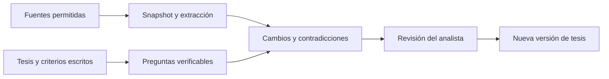

# OP-02 — Thesis Tracker con registro de evidencia

Diseño preliminar, no implementado. Prioridad estratégica 2. Es una herramienta independiente; no necesita desarrollar primero los otros cuatro diseños.

## Objetivo y casos de uso

Mantener explícita una hipótesis, sus alternativas y sus criterios de invalidación. Primera capacidad útil: tres fichas —BTC, ETH y HYPE— con cinco afirmaciones materiales cada una, evidencia enlazada y un registro manual de cambios.

Ejemplo: «el crecimiento de actividad mantiene captura de valor después de incentivos». La herramienta debe mostrar qué métrica lo respalda, qué evidencia lo contradice, qué explicación alternativa existe y qué observación obligaría a revisar la tesis. No asigna automáticamente una recomendación de inversión.

## Flujo y arquitectura mínima

SQLite para textos cortos/relaciones y ficheros locales para documentos permitidos. Un formulario o notebook; adquisición separada de lectura. Tablas: thesis, claim, evidence, counterevidence, trigger, review. Un registro de fuentes con fecha de publicación, adquisición, versión y derechos. Sin base vectorial hasta que la búsqueda textual deje de ser suficiente.

Bibliotecas candidatas: [Docling](https://github.com/docling-project/docling) para estructura documental; [Trafilatura](https://github.com/adbar/trafilatura) para web; DataComPy para cambios en tablas; SQLite/DuckDB y marimo. El LLM es opcional y solo propone extracción o resumen. Las rutas temporales de [TradingAgents](https://github.com/TauricResearch/TradingAgents) son referencia para controles, no razón para adoptar toda su organización multiagente.

## Datos, fuentes y permisos

Documentación de protocolos, propuestas de gobernanza, contratos/avisos y métricas con procedencia. Fuentes externas son datos no confiables: sus instrucciones nunca autorizan herramientas, descargas, cambios de configuración ni mensajes. Conservar enlaces y pasajes mínimos; no republicar documentos o noticias restringidos.

Alternativa gratuita: una plantilla local y enlaces revisados manualmente. Puede aportar casi todo el valor antes de añadir IA. Un modelo alojado añade coste variable y tratamiento externo de información; evaluar después con el conjunto público del piloto. No subir posiciones ni documentación privada por defecto.

## Contratos y métodos

Claim: id, texto, activo, mecanismo, horizonte, supuestos, estado, creador y fecha. Evidence: claim_id, source_id, pasaje/página o clave de fila, fecha conocida, tipo —observación, declaración del emisor, inferencia— y contradicciones. Review: qué cambió, por qué, decisión humana y evidencia pendiente.

El sistema diferencia cambiar un documento de cambiar un hecho. Una modificación de redacción no es necesariamente un catalizador; un cambio de parámetro puede ser material aunque apenas cambie el texto. Empezar con diff literal/estructural y reglas; añadir clasificación semántica solo si reduce trabajo medido.

Una fuente reproducida por diez medios no cuenta como diez pruebas. Registrar origen común y no actualizar probabilidades bayesianas como si documentos dependientes fueran observaciones independientes. Mostrar confianza por afirmación y una salida explícita de abstención cuando no haya evidencia suficiente.

La confianza inicial será ordinal y explicada por cobertura/calidad/independencia, separando extracción y credibilidad. Registrar para cada enlace `supports`, `contradicts` o `insufficient` y revisor: que la cita exista no demuestra que respalde la afirmación. Motivos de abstención enumerados: fuente inaccesible, disponibilidad histórica desconocida, unidad/escala sin resolver, contradicción no conciliada, extracción parcial o cálculo sin inputs respaldados. Distinguir publicación, primera observación y adquisición; no fechar una noticia actual según el evento antiguo que describe.

Salida: «desde la última revisión», tres cambios más relevantes, contradicciones abiertas, próximos catalizadores y enlaces a evidencia. Consulta diaria de 3–5 minutos; revisión semanal más larga. Los números se calculan en código determinista futuro, no mediante generación libre de texto.

## Experimento y aceptación

Diseñar un conjunto de 20 documentos públicos, 15 afirmaciones y cambios conocidos: cinco verdaderos, cinco ambiguos y cinco irrelevantes. Incluir tablas corregidas, fuentes contradictorias y texto que intente instruir al agente. Un humano define antes la respuesta esperada.

Aceptar si toda afirmación material tiene evidencia localizable, no se ejecuta ninguna instrucción del contenido externo, no se fabrican citas y los casos ambiguos se remiten a revisión. Medir precisión/recall de cambios materiales, tasa de abstención, tiempo de revisión y coste por documento. Los umbrales de clasificación se fijan con un conjunto de desarrollo; el lote final no se usa para afinar repetidamente.

Un humano debe juzgar también el soporte semántico, unidad y periodo de cada afirmación material del lote final. Separar desarrollo/validación por documento, origen y fecha; el piloto pequeño no estima fiabilidad de producción. Instrumentar permisos con herramientas simuladas y registro de intentos denegados: el generador no dispone de shell, mensajes ni escritura de tesis. No depender únicamente del prompt para aislar instrucciones externas. La prueba no certifica inmunidad universal.

La primera utilidad debe demostrarse frente a una checklist manual. Si un LLM no mejora tiempo o cobertura manteniendo exactitud, conservar el flujo determinista. No se ha ejecutado esta evaluación.

## Riesgos, recursos e incrementos

Riesgos: referencias erróneas, pérdida de contexto de tablas, privilegios excesivos, filtración de notas personales y automatización del sesgo del analista. Ningún resumen debe cambiar la tesis sin confirmación humana explícita dentro de la futura herramienta.

Incrementos: plantilla de tres tesis → registro de cambios → extracción con revisión → evaluación de citas/abstención → resúmenes periódicos. Estimación: 4–8 jornadas para la primera automatización, CPU y 8–16 GB RAM; OCR/modelos concretos requerirán dimensionamiento propio. No hace falta GPU para el flujo manual ni búsqueda textual. Evitar debate multiagente, scraping masivo y memoria opaca que reescriba hechos.

El piloto debe fijar máximos de llamadas, tokens, reintentos y tiempo, con salida determinista al agotarlos. Medir consumo real y usar la tarifa vigente solo si se autoriza un proveedor futuro. Fijar por separado versiones/licencias del parser, OCR/VLM, pesos y documentos; no permitir descargas implícitas sin revisión.
