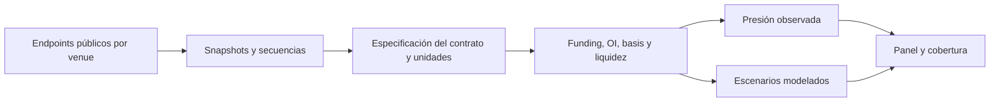

# OP-04 — Derivatives Stress Monitor

Diseño preliminar, no implementado. Prioridad estratégica 4. Herramienta de diagnóstico de riesgo; no motor de trading ni estimador omnisciente de liquidaciones.

## Objetivo y casos

Detectar combinaciones de presión cuya interpretación pueda justificarse: subida de OI junto a funding elevado, menor profundidad y divergencias de basis. Primera capacidad: BTC/ETH en dos venues con funding y OI normalizados; HYPE se añade como mercado con estructura propia.

El usuario debe distinguir «hay más exposición abierta observada» de «habrá liquidaciones a este precio». Una caída de OI puede reflejar cierres voluntarios, liquidaciones o cambios en la medición. Un ratio long/short de cuentas no equivale al posicionamiento neto de nocional.

## Flujo y sistema mínimo

Recolectores de solo lectura, un registro de instrumentos, Parquet/DuckDB y panel local. Captura horaria para la primera versión; profundidad con timestamp y cobertura si se añade después. Guardar last_success y gap_since. No almacenar claves privadas ni conectar endpoints de órdenes.

Candidatos: [CCXT](../03_DEEP_TECHNICAL_REVIEWS/crypto_ccxt.md), [Hyperliquid SDK](../03_DEEP_TECHNICAL_REVIEWS/crypto_hyperliquid_sdk.md), cliente oficial de cada venue y pandas/Polars. Cryptofeed solo si su cobertura y licencia actual justifican la complejidad. La normalización del SDK no elimina diferencias de contrato ni fabrica históricos ausentes.

## Fuentes y acceso

Revisar documentación oficial de funding, open interest, mark/index y liquidaciones de cada mercado. [Hyperliquid API](https://hyperliquid.gitbook.io/hyperliquid-docs/for-developers/api) describe tipos de consulta y límites; comprobar en la versión revisada qué periodos son realmente recuperables. Archivos públicos de exchanges son alternativa para OHLCV/trades, no necesariamente para profundidad u OI histórico completo.

Sin datos de pago: empezar a guardar observaciones prospectivas; usar retrospectivos solo donde la fuente documente cobertura. La reducción de capacidad debe aparecer en la interfaz: «historial desde fecha X» y «sin profundidad histórica». No construir heatmaps precisos rellenando huecos con supuestos invisibles.

## Contrato, cálculos y salida

Instrumento: venue, id nativo, base/quote/settlement, linear/inverse, contract_size, vencimiento, horario funding y fuente de especificación. Observación: valor nativo, unidad, conversión y precio usado, timestamps de evento/adquisición/disponibilidad, secuencia y calidad.

Funding añade fase —estimado, próximo o realizado—, signo/convenio de pagador y periodo efectivo. Si el intervalo es desconocido, no asumir ocho horas ni anualizar. La captura horaria permite estudiar presión de régimen, pero no demostrar anticipación de cascadas intrahorarias; esa pregunta exigiría otra frecuencia, historia y presupuesto.

Convertir OI a una unidad común únicamente cuando se conoce la especificación. Separar efecto cantidad del efecto precio: OI en USD puede subir sin aumentar contratos. Funding debe compararse por intervalo equivalente; una anualización simple es una convención indicativa, no una tasa garantizada ni interés compuesto realizable.

Conservar si OI se reporta en contratos, moneda base o nocional y su convenio de conteo. No sumar long y short como dos contratos ni aplicar la misma fórmula contractSize×markPrice a contratos inversos. El agregado entre venues representa exposición bruta reportada y puede incluir coberturas. No acumular sucesivas estimaciones del mismo pago de funding; comparar periodos realizados válidos y cobertura.

Base explicable: percentiles móviles por venue, variación de OI en cantidad/nocional, funding acumulado equivalente, basis contra spot válido y spread/profundidad observada. Presentar evidencia por bloque; si se añade score, fijar pesos antes del periodo de validación y evaluar contra una regla de volatilidad simple.

Liquidaciones confirmadas: eventos reportados por la fuente, con aviso si el feed limita o muestrea. Estimaciones: escenarios condicionados a supuestos de márgenes y posiciones desconocidas. No sumar ambas series ni tratar la ausencia de eventos como cero liquidaciones cuando hubo caída de conexión.

Mantener lado nativo, lado normalizado y regla usada: el venue puede informar la posición liquidada o la orden de cierre. No se confirmó en la documentación vigente la antigua regla de muestreo atribuida a Binance; no reutilizarla como hecho actual. Separar premium del perpetuo y basis del futuro con vencimiento: el perpetuo no tiene fecha de convergencia anualizable. Alinear referencia spot, timestamps y USDT/USDC/USD antes de comparar.

## Experimento y aceptación

Piloto de 60–90 días y replay de episodios donde existan datos adecuados. Predefinir «episodio de tensión» usando caída de precio/volatilidad/liquidez, sin elegirlo porque el score ya se activó. Medir falsas alertas por semana, precisión/recall, anticipación y persistencia; intervalos por número de episodios y régimen.

Inyectar cambios de funding 1h/8h, contrato inverso, salto de multiplier, corte de feed, duplicado y retraso. Aceptar si todos los errores de unidad/frescura quedan detectados, el panel muestra cobertura y cada aviso tiene una explicación reproducible. Si no supera una regla base en utilidad o fatiga de alertas, descartar el compuesto.

«Todos» se limita a las clases y casos inyectados, no es garantía universal. Separar diagnóstico simultáneo de pronóstico; la etiqueta futura no puede reutilizar la misma variación contemporánea que dispara la alerta. Fijar horizonte y consolidar avisos de un episodio; con pocos episodios publicar conteos descriptivos y dependencia entre ellos. La profundidad secuenciada es una fase distinta del alcance inicial funding/OI.

## Riesgos, recursos e incrementos

Riesgos: API truncada, datos de una sola venue extrapolados al mercado, wash trading, movimientos de colateral y feedback entre precio/OI. Capacidad de abstención al faltar especificaciones o historia mínima.

Incrementos: funding/OI de dos venues → basis → profundidad observada → escenarios y validación. Estimación: 6–12 jornadas, CPU y 8–16 GB RAM; el historial granular puede elevar mucho disco/coste. Evitar HFT, simulación de ejecución, endpoints privados y mapas de liquidación presentados como observaciones.
