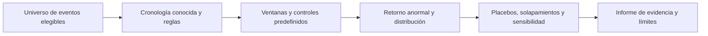

# OP-05 — Event Impact Research Lab

Diseño preliminar, no implementado. Prioridad estratégica 5. Se elige por complementar fundamentos, contexto, estrés y tesis con un método explícito para contrastar catalizadores. Puede aplazarse si no se logra un registro fiable de eventos.

## Objetivo y primera pregunta

Investigar si una familia de eventos muestra una reacción distinta de la que explican el mercado y el régimen. Primera capacidad: 20–40 anuncios comparables de cambios de mecanismos de captura de valor o unlocks; si no existen tantos casos comparables, usar una serie de casos y no forzar inferencia estadística.

Casos: anuncio frente a activación de fees; gobernanza aprobada frente a ejecución; unlock previsto frente a transferencia efectiva; incidente frente a remediación. Estos son hitos diferentes y sus timestamps no deben fusionarse para obtener un efecto más atractivo.

## Flujo y arquitectura

CSV/Parquet versionado, DuckDB y notebook local; statsmodels/SciPy para estimación y [arch](../03_DEEP_TECHNICAL_REVIEWS/quant_arch.md) para bootstrap/pruebas de comparación cuando sean adecuadas. No se necesita un servicio de agentes ni un crawler generalista.

Datos: evento, clase, activo, source_id, publicación más temprana verificada, adquisición, precisión temporal, fecha prevista/ejecutada, regla de inclusión y razón de exclusión. Precios/retornos, controles de mercado y una lista de factores de confusión. Conservar eventos sin efecto, anulados y activos que desaparecieron.

Cada evento incluido necesita además snapshot/hash permitido o evidencia histórica estable, versión del cálculo y regla de alineación UTC con las barras. Un enlace editable actual no basta para reconstruir lo conocido. Registrar si el anuncio era previsto y qué información fue nueva; una transferencia en la fecha de unlock no demuestra venta.

## Fuentes y permisos

Anuncios oficiales, gobernanza y registros on-chain para cronología; datos de mercado de fuente con permiso y cobertura. La fecha actual de una página editada no reconstruye su texto original. Un archivo de noticias comercial puede resolver parte del historial, pero no se contrata ni se sustituye por scraping no autorizado.

Alternativa gratuita: colección prospectiva y curación manual de una sola familia. Produce menos casos e inferencia más débil; a cambio controla exactamente qué era conocido. Los [métodos cuantitativos](../04_ALGORITHMS_AND_METHODS.md) y el inventario de papers conservan referencias para distinguir un event study de una afirmación causal.

## Algoritmos y salidas

Retorno anormal básico: retorno del activo menos retorno esperado bajo un modelo de mercado estimado en ventana anterior. CAR suma retornos anormales en una ventana fijada previamente; no optimizar el inicio/fin para maximizar significación. BTC puede servir de factor de mercado para altcoins, pero no elimina todas las exposiciones ni la simultaneidad.

Fijar antes si se usan retornos simples o logarítmicos y mantener la convención en modelo y agregación. CAR es una estadística de estudio; no equivale automáticamente a rentabilidad compuesta ni operable. No presentar su suma como ganancia de una estrategia sin una construcción económica distinta.

Ventanas candidatas de días/semanas para la pregunta de inversión; intradía solo cuando la hora del evento y el dato lo permitan. Publicar efecto, distribución, n, cobertura, intervalos y sensibilidad a benchmark. Si el anuncio solo está fechado por día, evaluar varias horas plausibles y rebajar confianza.

Bootstrap por bloques o agrupación por fecha/activo para dependencia; no remuestrear todos los retornos como observaciones iid. Eventos superpuestos pueden compartir shocks: agrupar, excluir con regla previa o estimar conjuntamente. Placebos temporales y en activos no afectados ayudan a detectar patrones espurios. Un control sintético requiere donantes no afectados y ajuste previo razonable; no declararlo causal por usar una biblioteca causal.

Preespecificar remuestreo sincronizado entre activos cuando comparten mercado y la agrupación por activo/fecha cuando corresponda. Veinte a cuarenta eventos no garantizan potencia: informar número de clusters y tamaño efectivo, y limitarse a descripción cuando sean insuficientes. Con hora incierta, evaluar todo el intervalo plausible sin seleccionar la hora que minimiza el p-value. El efecto de un unlock esperado depende de la sorpresa respecto a lo ya conocido.

Decidir antes del remuestreo si se reestima el modelo de mercado en cada réplica y cómo se preserva la dependencia en ambos ejes. No remuestrear CAR individuales como observaciones independientes por comodidad. Fijar efecto económicamente relevante y precisión alcanzable; si faltan clusters, presentar series de casos. Si se añade una medida compuesta para ventanas largas, predefinirla como sensibilidad y publicar ambos resultados.

FDR/ajustes por ensayos si se exploran familias o ventanas múltiples. Llevar un registro de experimentos, incluidos los descartados; un Deflated Sharpe no corrige la ocultación de ensayos ni arregla datos con fuga temporal.

Salida: ficha de evento, gráfico de trayectoria con banda, tabla de hipótesis alternativas y conclusión graduada: descriptiva, consistente con efecto o evidencia insuficiente. Nunca «este evento genera una rentabilidad» a partir de la media de pocos casos.

## Experimentos y criterios de aceptación

Antes de ver el resultado, fijar familia, universo, timestamp, ventanas, benchmark, exclusiones, estadísticas y umbral de utilidad. Separar un lote de desarrollo y un lote prospectivo o temporal final. Hacer un placebo con fechas conocidas como no-evento; mantener resultados negativos.

«Sin evento conocido» no significa ausencia de shocks: seleccionar placebos con reglas previas de calendario, régimen y volatilidad, conservando exclusiones y placebos fallidos. Para múltiples ventanas, declarar la familia completa y el procedimiento de ajuste antes de observar los resultados; la mención genérica de FDR no basta.

Aceptar la herramienta si otro analista puede reconstruir el registro, el 100% de los eventos incluidos tiene una fuente, las incertidumbres horarias se muestran y las conclusiones sobreviven a controles razonables o se rebajan explícitamente cuando no lo hacen. La utilidad se mide por hipótesis refutadas, errores evitados y tiempo de análisis; no solo por p-values.

En un subconjunto preseleccionado, el segundo lector debe reconstruir ventanas y CAR dentro de una tolerancia declarada, sin consultar al autor, y detectar casos preparados con anuncio tardío, delisting y solapamiento. La herramienta puede superar la aceptación aunque no encuentre efectos económicos.

## Incrementos, recursos y riesgos

Registro de una familia → estudio descriptivo → placebos/solapamientos → comparación por régimen → validación prospectiva. Estimación: 8–15 jornadas iniciales, CPU/8–16 GB RAM, curación manual como coste dominante. No se han ejecutado experimentos.

Riesgos: anticipación del anuncio, eventos endógenos, muestra pequeña, cambio de narrativa y supervivencia. Evitar un detector universal de noticias, estimar efecto causal sin identificación y usar el propio efecto posterior para etiquetar la importancia del evento.
