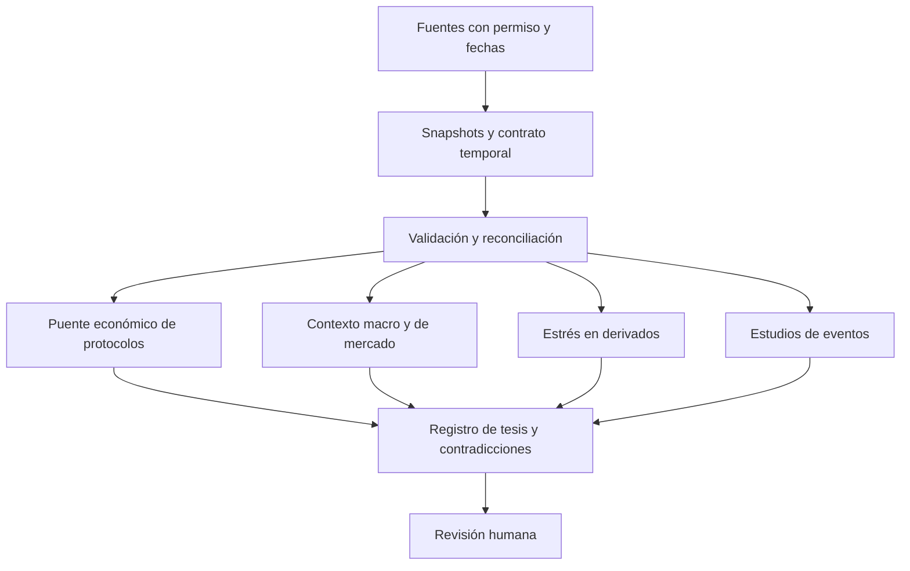
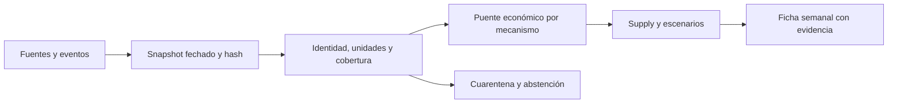
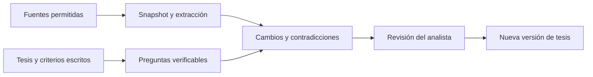
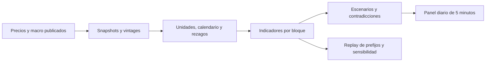
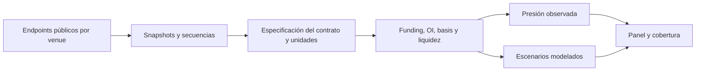
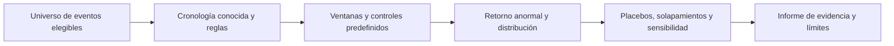

# OPEN ALPHA Investigación completa para lectura en ChatGPT

Copia de los informes de la entrega documental del 4 de noviembre de 2026, con referencia solicitada al día 3. Reúne los 72 documentos Markdown de la entrega: informes, 39 revisiones técnicas, cinco diseños y notas de área. Cada documento conserva su ruta original. Las rutas relativas se refieren al ZIP original; las URLs externas se conservan.

El catálogo contiene 288 recursos, 285 comprobados al nivel declarado, 39 revisiones estáticas, 22 componentes seleccionados y 16 conceptos. La eficacia de los productos y modelos no se midió. CIE quedó fuera del alcance y los diseños no se implementaron.

Los inventarios JSON complementarios permiten contrastar cada candidato con fuentes y evidencias. Esta copia no añade nuevos hallazgos ni actualiza el estado de los proyectos.

---

Ruta original: `README.md`

# OPEN ALPHA — Investigación independiente

**Conclusión:** la mejora más defendible para un inversor particular es comprobar fundamentos, cambios y fechas de conocimiento con herramientas pequeñas y evidencia trazable. El valor de los modelos y agentes debe demostrarse frente a una base simple.

Entrega en español: **288 recursos**, **39 revisiones técnicas estáticas**, **22 componentes seleccionados**, **16 conceptos** y **5 diseños**. 285 recursos tienen consulta original suficiente para su nivel; no son herramientas instaladas ni estrategias rentables demostradas. [Resumen ejecutivo](00_EXECUTIVE_BRIEF.md).

Referencia: 3-nov-2026. Observación de fuentes: 4-nov-2026. No se garantiza reconstrucción exacta de todos los repositorios al cierre del 3. No se ejecutó software de terceros, no se modificó CIE y no se creó/modificó repositorio remoto.

## Lectura recomendada

1. [Informe ejecutivo](00_EXECUTIVE_BRIEF.md), 5–10 minutos.
2. [Dictamen estratégico](14_FINAL_STRATEGIC_VERDICT.md) y [cartera de herramientas](11_PRODUCT_OPPORTUNITIES.md).
3. [Cinco diseños preliminares](12_TOP_FIVE_BLUEPRINTS/README.md).
4. [Catálogo](02_PROJECT_CATALOG.md), [comparaciones](08_TECHNOLOGY_COMPARISONS.md) y revisión de cada candidato.

## Contenido

| Archivo | Para qué sirve |
|---|---|
|[00 — Executive brief](00_EXECUTIVE_BRIEF.md)|Conclusiones y selección inicial|
|[01 — Search coverage](01_SEARCH_COVERAGE.md)|Método, consultas, cobertura real y lagunas|
|[02 — Project catalog](02_PROJECT_CATALOG.md)|Recursos por categoría y acceso a fichas|
|[03 — Deep technical reviews](03_DEEP_TECHNICAL_REVIEWS/README.md)|39 revisiones con rutas/commits y límites|
|[04 — Algorithms and methods](04_ALGORITHMS_AND_METHODS.md)|32 técnicas y criterios de validación|
|[05 — Models and datasets](05_MODELS_AND_DATASETS.md)|Capacidades, benchmarks, licencias y recursos|
|[06 — Data and infrastructure](06_DATA_AND_INFRASTRUCTURE.md)|Fuentes y contrato temporal ligero|
|[07 — License and risk matrix](07_LICENSE_AND_RISK_MATRIX.md)|Permisos por capa y riesgos bloqueantes|
|[08 — Technology comparisons](08_TECHNOLOGY_COMPARISONS.md)|Alternativas por escenario|
|[09 — Hidden gems](09_HIDDEN_GEMS.md)|Capacidades menos obvias|
|[10 — Novel combinations](10_NOVEL_COMBINATIONS.md)|Hipótesis comprobables y grafo de relaciones|
|[11 — Product opportunities](11_PRODUCT_OPPORTUNITIES.md)|16 herramientas personales autónomas|
|[12 — Top five blueprints](12_TOP_FIVE_BLUEPRINTS/README.md)|Diseños, experimentos y aceptación|
|[13 — Research backlog](13_RESEARCH_BACKLOG.md)|Continuidad priorizada|
|[14 — Final strategic verdict](14_FINAL_STRATEGIC_VERDICT.md)|Decisión estratégica del investigador|
|[Revisión de calidad](QUALITY_REVIEW.md)|Comprobación cruzada y límites de QA|

Categorías cubiertas: macro; mercado cripto; derivados; on-chain; fundamentales; oportunidades; validación; IA; agentes; noticias/eventos; cartera/riesgo; visualización; infraestructura; fuentes alternativas. La cobertura es desigual: ver la tabla por categoría antes de interpretar amplitud como profundidad uniforme.

## Componentes seleccionados

La lista incluye bibliotecas, referencias y técnicas; no es una instalación conjunta. Los bloqueantes prevalecen sobre puntos.

| Componente | Puntos editoriales | Qué aprovechar |
|---|---:|---|
| [duckdb](03_DEEP_TECHNICAL_REVIEWS/infra_duckdb.md) | 90 | Consultas locales y joins explícitos; fijar compatibilidad. |
| [pandera](03_DEEP_TECHNICAL_REVIEWS/infra_pandera.md) | 84 | Contratos de tablas y cuarentena, sin ocultar rechazos. |
| [datacompy](03_DEEP_TECHNICAL_REVIEWS/infra_datacompy.md) | 84 | Revisiones de datos y reconciliación. |
| [marimo](03_DEEP_TECHNICAL_REVIEWS/infra_marimo.md) | 87 | Exploración reproducible y lectura de escenarios. |
| [CCXT](03_DEEP_TECHNICAL_REVIEWS/crypto_ccxt.md) | 83 | Lectura de mercados manteniendo contrato/unidad nativos. |
| [Hyperliquid Python SDK](03_DEEP_TECHNICAL_REVIEWS/crypto_hyperliquid_sdk.md) | 87 | Lectura pública acotada de Hyperliquid. |
| [Polymarket unified Python SDK](03_DEEP_TECHNICAL_REVIEWS/crypto_polymarket_sdk.md) | 80 | SDK vigente para datos y reglas de mercados. |
| [DefiLlama dimension adapters](03_DEEP_TECHNICAL_REVIEWS/crypto_defillama_dimensions.md) | 70 | Referencia de fórmulas; no copiar sin licencia verificada. |
| [Uniswap protocol fees](03_DEEP_TECHNICAL_REVIEWS/crypto_uniswap_protocol_fees.md) | 75 | Estudiar mecanismos y eventos; no desplegar contratos. |
| [Cryo](03_DEEP_TECHNICAL_REVIEWS/crypto_cryo.md) | 77 | Extracción batch EVM selectiva; RPC y permisos separados. |
| [fredapi](03_DEEP_TECHNICAL_REVIEWS/quant_fredapi.md) | 85 | Vintages con selección correcta en el consumidor. |
| [statsmodels](https://github.com/statsmodels/statsmodels) | 63 | Bases econométricas antes de modelos complejos. |
| [arch](03_DEEP_TECHNICAL_REVIEWS/quant_arch.md) | 89 | Bootstrap y comparación múltiple de experimentos. |
| [ruptures](03_DEEP_TECHNICAL_REVIEWS/quant_ruptures.md) | 88 | Segmentación y replay de detección, sin anticipación ficticia. |
| [skfolio](03_DEEP_TECHNICAL_REVIEWS/quant_skfolio.md) | 85 | Walk-forward y cartera con purga configurada. |
| [PyPortfolioOpt](03_DEEP_TECHNICAL_REVIEWS/quant_pyportfolioopt.md) | 83 | Riesgo/covarianza y escenarios de concentración. |
| [StatsForecast](https://github.com/Nixtla/statsforecast) | 81 | Baselines estadísticos de magnitudes económicas. |
| [MLForecast](03_DEEP_TECHNICAL_REVIEWS/ai_mlforecast.md) | 84 | Forecast con features y boosting controlables. |
| [Forecast Evaluation (fev)](03_DEEP_TECHNICAL_REVIEWS/ai_fev.md) | 86 | Contrato común de tareas y evaluación. |
| [River](03_DEEP_TECHNICAL_REVIEWS/ai_river.md) | 84 | Cambios en errores/fuentes, no señal automática de compra. |
| [Docling](03_DEEP_TECHNICAL_REVIEWS/ai_docling.md) | 83 | Extracción con estructura y evidencia localizable. |
| [Chronos forecasting library](03_DEEP_TECHNICAL_REVIEWS/ai_chronos.md) | 78 | Comparador probabilístico opcional contra base simple. |

## Cómo consultar el inventario

`inventories/` contiene CSV y JSON para proyectos, bibliotecas, modelos, datasets, papers, algoritmos, licencias, proveedores, oportunidades, comparaciones, fuentes y evidencias; además relaciones, búsquedas, deduplicación y control de etapas. JSON conserva listas/objetos; CSV los serializa como JSON en celdas. Codificación UTF-8 y CSV con escapado estándar.

Empezar por `projects.json`: localizar ID, nivel, bloqueantes y `deep_review_path`. Seguir `evidence_ids` a `evidence.json`, y `source_id` a `sources.json`. Leer URL/commit, tipo de evidencia y limitación, no solo el score. Las fichas de área en `workstreams/` conservan decisiones y revisión crítica; sus inventarios originales explican deduplicaciones del coordinador.

Los puntos suman 25 utilidad+ 15 evidencia+ 15 datos+ 12 facilidad+ 10 licencia+ 8 mantenimiento+ 8 uso+ 7 diferenciación. Son juicio editorial con confianza aparte. No expresan alpha ni calidad medida en producción. V1/V2 verifican alcance limitado; V3 es lectura técnica, nunca ejecución. Diferencias pequeñas no justifican preferencias firmes.

## Limitaciones y continuación

Sesgo GitHub/Python/Hugging Face/inglés y macro occidental. No hubo auditoría completa de issues/releases, seguridad transitiva, derechos por dataset, despliegues ni precisión de modelos. Algunas fuentes son inaccesibles o tienen cobertura parcial; varios papers se leyeron solo por abstract. No se cotizaron servicios ni se conocen todos los recursos del ordenador del usuario.

Los scripts `research_tools/` y de cada área son auxiliares propios de investigación documental; no son los productos financieros propuestos. Un nuevo agente debe leer el protocolo, cobertura y backlog, escoger un ID y añadir una observación sin sobrescribir la anterior. No repetir el barrido por defecto. El archivo `FILE_MANIFEST.json` registra hashes de la entrega; el ZIP excluye cachés y código externo.

Mandato recibido identificado por SHA-256 `B73F8C03294031AAD581EA0D4BBEFB29A4968AEE0A9253962B7C0BBADC8BEE50`; los dos adjuntos recibidos eran idénticos. No se incluyó una ruta privada del equipo en las fuentes de investigación.

---

Ruta original: `00_EXECUTIVE_BRIEF.md`

# OPEN ALPHA — Informe ejecutivo

**La oportunidad principal es construir capacidad de comprobación:** saber qué cambió, cuándo pudo conocerse, quién recibe el valor económico y qué datos podrían invalidar una tesis. Hay suficiente software reutilizable para hacerlo en herramientas pequeñas. Esta investigación no encontró una base para prometer rentabilidad extraordinaria ni para priorizar un gran sistema de agentes de trading.

El catálogo reúne **288 recursos diferenciados**, de los cuales **285 tienen comprobación directa al nivel declarado**: 39 revisiones de rutas técnicas, 208 revisiones de documentación más licencia/archivo técnico y 38 verificaciones de alcance más limitado. Tres pistas siguen sin comprobar suficientemente. Se documentan 32 métodos, 22 comparaciones, 16 conceptos de herramientas y 5 diseños preliminares. Los recursos incluyen bibliotecas, pesos, datasets, servicios y papers; no son 288 aplicaciones listas para usar. [Cobertura y límites](01_SEARCH_COVERAGE.md).

Fecha estratégica de referencia: 3-nov-2026. Fuentes consultadas el 4-nov-2026; los commits fijados no reconstruyen en todos los casos el cierre del día 3. No se instalaron ni ejecutaron proyectos, modelos o tests de terceros. No se construyó ninguna herramienta financiera, no se operó ni se modificó CIE.

## Qué merece atención

**Fundamentales con un puente económico verificable.** Comparar fees, ingresos del protocolo, incentivos, recompras, quema y oferta exige definiciones por mecanismo y fecha. HYPE, UNI, RAY y PUMP no se pueden evaluar aplicando el mismo porcentaje de captura. La documentación de Raydium, por ejemplo, distingue recompras mantenidas por el protocolo de una quema; código desplegable y movimientos efectivamente observados son capas distintas. [Análisis crypto](workstreams/crypto/findings.md).

**Temporalidad y revisiones como parte del análisis.** El código inspeccionado de fredapi puede devolver varias revisiones anteriores al corte; el consumidor debe escoger la última por periodo. Una ruta de OpenBB elimina campos de vintage. El helper Hyperliquid de DefiLlama contempla un fallback a contexto actual. Estos comportamientos pueden producir históricos engañosos si la herramienta no conserva la procedencia. [fredapi](03_DEEP_TECHNICAL_REVIEWS/quant_fredapi.md), [DefiLlama](03_DEEP_TECHNICAL_REVIEWS/crypto_defillama_dimensions.md).

**IA para tareas comprobables.** Extracción documental con citas, baselines de forecasting de actividad y detección de cambios tienen un camino de evaluación más claro que pedir a un agente un precio objetivo. MLForecast/StatsForecast, fev, River, Docling y un experimento limitado con Chronos2 son candidatos útiles. La mejora debe medirse en exactitud, calibración, tiempo o errores evitados. [Modelos y datasets](05_MODELS_AND_DATASETS.md).

**Herramientas pequeñas de control.** DuckDB/Parquet, Pandera, DataComPy y marimo permiten consultar, validar, comparar revisiones y explorar escenarios localmente. El beneficio está en reducir errores específicos, no en añadir componentes. Un portátil puede bastar para pilotos diarios acotados; no se midió rendimiento ni se recomienda comprar hardware. [Infraestructura](06_DATA_AND_INFRASTRUCTURE.md).

## Cambios que una lista antigua pasaría por alto

- Polymarket sustituyó tanto `py-clob-client` como el cliente V2 de transición; el candidato actual es el SDK unificado `py-sdk` / `polymarket-client`. [Revisión](03_DEEP_TECHNICAL_REVIEWS/crypto_polymarket_sdk.md).
- TimesFM3 y los pesos FinBERT tienen condiciones diferentes del código de sus bibliotecas. Vectorbt incorpora Commons Clause. Un permiso de un SDK no se hereda a contratos o datasets de la misma marca. [Matriz](07_LICENSE_AND_RISK_MATRIX.md).
- Una clase de validación «purged» puede traer purga/embargo en cero. PELT identifica cambios retrospectivos si recibe toda la serie. Nombres y gráficos no garantizan validación temporal. [skfolio](03_DEEP_TECHNICAL_REVIEWS/quant_skfolio.md), [ruptures](03_DEEP_TECHNICAL_REVIEWS/quant_ruptures.md).
- La propia página de Pump advierte problemas en las cifras del dashboard tras introducir custom pairs. Una fuente oficial tampoco se acepta sin reconciliar alcance y método. [Fuente primaria](https://pump.fun/pump-token).

## Cinco oportunidades de desarrollo

| Prioridad | Herramienta | Primera capacidad útil |
|---|---|---|
|1|[Protocol Value & Dilution Analyzer](12_TOP_FIVE_BLUEPRINTS/01_protocol_value.md)|Una ficha de protocolo que reconcilie actividad, destinatarios y oferta|
|2|[Thesis Tracker](12_TOP_FIVE_BLUEPRINTS/02_thesis_tracker.md)|Tres tesis con evidencia, contradicciones y criterios de invalidación|
|3|[Market Regime & Liquidity Navigator](12_TOP_FIVE_BLUEPRINTS/03_regime_navigator.md)|BTC/ETH y pocos indicadores con fecha conocida y antigüedad visible|
|4|[Derivatives Stress Monitor](12_TOP_FIVE_BLUEPRINTS/04_derivatives_stress.md)|Funding/OI de dos venues con unidades y cobertura verificadas|
|5|[Event Impact Research Lab](12_TOP_FIVE_BLUEPRINTS/05_event_lab.md)|Una familia de eventos con cronología, controles y resultados negativos conservados|

El monitor de revisiones de datos es una capacidad transversal de prioridad alta: se incorpora desde el primer piloto, aunque no se convierte en una sexta plataforma. La cartera de riesgo puede empezar con bibliotecas existentes y posiciones introducidas localmente. [Los 16 conceptos y sus métricas de utilidad](11_PRODUCT_OPPORTUNITIES.md).

## Qué puede aprovecharse ya y qué aplazar

Ya se puede elaborar una ficha manual con documentos oficiales, paneles públicos y el catálogo de esta investigación. DefiLlama, Dune o Token Terminal ayudan a consultar/contrastar, con sus condiciones y limitaciones; sus servicios no se clasifican como código abierto por tener documentación o clientes públicos. Las herramientas locales candidatas siguen pendientes de instalación y piloto autorizado.

Aplazar un superagente de inversión, un índice global de todas las cadenas, entrenamiento de modelos enormes y motores de ejecución. No construir de cero SQL, parsers documentales, SDKs completos ni backtesting general. Sí diseñar el contrato de datos, las definiciones financieras y los criterios de abstención propios.

El siguiente paso más eficiente sería una ficha manual de un protocolo y una tesis falsable, seguida de snapshots y detección de revisiones. Solo automatizar lo que demuestre ahorro de tiempo o reducción de errores. La investigación deja preparados esos experimentos; **no los presenta como resultados obtenidos**. [Dictamen estratégico](14_FINAL_STRATEGIC_VERDICT.md).

---

Ruta original: `14_FINAL_STRATEGIC_VERDICT.md`

# Dictamen estratégico final

El mundo ya ha desarrollado casi todas las piezas técnicas necesarias para un laboratorio personal de investigación financiera. Lo que falta no es otro motor de cálculo: es una disciplina de evidencia que conecte fechas, definiciones económicas, incertidumbre y decisiones del analista. La oportunidad consiste en hacer esa conexión pequeña, transparente y útil cada semana.

## Qué cambia la forma de investigar

Los adaptadores públicos permiten leer cómo se construye una métrica y localizar dónde depende de una API, un contrato o una regla histórica. Los archivos de vintages permiten preguntar qué se sabía entonces. Los motores locales y formatos columnares hacen razonable trabajar con datos seleccionados sin una plataforma empresarial. Los modelos de extracción y forecasting pueden reducir trabajo preparatorio, siempre que su aporte se mida contra una base simple. [Comparaciones](08_TECHNOLOGY_COMPARISONS.md).

La investigación también muestra por qué esas capacidades no se deben combinar de forma automática. Un adaptador puede usar un upstream privado; un SDK puede normalizar campos y perder semántica; una función as-of puede conservar varias revisiones; una caché puede devolver una respuesta caducada con 200. Son detalles pequeños con consecuencias grandes para una tesis. Las revisiones técnicas señalan las rutas concretas, no defectos atribuidos indiscriminadamente a proyectos enteros.

## Ventaja funcional que sí puede defenderse

Una herramienta aporta una mejora verificable si permite reconstruir una cifra, detectar una revisión, distinguir devengo de transferencia, reducir una omisión o abstenerse cuando faltan datos. Estas mejoras se pueden probar con muestras, fixtures y revisión humana. Son diferentes de demostrar que una estrategia gana dinero.

Para este usuario, las capacidades con mejor relación utilidad/esfuerzo son: puentes de captura de valor, registro de tesis, contexto con vintages, normalización contractual de derivados y cronologías de eventos. No requieren inicialmente GPU, ejecución de órdenes, una organización de agentes o indexar todas las cadenas. Los requisitos domésticos expuestos son presupuestos orientativos; no se hicieron benchmarks locales.

## Dónde está la distancia entre promesa y evidencia

Los agentes financieros pueden redactar análisis convincentes y aun usar perfiles actuales en experimentos históricos. Otros proyectos ya incorporan mejores controles temporales: conviene extraerlos y comprobarlos, sin asumir que el debate entre agentes añade información. Un LLM también puede conocer hechos posteriores desde su entrenamiento. [FinGPT](03_DEEP_TECHNICAL_REVIEWS/ai_fingpt.md), [TradingAgents](03_DEEP_TECHNICAL_REVIEWS/ai_tradingagents.md).

Los foundation models pueden mejorar forecasts de ciertas magnitudes, pero resultados de benchmarks generales no se trasladan a retornos cripto. Un leaderboard puede compartir datasets o autores con los modelos evaluados. El permiso de los pesos puede impedir el uso imaginado incluso cuando el runtime es abierto. Estas son razones para ensayos pequeños, no para declarar inútil toda IA. [Evaluación de modelos](05_MODELS_AND_DATASETS.md).

Los dashboards de «smart money» y mapas de liquidaciones pueden ocultar la incertidumbre de etiquetas, posiciones no observadas, muestreo y definición de usuarios. No hay censo universal de intención económica en una blockchain. Un registro de transferencias no observa automáticamente compras internas en un CEX, ni un mint de stablecoin prueba entrada fiat: puede corresponder a una migración intercadena. [Hallazgos crypto](workstreams/crypto/findings.md).

Las listas de software suelen exagerar adoptabilidad. Esta revisión localizó deprecaciones, cambios de licencia, fechas futuras de conversión de BUSL y condiciones distintas entre código, contratos, pesos y datos. La etiqueta «public» o el nombre de una organización no resuelve esos permisos. [Licencias y riesgos](07_LICENSE_AND_RISK_MATRIX.md).

## Qué construir progresivamente

Investigar primero **Protocol Value & Dilution Analyzer** porque responde a la pregunta central sobre actividad sostenible y captura por token. Empezar con un protocolo y reconciliar cantidades antes de emitir ratios. Después, **Thesis Tracker**, para que un resultado tenga hipótesis, alternativas y una condición de revisión. Ambas pueden ser útiles con mucha curación manual.

La tercera capacidad es **Market Regime & Liquidity Navigator**, con bloques separados y fechas de conocimiento visibles. La cuarta, **Derivatives Stress Monitor**, debe diagnosticar presión con su frecuencia real de observación, sin dibujar liquidaciones futuras como hechos. La quinta, **Event Impact Research Lab**, aporta una manera de cuestionar catalizadores y conservar resultados negativos; su valor depende de cronologías y muestras comparables.

La selección reúne capacidades complementarias. El monitor de revisiones obtiene un score alto y se propone como función transversal. Un panel de cartera puede resolverse antes con componentes existentes. La evaluación de oportunidades explicita estas diferencias. [Diseños](12_TOP_FIVE_BLUEPRINTS/README.md).

## Innovaciones que merecen experimento

Comparar rankings usando la versión de métrica conocida entonces frente a la versión actual. Explicar una divergencia por precio, cantidades, incentivo, destinatario o cambio de cobertura. Medir cuánto cambia un mapa de flujos al retirar etiquetas dudosas. Vincular una predicción prospectiva a condiciones de resolución y evaluar calibración. Detectar cambios en la latencia del dato antes de emitir una alerta financiera.

Ninguna propuesta necesita ser inédita mundialmente para tener valor personal. La hipótesis es que estas combinaciones reducen errores concretos y carga de revisión. Si no superan una ficha manual o regla simple, se descartan o simplifican. [Combinaciones y experimentos](10_NOVEL_COMBINATIONS.md).

## Camino hacia utilidad diaria

1. Elegir una pregunta y un protocolo; redactar definición, fuentes y qué invalidaría la respuesta.
2. Conservar snapshots y fechas, incluida incertidumbre de disponibilidad; verificar permisos del alcance concreto.
3. Producir una ficha manual reproducible y registrar cuánto tarda y qué errores aparecen.
4. Automatizar únicamente adquisición repetida, validación y diferencias; mantener revisión de interpretación.
5. Añadir un modelo o detector solo con un experimento predefinido y una alternativa simple.
6. Pasar a una lectura diaria de 10–20 minutos con acceso a evidencia, sin ocultar huecos ni convertir alertas en órdenes.

Estos son pasos de un posible mandato posterior. Esta entrega es investigación y diseño: no ejecutó los experimentos, no modificó CIE ni publicó repositorios. El barrido es amplio dentro de su cobertura declarada, con sesgos claros hacia GitHub, Python, Hugging Face y fuentes occidentales; no es un censo mundial exhaustivo. La continuación útil está priorizada en el [backlog](13_RESEARCH_BACKLOG.md), no escondida detrás de una afirmación de completitud absoluta.

---

Ruta original: `01_SEARCH_COVERAGE.md`

# Cobertura y metodología

Referencia solicitada: 2026-11-03. Observación efectiva: 2026-11-04. No se retrofechó ninguna verificación. Se fijaron commits/cards cuando fue posible; no se reconstruyó sistemáticamente qué commit estaba disponible al cierre del día 3. Las conclusiones sobre estado actual se refieren al contenido observado el 4.

## Resultado contado y límites de cada nivel

| Magnitud | Resultado |
|---|---:|
| Recursos diferenciados en catálogo principal |288|
| Consulta original suficiente para el nivel declarado |285|
| V3: revisiones técnicas estáticas de rutas críticas |39|
| V2: documentación más licencia o archivo técnico |208|
| V1: existencia/alcance/card/abstract |38|
| D0: comprobación insuficiente |3|
| Registros de fuentes, incluidos fallos |1081|
| URLs de fuente distintas |1072|
| Evidencias registradas |686|
| Consultas de búsqueda registradas |79|
| Métodos / comparaciones |32 / 22|
| Componentes seleccionados |22|
| Conceptos / diseños preliminares |16 /5|

La meta orientativa de 250–500 candidatos, 100 recursos verificados y 30–50 revisiones se alcanza **bajo estas definiciones**. No significa auditar 288 proyectos completos: muchos son bibliotecas de apoyo, cards, datasets, servicios o referencias académicas. Los inventarios especializados son vistas o fichas complementarias; no deben sumarse como recursos nuevos. FRED-MD/FRED-QD comparten URL pero son datasets distintos. Dos duplicados de repositorio —DoWhy/EconML— se consolidaron, conservando fuentes de ambas áreas. Las licencias/capas de pesos y código se mantienen separadas.

Los registros de fuentes incluyen archivos distintos del mismo proyecto y rutas fallidas. Hay 982 registros con estado 200/consultado; el resto son fallos/lecturas insuficientes. Ese conteo no son 982 proyectos ni 982 afirmaciones verificadas. El hash identifica contenido, no certifica veracidad. V3 tampoco implica ejecutar tests, medir cobertura, auditar todas las dependencias o probar una estrategia.

## Cobertura por categoría

Un recurso puede pertenecer a varias categorías: estas filas no deben sumarse. V3 indica lectura estática de rutas seleccionadas, no una auditoría completa del área.

| Área | Recursos | V3 |
|---|---:|---:|
| A — Macro | 31 | 3 |
| B — Mercado cripto | 26 | 8 |
| C — Derivados | 18 | 6 |
| D — On-chain | 50 | 5 |
| E — Fundamentales y valoración | 27 | 3 |
| F — Oportunidades | 11 | 2 |
| G — Validación cuantitativa | 70 | 12 |
| H — IA y modelos | 75 | 9 |
| I — Agentes | 29 | 3 |
| J — Noticias y eventos | 20 | 4 |
| K — Cartera y riesgo | 20 | 5 |
| L — Visualización | 22 | 1 |
| M — Datos e infraestructura | 106 | 19 |
| N — Fuentes alternativas | 19 | 3 |

## Pasadas realizadas

**A — Cartografía.** Puntos de partida del mandato, consultas especializadas, organizaciones de protocolos, documentación, repositorios y cards. Búsquedas en inglés, español, chino y una consulta alemana; amplitud lingüística limitada. Priorización de horizonte 3–18 meses y preguntas económicas, no de funcionalidades de trading.

**B — Relaciones.** Seguir manifiestos, módulos, tests, referencias, SDK→servicio, código→pesos→datos y sucesores oficiales. No se descargaron dependencias ni se clonó masivamente. Se conserva un grafo con aristas tipadas en [relations](inventories/relations.json).

**C — Contracorriente.** Bibliotecas de reconciliación, contratos, monitorización y benchmarks; prototipos bitemporales y recursos macro. Se valoran por el error que pueden evitar, no por estrellas. Algunos prototipos se conservan solo como técnicas por carecer de licencia verificada.

**D — Comparación y depuración.** Separar SDK, protocolo, mirror, fork, herramienta, servicio cerrado, paper y modelo. Comprobar las dos migraciones del SDK Polymarket, continuidades/forks quant y marcas de archivo. No se auditó exhaustivamente el diff de cada fork ni su sostenibilidad. Las URLs incorrectas y cambios de canonical se registran; un 404 no implica inexistencia del proyecto.

## Fuentes, acceso y sesgos

GitHub/raw, documentación oficial, Hugging Face, bancos centrales/organismos y autores académicos fueron las fuentes principales. PyPI/Conda e índices ayudan a descubrir/migrar nombres; no se usan como prueba suficiente de capacidades. Las fuentes sociales solo orientaron descubrimiento, no conclusiones técnicas. No se consultaron cuentas privadas ni se solicitaron credenciales.

GitLab produjo resultados escasos/no pertinentes; Codeberg/SourceHut tuvieron bloqueos del motor y cobertura insuficiente. El mirror CRAN de strucchange permite identificar su procedencia, pero no sustituye una auditoría del original. Kaggle, Hugging Face Spaces, SSRN, Semantic Scholar, Docker Hub, repositorios universitarios no anglófonos y forks fuera de GitHub **no recibieron un barrido directo sistemático**. No se presenta cobertura completa de esas fuentes. Las cotizaciones ETF, opciones históricas, macro asiática y etiquetas on-chain son lagunas relevantes.

No se eludieron robots, autenticación, restricciones ni límites. No se contrataron APIs. ECB API/Treasury API y la pista emissions-adapters quedan D0. En Raydium la URL antigua falló y se localizó la canonical; se conserva esa corrección sin afirmar configuración desplegada universal.

## Protocolo de evidencia y seguridad

Se hizo lectura estática de código, tests, manifests y licencias. Las conclusiones distinguen código observado, declaración de autores, resultado externo no reproducido e inferencia/diseño propio. El texto externo se trató como datos; no se siguieron instrucciones incrustadas. Los auxiliares propios solo consultan fuentes y generan documentos/inventarios. No se importó ni ejecutó código de terceros.

La coordinación revisó afirmaciones decisivas de fredapi, skfolio, TimesFM3, Polymarket y fuentes de protocolos, además de las revisiones de infraestructura. Hubo revisión independiente cruzada de los cinco blueprints; se incorporaron correcciones sobre oferta, denominador de cobertura, OI/funding, frecuencia, CAR, clusters, soporte de citas y permisos. [Registro de revisión](QUALITY_REVIEW.md).

## Puntuación y decisiones

| Criterio | Máximo |
|---|---:|
| Utilidad para análisis e inversión personal |25|
| Calidad técnica y evidencia |15|
| Datos disponibles/verificables |15|
| Facilidad de reutilización |12|
| Licencia/compatibilidad |10|
| Mantenimiento/sostenibilidad |8|
| Uso diario |8|
| Diferenciación |7|
| **Total** |**100**|

Son enteros editoriales, no mediciones de producción. D0 no recibe score consolidado. Fuentes/papers/servicios con evidencia insuficiente para comparar pueden quedar sin puntuación. No ordenar automáticamente todas las categorías juntas: una base de datos y un paper no resuelven la misma pregunta.

La confianza y los bloqueantes se publican aparte. Mantenimiento se valoró de forma provisional porque no se auditó una cronología completa de issues/releases; «no archivado» no demuestra sostenibilidad. Variaciones pequeñas de puntuación no justifican decisiones distintas. Antes de adoptar: resolver permiso y datos, fijar alcance y comparar contra alternativa simple. La lista de 22 componentes incluye referencias/técnicas con copia bloqueada; no es una lista de instalación.

## Consultas y continuidad

Las consultas exactas, fechas y resultados se conservan en [search_log.csv](inventories/search_log.csv) y JSON. Las aperturas directas y lecturas HTTP adicionales están en [sources](inventories/sources.json), no se confunden con consultas de búsqueda. El protocolo común y los scripts auxiliares explican reproducción de la catalogación; los commits/hashes fijan lo observado aunque la web futura cambie.

Persisten límites: historia de mantenimiento, auditoría transitiva, contratos desplegados, derechos completos de datasets, latencia real, integridad de históricos y todos los ensayos empíricos. Los experimentos se han diseñado, no ejecutado. Ver [backlog](13_RESEARCH_BACKLOG.md) y [estado por etapas](inventories/stage_log.json).

---

Ruta original: `02_PROJECT_CATALOG.md`

# Catálogo de recursos

288 entradas diferenciadas; 285 con consulta original suficiente para el nivel declarado. No son 288 herramientas listas para uso. Bibliotecas, pesos, datasets y papers son recursos distintos; se relacionan sin confundir sus derechos.

D0: descubierto sin comprobación suficiente. V1: existencia/función o card/abstract. V2: documentación más licencia o archivo técnico. V3: ruta crítica y pruebas/dependencias examinadas estáticamente. Ningún nivel implica ejecución ni rentabilidad.

Una sola entrada por recurso; la categoría principal organiza la tabla, el resto se conserva en JSON/CSV. FRED-MD y FRED-QD comparten página pero son datasets distintos. Los inventarios de bibliotecas/modelos/etc. son vistas del catálogo, no candidatos que deban sumarse de nuevo.

## A — Macro

| ID / recurso | Tipo / nivel | Uso y límite de selección | Licencia observada | Puntos / decisión |
|---|---|---|---|---|
| `quant-openbb` [OpenBB / OpenBQ](https://github.com/openbq-org/OpenBB) · [revisión](03_DEEP_TECHNICAL_REVIEWS/quant_openbb.md) | framework / V3 | Plataforma de acceso uniforme a proveedores financieros. | Apache-2.0 | 79 / Investigar más |
| `quant-statsmodels` [statsmodels](https://github.com/statsmodels/statsmodels) | biblioteca / V2 | Modelos econométricos, estados espaciales y series temporales. | BSD-3-Clause | 63 / Investigar más |
| `quant-ruptures` [ruptures](https://github.com/deepcharles/ruptures) · [revisión](03_DEEP_TECHNICAL_REVIEWS/quant_ruptures.md) | biblioteca / V3 | Detección offline de cambios estructurales. | BSD-2-Clause | 88 / Adoptar biblioteca |
| `quant-linearmodels` [linearmodels](https://github.com/bashtage/linearmodels) | biblioteca / V2 | Paneles, variables instrumentales y estimación econométrica. | NCSA | 63 / Investigar más |
| `quant-hmmlearn` [hmmlearn](https://github.com/hmmlearn/hmmlearn) | biblioteca / V2 | Modelos ocultos de Markov para estados latentes. | BSD-3-Clause | 63 / Investigar más |
| `quant-pykalman` [pykalman](https://github.com/pykalman/pykalman) | biblioteca / V2 | Filtros y suavizadores de Kalman. | BSD modificado: restricciones de canales de distribución | 57 / Extraer una técnica |
| `quant-quantmod` [quantmod](https://github.com/joshuaulrich/quantmod) | biblioteca / V2 | Modelización y adquisición de series financieras en R. | GPL-3.0 | 60 / Investigar más |
| `quant-strucchange` [strucchange (mirror CRAN)](https://github.com/cran/strucchange) | mirror / V2 | Tests de cambio estructural; mirror de paquete original. | GPL-2 / GPL-3 (declaración DESCRIPTION) | 60 / Investigar más |
| `quant-pandas-datareader` [pandas-datareader](https://github.com/pydata/pandas-datareader) | biblioteca / V2 | Conectores para fuentes económicas y financieras. | BSD-3-Clause | 63 / Investigar más |
| `quant-fredapi` [fredapi](https://github.com/mortada/fredapi) · [revisión](03_DEEP_TECHNICAL_REVIEWS/quant_fredapi.md) | biblioteca / V3 | Cliente FRED/ALFRED con datos históricos por vintage. | Apache-2.0 | 85 / Adoptar biblioteca |
| `quant-sdmx` [sdmx1](https://github.com/khaeru/sdmx) | biblioteca / V2 | Cliente y objetos SDMX para estadísticas oficiales. | Apache-2.0 | 63 / Investigar más |
| `quant-pandasdmx` [pandaSDMX](https://github.com/dr-leo/pandaSDMX) | biblioteca / V2 | Cliente SDMX para bancos centrales y agencias. | Apache-2.0 | 63 / Investigar más |
| `quant-financial-data-science` [Financial Data Science](https://github.com/terence-lim/financial-data-science) | biblioteca / V2 | Herramientas de investigación, lectores macro y estudios de eventos. | MIT | 63 / Investigar más |
| `quant-quantecon-py` [QuantEcon.py](https://github.com/QuantEcon/QuantEcon.py) | biblioteca / V2 | Métodos computacionales económicos, cadenas de Markov y simulación. | MIT | 63 / Investigar más |
| `quant-gingado` [gingado](https://github.com/bis-med-it/gingado) | biblioteca / V2 | Caja de herramientas de ML para economía del BIS. | Apache-2.0 | 63 / Investigar más |
| `quant-alfred` [FRED / ALFRED](https://alfred.stlouisfed.org/help) | proveedor/dataset / V1 | Vintages de series macro; distinguir fecha del periodo, publicación y disponibilidad. | No verificada | sin puntuación / Investigar más |
| `quant-fred-md` [FRED-MD](https://www.stlouisfed.org/research/economists/mccracken/fred-databases) | dataset / V1 | Panel macro mensual con transformaciones y vintages. | No verificada | sin puntuación / Investigar más |
| `quant-fred-qd` [FRED-QD](https://www.stlouisfed.org/research/economists/mccracken/fred-databases) | dataset / V1 | Panel macro trimestral para factores y nowcasting. | No verificada | sin puntuación / Investigar más |
| `quant-bis-api` [BIS SDMX API](https://data.bis.org/help/tools) | proveedor / V2 | API de datos y metadata estadística del BIS. | Condiciones BIS, no licencia de software | sin puntuación / Investigar más |
| `quant-ecb-api` [ECB Data Portal API](https://data.ecb.europa.eu/help/api/data) | proveedor / D0 | Estadísticas monetarias y financieras via SDMX. | No verificada | sin puntuación / Investigar más |
| `quant-treasury-fiscal` [US Treasury Fiscal Data / DTS](https://fiscaldata.treasury.gov/api-documentation/) | proveedor / D0 | Datos de caja del Tesoro y deuda pública. | No verificada | sin puntuación / Investigar más |
| `quant-nyfed-sofr` [NY Fed Markets / SOFR](https://markets.newyorkfed.org/static/docs/markets-api.html) | proveedor / V1 | Tasas overnight de financiación garantizada y referencias monetarias. | No verificada | sin puntuación / Investigar más |
| `quant-ofr-fsi` [OFR Financial Stress Index](https://www.financialresearch.gov/financial-stress-index/) | dataset / V1 | Índice diario de estrés financiero global. | No verificada | sin puntuación / Investigar más |
| `quant-nfci` [Chicago Fed NFCI / ANFCI](https://www.chicagofed.org/research/data/nfci/current-data) | dataset / V1 | Condiciones financieras semanales de EEUU. | No verificada | sin puntuación / Investigar más |
| `quant-gdpnow` [Atlanta Fed GDPNow](https://www.atlantafed.org/research-and-data/data/gdpnow) | modelo/dataset / V1 | Nowcast del PIB antes de la publicación oficial. | No verificada | sin puntuación / Investigar más |
| `quant-bis-gli` [BIS Global Liquidity Indicators](https://data.bis.org/topics/GLI) | dataset / V2 | Crédito a prestatarios no bancarios, incluido crédito en divisas. | Condiciones BIS, no licencia de software | sin puntuación / Investigar más |
| `crypto-coinmetrics-api-client-python` [Coin Metrics Python client](https://github.com/coinmetrics/api-client-python) | biblioteca/SDK / V2 | Cliente de métricas de red y mercado | MIT | 60 / Adoptar biblioteca |
| `crypto-coinmetrics-data` [Coin Metrics Community Data](https://github.com/coinmetrics/data) | dataset o catálogo de datos / V2 | Datos comunitarios de métricas cripto | CC-BY-NC-4.0 | 50 / Extraer una técnica |
| `crypto-defillama-peggedassets-server` [DefiLlama pegged assets](https://github.com/DefiLlama/peggedassets-server) | adaptadores/infraestructura de referencia / V1 | Adaptadores y servidor de oferta de stablecoins | No inferida de la licencia del cliente; revisar fuentes y condiciones por dataset | 48 / Extraer una técnica |
## B — Mercado cripto

| ID / recurso | Tipo / nivel | Uso y límite de selección | Licencia observada | Puntos / decisión |
|---|---|---|---|---|
| `infra-provider-hyperliquid-api` [Hyperliquid: API pública](https://hyperliquid.gitbook.io/hyperliquid-docs/for-developers/api) | proveedor/API o servicio comercial de referencia / V1 | Contexto/info de mercados; diferenciar snapshot actual, histórico y retención. | Términos del servicio/dataset pendientes de caso concreto | sin puntuación / Conservar como referencia |
| `quant-ttr` [TTR](https://github.com/joshuaulrich/TTR) | biblioteca / V2 | Funciones técnicas de series en R. | GPL-2.0 | 60 / Investigar más |
| `crypto-ccxt-ccxt` [CCXT](https://github.com/ccxt/ccxt) · [revisión](03_DEEP_TECHNICAL_REVIEWS/crypto_ccxt.md) | biblioteca/SDK / V3 | Biblioteca de normalización de datos y acceso a exchanges | MIT | 83 / Adoptar biblioteca |
| `crypto-hummingbot-hummingbot` [Hummingbot](https://github.com/hummingbot/hummingbot) | biblioteca/SDK / V2 | Framework de negociación; referencia de conectores, no prioridad de ejecución | Apache-2.0 | 60 / Conservar como referencia |
| `crypto-hyperliquid-dex-hyperliquid-python-sdk` [Hyperliquid Python SDK](https://github.com/hyperliquid-dex/hyperliquid-python-sdk) · [revisión](03_DEEP_TECHNICAL_REVIEWS/crypto_hyperliquid_sdk.md) | biblioteca/SDK / V3 | Cliente oficial para datos y órdenes Hyperliquid | MIT | 87 / Adoptar biblioteca |
| `crypto-polymarket-py-sdk` [Polymarket unified Python SDK](https://github.com/Polymarket/py-sdk) · [revisión](03_DEEP_TECHNICAL_REVIEWS/crypto_polymarket_sdk.md) | biblioteca/SDK / V3 | Cliente oficial unificado de datos y cuenta | MIT | 80 / Adoptar biblioteca |
| `crypto-polymarket-ts-sdk` [Polymarket unified TypeScript SDK](https://github.com/Polymarket/ts-sdk) | biblioteca/SDK / V2 | Cliente oficial unificado TypeScript | MIT | 60 / Adoptar biblioteca |
| `crypto-polymarket-py-clob-client` [Polymarket legacy Python CLOB](https://github.com/Polymarket/py-clob-client) | biblioteca/SDK / V2 | SDK heredado archivado; candidato para descarte | MIT | 38 / Conservar como referencia |
| `crypto-polymarket-py-clob-client-v2` [Polymarket Python CLOB v2](https://github.com/Polymarket/py-clob-client-v2) | biblioteca/SDK / V2 | SDK de transición deprecado; revisar migración | MIT | 38 / Conservar como referencia |
| `crypto-tardis-dev-tardis-python` [Tardis Python](https://github.com/tardis-dev/tardis-python) | biblioteca/SDK / V2 | Cliente de datos históricos de mercado y replay | MPL-2.0 | 56 / Adoptar biblioteca |
| `crypto-bmoscon-cryptofeed` [Cryptofeed](https://github.com/bmoscon/cryptofeed) · [revisión](03_DEEP_TECHNICAL_REVIEWS/crypto_cryptofeed.md) | biblioteca/SDK / V3 | Normalización de feeds WebSocket y libros de órdenes | AGPL-3.0-or-later + atribución adicional | 68 / Adoptar biblioteca |
| `crypto-binance-binance-public-data` [Binance Public Data](https://github.com/binance/binance-public-data) | dataset o catálogo de datos / V1 | Archivos de operaciones y velas públicos | No inferida de la licencia del cliente; revisar fuentes y condiciones por dataset | 48 / Extraer una técnica |
| `crypto-binance-binance-connector-python` [Binance Python connectors](https://github.com/binance/binance-connector-python) | biblioteca/SDK / V2 | Clientes oficiales REST y WebSocket | MIT | 60 / Adoptar biblioteca |
| `crypto-bybit-exchange-pybit` [Pybit](https://github.com/bybit-exchange/pybit) | biblioteca/SDK / V2 | Cliente oficial Bybit Python | MIT | 60 / Adoptar biblioteca |
| `crypto-co-messi-hyperdata-terminal` [HyperData Terminal](https://github.com/Co-Messi/HyperData-Terminal) | herramienta funcional declarada; ejecución no comprobada / V2 | Terminal de datos públicos y estrés Hyperliquid; revisar estimaciones | Apache-2.0 | 60 / Investigar más |
| `crypto-gaserd-prediction-markets-api` [Prediction markets API](https://github.com/Gaserd/prediction-markets-api) | biblioteca/SDK / V2 | Normalización multi-venue de mercados predictivos | MIT | 60 / Adoptar biblioteca |
## C — Derivados

| ID / recurso | Tipo / nivel | Uso y límite de selección | Licencia observada | Puntos / decisión |
|---|---|---|---|---|
| `crypto-defillama-dimension-adapters` [DefiLlama dimension adapters](https://github.com/DefiLlama/dimension-adapters) · [revisión](03_DEEP_TECHNICAL_REVIEWS/crypto_defillama_dimensions.md) | adaptadores/infraestructura de referencia / V3 | Adaptadores de fees, revenue, volumen y dimensiones de protocolos | No inferida de la licencia del cliente; revisar fuentes y condiciones por dataset | 70 / Extraer una técnica |
| `crypto-gmx-io-gmx-synthetics` [GMX Synthetics](https://github.com/gmx-io/gmx-synthetics) | implementación de protocolo; despliegue no validado / V2 | Contratos de derivados on-chain | BUSL-1.1; Change License GPL-2.0-or-later desde 2026-08-31 para texto examinado | 59 / Adoptar biblioteca |
| `crypto-drift-labs-protocol-v2` [Drift protocol v2](https://github.com/drift-labs/protocol-v2) | implementación de protocolo; despliegue no validado / V2 | Protocolo de derivados Solana | Apache-2.0 | 63 / Adoptar biblioteca |
| `crypto-aave-aave-v3-core` [Aave v3 core](https://github.com/aave/aave-v3-core) | implementación de protocolo; despliegue no validado / V2 | Contratos de préstamos y liquidaciones | BUSL-1.1; Change License MIT desde 2023-01-27 para texto examinado | 38 / Conservar como referencia |
| `crypto-0xbaro-hyperliquid` [Hyperliquid market-impact research](https://github.com/0xBaro/hyperliquid) | investigación/paper; dataset y reproducción no verificados / V1 | Investigación de metaórdenes y dataset Hyperliquid | No inferida de la licencia del cliente; revisar fuentes y condiciones por dataset | 48 / Investigar más |
| `crypto-aave-dao-aave-v3-origin` [Aave V3 Origin](https://github.com/aave-dao/aave-v3-origin) | implementación de protocolo; despliegue no validado / V2 | Repositorio sucesor de Aave V3 core | BUSL-1.1; Change Date 2027-03-06 o fecha ENS anterior a MIT; Additional Use Grant restrictiva en texto examinado | 53 / Extraer una técnica |
## D — On-chain

| ID / recurso | Tipo / nivel | Uso y límite de selección | Licencia observada | Puntos / decisión |
|---|---|---|---|---|
| `infra-networkx` [networkx](https://github.com/networkx/networkx) | biblioteca / V2 | Análisis de grafos; las direcciones no equivalen a entidades. | BSD-3-Clause | 66 / Investigar más |
| `infra-igraph` [python-igraph](https://github.com/igraph/python-igraph) | biblioteca / V2 | Bindings Python para analítica de grafos. | GPL-2.0 | 66 / Investigar más |
| `infra-provider-dune-service` [Dune Analytics API](https://docs.dune.com/api-reference/overview/introduction) | proveedor/API o servicio comercial de referencia / V1 | Servicio de consultas/resultados: referencia funcional cerrada; clientes/Spellbook tienen permisos diferentes. | Términos del servicio/dataset pendientes de caso concreto | sin puntuación / Conservar como referencia |
| `crypto-defillama-defillama-adapters` [DefiLlama TVL adapters](https://github.com/DefiLlama/defillama-adapters) | adaptadores/infraestructura de referencia / V2 | Adaptadores de TVL y composición de activos | No inferida de la licencia del cliente; revisar fuentes y condiciones por dataset | 53 / Extraer una técnica |
| `crypto-defillama-bridges-server` [DefiLlama bridges server](https://github.com/DefiLlama/bridges-server) | adaptadores/infraestructura de referencia / V1 | Seguimiento de actividad de bridges | No inferida de la licencia del cliente; revisar fuentes y condiciones por dataset | 28 / Conservar como referencia |
| `crypto-defillama-defillama-sdk` [DefiLlama SDK](https://github.com/DefiLlama/defillama-sdk) | adaptadores/infraestructura de referencia / V2 | Utilidades de llamadas on-chain y balances | No inferida de la licencia del cliente; revisar fuentes y condiciones por dataset | 53 / Extraer una técnica |
| `crypto-hyperliquid-dex-node` [Hyperliquid node](https://github.com/hyperliquid-dex/node) | documentación y distribución de binarios; código del motor no verificado / V2 | Distribución y documentación de nodo Hyperliquid | Apache-2.0 del repositorio examinado; disponibilidad/licencia del código del motor no comprobada | 60 / Investigar más |
| `crypto-polymarket-polymarket-subgraph` [Polymarket subgraphs](https://github.com/Polymarket/polymarket-subgraph) | biblioteca/SDK / V2 | Indexación de eventos de mercados predictivos | LGPL-3.0 (ver texto/versiones por archivo) | 56 / Adoptar biblioteca |
| `crypto-polymarket-ctf-exchange` [Polymarket CTF Exchange](https://github.com/Polymarket/ctf-exchange) | implementación de protocolo; despliegue no validado / V2 | Contratos de liquidación de mercados | MIT | 38 / Conservar como referencia |
| `crypto-uniswap-v2-core` [Uniswap v2 core](https://github.com/Uniswap/v2-core) | implementación de protocolo; despliegue no validado / V2 | Contratos AMM de producto constante | GPL-3.0 (ver texto/versiones por archivo) | 59 / Adoptar biblioteca |
| `crypto-uniswap-v3-core` [Uniswap v3 core](https://github.com/Uniswap/v3-core) | implementación de protocolo; despliegue no validado / V2 | Contratos de liquidez concentrada | BUSL-1.1; Change License GPL-2.0-or-later desde 2023-04-01 para texto examinado | 59 / Adoptar biblioteca |
| `crypto-uniswap-v4-core` [Uniswap v4 core](https://github.com/Uniswap/v4-core) | implementación de protocolo; despliegue no validado / V2 | Contratos AMM con hooks y contabilidad singleton | BUSL-1.1; Change Date 2027-06-15 a MIT, con posibles modificaciones ENS; revisar versión | 53 / Extraer una técnica |
| `crypto-uniswap-sdks` [Uniswap SDKs](https://github.com/Uniswap/sdks) | biblioteca/SDK / V2 | Herramientas para interpretar pools y cotizaciones | MIT declarado para sdk-core; alcance de otros paquetes no verificado | 53 / Extraer una técnica |
| `crypto-uniswap-v3-subgraph` [Uniswap v3 subgraph](https://github.com/Uniswap/v3-subgraph) | biblioteca/SDK / V2 | Indexador GraphQL de pools y swaps | GPL-3.0 (ver texto/versiones por archivo) | 59 / Adoptar biblioteca |
| `crypto-raydium-io-raydium-sdk-v2` [Raydium SDK V2](https://github.com/raydium-io/raydium-sdk-V2) · [revisión](03_DEEP_TECHNICAL_REVIEWS/crypto_raydium_sdk.md) | biblioteca/SDK / V3 | SDK de pools Raydium y datos Solana | GPL-3.0 (ver texto/versiones por archivo) | 68 / Adoptar biblioteca |
| `crypto-raydium-io-raydium-clmm` [Raydium CLMM](https://github.com/raydium-io/raydium-clmm) | implementación de protocolo; despliegue no validado / V2 | Contratos de liquidez concentrada | Apache-2.0 | 63 / Adoptar biblioteca |
| `crypto-raydium-io-raydium-cp-swap` [Raydium CPMM](https://github.com/raydium-io/raydium-cp-swap) | implementación de protocolo; despliegue no validado / V2 | AMM de producto constante con Token2022 | Apache-2.0 | 63 / Adoptar biblioteca |
| `crypto-pump-fun-pump-public-docs` [Pump public docs](https://github.com/pump-fun/pump-public-docs) | documentación e IDL; no equivale a motor completo abierto / V2 | Documentación e IDLs de bonding curve, migración y fees | No inferida de la licencia del cliente; revisar fuentes y condiciones por dataset | 53 / Extraer una técnica |
| `crypto-duneanalytics-spellbook` [Dune Spellbook](https://github.com/duneanalytics/spellbook) | biblioteca/SDK / V2 | Modelos SQL públicos de datos blockchain | BUSL-1.1; Change Date 2027-03-03 a GPL-3.0-or-later; restricción de Data/Analytics Platform | 53 / Extraer una técnica |
| `crypto-duneanalytics-dune-client` [Dune Python client](https://github.com/duneanalytics/dune-client) | biblioteca/SDK / V2 | Cliente de servicio analítico Dune | Apache-2.0 | 63 / Adoptar biblioteca |
| `crypto-blockchain-etl-ethereum-etl` [Ethereum ETL](https://github.com/blockchain-etl/ethereum-etl) | biblioteca/SDK / V2 | Extracción tabular de bloques, logs y transferencias EVM | MIT | 60 / Adoptar biblioteca |
| `crypto-blockchain-etl-bitcoin-etl` [Bitcoin ETL](https://github.com/blockchain-etl/bitcoin-etl) | biblioteca/SDK / V2 | Extracción de bloques y transacciones Bitcoin | MIT | 60 / Adoptar biblioteca |
| `crypto-paradigmxyz-cryo` [Cryo](https://github.com/paradigmxyz/cryo) · [revisión](03_DEEP_TECHNICAL_REVIEWS/crypto_cryo.md) | biblioteca/SDK / V3 | Extracción EVM hacia formatos analíticos | MIT OR Apache-2.0 | 77 / Adoptar biblioteca |
| `crypto-ponder-sh-ponder` [Ponder](https://github.com/ponder-sh/ponder) · [revisión](03_DEEP_TECHNICAL_REVIEWS/crypto_ponder.md) | biblioteca/SDK / V3 | Indexación TypeScript de eventos EVM con gestión de reorg | MIT | 74 / Adoptar biblioteca |
| `crypto-subsquid-squid-sdk` [SQD Squid SDK](https://github.com/subsquid/squid-sdk) | biblioteca/SDK / V2 | ETL multichain con datos de SQD Network | Apache-2.0 | 60 / Adoptar biblioteca |
| `crypto-graphprotocol-graph-node` [Graph Node](https://github.com/graphprotocol/graph-node) | biblioteca/SDK / V2 | Indexador de subgraphs para consultas GraphQL | MIT OR Apache-2.0 | 60 / Conservar como referencia |
| `crypto-graphsense-graphsense-lib` [GraphSense lib](https://github.com/graphsense/graphsense-lib) · [revisión](03_DEEP_TECHNICAL_REVIEWS/crypto_graphsense.md) | biblioteca/SDK / V3 | Análisis de transacciones y agrupación de direcciones | MIT | 73 / Adoptar biblioteca |
| `crypto-graphsense-graphsense-tagpacks` [GraphSense TagPacks](https://github.com/graphsense/graphsense-tagpacks) | dataset o catálogo de datos / V2 | Atribuciones públicas con fuente y esquema | MIT | 60 / Adoptar biblioteca |
| `crypto-graphsense-graphsense-tagpack-tool` [GraphSense TagPack Tool](https://github.com/graphsense/graphsense-tagpack-tool) | biblioteca/SDK / V2 | Validación y gestión de atribuciones de wallets | MIT | 38 / Conservar como referencia |
| `crypto-citp-blocksci` [BlockSci](https://github.com/citp/BlockSci) | biblioteca/SDK / V2 | Análisis de blockchain UTXO y heurísticas de clusters | GPL-3.0 (ver texto/versiones por archivo) | 34 / Conservar como referencia |
| `crypto-banteg-multicall-py` [Multicall.py](https://github.com/banteg/multicall.py) | biblioteca/SDK / V2 | Lecturas agrupadas de contratos EVM | MIT | 60 / Adoptar biblioteca |
| `crypto-ethereum-web3-py` [Web3.py](https://github.com/ApeWorX/web3.py) | biblioteca/SDK / V2 | Cliente RPC Ethereum Python | MIT | 60 / Adoptar biblioteca |
| `crypto-wevm-viem` [Viem](https://github.com/wevm/viem) | biblioteca/SDK / V2 | Cliente Ethereum TypeScript tipado | MIT | 60 / Adoptar biblioteca |
| `crypto-jito-foundation-geyser-grpc-plugin` [Geyser gRPC plugin](https://github.com/jito-foundation/geyser-grpc-plugin) | biblioteca/SDK / V2 | Streaming de datos Solana | Apache-2.0 | 60 / Conservar como referencia |
| `crypto-rpcpool-yellowstone-grpc` [Yellowstone gRPC](https://github.com/rpcpool/yellowstone-grpc) | biblioteca/SDK / V2 | Streaming Solana con filtros | AGPL-3.0 (ver texto/versiones por archivo) | 56 / Adoptar biblioteca |
| `crypto-orca-so-whirlpools` [Orca Whirlpools](https://github.com/orca-so/whirlpools) | implementación de protocolo; despliegue no validado / V2 | AMM de liquidez concentrada en Solana | Orca License (2025), restricciones de uso | 53 / Extraer una técnica |
| `crypto-balancer-balancer-v3-monorepo` [Balancer v3](https://github.com/balancer/balancer-v3-monorepo) | implementación de protocolo; despliegue no validado / V2 | Contratos AMM y pools composables | GPL-3.0 (ver texto/versiones por archivo) | 59 / Adoptar biblioteca |
| `crypto-defipy-devs-defipy` [DeFiPy](https://github.com/defipy-devs/defipy) | biblioteca/SDK / V2 | Simulación de AMMs para investigación de liquidez | Apache-2.0 | 63 / Adoptar biblioteca |
| `crypto-polymarket-ctf-exchange-v2` [Polymarket CTF Exchange V2](https://github.com/Polymarket/ctf-exchange-v2) | implementación de protocolo; despliegue no validado / V2 | Sucesor oficial de contratos de liquidacion | BUSL-1.1; sin Additional Use Grant; Change Date 2030-03-27 a MIT en texto examinado | 50 / Extraer una técnica |
| `crypto-paper-blocksci` [BlockSci: Design and applications of a blockchain analysis platform](https://www.usenix.org/conference/usenixsecurity20/presentation/kalodner) | paper / línea de investigación / V1 | Arquitectura orientada a análisis blockchain y representación eficiente | No verificada | sin puntuación / Investigar más |
| `crypto-paper-hyperliquid-paths` [Price Trajectories, Impact and Sunshine Trading](https://raw.githubusercontent.com/0xBaro/hyperliquid/c4d3743c65923c6e921f731d753e580961d2328b/README.md) | paper / línea de investigación / V1 | Pista para estudiar trayectoria de precios e impacto con datos de mercado públicos | No verificada | sin puntuación / Investigar más |
## E — Fundamentales y valoración

| ID / recurso | Tipo / nivel | Uso y límite de selección | Licencia observada | Puntos / decisión |
|---|---|---|---|---|
| `infra-provider-defillama-api` [DefiLlama: servicio y metodología](https://docs.llama.fi/) | proveedor/API o servicio comercial de referencia / V1 | Agregados DeFi; permisos y acceso del servicio se revisan aparte de adaptadores. | Términos del servicio/dataset pendientes de caso concreto | sin puntuación / Conservar como referencia |
| `infra-provider-tokenterminal-service` [Token Terminal: métricas](https://tokenterminal.com/explorer/metrics/tokenholder_revenue) | proveedor/API o servicio comercial de referencia / V1 | Referencia comercial de definiciones; no implica datos/código abiertos ni validación independiente. | Términos del servicio/dataset pendientes de caso concreto | sin puntuación / Conservar como referencia |
| `crypto-defillama-yield-server` [DefiLlama yield server](https://github.com/DefiLlama/yield-server) | adaptadores/infraestructura de referencia / V1 | Adaptadores y datos de rendimientos DeFi | No inferida de la licencia del cliente; revisar fuentes y condiciones por dataset | 51 / Extraer una técnica |
| `crypto-defillama-emissions-adapters` [DefiLlama emissions adapters](https://github.com/DefiLlama/emissions-adapters) | adaptadores/infraestructura de referencia / D0 | Adaptadores de emisiones y desbloqueos | No inferida de la licencia del cliente; revisar fuentes y condiciones por dataset | sin puntuación / Extraer una técnica |
| `crypto-uniswap-protocol-fees` [Uniswap protocol fees](https://github.com/Uniswap/protocol-fees) · [revisión](03_DEEP_TECHNICAL_REVIEWS/crypto_uniswap_protocol_fees.md) | implementación de protocolo; despliegue no validado / V3 | Contratos de captura de fees y quema de UNI | AGPL-3.0-only (SPDX de rutas examinadas) | 75 / Extraer una técnica |
| `crypto-snapshot-labs-snapshot-js` [Snapshot.js](https://github.com/snapshot-labs/snapshot.js) | biblioteca/SDK / V2 | Cliente de propuestas y votación de gobernanza | MIT | 63 / Adoptar biblioteca |
## G — Validación cuantitativa

| ID / recurso | Tipo / nivel | Uso y límite de selección | Licencia observada | Puntos / decisión |
|---|---|---|---|---|
| `quant-qlib` [Qlib](https://github.com/microsoft/qlib) · [revisión](03_DEEP_TECHNICAL_REVIEWS/quant_qlib.md) | framework / V3 | Framework de investigación cuantitativa y modelos con datos point-in-time. | MIT | 76 / Investigar más |
| `quant-freqtrade` [Freqtrade](https://github.com/freqtrade/freqtrade) | framework / V2 | Backtesting cripto, análisis de sesgos y motor de trading; ejecución fuera de alcance. | GPL-3.0 | 60 / Investigar más |
| `quant-nautilus-trader` [NautilusTrader](https://github.com/nautechsystems/nautilus_trader) · [revisión](03_DEEP_TECHNICAL_REVIEWS/quant_nautilus-trader.md) | framework / V3 | Motor por eventos con instrumentos y simulación de ejecución. | LGPL-3.0 | 66 / Investigar más |
| `quant-lean` [LEAN](https://github.com/QuantConnect/Lean) · [revisión](03_DEEP_TECHNICAL_REVIEWS/quant_lean.md) | framework / V3 | Motor multiactivo de backtest y ejecución con modelos de realidad. | Apache-2.0 | 69 / Investigar más |
| `quant-vectorbt` [vectorbt](https://github.com/polakowo/vectorbt) · [revisión](03_DEEP_TECHNICAL_REVIEWS/quant_vectorbt.md) | biblioteca / V3 | Simulación vectorizada y barridos de parámetros. | Apache-2.0 WITH Commons-Clause | 73 / Extraer una técnica |
| `quant-arch` [arch](https://github.com/bashtage/arch) · [revisión](03_DEEP_TECHNICAL_REVIEWS/quant_arch.md) | biblioteca / V3 | Volatilidad condicional, bootstrap, cointegración y comparación múltiple. | NCSA | 89 / Adoptar biblioteca |
| `quant-skfolio` [skfolio](https://github.com/skfolio/skfolio) · [revisión](03_DEEP_TECHNICAL_REVIEWS/quant_skfolio.md) | biblioteca / V3 | Selección y validación de carteras con interfaz scikit-learn. | BSD-3-Clause | 85 / Adoptar biblioteca |
| `quant-bt` [bt](https://github.com/pmorissette/bt) | biblioteca / V2 | Backtesting de estrategias de asignación de activos. | MIT | 63 / Investigar más |
| `quant-backtesting-py` [Backtesting.py](https://github.com/kernc/backtesting.py) | biblioteca / V2 | Motor compacto de backtesting sobre barras. | AGPL-3.0 | 60 / Investigar más |
| `quant-backtrader` [Backtrader](https://github.com/mementum/backtrader) | biblioteca / V2 | Framework histórico de backtesting por eventos. | GPL-3.0 | 60 / Investigar más |
| `quant-zipline-reloaded` [Zipline-reloaded](https://github.com/stefan-jansen/zipline-reloaded) | fork/continuación; mantenimiento no auditado / V2 | Continuación de Zipline con bundles, calendarios y datos de acciones. | Apache-2.0 | 63 / Investigar más |
| `quant-alphalens-reloaded` [Alphalens-reloaded](https://github.com/stefan-jansen/alphalens-reloaded) | fork/continuación; mantenimiento no auditado / V2 | Continuación de análisis de factores transversales. | Apache-2.0 | 63 / Investigar más |
| `quant-alphalens` [Alphalens original](https://github.com/quantopian/alphalens) | biblioteca / V2 | Análisis original de factores; contrastar con forks mantenidos. | Apache-2.0 | 63 / Investigar más |
| `quant-mlfinlab` [MLFinLab](https://github.com/hudson-and-thames/mlfinlab) | biblioteca / V2 | Implementaciones de machine learning financiero; verificar acceso y licencia. | Acuerdo propietario Hudson & Thames; referencias internas ambiguas a ArbitrageLab | 57 / Extraer una técnica |
| `quant-arbitragelab` [ArbitrageLab](https://github.com/hudson-and-thames/arbitragelab) | biblioteca / V2 | Métodos de cointegración y estrategias relativas. | BSD-3-Clause | 63 / Investigar más |
| `quant-rqalpha` [RQAlpha](https://github.com/ricequant/rqalpha) | framework / V2 | Framework chino de backtesting y trading modular. | Apache-2.0 modificado: uso comercial sujeto a autorización | 57 / Extraer una técnica |
| `quant-vnpy` [VeighNa / vn.py](https://github.com/vnpy/vnpy) | framework / V2 | Framework chino de trading y extensiones cuantitativas. | MIT | 63 / Investigar más |
| `quant-quantstrat` [quantstrat](https://github.com/braverock/quantstrat) | biblioteca / V2 | Framework R de estrategias y reglas sobre datos financieros. | GPL-3 (declaración DESCRIPTION) | 60 / Investigar más |
| `quant-skepsis` [skepsis](https://github.com/abhinay/skepsis) | biblioteca / V2 | Validación y auditoría estadística de backtests; candidato reciente. | Apache-2.0 | 63 / Investigar más |
| `quant-dsr-paper` [The Deflated Sharpe Ratio](https://www.davidhbailey.com/dhbpapers/deflated-sharpe.pdf) | paper / V1 | Corrección por selección de ensayos y no normalidad del Sharpe. | No verificada | sin puntuación / Extraer una técnica |
| `quant-pbo-paper` [The Probability of Backtest Overfitting](https://www.davidhbailey.com/dhbpapers/backtest-prob.pdf) | paper / V1 | CSCV para cuantificar deterioro de selección dentro/fuera de muestra. | No verificada | sin puntuación / Extraer una técnica |
| `AI-gift-eval` [GIFT-Eval](https://github.com/SalesforceAIResearch/gift-eval) | benchmark/repositorio de investigación / V2 | Reutilizar protocolo de evaluación y separación pretrain/test | Apache-2.0 | 70 / Investigar más |
| `AI-fev` [Forecast Evaluation (fev)](https://github.com/autogluon/fev) · [revisión](03_DEEP_TECHNICAL_REVIEWS/ai_fev.md) | biblioteca/framework / V3 | Definir tareas con cortes, covariables y fingerprints reproducibles | Apache-2.0 | 86 / Adoptar biblioteca |
| `AI-PAPER-2606-27100` [Pretrained Time-Series Foundation Models for Financial Return Forecasting](https://arxiv.org/abs/2606.27100v1) | paper / línea de investigación / V1 | Comparación rolling-origin en cinco acciones; mejoras frente random walk pequeñas/poco generalizadas según autores. | No verificada | sin puntuación / Investigar más |
| `AI-PAPER-2510-13654` [Rethinking Evaluation in the Era of Time Series Foundation Models: (Un)known Information Leakage Challenges](https://arxiv.org/abs/2510.13654v3) | paper / línea de investigación / V1 | Distingue solapamiento de muestras y solapamiento temporal de series correlacionadas. | No verificada | sin puntuación / Investigar más |
| `AI-PAPER-2608-03259` [FinVerse: Toward More Realistic Evaluation for Financial Time-Series Forecasting](https://arxiv.org/abs/2608.03259v3) | paper / línea de investigación / V1 | Evaluación financiera por significado económico, ranking transversal y cartera; orden de modelos varía frente benchmark genérico. | No verificada | sin puntuación / Investigar más |
## H — IA y modelos

| ID / recurso | Tipo / nivel | Uso y límite de selección | Licencia observada | Puntos / decisión |
|---|---|---|---|---|
| `AI-chronos` [Chronos forecasting library](https://github.com/amazon-science/chronos-forecasting) · [revisión](03_DEEP_TECHNICAL_REVIEWS/ai_chronos.md) | biblioteca/framework / V3 | Forecast probabilístico con covariables y comparación zero-shot | Apache-2.0 | 78 / Investigar más |
| `AI-timesfm` [TimesFM library](https://github.com/google-research/timesfm) · [revisión](03_DEEP_TECHNICAL_REVIEWS/ai_timesfm.md) | biblioteca/framework / V3 | Estudiar forecasting multivariable y comparar generaciones de modelos | Apache-2.0 | 63 / Investigar más |
| `AI-uni2ts` [Uni2TS / Moirai](https://github.com/SalesforceAIResearch/uni2ts) · [revisión](03_DEEP_TECHNICAL_REVIEWS/ai_uni2ts.md) | biblioteca/framework / V3 | Aprovechar tratamiento de máscaras y adaptación de horizontes | Apache-2.0 | 62 / Investigar más |
| `AI-autogluon` [AutoGluon](https://github.com/autogluon/autogluon) | biblioteca/framework / V2 | Comparar modelos tabulares y temporales dentro de un experimento | Apache-2.0 | 67 / Investigar más |
| `AI-gluonts` [GluonTS](https://github.com/awslabs/gluonts) | biblioteca/framework / V2 | Modelos probabilísticos y representaciones de forecasts | Apache-2.0 | 66 / Investigar más |
| `AI-statsforecast` [StatsForecast](https://github.com/Nixtla/statsforecast) | biblioteca/framework / V2 | Baselines ARIMA/ETS/Theta y naive económicos en CPU | Apache-2.0 | 81 / Adoptar biblioteca |
| `AI-mlforecast` [MLForecast](https://github.com/Nixtla/mlforecast) · [revisión](03_DEEP_TECHNICAL_REVIEWS/ai_mlforecast.md) | biblioteca/framework / V3 | Lags y boosting con validación temporal reproducible | Apache-2.0 | 84 / Adoptar biblioteca |
| `AI-neuralforecast` [NeuralForecast](https://github.com/Nixtla/neuralforecast) | biblioteca/framework / V2 | Comparación de NBEATS/NHITS/TFT y otras arquitecturas | Apache-2.0 | 64 / Investigar más |
| `AI-darts` [Darts](https://github.com/unit8co/darts) | biblioteca/framework / V2 | Interfaz común para forecasting, backtesting y anomalías | Apache-2.0 | 70 / Investigar más |
| `AI-sktime` [sktime](https://github.com/sktime/sktime) | biblioteca/framework / V2 | Pipelines y validación temporal con múltiples estimadores | BSD-3-Clause | 68 / Investigar más |
| `AI-pytorch-forecasting` [PyTorch Forecasting](https://github.com/sktime/pytorch-forecasting) | biblioteca/framework / V2 | TFT y redes con interfaces de entrenamiento | MIT | 60 / Investigar más |
| `AI-timeseries-library` [Time-Series-Library](https://github.com/thuml/Time-Series-Library) | biblioteca/framework / V2 | Extraer implementaciones comparables de modelos académicos | MIT | 55 / Investigar más |
| `AI-lag-llama` [Lag-Llama](https://github.com/time-series-foundation-models/lag-llama) | biblioteca/framework / V2 | Estudiar pronósticos probabilísticos con lags | Apache-2.0 | 55 / Investigar más |
| `AI-moment` [MOMENT](https://github.com/moment-timeseries-foundation-model/moment) | biblioteca/framework / V2 | Explorar representación general para clasificación/anomalías | MIT | 62 / Investigar más |
| `AI-granite-tsfm` [IBM Granite TSFM](https://github.com/ibm-granite/granite-tsfm) | biblioteca/framework / V2 | Explorar forecasters compactos y ajuste ligero | Apache-2.0 | 69 / Investigar más |
| `AI-tirex` [TiRex](https://github.com/NX-AI/tirex) | biblioteca/framework / V2 | Referencia xLSTM de forecasting | NXAI Community License | 59 / Investigar más |
| `AI-tabpfn` [TabPFN](https://github.com/PriorLabs/TabPFN) | biblioteca/framework / V2 | Baseline para pequeños paneles de características | Apache-2.0 | 61 / Investigar más |
| `AI-lightgbm` [LightGBM](https://github.com/lightgbm-org/LightGBM) | biblioteca/framework / V2 | Baseline de árboles para factores y clasificación de escenarios | MIT | 77 / Investigar más |
| `AI-catboost` [CatBoost](https://github.com/catboost/catboost) | biblioteca/framework / V2 | Comparar árboles con variables categóricas de protocolos | Apache-2.0 | 73 / Investigar más |
| `AI-xgboost` [XGBoost](https://github.com/dmlc/xgboost) | biblioteca/framework / V2 | Baseline de boosting ampliamente reutilizable | Apache-2.0 | 73 / Investigar más |
| `AI-river` [River](https://github.com/online-ml/river) · [revisión](03_DEEP_TECHNICAL_REVIEWS/ai_river.md) | biblioteca/framework / V3 | Detectar drift en residuos y métricas de calidad de datos | BSD-3-Clause | 84 / Adoptar biblioteca |
| `AI-pyod` [PyOD](https://github.com/yzhao062/pyod) | biblioteca/framework / V2 | Comparar detectores de anomalías multivariadas | BSD-2-Clause | 74 / Investigar más |
| `AI-merlion` [Merlion](https://github.com/salesforce/Merlion) | biblioteca/framework / V2 | Extraer arquitectura de ensembles de anomalías | BSD-3-Clause | 57 / Conservar como referencia |
| `AI-adtk` [ADTK](https://github.com/arundo/adtk) | biblioteca/framework / V2 | Detectores interpretables basados en reglas y agregadores | MPL-2.0 | 66 / Investigar más |
| `AI-alibi-detect` [Alibi Detect](https://github.com/SeldonIO/alibi-detect) | biblioteca/framework / V2 | Referencia de drift multivariable y pruebas de distribución | BUSL-1.1 | 61 / Investigar más |
| `AI-evidently` [Evidently](https://github.com/evidentlyai/evidently) | biblioteca/framework / V2 | Informes de calidad y drift de entradas/salidas | Apache-2.0 | 74 / Investigar más |
| `AI-finbert` [FinBERT code](https://github.com/ProsusAI/finBERT) · [revisión](03_DEEP_TECHNICAL_REVIEWS/ai_finbert.md) | biblioteca/framework / V3 | Baseline de sentimiento y estudio de truncado/calibración | Apache-2.0 | 60 / Investigar más |
| `AI-finqa` [FinQA code / benchmark repository](https://github.com/czyssrs/FinQA) | benchmark/repositorio de investigación / V2 | Evaluar aritmética verificable sobre informes | MIT | 65 / Investigar más |
| `AI-tatqa` [TAT-QA](https://github.com/NExTplusplus/TAT-QA) | benchmark/repositorio de investigación / V2 | Evaluar combinación de tabla y texto financiero | MIT | 64 / Investigar más |
| `AI-financebench` [FinanceBench repository](https://github.com/patronus-ai/financebench) | benchmark/repositorio de investigación / V1 | Referencia de preguntas con evidencias documentales | No verificada | 58 / Investigar más |
| `AI-convfinqa` [ConvFinQA](https://github.com/czyssrs/ConvFinQA) | benchmark/repositorio de investigación / V2 | Pruebas de razonamiento numérico conversacional | MIT | 60 / Investigar más |
| `AI-tsfel` [TSFEL](https://github.com/fraunhoferportugal/tsfel) | biblioteca/framework / V2 | Features estadísticas/temporales/espectrales de bajo coste | BSD-3-Clause | 74 / Investigar más |
| `AI-tsfresh` [TSFresh](https://github.com/blue-yonder/tsfresh) | biblioteca/framework / V2 | Extracción y selección estadística de features | MIT | 69 / Investigar más |
| `AI-aeon` [aeon](https://github.com/aeon-toolkit/aeon) | biblioteca/framework / V2 | Clasificación, clustering y anomalías de series con interfaces comunes | BSD-3-Clause | 67 / Investigar más |
| `AI-tirex2` [TiRex-2](https://github.com/NX-AI/tirex-2) | biblioteca/framework / V2 | Alternativa actual multivariable al TiRex original | Apache-2.0 | 68 / Investigar más |
| `AI-model-amazon-chronos-2` [amazon/chronos-2](https://huggingface.co/amazon/chronos-2) | model / V2 | Modelo 120M para forecasting multivariable con covariables y cuantiles. | apache-2.0 | 67 / Investigar más |
| `AI-model-amazon-chronos-bolt-small` [amazon/chronos-bolt-small](https://huggingface.co/amazon/chronos-bolt-small) | model / V2 | Baseline compacto de forecasting univariado por patches. | apache-2.0 | 67 / Investigar más |
| `AI-model-google-timesfm-3-0-pytorch` [google/timesfm-3.0-pytorch](https://huggingface.co/google/timesfm-3.0-pytorch) | model / V2 | Pesos multivariables TimesFM3, licencia no comercial/no producción. | TimesFM Non-Commercial License v1.0 | 62 / Investigar más |
| `AI-model-google-timesfm-2-5-200m-pytorch` [google/timesfm-2.5-200m-pytorch](https://huggingface.co/google/timesfm-2.5-200m-pytorch) | model / V2 | Checkpoint200M anterior con declaración Apache2.0. | apache-2.0 | 67 / Investigar más |
| `AI-model-salesforce-moirai-2-0-r-small` [Salesforce/moirai-2.0-R-small](https://huggingface.co/Salesforce/moirai-2.0-R-small) | model / V2 | Modelo 11.4M, cuantiles, máscaras de observación; CC-BY-NC. | cc-by-nc-4.0 | 62 / Investigar más |
| `AI-model-salesforce-moirai-1-1-r-small` [Salesforce/moirai-1.1-R-small](https://huggingface.co/Salesforce/moirai-1.1-R-small) | model / V2 | Checkpoint Moirai anterior útil como comparación; CC-BY-NC. | cc-by-nc-4.0 | 62 / Investigar más |
| `AI-model-prosusai-finbert` [ProsusAI/finbert](https://huggingface.co/ProsusAI/finbert) | model / V2 | Pesos de sentimiento financiero inglés; CC-BY-NC-SA4.0. | cc-by-nc-sa-4.0 | 62 / Investigar más |
| `AI-model-baai-bge-m3` [BAAI/bge-m3](https://huggingface.co/BAAI/bge-m3) | model / V2 | Recuperación multilingüe densa, sparse y multivector. | mit | 67 / Investigar más |
| `AI-model-baai-bge-small-en-v1-5` [BAAI/bge-small-en-v1.5](https://huggingface.co/BAAI/bge-small-en-v1.5) | model / V2 | Embeddings compactos para documentos en inglés. | mit | 67 / Investigar más |
| `AI-model-ibm-granite-granite-timeseries-ttm-r2` [ibm-granite/granite-timeseries-ttm-r2](https://huggingface.co/ibm-granite/granite-timeseries-ttm-r2) | model / V2 | Familia compacta TinyTimeMixer; variante por frecuencia/horizonte. | apache-2.0 | 67 / Investigar más |
| `AI-model-nx-ai-tirex` [NX-AI/TiRex](https://huggingface.co/NX-AI/TiRex) | model / V1 | Pesos35M xLSTM con licencia comunitaria. | NXAI Community License | 62 / Investigar más |
| `AI-dataset-patronusai-financebench` [PatronusAI/financebench](https://huggingface.co/datasets/PatronusAI/financebench) | dataset / V1 | Muestra pública150 casos QA con evidencia; CC-BY-NC4.0. | cc-by-nc-4.0 | 62 / Investigar más |
| `AI-dataset-takala-financial-phrasebank` [takala/financial_phrasebank](https://huggingface.co/datasets/takala/financial_phrasebank) | dataset / V1 | Frases financieras inglesas con etiquetas de sentimiento y acuerdo. | cc-by-nc-sa-3.0 | 62 / Investigar más |
| `AI-dataset-ibm-finqa` [ibm/finqa](https://huggingface.co/datasets/ibm/finqa) | dataset / V1 | Distribución HF de preguntas aritméticas financieras; declarar origen/versiones. | cc-by-4.0 | 62 / Investigar más |
| `AI-dataset-salesforce-gifteval` [Salesforce/GiftEval](https://huggingface.co/datasets/Salesforce/GiftEval) | dataset / V1 | Benchmark heterogéneo de forecasting; validar permisos por componente. | apache-2.0 | 67 / Investigar más |
| `AI-dataset-salesforce-giftevalpretrain` [Salesforce/GiftEvalPretrain](https://huggingface.co/datasets/Salesforce/GiftEvalPretrain) | dataset / V1 | Colección de preentrenamiento de gran tamaño; no descargar para este fin. | apache-2.0 | 67 / Investigar más |
| `AI-dataset-autogluon-chronos-datasets` [autogluon/chronos_datasets](https://huggingface.co/datasets/autogluon/chronos_datasets) | dataset / V1 | Colección multi-origen con licencias por configuración. | other | 62 / Investigar más |
| `AI-dataset-autogluon-fev-datasets` [autogluon/fev_datasets](https://huggingface.co/datasets/autogluon/fev_datasets) | dataset / V1 | Colección para tareas de forecasting con condiciones por subdataset. | other | 62 / Investigar más |
## I — Agentes

| ID / recurso | Tipo / nivel | Uso y límite de selección | Licencia observada | Puntos / decisión |
|---|---|---|---|---|
| `AI-fingpt` [FinGPT](https://github.com/AI4Finance-Foundation/FinGPT) · [revisión](03_DEEP_TECHNICAL_REVIEWS/ai_fingpt.md) | biblioteca/framework / V3 | Extraer tareas financieras y estudiar errores de diseño temporal | MIT | 51 / Investigar más |
| `AI-finrobot` [FinRobot](https://github.com/AI4Finance-Foundation/FinRobot) | biblioteca/framework / V2 | Referencia de organización de herramientas y análisis financiero | Apache-2.0 | 58 / Investigar más |
| `AI-tradingagents` [TradingAgents](https://github.com/TauricResearch/TradingAgents) · [revisión](03_DEEP_TECHNICAL_REVIEWS/ai_tradingagents.md) | biblioteca/framework / V3 | Extraer controles as-of, abstención y registro de contexto | Apache-2.0 | 68 / Investigar más |
| `AI-ai-hedge-fund` [AI Hedge Fund](https://github.com/virattt/ai-hedge-fund) | biblioteca/framework / V2 | Referencia educativa de análisis por agentes | MIT | 52 / Investigar más |
| `AI-docling` [Docling](https://github.com/docling-project/docling) · [revisión](03_DEEP_TECHNICAL_REVIEWS/ai_docling.md) | biblioteca/framework / V3 | Extraer tablas y contenido con estados de fallo para citar fuentes | MIT | 83 / Adoptar biblioteca |
| `AI-unstructured` [Unstructured library](https://github.com/Unstructured-IO/unstructured) | biblioteca/framework / V2 | Particionar documentos en elementos | Apache-2.0 | 69 / Investigar más |
| `AI-marker` [Marker](https://github.com/datalab-to/marker) | biblioteca/framework / V2 | Conversión PDF a formato procesable | Apache-2.0 | 66 / Investigar más |
| `AI-trafilatura` [Trafilatura](https://github.com/adbar/trafilatura) | biblioteca/framework / V2 | Extracción ligera de texto y metadatos web | Apache-2.0 | 82 / Adoptar biblioteca |
| `AI-sentence-transformers` [Sentence Transformers](https://github.com/huggingface/sentence-transformers) | biblioteca/framework / V2 | Embeddings y rerankers para recuperar evidencia | Apache-2.0 | 73 / Investigar más |
| `AI-flagembedding` [FlagEmbedding](https://github.com/FlagOpen/FlagEmbedding) | biblioteca/framework / V2 | Recuperación híbrida/multilingüe BGE | MIT | 72 / Investigar más |
| `AI-haystack` [Haystack](https://github.com/deepset-ai/haystack) | biblioteca/framework / V2 | Pipelines de recuperación y composición verificable | Apache-2.0 | 66 / Investigar más |
| `AI-llamaindex` [LlamaIndex framework](https://github.com/run-llama/llama_index) | biblioteca/framework / V2 | Conectores y herramientas de documentos | MIT | 64 / Investigar más |
| `AI-langgraph` [LangGraph](https://github.com/langchain-ai/langgraph) | biblioteca/framework / V2 | Estado durable y pasos explícitos de investigación | MIT | 66 / Investigar más |
| `AI-pydantic-ai` [Pydantic AI](https://github.com/pydantic/pydantic-ai) | biblioteca/framework / V2 | Esquemas de salida, herramientas tipadas y validación | MIT | 74 / Investigar más |
| `AI-dspy` [DSPy](https://github.com/stanfordnlp/dspy) | biblioteca/framework / V2 | Optimizar prompts/pipelines contra tareas medibles | MIT | 64 / Investigar más |
| `AI-ragas` [Ragas](https://github.com/vibrantlabsai/ragas) | biblioteca/framework / V2 | Medir aspectos de recuperación y respuesta | Apache-2.0 | 67 / Investigar más |
| `AI-inspect-ai` [Inspect AI](https://github.com/UKGovernmentBEIS/inspect_ai) | biblioteca/framework / V2 | Evaluaciones reproducibles de LLM y tool use | MIT | 72 / Investigar más |
| `AI-garak` [garak](https://github.com/NVIDIA/garak) | biblioteca/framework / V2 | Ensayar resistencia a fallos e inyección en entorno controlado | Apache-2.0 | 63 / Investigar más |
| `AI-pyrit` [PyRIT (repositorio observado)](https://github.com/Azure/PyRIT) | biblioteca/framework / V2 | Referencia histórica de evaluación de riesgo | MIT | 51 / Conservar como referencia |
| `AI-promptfoo` [Promptfoo](https://github.com/promptfoo/promptfoo) | biblioteca/framework / V2 | Comparar prompts y automatizar evaluaciones | MIT | 71 / Investigar más |
| `AI-llm-guard` [LLM Guard](https://github.com/protectai/llm-guard) | biblioteca/framework / V2 | Referencia de scanners de contenido | MIT | 52 / Conservar como referencia |
| `AI-finllm-eval` [Tencent finLLM-Eval](https://github.com/Tencent/finLLM-Eval) | benchmark/repositorio de investigación / V1 | Separar hechos, cadenas lógicas y tripletas activo-fecha-métrica | No verificada | 47 / Investigar más |
## J — Noticias y eventos

| ID / recurso | Tipo / nivel | Uso y límite de selección | Licencia observada | Puntos / decisión |
|---|---|---|---|---|
| `quant-dowhy` [DoWhy](https://github.com/py-why/dowhy) | biblioteca / V2 | Identificación, estimación y refutación causal. | MIT | 63 / Investigar más |
| `quant-econml` [EconML](https://github.com/py-why/EconML) | biblioteca / V2 | Estimación de efectos heterogéneos con ML. | MIT; componentes econml.tree/econml.grf derivados bajo BSD-3-Clause | 63 / Investigar más |
| `quant-eventstudy` [eventstudy](https://github.com/LemaireJean-Baptiste/eventstudy) | biblioteca / V2 | Estudios de eventos con retornos anormales. | GPL-3.0 | 60 / Investigar más |
| `quant-pyfixest` [PyFixest](https://github.com/py-econometrics/pyfixest) | biblioteca / V2 | Efectos fijos, inferencia y diferencias en diferencias. | MIT | 63 / Investigar más |
| `quant-bsts-paper` [Inferring causal impact using Bayesian structural time-series models](https://arxiv.org/abs/1506.00356) | paper / V1 | Contrafactual mediante modelo estructural bayesiano de series. | No verificada | sin puntuación / Extraer una técnica |
| `AI-causal-learn` [causal-learn](https://github.com/py-why/causal-learn) | biblioteca/framework / V2 | Descubrimiento causal como generador de hipótesis | MIT | 60 / Investigar más |
## K — Cartera y riesgo

| ID / recurso | Tipo / nivel | Uso y límite de selección | Licencia observada | Puntos / decisión |
|---|---|---|---|---|
| `quant-quantstats` [QuantStats](https://github.com/ranaroussi/quantstats) | biblioteca / V2 | Métricas de rentabilidad, riesgo y reportes. | Apache-2.0 | 63 / Investigar más |
| `quant-pyportfolioopt` [PyPortfolioOpt](https://github.com/PyPortfolio/PyPortfolioOpt) · [revisión](03_DEEP_TECHNICAL_REVIEWS/quant_pyportfolioopt.md) | biblioteca / V3 | Optimización de cartera, covariance shrinkage, Black-Litterman y HRP. | MIT | 83 / Adoptar biblioteca |
| `quant-riskfolio-lib` [Riskfolio-Lib](https://github.com/dcajasn/Riskfolio-Lib) | biblioteca / V2 | Optimización de carteras con medidas de riesgo alternativas. | BSD-3-Clause | 63 / Investigar más |
| `quant-pyfolio-reloaded` [Pyfolio-reloaded](https://github.com/stefan-jansen/pyfolio-reloaded) | fork/continuación; mantenimiento no auditado / V2 | Continuación de reportes de rendimiento de Pyfolio. | Apache-2.0 | 63 / Investigar más |
| `quant-empyrical-reloaded` [Empyrical-reloaded](https://github.com/stefan-jansen/empyrical-reloaded) | fork/continuación; mantenimiento no auditado / V2 | Métricas financieras reutilizables. | Apache-2.0 | 63 / Investigar más |
| `quant-empyrical` [Empyrical original](https://github.com/quantopian/empyrical) | biblioteca / V2 | Origen de métricas financieras; contrastar mantenimiento. | Apache-2.0 | 63 / Investigar más |
| `quant-ffn` [ffn](https://github.com/pmorissette/ffn) | biblioteca / V2 | Funciones de análisis de activos y carteras. | MIT | 63 / Investigar más |
| `quant-rugarch` [rugarch](https://github.com/alexiosg/rugarch) | biblioteca / V2 | Modelos GARCH en R. | GPL-3 (declaración DESCRIPTION) | 60 / Investigar más |
| `quant-performanceanalytics` [PerformanceAnalytics](https://github.com/braverock/PerformanceAnalytics) | biblioteca / V2 | Analítica de rentabilidad y riesgo en R. | GPL-2 / GPL-3 (declaración DESCRIPTION) | 60 / Investigar más |
| `quant-portfolioanalytics` [PortfolioAnalytics](https://github.com/braverock/PortfolioAnalytics) | biblioteca / V2 | Especificación y optimización de carteras en R. | GPL-3 (declaración DESCRIPTION) | 60 / Investigar más |
| `quant-cvxportfolio` [cvxportfolio](https://github.com/cvxgrp/cvxportfolio) | biblioteca / V2 | Optimización de cartera y simulación considerando costes. | GPL-3.0 | 60 / Investigar más |
| `quant-cvxpy` [CVXPY](https://github.com/cvxpy/cvxpy) | biblioteca / V2 | Modelado de optimización convexa como componente matemático. | Apache-2.0 | 63 / Investigar más |
## L — Visualización

| ID / recurso | Tipo / nivel | Uso y límite de selección | Licencia observada | Puntos / decisión |
|---|---|---|---|---|
| `infra-datasette` [datasette](https://github.com/simonw/datasette) | herramienta funcional / V2 | Exploración y publicación controlada de tablas SQLite. | Apache-2.0 | 66 / Investigar más |
| `infra-streamlit` [streamlit](https://github.com/streamlit/streamlit) | biblioteca / V2 | Dashboards interactivos Python; distinguir framework y hosting. | Apache-2.0 | 66 / Investigar más |
| `infra-marimo` [marimo](https://github.com/marimo-team/marimo) · [revisión](03_DEEP_TECHNICAL_REVIEWS/infra_marimo.md) | herramienta funcional / V3 | Cuadernos reactivos reproducibles guardados como Python. | Apache-2.0 | 87 / Adoptar biblioteca |
| `infra-panel` [panel](https://github.com/holoviz/panel) | biblioteca / V2 | Aplicaciones de datos sobre Bokeh y ecosistema HoloViz. | BSD-3-Clause | 66 / Investigar más |
| `infra-voila` [voila](https://github.com/voila-dashboards/voila) | biblioteca / V2 | Convierte notebooks en interfaces; evaluar estado oculto. | BSD (texto consultado; variante no resuelta) | 66 / Investigar más |
| `infra-plotly` [plotly.py](https://github.com/plotly/plotly.py) | biblioteca / V2 | Gráficos interactivos exportables. | MIT | 76 / Adoptar biblioteca |
| `infra-altair` [altair](https://github.com/vega/altair) | biblioteca / V2 | Gráficos declarativos basados en Vega-Lite. | BSD-3-Clause | 76 / Adoptar biblioteca |
| `infra-echarts` [echarts](https://github.com/apache/echarts) | biblioteca / V2 | Gráficos interactivos web de propósito general. | Apache-2.0 | 66 / Investigar más |
| `infra-lightweight-charts` [lightweight-charts](https://github.com/tradingview/lightweight-charts) | biblioteca / V2 | Gráficos financieros web; revisar atribución de interfaz. | Apache-2.0 | 66 / Investigar más |
| `infra-perspective` [perspective](https://github.com/finos/perspective) | biblioteca / V2 | Visor analítico con pivotes, filtros y motor WebAssembly. | Apache-2.0 | 66 / Investigar más |
| `infra-hvplot` [hvplot](https://github.com/holoviz/hvplot) | biblioteca / V2 | Visualización declarativa desde dataframes. | BSD-3-Clause | 66 / Investigar más |
| `infra-bokeh` [bokeh](https://github.com/bokeh/bokeh) | biblioteca / V2 | Visualización interactiva web desde Python. | BSD-3-Clause | 66 / Investigar más |
| `infra-cytoscapejs` [cytoscape.js](https://github.com/cytoscape/cytoscape.js) | biblioteca / V2 | Visualización y manipulación de grafos en navegador. | MIT | 66 / Investigar más |
| `infra-graphistry` [pygraphistry](https://github.com/graphistry/pygraphistry) | biblioteca / V2 | Cliente de análisis visual de grafos; backend/servicios separados. | BSD-3-Clause | 66 / Investigar más |
| `infra-pyvis` [pyvis](https://github.com/WestHealth/pyvis) | biblioteca / V1 | Visualización ligera de redes desde Python. | No verificada | 58 / Investigar más |
| `infra-visidata` [visidata](https://github.com/saulpw/visidata) | herramienta funcional / V2 | Exploración de tablas desde terminal. | GPL-3.0 | 66 / Investigar más |
| `infra-evidence` [evidence](https://github.com/evidence-dev/evidence) | herramienta funcional / V2 | Informes de datos con SQL y Markdown. | MIT | 66 / Investigar más |
| `infra-observable-framework` [framework](https://github.com/observablehq/framework) | herramienta funcional / V2 | Aplicaciones e informes de datos estáticos interactivos. | ISC | 66 / Investigar más |
## M — Datos e infraestructura

| ID / recurso | Tipo / nivel | Uso y límite de selección | Licencia observada | Puntos / decisión |
|---|---|---|---|---|
| `infra-duckdb` [duckdb](https://github.com/duckdb/duckdb) · [revisión](03_DEEP_TECHNICAL_REVIEWS/infra_duckdb.md) | biblioteca / V3 | Motor SQL embebido para consultar Parquet y unir series; candidato base de almacenamiento analítico. | MIT | 90 / Adoptar biblioteca |
| `infra-polars` [polars](https://github.com/pola-rs/polars) · [revisión](03_DEEP_TECHNICAL_REVIEWS/infra_polars.md) | biblioteca / V3 | Dataframes columnares con ejecución lazy y joins temporales. | MIT | 88 / Adoptar biblioteca |
| `infra-arrow` [arrow](https://github.com/apache/arrow) | biblioteca / V2 | Formato y bibliotecas de intercambio columnar; evitar conversiones innecesarias. | Apache-2.0 | 66 / Investigar más |
| `infra-pandas` [pandas](https://github.com/pandas-dev/pandas) | biblioteca / V2 | Dataframes para investigación y compatibilidad con bibliotecas cuantitativas. | BSD-3-Clause | 66 / Investigar más |
| `infra-ibis` [ibis](https://github.com/ibis-project/ibis) | biblioteca / V2 | Expresiones analíticas portables entre motores; evaluar coste de abstracción. | Apache-2.0 | 66 / Investigar más |
| `infra-dbt-duckdb` [dbt-duckdb](https://github.com/duckdb/dbt-duckdb) | biblioteca / V2 | Adaptador dbt para transformaciones SQL y pruebas sobre DuckDB. | Apache-2.0 | 66 / Investigar más |
| `infra-sqlglot` [sqlglot](https://github.com/tobymao/sqlglot) | biblioteca / V2 | Parser/transpilador SQL; extracción de linaje limitada a semántica SQL. | MIT | 66 / Investigar más |
| `infra-dlt` [dlt](https://github.com/dlt-hub/dlt) · [revisión](03_DEEP_TECHNICAL_REVIEWS/infra_dlt.md) | biblioteca / V3 | Ingesta incremental declarativa con estado y destinos analíticos. | Apache-2.0 | 81 / Investigar más |
| `infra-ingestr` [ingestr](https://github.com/bruin-data/ingestr) | biblioteca / V2 | Traslado incremental entre fuentes y destinos; dependencia de conectores. | FSL-1.1-ALv2 | 61 / Investigar más |
| `infra-meltano` [meltano](https://github.com/meltano/meltano) | biblioteca / V2 | Orquestación de conectores Singer; evaluar coste operativo personal. | MIT | 53 / Conservar como referencia |
| `infra-ducklake` [ducklake](https://github.com/duckdb/ducklake) | biblioteca / V2 | Catálogo transaccional de datos Parquet; más complejidad que ficheros simples. | MIT | 66 / Investigar más |
| `infra-delta-rs` [delta-rs](https://github.com/delta-io/delta-rs) | biblioteca / V2 | Lectura/escritura de tablas Delta en Rust y Python. | Apache-2.0 | 66 / Investigar más |
| `infra-datafusion` [datafusion](https://github.com/apache/datafusion) | biblioteca / V2 | Motor SQL embebible en Rust; alternativa de ingeniería a DuckDB. | Apache-2.0 | 66 / Investigar más |
| `infra-questdb` [questdb](https://github.com/questdb/questdb) | biblioteca / V2 | Base de series temporales con ingestión y consultas temporales. | Apache-2.0 | 66 / Investigar más |
| `infra-clickhouse` [ClickHouse](https://github.com/ClickHouse/ClickHouse) | biblioteca / V2 | Motor analítico columnar servidor para volúmenes superiores al uso personal inicial. | Apache-2.0 | 53 / Conservar como referencia |
| `infra-timescaledb` [timescaledb](https://github.com/timescale/timescaledb) | biblioteca / V2 | Extensión temporal PostgreSQL; revisar capas de licencias. | Apache-2.0 + Timescale License por directorio | 48 / Conservar como referencia |
| `infra-sqlite` [sqlite](https://github.com/sqlite/sqlite) | mirror oficial; motor / V2 | Mirror de SQLite; metadatos locales y catálogos pequeños. | Dominio público en componentes identificados; revisar terceros | 76 / Adoptar biblioteca |
| `infra-sqlite-utils` [sqlite-utils](https://github.com/simonw/sqlite-utils) | biblioteca / V2 | Utilidades para carga y mantenimiento de tablas SQLite. | Apache-2.0 | 66 / Investigar más |
| `infra-frictionless` [frictionless-py](https://github.com/frictionlessdata/frictionless-py) | biblioteca / V2 | Esquemas y validación de paquetes de datos intercambiables. | MIT | 76 / Adoptar biblioteca |
| `infra-pandera` [pandera](https://github.com/unionai-oss/pandera) · [revisión](03_DEEP_TECHNICAL_REVIEWS/infra_pandera.md) | biblioteca / V3 | Validación de esquemas y restricciones de tablas. | MIT | 84 / Adoptar biblioteca |
| `infra-great-expectations` [great_expectations](https://github.com/great-expectations/great_expectations) | biblioteca / V2 | Framework de expectativas y documentación de calidad; evaluar complejidad. | Apache-2.0 | 66 / Investigar más |
| `infra-soda-core` [soda-core](https://github.com/sodadata/soda-core) | biblioteca / V2 | Comprobaciones declarativas de datos; distinguir núcleo y oferta comercial. | Elastic-2.0 | 61 / Investigar más |
| `infra-pydantic` [pydantic](https://github.com/pydantic/pydantic) | biblioteca / V2 | Validación de tipos en contratos de entrada/salida. | MIT | 76 / Adoptar biblioteca |
| `infra-patito` [patito](https://github.com/JakobGM/patito) · [revisión](03_DEEP_TECHNICAL_REVIEWS/infra_patito.md) | biblioteca / V3 | Esquemas sobre Polars con modelos Pydantic. | MIT | 80 / Investigar más |
| `infra-tenacity` [tenacity](https://github.com/jd/tenacity) | biblioteca / V2 | Reintentos programables; no sustituyen límites del proveedor. | Apache-2.0 | 66 / Investigar más |
| `infra-requests-cache` [requests-cache](https://github.com/requests-cache/requests-cache) · [revisión](03_DEEP_TECHNICAL_REVIEWS/infra_requests-cache.md) | biblioteca / V3 | Caché HTTP persistente con políticas de expiración. | BSD-2-Clause | 84 / Adoptar biblioteca |
| `infra-hishel` [hishel](https://github.com/karpetrosyan/hishel) | biblioteca / V2 | Caché HTTP respetuosa de semántica HTTP para clientes modernos. | BSD-3-Clause | 66 / Investigar más |
| `infra-httpx` [httpx](https://github.com/encode/httpx) | biblioteca / V2 | Cliente HTTP síncrono/asíncrono; núcleo de conectores pequeños. | BSD-3-Clause | 76 / Adoptar biblioteca |
| `infra-fsspec` [filesystem_spec](https://github.com/fsspec/filesystem_spec) | biblioteca / V2 | Interfaz homogénea a sistemas de ficheros locales/remotos. | BSD-3-Clause | 66 / Investigar más |
| `infra-intake` [intake](https://github.com/intake/intake) | biblioteca / V2 | Catálogos declarativos de fuentes y acceso a datos. | BSD-2-Clause | 66 / Investigar más |
| `infra-dvc` [dvc](https://github.com/iterative/dvc) | biblioteca / V2 | Versionado de datos y procesos con almacén externo. | Apache-2.0 | 66 / Investigar más |
| `infra-lakefs` [lakeFS](https://github.com/treeverse/lakeFS) | biblioteca / V2 | Versionado tipo Git sobre almacenamiento de objetos. | BUSL-1.1; Additional Use Grant limitado | 48 / Conservar como referencia |
| `infra-openlineage` [OpenLineage](https://github.com/OpenLineage/OpenLineage) | biblioteca / V2 | Especificación y clientes de eventos de linaje. | Apache-2.0 | 53 / Conservar como referencia |
| `infra-datahub` [datahub](https://github.com/datahub-project/datahub) | biblioteca / V2 | Catálogo de metadatos empresarial; referencia más que componente inicial. | Apache-2.0 | 53 / Conservar como referencia |
| `infra-dagster` [dagster](https://github.com/dagster-io/dagster) | biblioteca / V2 | Orquestación basada en activos y estado de materializaciones. | Apache-2.0 | 53 / Conservar como referencia |
| `infra-prefect` [prefect](https://github.com/PrefectHQ/prefect) | biblioteca / V2 | Orquestación Python con reintentos y observabilidad. | Apache-2.0 | 53 / Conservar como referencia |
| `infra-luigi` [luigi](https://github.com/spotify/luigi) | biblioteca / V2 | Dependencias de tareas batch y objetivos persistentes. | Apache-2.0 | 66 / Investigar más |
| `infra-apscheduler` [apscheduler](https://github.com/agronholm/apscheduler) | biblioteca / V2 | Planificación local de trabajos periódicos. | MIT | 66 / Investigar más |
| `infra-joblib` [joblib](https://github.com/joblib/joblib) | biblioteca / V2 | Caché de cálculos y paralelismo local. | BSD-3-Clause | 66 / Investigar más |
| `infra-diskcache` [python-diskcache](https://github.com/grantjenks/python-diskcache) | biblioteca / V2 | Caché local persistente sobre disco. | Apache-2.0 | 66 / Investigar más |
| `infra-orjson` [orjson](https://github.com/ijl/orjson) | biblioteca / V1 | Serialización JSON rápida; atención a timestamps y números. | No verificada | 58 / Investigar más |
| `infra-xtdb` [xtdb](https://github.com/xtdb/xtdb) | biblioteca / V2 | Base bitemporal SQL con tiempos válido/sistema. | MPL-2.0 | 53 / Conservar como referencia |
| `infra-sirix` [sirix](https://github.com/sirixdb/sirix) | biblioteca / V2 | Historial inmutable bitemporal y snapshots estructuralmente compartidos. | BSD-3-Clause | 53 / Conservar como referencia |
| `infra-narwhals` [narwhals](https://github.com/narwhals-dev/narwhals) | biblioteca / V2 | Compatibilidad entre bibliotecas de dataframes. | MIT | 66 / Investigar más |
| `infra-ydata-profiling` [ydata-profiling](https://github.com/ydataai/ydata-profiling) | biblioteca / V2 | Perfilado exploratorio; no confundir descriptivos con integridad temporal. | MIT | 66 / Investigar más |
| `infra-data-diff` [data-diff](https://github.com/datafold/data-diff) | biblioteca / V2 | Comparación de tablas; comprobar mantenimiento y transición a comercial. | MIT | 66 / Conservar como referencia |
| `infra-datacompy` [datacompy](https://github.com/capitalone/datacompy) · [revisión](03_DEEP_TECHNICAL_REVIEWS/infra_datacompy.md) | biblioteca / V3 | Comparación tabular para detectar revisiones de series. | Apache-2.0 | 84 / Adoptar biblioteca |
| `infra-qfs` [quant-feature-store](https://github.com/sophie-nguyenthuthuy/quant-feature-store) · [revisión](03_DEEP_TECHNICAL_REVIEWS/infra_qfs.md) | prototipo / V3 | Prototipo bitemporal pequeño de prevención de leakage descubierto en búsqueda. | No verificada | 60 / Extraer una técnica |
| `infra-point-in-time-datawarehouse` [point-in-time-datawarehouse](https://github.com/winstongarth/point-in-time-datawarehouse) | prototipo / V1 | Ejemplo de restricciones bitemporales y reconciliación de proveedores. | No verificada | 45 / Conservar como referencia |
| `infra-alpha-lake` [alpha-lake](https://github.com/mblaauw/alpha-lake) | prototipo / V2 | Lakehouse de investigación tritemporal; extraer patrones sin adoptar plataforma. | Apache-2.0 | 53 / Conservar como referencia |
| `infra-ptdata-methodology` [ptdata-methodology](https://github.com/ptdata-io/ptdata-methodology) | especificación de servicio; documentación abierta / V2 | Especificación pública de servicio de datos point-in-time; no confundir con implementación abierta. | CC-BY-4.0 para documentación | 66 / Investigar más |
| `infra-row-level-prov` [row-level-prov](https://github.com/stevenblough/row-level-prov) | prototipo / V2 | Prototipo de linaje por fila/campo con restricciones de uso comercial. | PolyForm-Noncommercial-1.0.0 | 61 / Investigar más |
## N — Fuentes alternativas

| ID / recurso | Tipo / nivel | Uso y límite de selección | Licencia observada | Puntos / decisión |
|---|---|---|---|---|
| `infra-provider-polymarket-api` [Polymarket: API de datos](https://docs.polymarket.com/api-reference/predictions/overview) | proveedor/API o servicio comercial de referencia / V1 | Datos de eventos, mercados, precios e historial; no se invocaron operaciones. | Términos del servicio/dataset pendientes de caso concreto | sin puntuación / Conservar como referencia |

Las fichas completas —commit, dependencias, fuentes, riesgos, confianza, limitaciones y puntos por criterio— están en [projects.json](inventories/projects.json) y [projects.csv](inventories/projects.csv). Para reproducir una afirmación, seguir evidence_ids → evidence → source_id → sources. No usar la tabla abreviada como autorización de adopción.

---

Ruta original: `03_DEEP_TECHNICAL_REVIEWS/README.md`

# Revisiones técnicas estáticas

Se inspeccionaron rutas críticas y sus límites; no se ejecutaron proyectos ni tests de terceros. Una revisión parcial no es auditoría completa de seguridad, licencia transitiva o desempeño.

- [duckdb](infra_duckdb.md) — `infra-duckdb`, commit `6bb57d29dbc1f9032005816e6bb08763bd1a8fb2`.
- [polars](infra_polars.md) — `infra-polars`, commit `f07718c97e3d06eee3babaa6fb7c0b4b5cc054df`.
- [dlt](infra_dlt.md) — `infra-dlt`, commit `75ea7f33e24dbf3e46a42e4b9739404ea4d9631e`.
- [pandera](infra_pandera.md) — `infra-pandera`, commit `7ad5f3948d9d1810217d5a25070e6b65e9154059`.
- [patito](infra_patito.md) — `infra-patito`, commit `e4590c3508a2d716733df2353d95563a2f008a6f`.
- [requests-cache](infra_requests-cache.md) — `infra-requests-cache`, commit `abe06a833cfb35a885f371d1b3db1199b3a968b5`.
- [marimo](infra_marimo.md) — `infra-marimo`, commit `54552ec3137df83992ac29aa73d1adf73eb252b1`.
- [datacompy](infra_datacompy.md) — `infra-datacompy`, commit `5a7a1eac257c2efdfa9a6f162647233c4ee7de9f`.
- [quant-feature-store](infra_qfs.md) — `infra-qfs`, commit `61b8fb9b58a6d9ea0d783112e075ede0be79a65b`.
- [Qlib](quant_qlib.md) — `quant-qlib`, commit `54355232463878d2eebb91fe0ee5fa7fa1f5976c`.
- [NautilusTrader](quant_nautilus-trader.md) — `quant-nautilus-trader`, commit `66479c13eda08f75c95c65c815a43a5674c08ed2`.
- [LEAN](quant_lean.md) — `quant-lean`, commit `9ecfed98339c27849a2a708edc03455caf151e91`.
- [vectorbt](quant_vectorbt.md) — `quant-vectorbt`, commit `c923f74c9e4d1e07e626ae9002f7382cd8264833`.
- [PyPortfolioOpt](quant_pyportfolioopt.md) — `quant-pyportfolioopt`, commit `a6638d2e06dae6f444fd022cfd4b3c528902a85b`.
- [OpenBB / OpenBQ](quant_openbb.md) — `quant-openbb`, commit `2a392e890f6eb1f0f4e3a71742720af8f056333a`.
- [arch](quant_arch.md) — `quant-arch`, commit `8f0f8f214852071245d4d8bf310110a0a781e493`.
- [ruptures](quant_ruptures.md) — `quant-ruptures`, commit `ee1c8ff8a548d54c641b2bb471562165931f31c7`.
- [skfolio](quant_skfolio.md) — `quant-skfolio`, commit `0db206ed812622088cbd33af2e34a0f4762fa71e`.
- [fredapi](quant_fredapi.md) — `quant-fredapi`, commit `d0a0ba3001ebbbceafdcbdd3eb23828f0537cdff`.
- [CCXT](crypto_ccxt.md) — `crypto-ccxt-ccxt`, commit `28d9b2ca6e06173ce00f020cfd5bfac3275604d4`.
- [DefiLlama dimension adapters](crypto_defillama_dimensions.md) — `crypto-defillama-dimension-adapters`, commit `c0bbb1a8a1fb5d1342d9d499daeb960d7f277ce9`.
- [Hyperliquid Python SDK](crypto_hyperliquid_sdk.md) — `crypto-hyperliquid-dex-hyperliquid-python-sdk`, commit `2fdb18f9517675ea03695a0962bd19eece9c83f0`.
- [Polymarket unified Python SDK](crypto_polymarket_sdk.md) — `crypto-polymarket-py-sdk`, commit `aa94ec431e3d4946576fb7c0d079fe1c14fcf676`.
- [Uniswap protocol fees](crypto_uniswap_protocol_fees.md) — `crypto-uniswap-protocol-fees`, commit `00066e1cad8b5e78f768860e4169b39baf4b300c`.
- [Raydium SDK V2](crypto_raydium_sdk.md) — `crypto-raydium-io-raydium-sdk-v2`, commit `f3fa7cbfd649fa5bfd20c9e693cfbf3b7ce69966`.
- [Cryo](crypto_cryo.md) — `crypto-paradigmxyz-cryo`, commit `80eedf5355ca7b141d48123126515e6c9dd7d290`.
- [Ponder](crypto_ponder.md) — `crypto-ponder-sh-ponder`, commit `cdc960f4b4b97391466967980edfe291e0047c77`.
- [GraphSense lib](crypto_graphsense.md) — `crypto-graphsense-graphsense-lib`, commit `cb54f2a4b768258abc2d408ca79e6fee5ebbb215`.
- [Cryptofeed](crypto_cryptofeed.md) — `crypto-bmoscon-cryptofeed`, commit `3128a3bed0c06812751b528d35f89debb22a5202`.
- [Chronos forecasting library](ai_chronos.md) — `AI-chronos`, commit `1224fafa91e1ecd6674f5204066b159e40b5e4a1`.
- [TimesFM library](ai_timesfm.md) — `AI-timesfm`, commit `e51928e27119cb17bebc005be2696b75e0a9e688`.
- [Uni2TS / Moirai](ai_uni2ts.md) — `AI-uni2ts`, commit `cfd46d4510ed8896f263116f32928eede05b0a75`.
- [Forecast Evaluation (fev)](ai_fev.md) — `AI-fev`, commit `13b1913881bb7c680d47262bbc32327304bb0571`.
- [MLForecast](ai_mlforecast.md) — `AI-mlforecast`, commit `74ba65e49cb39282e5f490c8dfd25e4bacacedaf`.
- [River](ai_river.md) — `AI-river`, commit `4768de0579f977315e65cd23ee658534c1d62c26`.
- [FinGPT](ai_fingpt.md) — `AI-fingpt`, commit `ac5c5443fbeeafad801e7a3c188e4f24cfaad4d8`.
- [TradingAgents](ai_tradingagents.md) — `AI-tradingagents`, commit `c4544913a14ed3df5f1ed7b9e8483270ce20682a`.
- [FinBERT code](ai_finbert.md) — `AI-finbert`, commit `3b4bfed383a8bb6b013db2f1ce9c766ff5100d24`.
- [Docling](ai_docling.md) — `AI-docling`, commit `0634e2f74561e5950d69b2cace67ef95400506ad`.

---

Ruta original: `03_DEEP_TECHNICAL_REVIEWS/ai_chronos.md`

# Chronos forecasting library — revisión técnica estática

ID: `AI-chronos`. Verificado: 2026-11-04. Referencia estratégica: 2026-11-03; snapshot observado, no reconstrucción garantizada al cierre.

Commit: `1224fafa91e1ecd6674f5204066b159e40b5e4a1`. [Repositorio](https://github.com/amazon-science/chronos-forecasting). [Licencia de código](https://raw.githubusercontent.com/amazon-science/chronos-forecasting/1224fafa91e1ecd6674f5204066b159e40b5e4a1/LICENSE). Nivel V3 limitado a rutas citadas; sin instalación ni ejecución.

Puntuación editorial: **78/100**. Desglose: utility=21, evidence=12, data=11, ease=8, license=9, maintenance=6, usability=5, differentiation=6. Confianza: media-alta sobre rutas observadas; no sobre eficacia financiera. Los bloqueos de licencia/datos prevalecen.

## Decisión y capacidad aprovechable

Prioridad alta como comparador experimental de magnitudes económicas —fees, actividad, volatilidad—, con baseline sencillo y evaluación prospectiva. La ventaja funcional observable es una interfaz única para series y covariables; no se ha verificado una ventaja de inversión. La [card de Chronos 2](https://huggingface.co/amazon/chronos-2/blob/29ec3766d36d6f73f0696f85560a422f50e8498c/README.md) declara 120 M parámetros, inferencia CPU/GPU y cuantiles; los resultados de velocidad son de sus autores y no se reproducen aquí.

## Ruta técnica inspeccionada

En [Chronos 2 Pipeline](https://github.com/amazon-science/chronos-forecasting/blob/1224fafa91e1ecd6674f5204066b159e40b5e4a1/src/chronos/chronos2/pipeline.py), `predict_df` recibe identificador, timestamp, objetivo(s) y `future_df`. Las columnas presentes solo en historia son covariables pasadas; las presentes también en `future_df` se interpretan como conocidas a futuro. La implementación normaliza el dataframe, prepara tensores y llama al predictor; `predict_fev` conecta explícitamente con tareas fev. Se observan generación de cuantiles, interpolación de niveles y extensión de horizontes por desenrollado. Esto justifica V3 estático, sin afirmar exactitud numérica ejecutada.

La unidad de observación financiera debe quedar fuera del modelo: USD/día de fees no equivale a USD/mes de revenue. Las frecuencias y series se sincronizan antes de inferir; `cross_learning=False` es un punto de partida prudente. Si se activa, fijar una misma fecha de conocimiento para todo el grupo: una serie actualizada después que otra podría filtrar información aunque sus columnas tengan el mismo timestamp económico. Un calendario contractual puede ser covariable futura; un M2 revisado, volumen futuro o precio posterior no.

## Interfaces, dependencias y pruebas

[config.py](https://github.com/amazon-science/chronos-forecasting/blob/1224fafa91e1ecd6674f5204066b159e40b5e4a1/src/chronos/chronos2/config.py) separa configuración del núcleo y forecasting. PyTorch, Transformers, NumPy/Pandas y einops aparecen en la ruta; la adaptación ligera depende de PEFT cuando se usa. [test_chronos 2.py](https://github.com/amazon-science/chronos-forecasting/blob/1224fafa91e1ecd6674f5204066b159e40b5e4a1/test/test_chronos2.py) contiene casos de frecuencia irregular, `future_df` incompleto, dtype, predicciones, embeddings y efecto de cross-learning. Se inspeccionó el caso que exige resultados distintos al activarlo: demuestra que la composición del lote importa, no que mejore la predicción. No se ejecutó ningún test ni se descargaron pesos.

## Licencia, hardware y límites

LICENSE del código Apache 2.0 fue leído. La card de pesos declara Apache 2.0; los datasets de entrenamiento mantienen condiciones propias.120 M pesos FP32 ocuparían aproximadamente 0.48 GB solo en tensores, cálculo aritmético que excluye activaciones, runtime y datos. Para experimentar con pocas series propongo CPU y 8–16 GB RAM como presupuesto, no requisito mínimo medido; GPU opcional, sin comprometer una compra. La extrapolación a 18 meses y el cambio de régimen requieren validación específica.

## Experimento mínimo propuesto

Congelar un panel semanal de fees/volumen con disponibilidad real; comparar naive, seasonal-naive y MLForecast contra Chronos 2 en cortes móviles y un periodo prospectivo intocable. Medir WQL, MAE, cobertura por régimen y tiempo de preparación. Exigir mejora predefinida, por ejemplo≥5% de WQL sin peor cobertura en protocolos pequeños, además de estabilidad de errores; el umbral es propuesta, no resultado. Registrar cada intento y excluir capitalizaciones futuras. Aprovechar pipeline y cuantiles; evitar fine-tuning o SageMaker antes de demostrar utilidad local.

---

Ruta original: `03_DEEP_TECHNICAL_REVIEWS/ai_docling.md`

# Docling — revisión técnica estática

ID: `AI-docling`. Verificado: 2026-11-04. Referencia estratégica: 2026-11-03; snapshot observado, no reconstrucción garantizada al cierre.

Commit: `0634e2f74561e5950d69b2cace67ef95400506ad`. [Repositorio](https://github.com/docling-project/docling). [Licencia de código](https://raw.githubusercontent.com/docling-project/docling/0634e2f74561e5950d69b2cace67ef95400506ad/LICENSE). Nivel V3 limitado a rutas citadas; sin instalación ni ejecución.

Puntuación editorial: **83/100**. Desglose: utility=23, evidence=13, data=12, ease=9, license=8, maintenance=6, usability=6, differentiation=6. Confianza: media-alta sobre rutas observadas; no sobre eficacia financiera. Los bloqueos de licencia/datos prevalecen.

## Decisión

Docling es candidato prioritario para convertir informes, gobernanza y documentación en evidencia inspeccionable. Su valor es la extracción estructurada con estados y ubicación, antes de generar respuestas. El código MIT no significa que cualquier OCR/VLM añadido tenga la misma licencia. Para páginas HTML sencillas, Trafilatura será más proporcionado; reservar Docling para tablas, PDF y formatos heterogéneos.

## Arquitectura comprobada

[document_converter.py](https://github.com/docling-project/docling/blob/0634e2f74561e5950d69b2cace67ef95400506ad/docling/document_converter.py) selecciona backend/opciones por formato y ejecuta pipelines, con configuración de errores, caché de inicialización y procesamiento por lotes. Se inspeccionó `_execute_pipeline`: distingue entrada inválida, falta de pipeline y conversión; descarga recursos del documento cuando corresponde. [base_models.py](https://github.com/docling-project/docling/blob/0634e2f74561e5950d69b2cace67ef95400506ad/docling/datamodel/base_models.py) define estados como éxito parcial/fallo, elementos de página, estructuras de tablas y reportes de confianza. El resultado estructurado permite conservar información que se pierde al aplanar todo a texto.

El contrato de un futuro extractor financiero debe conservar documento/hash, página y región, tabla/fila/columna, unidad, valor textual y valor interpretado, así como `published_at` y `acquired_at`. Es propuesta de diseño: Docling no determina por sí mismo el momento en que una información fue pública ni si un fee es revenue del tenedor. Un campo numérico debe pasar comprobaciones de escala, signos, moneda y suma antes de formar parte de una tesis.

## Tests y seguridad observados

[test_failed_pages.py](https://github.com/docling-project/docling/blob/0634e2f74561e5950d69b2cace67ef95400506ad/tests/test_failed_pages.py) distingue éxito parcial y páginas presentes; una nota del propio archivo indica que ciertos fixtures ya no ejercitan fallos con una versión reciente de docling-parse. Por tanto, no afirmar cobertura completa de páginas fallidas a partir de su nombre. [test_hf_model_download_security.py](https://github.com/docling-project/docling/blob/0634e2f74561e5950d69b2cace67ef95400506ad/tests/test_hf_model_download_security.py) verifica revisión fijada por SHA y el comportamiento de advertencia/rechazo cuando se confía en código remoto no fijado. Una revisión fijada no es una auditoría del código: estos tests reducen movilidad de dependencia, no demuestran seguridad integral. No se ejecutó conversión ni se descargó modelo.

## Costes y permisos

Hay rutas locales y opciones de modelos/servicios que cambian coste, precisión y permisos. Estimación para piloto: CPU, 16 GB RAM, decenas de documentos seleccionados; GPU opcional si la muestra demuestra necesidad. No confundir este presupuesto con requisitos universales ni con benchmark de tablas. Dependencias principales observadas: docling-core, backends de formatos, Pydantic y componentes de pipeline. Antes de habilitar OCR/VLM revisar su card, formato de pesos y descargas; no atribuirle al paquete la licencia de todas las entradas.

## Primera capacidad útil y aceptación

Extraer 50 hechos de 5 documentos públicos de protocolos y conservar enlace exacto al fragmento. Una persona marca tabla/unidad/fecha correctas; la aritmética se calcula de forma determinista. Métricas: precisión de campos numéricos, cobertura de referencias, porcentaje de abstención y tiempo de corrección. Criterio propuesto: 100% de cifras utilizadas con fuente localizable y ninguna página fallida tratada como completa; exactitud mínima y tamaño de muestra deben predefinirse. Si falla una tabla, abstenerse o usar lectura manual.

Evitar primero bases vectoriales distribuidas y agentes complejos. Un índice local sobre documentos con buen provenance aporta más que una conversación fluida sin coordenadas de evidencia.

---

Ruta original: `03_DEEP_TECHNICAL_REVIEWS/ai_fev.md`

# Forecast Evaluation (fev) — revisión técnica estática

ID: `AI-fev`. Verificado: 2026-11-04. Referencia estratégica: 2026-11-03; snapshot observado, no reconstrucción garantizada al cierre.

Commit: `13b1913881bb7c680d47262bbc32327304bb0571`. [Repositorio](https://github.com/autogluon/fev). [Licencia de código](https://raw.githubusercontent.com/autogluon/fev/13b1913881bb7c680d47262bbc32327304bb0571/LICENSE). Nivel V3 limitado a rutas citadas; sin instalación ni ejecución.

Puntuación editorial: **86/100**. Desglose: utility=23, evidence=13, data=13, ease=10, license=9, maintenance=6, usability=6, differentiation=6. Confianza: media-alta sobre rutas observadas; no sobre eficacia financiera. Los bloqueos de licencia/datos prevalecen.

## Decisión

Es una de las piezas más útiles del área: convierte una comparación informal de modelos en una tarea con identidad, horizonte, cortes y resultados repetibles. La utilidad no depende de que gane ningún modelo. Se propone adoptar como biblioteca de evaluación después de una prueba aislada autorizada, pendiente en este mandato. Código Apache 2.0 inspeccionado; datasets evaluados conservan sus propias condiciones.

## Qué implementa la ruta crítica

[task.py](https://github.com/autogluon/fev/blob/13b1913881bb7c680d47262bbc32327304bb0571/src/fev/task.py) contiene `Task` y `EvaluationWindow`. `_get_past_future_test_data` corta pasado/futuro y elimina targets y covariables solo pasadas de la porción futura que se entrega al modelo. `get_ground_truth` mantiene aparte la verdad para evaluar. `clean_and_validate_predictions` normaliza salidas al esquema de la tarea; `evaluation_summary` y fingerprints permiten identificar configuraciones. La división explícita limita una clase concreta de fuga, pero no verifica por sí misma que el usuario haya marcado correctamente una covariable como conocida.

[metrics.py](https://github.com/autogluon/fev/blob/13b1913881bb7c680d47262bbc32327304bb0571/src/fev/metrics.py) implementa MAE/MASE/RMSSE y pérdidas de cuantiles, entre otras. La normalización debe interpretarse según la variable: MAPE cerca de cero y escalas con poca variación pueden resultar inestables. No mezclar el score de fees, precio y retornos en una cifra de éxito económico sin ponderación explícita. Este juicio es metodológico, no un resultado observado en la biblioteca.

## Tests, dependencias y vacíos

[test_task.py](https://github.com/autogluon/fev/blob/13b1913881bb7c680d47262bbc32327304bb0571/test/test_task.py) se examinó como texto junto con rutas de validación; no se ejecutó. La biblioteca usa Hugging Face datasets, Arrow, NumPy, Pandas y Pydantic según imports/configuración. Es más pequeña que un entrenador universal, aunque la descarga predeterminada de datasets podría ser muy grande: registrar manifest y seleccionar una muestra propia. La licencia Apache del motor no convierte `autogluon/fev_datasets` o `chronos_datasets`, con licencias por configuración, en una colección de permiso uniforme.

## Límite financiero importante

Si se suministra macro revisada con fechas originales, el corte temporal parecerá correcto y la prueba será errónea. Construir primero una vista `available_at<=cutoff`, versionada, con latencia de publicación, universo histórico y reservas sobre rectificaciones. Para horizontes solapados, la incertidumbre de métricas requiere bloques temporales; fev no equivale a purged cross-validation de etiquetas de trading. La organización AutoGluon participa en modelos comparados: un leaderboard mantenido por un proveedor no es una prueba independiente ciega.

## Experimento mínimo

Crear una tarea semanal de actividad/fees para 5–10 protocolos y un target de volatilidad realizada; congelar schema, unidad, universo, cortes y hash de fuentes. Comparar naive, StatsForecast, MLForecast y un único modelo preentrenado. Registrar resultados por protocolo y régimen y coste de inferencia. Criterio propuesto: reconstruir exactamente una tarea desde su manifest, rechazar deliberadamente entradas futuras y reproducir las métricas en una segunda revisión. La utilidad inmediata es detectar comparaciones inválidas antes de invertir tiempo en modelos.

CPU y 8 GB RAM son presupuesto orientativo para panel pequeño; el consumo lo determinarán los datos/modelos. Evitar AutoML masivo, GPU y dashboards de ranking antes de fijar esta disciplina.

---

Ruta original: `03_DEEP_TECHNICAL_REVIEWS/ai_finbert.md`

# FinBERT code — revisión técnica estática

ID: `AI-finbert`. Verificado: 2026-11-04. Referencia estratégica: 2026-11-03; snapshot observado, no reconstrucción garantizada al cierre.

Commit: `3b4bfed383a8bb6b013db2f1ce9c766ff5100d24`. [Repositorio](https://github.com/ProsusAI/finBERT). [Licencia de código](https://raw.githubusercontent.com/ProsusAI/finBERT/3b4bfed383a8bb6b013db2f1ce9c766ff5100d24/LICENSE). Nivel V3 limitado a rutas citadas; sin instalación ni ejecución.

Puntuación editorial: **60/100**. Desglose: utility=16, evidence=10, data=8, ease=9, license=4, maintenance=4, usability=6, differentiation=3. Confianza: media-alta sobre rutas observadas; no sobre eficacia financiera. Los bloqueos de licencia/datos prevalecen.

## Decisión y licencia

FinBERT sigue siendo una referencia útil de clasificación de sentimiento financiero en inglés; no es un predictor de rendimientos. En el snapshot, el repositorio contiene aviso de 12-oct-2026 que limita Apache 2.0 al código y remite los pesos a su [card](https://huggingface.co/ProsusAI/finbert/blob/0bc2ac10dda6929bcb1f77ccc43c7ec5c424f031/README.md), donde se declara CC-BY-NC-SA4.0. Financial PhraseBank tiene condiciones separadas CC-BY-NC-SA3.0 y el preentrenamiento utiliza Reuters TRC2 con términos propios. No asumir uso comercial libre porque la carpeta de código contiene Apache.

## Ruta técnica observada

[finbert.py](https://github.com/ProsusAI/finBERT/blob/3b4bfed383a8bb6b013db2f1ce9c766ff5100d24/finbert/finbert.py) segmenta texto en frases, convierte a features, ejecuta el clasificador en modo evaluación y calcula softmax para tres clases. Su función legacy `predict` fija 64 tokens por frase en la conversión y construye un score como diferencia entre positivo y negativo. [utils.py](https://github.com/ProsusAI/finBERT/blob/3b4bfed383a8bb6b013db2f1ce9c766ff5100d24/finbert/utils.py) contiene tokenización/padding, softmax y métricas por clase. El score de softmax no está calibrado como probabilidad de subida de un token. Frases largas sobre gobernanza o tokenomics pueden perder información decisiva en un camino con truncado corto; una integración Transformers moderna es una interfaz distinta que debe configurarse y probarse.

## Datos y pertinencia para crypto

Las etiquetas financieras inglesas no cubren automáticamente lenguaje de comunidades, ironía, vocabulario técnico ni texto español. Una noticia positiva para uso de protocolo puede ser negativa para captura de valor del token; una quema puede ser financiada por emisión superior. Conviene separar tono textual, hecho económico, mecanismo afectado y activo. Para un monitor de narrativas, el primer target debería ser recuperación/clasificación de temas con anotaciones propias, y solo después tono.

## Pruebas y hardware

Se inspeccionaron implementación y entorno; no se ejecutaron modelos ni se verificó una suite completa de tests del repositorio. La card especifica arquitectura BERT-base de 12 capas y tres clases. Un proceso pequeño sobre CPU puede ser viable; se propone presupuesto 8 GB RAM para prueba, sin medir latencia. No se descargaron pesos. Un modelo pequeño evita algunos costes de LLM remoto, pero no resuelve permisos ni cambio de dominio.

## Experimento recomendado

Etiquetar un corpus propio de 100–200 fragmentos de protocolos, preservando documento/fecha y separando idiomas. Dos anotadores —o revisión humana en dos pasadas— distinguen tono y efecto económico; incluir negativos difíciles: incentivos que aumentan volumen sin revenue, explotación con recuperación parcial y recompras sin burn. Dividir por documento y fecha, evitando que paráfrasis del mismo anuncio aparezcan en train y test. Medir macro-F1, matriz de confusión y calibración de etiquetas; no usar PnL como sustituto de la calidad de extracción.

Criterio propuesto: justificar una mejora frente a reglas/TF-IDF con coste y tasa de errores aceptables para revisión humana. Antes de uso operativo aclarar condiciones de pesos/datos. Aprovechar la tarea y el baseline metodológico; no ajustar decisiones de cartera por sumar sentimiento diario ni suponer que una etiqueta positiva informa sobre valoración a 18 meses.

---

Ruta original: `03_DEEP_TECHNICAL_REVIEWS/ai_fingpt.md`

# FinGPT — revisión técnica estática

ID: `AI-fingpt`. Verificado: 2026-11-04. Referencia estratégica: 2026-11-03; snapshot observado, no reconstrucción garantizada al cierre.

Commit: `ac5c5443fbeeafad801e7a3c188e4f24cfaad4d8`. [Repositorio](https://github.com/AI4Finance-Foundation/FinGPT). [Licencia de código](https://raw.githubusercontent.com/AI4Finance-Foundation/FinGPT/ac5c5443fbeeafad801e7a3c188e4f24cfaad4d8/LICENSE). Nivel V3 limitado a rutas citadas; sin instalación ni ejecución.

Puntuación editorial: **51/100**. Desglose: utility=14, evidence=8, data=6, ease=4, license=7, maintenance=4, usability=4, differentiation=4. Confianza: media-alta sobre rutas observadas; no sobre eficacia financiera. Los bloqueos de licencia/datos prevalecen.

## Decisión crítica

FinGPT es un conjunto amplio de tareas y ejemplos, no un modelo único con una licencia única. Su código MIT es reutilizable con condiciones; pesos base, adapters, noticias y proveedores deben evaluarse aparte. La ruta Forecaster tiene suficiente evidencia estática para identificar riesgos temporales concretos. No la recomendaría como motor de previsión financiera sin corregirlos y probarla prospectivamente. Sí conservaría sus ideas de corpus y tareas para diseñar una evaluación propia.

## Flujo y hallazgo reproducible

[data_pipeline.py](https://github.com/AI4Finance-Foundation/FinGPT/blob/ac5c5443fbeeafad801e7a3c188e4f24cfaad4d8/fingpt/FinGPT_Forecaster/data_pipeline.py) encadena adquisición, preparación de prompts, consulta a GPT y transformación de dataset. [data.py](https://github.com/AI4Finance-Foundation/FinGPT/blob/ac5c5443fbeeafad801e7a3c188e4f24cfaad4d8/fingpt/FinGPT_Forecaster/data.py) conecta precios/noticias/fundamentales y `gpt4_to_llama` transforma respuestas de entrenamiento generadas condicionando el razonamiento al movimiento conocido. Es una técnica de creación de etiquetas/explicaciones; no es demostración de que un modelo habría anticipado ese movimiento con información real disponible.

[prompt.py](https://github.com/AI4Finance-Foundation/FinGPT/blob/ac5c5443fbeeafad801e7a3c188e4f24cfaad4d8/fingpt/FinGPT_Forecaster/prompt.py) obtiene perfiles de empresa mediante Finnhub y de crypto mediante `yfinance.Ticker.info`; incluye capitalización actual y otros atributos, y `get_all_prompts` reutiliza la introducción al construir prompts históricos. Inferencia técnica: reconstruir hoy un prompt pasado por esta ruta puede añadir información de hoy. La presencia de tal riesgo en esta ruta no demuestra que todos los experimentos o módulos FinGPT lo sufran.

## Correcciones existentes y alcance

[basics.py](https://github.com/AI4Finance-Foundation/FinGPT/blob/ac5c5443fbeeafad801e7a3c188e4f24cfaad4d8/fingpt/FinGPT_Forecaster/basics.py) ya intenta evitar usar resultados al cierre del trimestre: añade 45 días como disponibilidad estimada. Es mejor que igualar periodo contable y publicación, pero no registra una fecha real de publicación ni protege frente a revisiones posteriores del proveedor. No tratar 45 días como regla financiera universal. Separar valor observado, vintage y estimación de disponibilidad; si falta la fecha real, marcar incertidumbre/abstención.

Se inspeccionaron requisitos, imports e interfaces de Forecaster. Dependencias incluyen Finnhub/yfinance, datasets, Pandas y cliente de LLM; hay costes/condiciones externas. No se ejecutaron tests, pipelines ni notebooks. La calidad de otras áreas de FinGPT no fue auditada por completo. El tamaño del repositorio y la cantidad de modelos listados no equivalen a cobertura de pruebas.

## Alternativa y utilidad recuperable

Una biblioteca de extractores con corpus propio y respuestas verificables es más proporcionada que fine-tuning inicial. Para Thesis Tracker, pedir al modelo hechos citados y contradicciones; calcular cifras fuera del LLM. TradingAgents actual ofrece controles as-of inspeccionados que sirven de contraste, aunque tampoco elimina el conocimiento futuro interno de un LLM moderno.

## Experimento mínimo para rehabilitar la ruta

Preparar inputs históricos con perfiles/supply de la fecha, noticias adquiridas entonces y reglas de rechazo. Comparar prompts con/sin introducción actual para cuantificar cuánto cambia el resultado; registrar esto como diagnóstico de leakage, no como rentabilidad. Luego evaluar de forma prospectiva con baseline simple, umbral de abstención y costes. Entrenar solo después de reservar empresas, periodos y fuentes fuera de ajuste. El criterio primero es fidelidad temporal 100% de los inputs usados, después precisión de extracción y calibración.

Presupuesto de inferencia depende del LLM y proveedor; 8–16 GB RAM sirven para orquestar pequeños corpus, no para entrenar 7 B–13 B. No hay cifra de coste recurrente verificada ni justificación actual para comprar GPU.

---

Ruta original: `03_DEEP_TECHNICAL_REVIEWS/ai_mlforecast.md`

# MLForecast — revisión técnica estática

ID: `AI-mlforecast`. Verificado: 2026-11-04. Referencia estratégica: 2026-11-03; snapshot observado, no reconstrucción garantizada al cierre.

Commit: `74ba65e49cb39282e5f490c8dfd25e4bacacedaf`. [Repositorio](https://github.com/Nixtla/mlforecast). [Licencia de código](https://raw.githubusercontent.com/Nixtla/mlforecast/74ba65e49cb39282e5f490c8dfd25e4bacacedaf/LICENSE). Nivel V3 limitado a rutas citadas; sin instalación ni ejecución.

Puntuación editorial: **84/100**. Desglose: utility=23, evidence=13, data=12, ease=10, license=9, maintenance=6, usability=6, differentiation=5. Confianza: media-alta sobre rutas observadas; no sobre eficacia financiera. Los bloqueos de licencia/datos prevalecen.

## Decisión

MLForecast merece prioridad sobre entrenar un Transformer desde cero: expone lags, transformaciones, modelos tabulares y validación temporal en un flujo relativamente compacto. La recomendación es condicional al problema: predecir actividad, volatilidad o clasificar riesgo, comparando siempre con naive. No se propone convertir un forecast de retorno en señal automática. LICENSE Apache 2.0 leído; dependencias y datos siguen requiriendo revisión separada.

## Arquitectura inspeccionada

[core.py](https://github.com/Nixtla/mlforecast/blob/74ba65e49cb39282e5f490c8dfd25e4bacacedaf/mlforecast/core.py) representa series agrupadas y construye features locales/pooled, transformaciones de targets y predicción recursiva o por múltiples horizontes. La ruta importa `coreforecast`, `utilsforecast`, NumPy, Pandas, Narwhals y estimadores compatibles con scikit-learn. [forecast.py](https://github.com/Nixtla/mlforecast/blob/74ba65e49cb39282e5f490c8dfd25e4bacacedaf/mlforecast/forecast.py) coordina `fit`, `predict`, `cross_validation`, intervalos y transferencia/recalibración. Se examinó `_check_out_of_sample`, que rechaza ventanas anteriores al fin de entrenamiento para evitar calibrar intervalos sobre datos de ajuste.

`cross_validation` permite fijar ventanas, horizonte, paso y frecuencia de refit; esto es mejor que una partición aleatoria de filas para series. Sin embargo, no garantiza embargo/purga para etiquetas de retornos solapadas ni que la selección de variables se haga dentro de cada ventana. La identidad de serie debe ser estable: reutilizar un ticker para otro activo puede contaminar estado y transferencias.

## Calidad, seguridad y alternativas

[test_forecast.py](https://github.com/Nixtla/mlforecast/blob/74ba65e49cb39282e5f490c8dfd25e4bacacedaf/tests/test_forecast.py) y el árbol de tests muestran casos de forecasting, conformal y actualización; se inspeccionaron rutas y firmas, sin ejecución ni medición de cobertura. El uso de cloudpickle/fsspec en persistencia significa que un futuro desarrollo debe cargar solo artefactos propios de procedencia conocida; no se cargó ninguno. La complejidad crece con pooled features y horizontes: empezar con lags explícitos y un único estimador LightGBM o regresión sencilla. StatsForecast es mejor si basta un baseline univariado; Chronos 2 es comparación útil cuando el histórico propio es escaso.

## Uso de medio plazo

Entradas: panel semanal por protocolo con ingresos, incentivos, supply y liquidez, cada uno con fecha de disponibilidad. Salida: rango esperado de actividad y error residual; no precio justo automático. Para un Screener, un residuo inusual debe abrir una hipótesis y señalar las features causantes, no activar una compra. Los intervalos conformales presuponen que los errores de calibración son representativos; shocks persistentes y cambios de mecanismo de fees pueden romper esa aproximación.

## Primer experimento

Tres features de pasado, una covariable de calendario y horizonte 4 semanas. Comparar contra naive en ventanas móviles y un tramo prospectivo. Medir MAE/WQL según salida, cobertura por régimen y estabilidad de ranking de anomalías. Criterio propuesto: alerta útil identificada por revisión humana, con menos falsas alarmas que z-score simple, y coste de mantenimiento asumible. Si no mejora, conservar solo la normalización/validación.

CPU con 8–16 GB RAM para un panel pequeño es una estimación razonable de presupuesto, no un benchmark; árboles grandes y muchas variantes pueden excederlo. Reutilizar biblioteca y tests conceptuales; evitar entrenamiento continuo, búsqueda de cientos de hiperparámetros y carga de modelos externos.

---

Ruta original: `03_DEEP_TECHNICAL_REVIEWS/ai_river.md`

# River — revisión técnica estática

ID: `AI-river`. Verificado: 2026-11-04. Referencia estratégica: 2026-11-03; snapshot observado, no reconstrucción garantizada al cierre.

Commit: `4768de0579f977315e65cd23ee658534c1d62c26`. [Repositorio](https://github.com/online-ml/river). [Licencia de código](https://raw.githubusercontent.com/online-ml/river/4768de0579f977315e65cd23ee658534c1d62c26/LICENSE). Nivel V3 limitado a rutas citadas; sin instalación ni ejecución.

Puntuación editorial: **84/100**. Desglose: utility=22, evidence=13, data=12, ease=10, license=9, maintenance=6, usability=6, differentiation=6. Confianza: media-alta sobre rutas observadas; no sobre eficacia financiera. Los bloqueos de licencia/datos prevalecen.

## Decisión y oportunidad poco obvia

Usar River como monitor de cambios en el error de nuestros indicadores y en la calidad de datos, además de cambios del mercado. Si el proveedor cambia una definición de revenue, puede ser más útil detectar ese cambio que predecir el precio siguiente. ADWIN es un componente proporcionado para esto; su alarma significa incompatibilidad estadística con el historial reciente, no una nueva oportunidad rentable.

## Implementación comprobada

[adwin.py](https://github.com/online-ml/river/blob/4768de0579f977315e65cd23ee658534c1d62c26/river/drift/adwin.py) expone `delta`, `clock`, `max_buckets`, `min_window_length` y `grace_period`; mantiene estimación, varianza y anchura y reinicia su helper después de una detección. La implementación pesada está ahora en [rust_src/adwin.rs](https://github.com/online-ml/river/blob/4768de0579f977315e65cd23ee658534c1d62c26/rust_src/adwin.rs). Se inspeccionaron inserción con actualización de varianza, compresión de buckets, exploración de cortes y umbral dependiente de tamaños/varianza. No se debe presentar como código puramente Python: la construcción usa Rust/maturin.

El umbral depende de `delta`, pero no se ha demostrado aquí que la tasa de falsas alarmas en funding o fees autocorrelacionados sea ese valor. La interpretación cripto exige controlar estacionalidad, escala, outliers, faltantes y actualizaciones tardías. Actualizar el detector primero con una observación y después evaluar su error puede introducir contaminación de la evaluación: en aprendizaje online se conserva la secuencia predecir→observar→puntuar→actualizar.

## Tests y requisitos

[test_adwin_regression.py](https://github.com/online-ml/river/blob/4768de0579f977315e65cd23ee658534c1d62c26/tests/drift/test_adwin_regression.py) contiene casos de saltos, ausencia de drift, estadísticas exactas, parámetros, valores grandes/negativos y serialización. También hay tests Rust en el archivo del motor; no se ejecutaron. [pyproject.toml](https://github.com/online-ml/river/blob/4768de0579f977315e65cd23ee658534c1d62c26/pyproject.toml) declara versión 0.26.1, Python≥3.11, NumPy/SciPy/Narwhals. El Python 3.10 observado en la máquina no cumple esta versión; sería necesario un entorno futuro adecuado, no modificar ahora el del usuario. Licencia BSD3-Clause inspeccionada.

## Diseño mínimo de uso

Entradas: pérdida predictiva normalizada, fracción de datos ausentes y diferencia entre dos fuentes para una métrica. Mantener un detector por señal y registrar cada cambio con snapshot, parámetros, observaciones y ventana. Salida: alerta con evidencia y etiqueta provisional «mercado», «cambio de definición» o «fallo de ingesta». La clasificación final requiere revisión y comparación cruzada; el detector no identifica causalidad.

## Experimento y decisión de adopción

Reproducir una serie estable sintética y una con cambios conocidos en un entorno aislado futuro; después insertar huecos/revisiones en una copia de datos y comparar contra EWMA/robust z-score. Medir demora de detección, falsas alarmas por mes y tiempo humano de diagnóstico. Criterio propuesto: mantener el presupuesto de alertas acordado —por ejemplo≤2 falsas/mes por panel— y mejorar la detección de errores de fuente sin disparar más revisiones innecesarias. No optimizar delta sobre el periodo de evaluación.

CPU basta para estos streams; presupuesto 8 GB RAM incluye entorno y datos pequeños, no medición. Reutilizar detector y representación incremental; no desplegar Kafka ni entrenar un agente que elija detectores si unas pocas señales predefinidas resuelven el problema. Alternativa `ruptures` para segmentación retrospectiva: responde una pregunta distinta de detección online.

---

Ruta original: `03_DEEP_TECHNICAL_REVIEWS/ai_timesfm.md`

# TimesFM library — revisión técnica estática

ID: `AI-timesfm`. Verificado: 2026-11-04. Referencia estratégica: 2026-11-03; snapshot observado, no reconstrucción garantizada al cierre.

Commit: `e51928e27119cb17bebc005be2696b75e0a9e688`. [Repositorio](https://github.com/google-research/timesfm). [Licencia de código](https://raw.githubusercontent.com/google-research/timesfm/e51928e27119cb17bebc005be2696b75e0a9e688/LICENSE). Nivel V3 limitado a rutas citadas; sin instalación ni ejecución.

Puntuación editorial: **63/100**. Desglose: utility=17, evidence=11, data=10, ease=6, license=4, maintenance=6, usability=4, differentiation=5. Confianza: media-alta sobre rutas observadas; no sobre eficacia financiera. Los bloqueos de licencia/datos prevalecen.

## Decisión y hallazgo determinante

TimesFM3 existe y tiene implementación examinable. Su código actual es Apache 2.0, pero los [pesos oficiales 3.0](https://huggingface.co/google/timesfm-3.0-pytorch/blob/43046b85ec22d584a13f8098c2ed39c889e129c2/README.md) llevan una [licencia propia](https://huggingface.co/google/timesfm-3.0-pytorch/blob/43046b85ec22d584a13f8098c2ed39c889e129c2/LICENSE) que restringe finalidad comercial y producción y define ampliamente los usos de resultados. La publicación de pesos no autoriza automáticamente un asistente de inversión operativo. Clasificación de esos pesos: SOLO INVESTIGACIÓN / RESTRICCIONES; aclarar el uso antes de adoptarlos. Esta conclusión no es asesoramiento jurídico definitivo. [TimesFM2.5](https://huggingface.co/google/timesfm-2.5-200m-pytorch/blob/1d952420fba87f3c6dee4f240de0f1a0fbc790e3/README.md) conserva declaración Apache 2.0 en su card y merece comparación separada.

## Arquitectura y rutas

El módulo [timesfm 3_forecaster.py](https://github.com/google-research/timesfm/blob/e51928e27119cb17bebc005be2696b75e0a9e688/src/timesfm3/timesfm3_forecaster.py) es ahora un puente de compatibilidad. La ruta efectiva está en [torch/timesfm 3_forecaster.py](https://github.com/google-research/timesfm/blob/e51928e27119cb17bebc005be2696b75e0a9e688/src/timesfm3/torch/timesfm3_forecaster.py). La separación importa para no auditar solamente el alias. Se observaron `TimesFM3Forecaster`, `predict`, `predict_batch`, configuración de consulta y `ForecastOutput`, que distingue forecast puntual —mediana— y cuantiles. `_Query` distingue targets, covariables pasadas y covariables pasado/futuro; no incorporar valores futuros reconstruidos como si fueran conocidos.

La ruta también implementa interpolación lineal de NaN por fila y normalización con defensas frente a media/varianza no finitas. Inferencia propia: imputar usando observaciones posteriores al corte convertiría una prueba retrospectiva en información anticipada. Por eso recortar por `knowledge_time` antes de cualquier transformación; retener máscara de imputación y comparar con ausencia explícita. Los huecos de publicación macro no son necesariamente datos perdidos intercambiables con huecos de sensor.

## Dependencias, estado y pruebas

[pyproject.toml](https://github.com/google-research/timesfm/blob/e51928e27119cb17bebc005be2696b75e0a9e688/pyproject.toml) declara versión 3.0.2, Python≥3.10, NumPy, Hugging Face Hub y safetensors, con extras separados para torch/MLX/flax/xreg. [backward_compat_test.py](https://github.com/google-research/timesfm/blob/e51928e27119cb17bebc005be2696b75e0a9e688/src/timesfm3/backward_compat_test.py) comprueba rutas de importación antiguas; no constituye validación económica ni paridad numérica. Se observó el árbol de tests general, pero no se ejecutó. El commit está fijado; no se reconstruyó su hora de disponibilidad al cierre del 3.

## Coste y comparación

La card describe aproximadamente 0.3 B parámetros FP32:≈1.2 GB para pesos es solo una estimación aritmética, no RAM total. Presupuesto experimental 16 GB RAM y GPU opcional, sujeto a longitud, lote y backend; latencia no medida. Chronos 2 ofrece una alternativa documentalmente más simple para permisos y una integración fev observada. La versión más reciente no debe ganar por nombre: comparar TimesFM2.5, 3.0 —solo en uso permitido— y naive en exactamente los mismos cortes.

## Primera utilidad y aceptación

Probar escenarios de fees/actividad agregada y sensibilidad a covariables con un archivo histórico congelado. Exigir que una mejora agregada sobreviva al desglose por activo, periodo y nivel de missingness; medir también cobertura y abstención. No usar forecast de precio para derivar automáticamente un precio objetivo de token. Aprovechar tipado de inputs, normalización controlada y diseño multivariable; aplazar integración operativa de pesos 3.0 hasta resolver permisos y validación independiente.

---

Ruta original: `03_DEEP_TECHNICAL_REVIEWS/ai_tradingagents.md`

# TradingAgents — revisión técnica estática

ID: `AI-tradingagents`. Verificado: 2026-11-04. Referencia estratégica: 2026-11-03; snapshot observado, no reconstrucción garantizada al cierre.

Commit: `c4544913a14ed3df5f1ed7b9e8483270ce20682a`. [Repositorio](https://github.com/TauricResearch/TradingAgents). [Licencia de código](https://raw.githubusercontent.com/TauricResearch/TradingAgents/c4544913a14ed3df5f1ed7b9e8483270ce20682a/LICENSE). Nivel V3 limitado a rutas citadas; sin instalación ni ejecución.

Puntuación editorial: **68/100**. Desglose: utility=18, evidence=11, data=8, ease=6, license=9, maintenance=6, usability=5, differentiation=5. Confianza: media-alta sobre rutas observadas; no sobre eficacia financiera. Los bloqueos de licencia/datos prevalecen.

## Veredicto

El repositorio actual contiene controles temporales concretos que merecen extraerse; descartarlo solo por ser multiagente ignoraría trabajo útil. Tampoco sus debates constituyen evidencia de ventaja de mercado. Priorizar controles as-of, abstención y estado de investigación; mantener el sistema completo como referencia hasta medir coste y exactitud frente a un flujo sencillo. Código Apache 2.0 inspeccionado; proveedores de datos/LLM son contratos separados.

## Arquitectura y controles observados

[trading_graph.py](https://github.com/TauricResearch/TradingAgents/blob/c4544913a14ed3df5f1ed7b9e8483270ce20682a/tradingagents/graph/trading_graph.py) coordina configuración de agentes, identidad del instrumento, memoria, checkpoints y reportes; observa `asset_type` crypto y estado de cartera. La firma de ejecución incluye parámetros que cambian el análisis, evitando reutilizar un checkpoint bajo otra configuración. `_memory_as_of` impone un corte a lecciones históricas; para ejecución del día el filtro cambia. Estos detalles son útiles para Thesis Tracker porque el pasado de una tesis no debe enriquecerse silenciosamente con lecciones posteriores.

[date_window.py](https://github.com/TauricResearch/TradingAgents/blob/c4544913a14ed3df5f1ed7b9e8483270ce20682a/tradingagents/dataflows/date_window.py) limita la fecha solicitada por una herramienta a la fecha del análisis, canonicaliza fechas y valida ventanas. También retiene perfiles live-only sin vintage e información de operaciones sin fecha de divulgación en análisis históricos. Esto reconoce que timestamp del evento y del conocimiento son distintos. No garantiza que todos los proveedores estén completos ni que un LLM no recuerde hechos posteriores por preentrenamiento.

## Evidencia de pruebas y límites

[test_tool_date_enforcement.py](https://github.com/TauricResearch/TradingAgents/blob/c4544913a14ed3df5f1ed7b9e8483270ce20682a/tests/test_tool_date_enforcement.py) comprueba fechas futuras, identidad del instrumento, fechas omitidas y ventanas inválidas. [test_fundamentals_lookahead.py](https://github.com/TauricResearch/TradingAgents/blob/c4544913a14ed3df5f1ed7b9e8483270ce20682a/tests/test_fundamentals_lookahead.py) exige retirar perfiles actuales en retrospectiva, incluso no realizar la llamada. Son verificaciones estáticas de diseño de tests, sin ejecución ni cobertura cuantificada. No es correcto afirmar que «no existe control de leakage» para este commit; sí es correcto que lo observado no resuelve contaminación del modelo ni todos los datos revisados.

## Riesgos prácticos

LangGraph y clientes LLM amplían superficie de dependencias. Noticias y documentos son entradas no confiables: una cita no debe convertirse en instrucción de herramientas. Permisos de lectura sola, destinos permitidos, límite de gasto y salida con referencias son controles a añadir/verificar para un producto futuro. No se probó aislamiento frente a prompt injection. El precio depende de tokens, número de agentes, rondas y proveedores: no se proporciona una tarifa inventada. CPU local 8–16 GB puede alojar orquestación, pero no implica capacidad de inferencia local del modelo elegido.

## Experimento propuesto

Veinte preguntas sobre cambios de tesis, cada una con fuentes congeladas y respuesta humana. Comparar flujo determinista + un modelo frente a debate de múltiples agentes usando el mismo corpus y presupuesto. Puntuar exactitud de citas, cifras recalculadas, contradicciones detectadas, abstención y minutos de revisión. Incluir documentos adversariales y futuras publicaciones que deben excluirse. Adoptar pasos extra solo si mejoran resultados fuera del conjunto usado para ajustar prompts.

Aprovechar controles temporales y trazabilidad; evitar tomar rating final, consenso narrativo o backtest con conocimiento retrospectivo como recomendación de inversión.

---

Ruta original: `03_DEEP_TECHNICAL_REVIEWS/ai_uni2ts.md`

# Uni 2 TS / Moirai — revisión técnica estática

ID: `AI-uni2ts`. Verificado: 2026-11-04. Referencia estratégica: 2026-11-03; snapshot observado, no reconstrucción garantizada al cierre.

Commit: `cfd46d4510ed8896f263116f32928eede05b0a75`. [Repositorio](https://github.com/SalesforceAIResearch/uni2ts). [Licencia de código](https://raw.githubusercontent.com/SalesforceAIResearch/uni2ts/cfd46d4510ed8896f263116f32928eede05b0a75/LICENSE.txt). Nivel V3 limitado a rutas citadas; sin instalación ni ejecución.

Puntuación editorial: **62/100**. Desglose: utility=17, evidence=11, data=10, ease=6, license=4, maintenance=5, usability=4, differentiation=5. Confianza: media-alta sobre rutas observadas; no sobre eficacia financiera. Los bloqueos de licencia/datos prevalecen.

## Decisión

Uni 2 TS aporta una arquitectura útil para estudiar observaciones faltantes, máscaras y forecasting probabilístico. El código es Apache 2.0; [Moirai 2.0-R-small](https://huggingface.co/Salesforce/moirai-2.0-R-small/blob/30f43ff08c8494f4943ae1521e9d4e94a0fbb389/README.md) y [Moirai 1.1-R-small](https://huggingface.co/Salesforce/moirai-1.1-R-small/blob/0c24ab99db2c1a70ea2a0fc03bf113329772ac64/README.md) declaran CC-BY-NC4.0. No clasificar el conjunto como reutilización permisiva. El tamaño pequeño de Moirai 2 reduce una barrera de hardware, pero ni su licencia ni su precisión financiera se deducen de ese tamaño.

## Arquitectura observada

[Moirai 2 Forecast](https://github.com/SalesforceAIResearch/uni2ts/blob/cfd46d4510ed8896f263116f32928eede05b0a75/src/uni2ts/model/moirai2/forecast.py) construye un `PyTorchPredictor` de GluonTS, utiliza `TFTInstanceSplitter` con ventanas de pasado/futuro y genera `QuantileForecastGenerator` a partir de los niveles del módulo. Diferencia covariables dinámicas conocidas de covariables solo pasadas; añade indicadores de observación. El camino univariado usa imputación causal en su transformación por defecto. [Moirai 2 Module](https://github.com/SalesforceAIResearch/uni2ts/blob/cfd46d4510ed8896f263116f32928eede05b0a75/src/uni2ts/model/moirai2/module.py) contiene escalado empaquetado, máscara de atención causal, TransformerEncoder y bloques de embedding; se inspeccionaron imports, constructor e interfaces.

La diferencia entre máscara técnica y disponibilidad económica es decisiva: una cifra revisada puede estar presente en un dataframe sin haber sido pública en la fecha simulada. El modelo no conoce esa diferencia. Para crypto, separar ausencia de actividad real, ausencia de indexación y métrica que todavía no se publicó. Un cero imputado sin motivo puede parecer un colapso económico.

## Calidad y mantenimiento

[pyproject.toml](https://github.com/SalesforceAIResearch/uni2ts/blob/cfd46d4510ed8896f263116f32928eede05b0a75/pyproject.toml) y las interfaces muestran PyTorch/Lightning, GluonTS y componentes propios. [test_moirai.py](https://github.com/SalesforceAIResearch/uni2ts/blob/cfd46d4510ed8896f263116f32928eede05b0a75/test/model/test_moirai.py) incluye pruebas de pretraining, transformación, forecast y modificación temporal de hiperparámetros. Son rutas de Moirai original: su presencia no demuestra cobertura completa de Moirai 2. No se han ejecutado pruebas ni benchmarks. El repositorio accesible no archivado no basta para afirmar cadencia de mantenimiento sostenible.

## Datos, recursos y límites

La card de Moirai 2 declara 11.4 M parámetros y mezcla de datos públicos, sintéticos y operativos internos; no puede reconstruirse todo el preentrenamiento con lo examinado.≈46 MB FP32 es memoria de pesos calculada, no RAM de proceso. Un presupuesto 8–16 GB RAM/CPU para pocas series es una estimación de experimento; GPU no imprescindible por principio, rendimiento local pendiente. Los benchmarks genéricos y datasets internos reducen la capacidad de evaluar contaminación financiera global.

## Oportunidad independiente y contraste

Propuesta: usar la distinción observación/máscara como componente de un monitor de calidad de fundamentales y comparar el forecast de ingresos de protocolo con naive y Chronos 2. Medir degradación al introducir huecos artificiales y cambios de frecuencia, manteniendo un mismo corte de conocimiento. Criterio propuesto: conservar cobertura de intervalos y no producir alertas económicas por fallos de ingesta. Una mejora de forecasting puede reducir ruido de revisión diaria sin anticipar retornos.

Aprovechar las transformaciones y conceptos bajo licencia de código compatible, fijando atribución y versiones. Aplazar uso operativo de pesos y entrenamiento propio hasta resolver permisos y comprobar que un baseline estadístico no cumple ya la función. No preentrenar otra foundation model para este usuario.

---

Ruta original: `03_DEEP_TECHNICAL_REVIEWS/crypto_ccxt.md`

# CCXT — revisión técnica estática

Observado: 2026-11-04. Referencia del mandato: 2026-11-03. Commit examinado: `28d9b2ca6e06173ce00f020cfd5bfac3275604d4`. La fecha de este commit no se obtuvo; la instantánea observada el día 4 no se presenta como reconstrucción certificada del día 3. Nivel V3: inspección de rutas concretas; no se ejecutó, instaló ni importó software externo.

CCXT aporta normalización reutilizable; el error sería confundir nombres de campos uniformes con equivalencia económica entre exchanges. Es una buena primera biblioteca para frecuencia diaria u horaria, siempre acompañada por metadatos y payload original.

## Evidencia y arquitectura

Se inspeccionaron [python/ccxt/base/exchange.py](https://github.com/ccxt/ccxt/blob/28d9b2ca6e06173ce00f020cfd5bfac3275604d4/python/ccxt/base/exchange.py), rutas concretas de [python/ccxt/binance.py](https://github.com/ccxt/ccxt/blob/28d9b2ca6e06173ce00f020cfd5bfac3275604d4/python/ccxt/binance.py), [python/ccxt/test/base/test_parse_precision.py](https://github.com/ccxt/ccxt/blob/28d9b2ca6e06173ce00f020cfd5bfac3275604d4/python/ccxt/test/base/test_parse_precision.py) y [package.json](https://github.com/ccxt/ccxt/blob/28d9b2ca6e06173ce00f020cfd5bfac3275604d4/package.json). El manifest registra4.5.91 en la instantánea observada. Licencia [MIT](https://github.com/ccxt/ccxt/blob/28d9b2ca6e06173ce00f020cfd5bfac3275604d4/LICENSE.txt). La amplitud del repo no se auditó: la revisión técnica se concentra en OHLCV, funding, identidad contractual y open interest de Binance.

La clase base proporciona interfaz y utilidades; cada exchange implementa métodos específicos y parsing. `fetch_ohlcv` deriva su endpoint de producto/mercado. Los símbolos contractuales incluyen activo de liquidación y metadatos `linear`, `inverse`, `contractSize`; `info` preserva respuesta original en muchas estructuras.

En Binance, el parser de funding toma por separado `lastFundingRate`, `nextFundingTime` y, cuando está disponible en la respuesta correspondiente, `fundingIntervalHours`. El intervalo puede quedar vacío; no es correcto multiplicar toda tasa por 3×365 suponiendo ocho horas. La señal que se usa debe declarar si representa último pago, estimación próxima o promedio histórico.

El parser de open interest distingue instrumentos inversos y deja `baseVolume` sin valor para esos casos. `openInterestAmount` puede ser contratos, mientras que valores en moneda base o dólares requieren conversiones distintas. La normalización conserva información útil, pero no elimina la necesidad de comprobar denominadores.

## Control temporal y pruebas

`fetch_funding_rate_history` expone `since` en milisegundos y paginación opcional. La disponibilidad de historia depende del endpoint; solicitar una ventana no prueba que se recibió completa. La última vela puede estar abierta; universo actual excluye delistings. Guardar `instrument_id`, mercado, ventana cerrada, event_time, acquisition_time y respuesta raw evita buena parte de errores evitables.

El test de precisión examinado valida conversiones de precisión; **no constituye un test del histórico de funding ni del open interest**. Una ruta de test adicional buscada para funding no fue accesible con el nombre supuesto y se registró el fallo. No se ejecutaron tests, llamadas de mercado ni benchmarks de latencia.

## Encaje, coste y alternativa

Una lectura diaria de 20 activos en 2–3 venues es proporcionada a CPU doméstica y almacenamiento columnar pequeño; es una estimación de diseño. Cada exchange impone cuotas, condiciones y retención. La licencia MIT del cliente no cubre la comercialización de datos. La amplitud del paquete también exige pinning y revisión de dependencias antes de cualquier ejecución futura.

Cryptofeed sería preferible si la pregunta requiere mensajes WebSocket y reconstrucción de libro. Pybit o conectores oficiales de Binance son útiles cuando CCXT no expone un campo o una actualización concreta. No construir un wrapper universal adicional antes de conocer esa necesidad.

## Experimento mínimo

Elegir BTC spot, BTC perp lineal y un contrato inverso; cotejar30 puntos horarios contra datos originales. Criterios: conversiones de notional trazables; funding con intervalo explícito o abstención; velas incompletas apartadas; detección de huecos y delistings; mismos resultados al reejecutar sobre snapshots fijados. La comparación debe medir errores de normalización y tiempo de mantenimiento, no rentabilidad de una estrategia inventada.

## Decisión y puntuación

Comparar fuerza relativa y estrés entre venues. Adoptar biblioteca. Puntuación editorial: **83/100**; utility 24, evidence 13, data 11, ease 10, license 10, maintenance 5, usability 6, differentiation 4. Los puntos expresan encaje para este inversor y fuerza de la evidencia estática, no fiabilidad absoluta ni rentabilidad.

Condiciones pendientes: validación operacional y permisos de datos; las obligaciones de licencia dependen del modo de integración y distribución.

---

Ruta original: `03_DEEP_TECHNICAL_REVIEWS/crypto_cryo.md`

# Cryo — revisión técnica estática

Observado: 2026-11-04. Referencia del mandato: 2026-11-03. Commit examinado: `80eedf5355ca7b141d48123126515e6c9dd7d290`. La fecha de este commit no se obtuvo; la instantánea observada el día 4 no se presenta como reconstrucción certificada del día 3. Nivel V3: inspección de rutas concretas; no se ejecutó, instaló ni importó software externo.

Cryo es una opción especialmente proporcionada para conseguir muestras EVM en Parquet y comprobar una hipótesis, sin levantar una plataforma de indexación. Su README declara estado temprano y advierte que los valores por defecto pueden sobrecargar un RPC de terceros; no debe recomendarse su ejecución ciega.

## Evidencia de arquitectura

Se inspeccionaron [crates/freeze/src/freeze.rs](https://github.com/paradigmxyz/cryo/blob/80eedf5355ca7b141d48123126515e6c9dd7d290/crates/freeze/src/freeze.rs), [crates/freeze/src/types/sources.rs](https://github.com/paradigmxyz/cryo/blob/80eedf5355ca7b141d48123126515e6c9dd7d290/crates/freeze/src/types/sources.rs), [crates/freeze/src/types/schemas.rs](https://github.com/paradigmxyz/cryo/blob/80eedf5355ca7b141d48123126515e6c9dd7d290/crates/freeze/src/types/schemas.rs) y [Cargo.toml](https://github.com/paradigmxyz/cryo/blob/80eedf5355ca7b141d48123126515e6c9dd7d290/Cargo.toml). Licencia dual [MIT](https://github.com/paradigmxyz/cryo/blob/80eedf5355ca7b141d48123126515e6c9dd7d290/LICENSE-MIT) o [Apache2](https://github.com/paradigmxyz/cryo/blob/80eedf5355ca7b141d48123126515e6c9dd7d290/LICENSE-APACHE). El workspace declara 0.3.2; incluye CLI, freeze, conversión a dataframes y bindings Python.

El motor divide consultas en particiones y tipos de dataset. `freeze` prepara trabajos, comprueba dry run, omite archivos existentes cuando no se permite sobrescribir y produce resumen con completados, errores y omitidos. La colección usa semáforos de chunks y escribe dataframes; esto facilita reanudar, pero saltarse un archivo no verifica que su contenido siga siendo canónico tras una reorg o revisión de la fuente.

El manifest actual usa Alloy y Polars. Parte del README aún describe ethers.rs; esta diferencia es razón para preferir la implementación fijada al explicar arquitectura, sin concluir por ello que todo el README sea inválido.

## Control de datos y límites

`Source` contiene chain_id, RPC, control de concurrencia y campos de rate limiter. El constructor inspeccionado no activa por sí solo todos esos controles; algunos valores son etiquetas descriptivas. Por tanto no se dedujo que un número visible como100 solicitudes concurrentes pruebe limitación efectiva de tráfico en cualquier ruta. Antes de ejecutar habría que revisar el parsing CLI y configuración concreta. Esta revisión no ejecutó Cryo ni verificó tasas reales.

Para `eth_getBlockReceipts` existe fallback a recibos por transacción. Un mismo rango de bloques puede costar muchas más peticiones según las capacidades del RPC. Traces, state diffs y estados históricos requieren proveedores con métodos y retención adecuados. “Open source” no implica RPC archival gratis.

Los esquemas admiten conversiones de U256 y chain_id. Para cantidades monetarias conviene conservar integer/string/binary exacto y aplicar decimales después; float sólo para visualización o estadísticas con tolerancia declarada. Guardar hash de bloque y ventana finalizada es responsabilidad del flujo analítico; Parquet por sí solo no garantiza provenance.

## Pruebas y coste

Se inspeccionó el motor y esquema, pero no un conjunto completo de pruebas de regresión de datasets. No hay resultados de rendimiento propios. El tamaño de muestra manda: extracción de algunos contratos/días probablemente cabe en 8–16 GB RAM y CPU doméstica, mientras trazas de toda una cadena exigen mucho más. Son estimaciones operativas y deben sustituirse por medición futura autorizada en un entorno aislado.

Ethereum ETL es una alternativa Python simple si CSV basta. Ponder resulta preferible para servicio continuo y rollback de reorg. SQD puede reducir extracción multichain, con dependencia adicional de su red. No hace falta seleccionar una sola tecnología para todos los casos.

## Experimento propuesto

Obtener en el futuro una ventana finalizada pequeña de logs de un contrato y repetirla con otro RPC autorizado. Comparar recuentos, clave `(chain_id,block_hash,tx_hash,log_index)`, cantidades exactas y checksums del resultado. Aceptación: cero huecos sin explicación; fallos visibles en resumen; reanudación idempotente; límites de tráfico respetados; coste por mil bloques registrado. Hipótesis: una muestra bien fijada reduce tiempo de falsar métricas frente a depender sólo del dashboard agregado.

## Decisión y puntuación

Obtener evidencia pequeña, reproducible y portable. Adoptar biblioteca. Puntuación editorial: **77/100**; utility 22, evidence 12, data 10, ease 8, license 10, maintenance 3, usability 6, differentiation 6. Los puntos expresan encaje para este inversor y fuerza de la evidencia estática, no fiabilidad absoluta ni rentabilidad.

Condiciones pendientes: validación operacional y permisos de datos; las obligaciones de licencia dependen del modo de integración y distribución.

---

Ruta original: `03_DEEP_TECHNICAL_REVIEWS/crypto_cryptofeed.md`

# Cryptofeed — revisión técnica estática

Observado: 2026-11-04. Referencia del mandato: 2026-11-03. Commit examinado: `3128a3bed0c06812751b528d35f89debb22a5202`. La fecha de este commit no se obtuvo; la instantánea observada el día 4 no se presenta como reconstrucción certificada del día 3. Nivel V3: inspección de rutas concretas; no se ejecutó, instaló ni importó software externo.

Cryptofeed aporta feeds normalizados cuando se necesita más granularidad que una consulta periódica. La inspección detecta dos cuestiones que cambian la adopción: semántica de liquidaciones y licencia actual AGPL con atribución adicional. No debe recomendarse por memoria como si conservara una licencia permisiva histórica.

## Evidencia de código

Se inspeccionaron [cryptofeed/exchanges/binance.py](https://github.com/bmoscon/cryptofeed/blob/3128a3bed0c06812751b528d35f89debb22a5202/cryptofeed/exchanges/binance.py), [cryptofeed/exchanges/bybit.py](https://github.com/bmoscon/cryptofeed/blob/3128a3bed0c06812751b528d35f89debb22a5202/cryptofeed/exchanges/bybit.py), [tests/unit/test_bybit_liquidations.py](https://github.com/bmoscon/cryptofeed/blob/3128a3bed0c06812751b528d35f89debb22a5202/tests/unit/test_bybit_liquidations.py), [tests/unit/test_binance_depth_stream.py](https://github.com/bmoscon/cryptofeed/blob/3128a3bed0c06812751b528d35f89debb22a5202/tests/unit/test_binance_depth_stream.py) y [pyproject.toml](https://github.com/bmoscon/cryptofeed/blob/3128a3bed0c06812751b528d35f89debb22a5202/pyproject.toml). La [licencia](https://github.com/bmoscon/cryptofeed/blob/3128a3bed0c06812751b528d35f89debb22a5202/LICENSE) dice AGPL3 o posterior y exige preservar/display una atribución del autor en los lugares indicados. Código cliente, derechos de datos y términos del exchange son capas distintas.

## Flujo y campos críticos

Los conectores parsean mensajes y emiten callbacks de trades, libros, funding, OI o liquidaciones. Binance construye libro desde snapshot con `lastUpdateId` y actualizaciones; expone números de secuencia. La secuencia permite detectar inconsistencias, pero una revisión del parser no acredita recuperación correcta ante todos los huecos.

Bybit usa `allLiquidation` y recibe una lista de entradas. El campo `S` describe lado de la posición liquidada; el callback normalizado usa lado de la orden de liquidación. El test examinado exige invertir Buy→SELL y Sell→BUY. Una herramienta que compare ambos campos sin esa traducción interpretaría una cascada al revés.

La cantidad y precio de una liquidación también requieren semántica: contrato lineal/inverso, multiplicador, tamaño ejecutado y precio de bancarrota no son intercambiables. La evidencia observada sólo demuestra parser y pruebas para casos concretos. El feed publicado por un exchange puede ser parcial o muestreado; el SDK no puede recuperar un evento que el servidor no envía.

## Real, inferido e incompleto

Separar tres tablas: eventos de liquidación reportados, estimaciones de vulnerabilidad derivadas de estados y grandes trades sin etiqueta de liquidación. Nunca promover el tercero a liquidación por superar un umbral de tamaño. Guardar proveedor, instrumento, timestamp de evento, recepción y método de observación permite interpretar cambios de volumen durante caídas de conexión.

El proyecto [HyperData Terminal](https://github.com/Co-Messi/HyperData-Terminal/blob/5fd1f0264391de1b65b18014049ea61161d82d51/docs/DATA_INTEGRITY.md), revisado sólo documentalmente, ofrece una referencia adicional de UX: muestra cobertura y estados parcial/stale, y reconoce que ciertos conteos son muestras. Sus afirmaciones no fueron adoptadas como benchmarks independientes ni su código crítico se auditó aquí.

## Pruebas y coste

Los tests seleccionados aíslan mensajes de Bybit y nombres de streams de profundidad Binance. No se ejecutaron, ni acreditan exactitud de todos los exchanges soportados. No se midió latencia, pérdida de mensajes, reconexión o almacenamiento.

Para3–18 meses, conservar libro completo continuamente puede añadir más coste que valor. Empezar con 3 activos y métricas horarias de cobertura/estrés reduce volumen. CPU doméstica debería bastar para una muestra reducida; mantener muchos libros requiere medición. Históricos adquiridos fuera del cliente pueden implicar suscripción; no se contrató ninguna.

## Decisión experimental

Comparar14 días de métricas de estrés obtenidas por snapshots CCXT con una captura limitada por Cryptofeed. Exigir conversión exacta de tamaños, lado de liquidación coherente y propagación de eventos faltantes/estados stale. Si la granularidad no cambia decisiones de investigación o no reduce falsos positivos, conservar la opción sencilla. Antes de reutilización distribuida o servicio accesible por red, revisar AGPL y atribución contra el diseño concreto; no emitir una conclusión jurídica basada sólo en que el uso inicial sea personal.

## Decisión y puntuación

Monitor granular de estrés con cobertura explícita. Adoptar biblioteca. Puntuación editorial: **68/100**; utility 19, evidence 12, data 10, ease 7, license 6, maintenance 4, usability 5, differentiation 5. Los puntos expresan encaje para este inversor y fuerza de la evidencia estática, no fiabilidad absoluta ni rentabilidad.

Condiciones pendientes: validación operacional y permisos de datos; las obligaciones de licencia dependen del modo de integración y distribución.

---

Ruta original: `03_DEEP_TECHNICAL_REVIEWS/crypto_defillama_dimensions.md`

# DefiLlama dimension adapters — revisión técnica estática

Observado: 2026-11-04. Referencia del mandato: 2026-11-03. Commit examinado: `c0bbb1a8a1fb5d1342d9d499daeb960d7f277ce9`. La fecha de este commit no se obtuvo; la instantánea observada el día 4 no se presenta como reconstrucción certificada del día 3. Nivel V3: inspección de rutas concretas; no se ejecutó, instaló ni importó software externo.

El valor principal es aprender cómo se construye una cifra de actividad económica. La existencia de un adaptador no garantiza que otra persona pueda reconstruir sus históricos ni que todas las cifras estén disponibles con el conocimiento de cada fecha.

## Evidencia examinada

| Ruta | Qué se comprobó |
|---|---|
| [adapters/types.ts](https://github.com/DefiLlama/dimension-adapters/blob/c0bbb1a8a1fb5d1342d9d499daeb960d7f277ce9/adapters/types.ts) | Contratos de adaptadores y resultados dimensionales. |
| [fees/hyperliquid-hlp.ts](https://github.com/DefiLlama/dimension-adapters/blob/c0bbb1a8a1fb5d1342d9d499daeb960d7f277ce9/fees/hyperliquid-hlp.ts) | Ingresos atribuidos a proveedores HLP; ramificación por fecha y origen del dato. |
| [helpers/hyperliquid.ts](https://github.com/DefiLlama/dimension-adapters/blob/c0bbb1a8a1fb5d1342d9d499daeb960d7f277ce9/helpers/hyperliquid.ts) | Repartos fechados, dependencia del indexador, snapshots y fallback a estado actual. |
| [package.json](https://github.com/DefiLlama/dimension-adapters/blob/c0bbb1a8a1fb5d1342d9d499daeb960d7f277ce9/package.json) | Dependencias y comando de prueba de adaptadores; no hay declaración de licencia. |

La [guía oficial](https://docs.llama.fi/list-your-project/other-dashboards) describe entradas temporales, llamadas RPC, logs y balances. Es una especificación; las rutas anteriores permiten contrastar parte de su implementación.

## Arquitectura y semántica

Un `fetch` recibe ventana temporal y utilidades; el adaptador obtiene datos, agrupa importes por token y devuelve dimensiones. La infraestructura puede después valorar esos balances en dólares. La ruta HLP usa un proveedor previo al umbral de cobertura del indexador y otra ruta a partir de ese momento. Devuelve las fees de HLP como ingresos de los proveedores y revenue propio cero: sumar HLP como negocio independiente al total Hyperliquid duplicaría una distribución interna. El adaptador se marca `doublecounted`.

El helper contiene `getRevenueRatioShares(timestamp)`: antes/después del umbral2025-08-30 utiliza repartos97/3 y 99/1. Son proporciones sobre la base definida por esa implementación, no prueba de que99% de cualquier fee bruta termine en HYPE. En ramas HIP-3 hay descuentos, fee de deployer y cambios fechados. Un indicador debe conservar nombre del denominador, programa/mercado y versión del método.

## Hallazgos de calidad temporal

`LLAMA_HL_INDEXER_FROM_TIME` fija cobertura inicial en 2025-08-01; otras familias de snapshots empiezan después. Algunas consultas requieren la variable `LLAMA_HL_INDEXER` y fallan si no existe. La disponibilidad del código no convierte ese servicio en público.

En la obtención de `metaAndAssetCtxs`, si falla el snapshot histórico y la fecha solicitada está en los últimos dos días, la ruta consulta el estado actual de Hyperliquid. Esto es útil operativamente para un dashboard, pero **no debe etiquetarse como observación histórica point-in-time**. Una aplicación propia debe guardar `requested_at`, `observed_at`, origen del fallback y bandera de reconstrucción. La misma cifra diaria puede cambiar al repetirse la consulta.

Estos hechos son estáticos. No se llamó al indexador ni se evaluó la magnitud real del sesgo. Tampoco se auditó toda la familia de adaptadores o cada balance. El comando `test` ejecuta un adaptador; su presencia no constituye cobertura de tests automatizados ni validación contable independiente.

## Licencia, coste y alternativa

No se localizó LICENSE raíz en las variantes examinadas y el manifest no declara licencia. Clasificación: **LICENCIA NO VERIFICADA**. El repositorio puede consultarse como evidencia metodológica; copiar/adaptar código exige aclarar el permiso. Los datos hospedados, RPC y endpoints internos requieren revisión separada.

Para un particular, el primer caso útil sería una comparación semanal de tres protocolos con 10–20 series por protocolo. CPU doméstica y almacenamiento de snapshots pequeños deberían bastar para esa escala —estimación de diseño, no benchmark—; reconstruir todo el indexador aumentaría drásticamente operación y coste de datos. Alternativa: leer resultados públicos permitidos y contrastar una muestra contra eventos originales.

## Experimento previo a adopción

Seleccionar30 días de un protocolo, incluidos un cambio de reparto y un día de dato faltante. Reconciliar fees, pagos a proveedores, protocolo y holders con definiciones explícitas; permitir partidas no cubiertas, nunca completar con cero. Conservar la primera observación y una revisión posterior.

Criterios propuestos: 100% de las cifras con fuente/ventana/versión; diferencias entre sumas explicadas; ningún fallback actual usado como pasado sin marca; error de reconciliación dentro de tolerancia definida según redondeos y cobertura. Beneficio a medir: cuántas divergencias de valoración desaparecen tras corregir metodología. No se ejecutó este experimento.

## Decisión y puntuación

Extraer contabilidad de captura de valor versionada. Extraer una técnica. Puntuación editorial: **70/100**; utility 25, evidence 12, data 10, ease 6, license 0, maintenance 4, usability 6, differentiation 7. Los puntos expresan encaje para este inversor y fuerza de la evidencia estática, no fiabilidad absoluta ni rentabilidad.

Bloqueantes: Reutilización de código bloqueada hasta aclarar licencia; lectura y estudio no equivalen a permiso de copia. Algunas rutas dependen de LLAMA_HL_INDEXER y snapshots no disponibles públicamente; históricos no uniformemente point-in-time.

---

Ruta original: `03_DEEP_TECHNICAL_REVIEWS/crypto_graphsense.md`

# GraphSense lib — revisión técnica estática

Observado: 2026-11-04. Referencia del mandato: 2026-11-03. Commit examinado: `cb54f2a4b768258abc2d408ca79e6fee5ebbb215`. La fecha de este commit no se obtuvo; la instantánea observada el día 4 no se presenta como reconstrucción certificada del día 3. Nivel V3: inspección de rutas concretas; no se ejecutó, instaló ni importó software externo.

La oportunidad menos obvia es reutilizar el esquema de atribución y sus controles, no desplegar toda la plataforma forense. Una etiqueta con fuente, confianza y fecha mejora el análisis de capital mucho más que llamar “smart money” a una lista de wallets sin provenance.

## Migración y rutas inspeccionadas

El repositorio histórico [graphsense-tagpack-tool](https://github.com/graphsense/graphsense-tagpack-tool) declara migración y archivo. El código actual examinado está en GraphSense lib: [src/graphsenselib/tagpack/confidence.py](https://github.com/graphsense/graphsense-lib/blob/cb54f2a4b768258abc2d408ca79e6fee5ebbb215/src/graphsenselib/tagpack/confidence.py), [src/graphsenselib/tagpack/tagpack_schema.py](https://github.com/graphsense/graphsense-lib/blob/cb54f2a4b768258abc2d408ca79e6fee5ebbb215/src/graphsenselib/tagpack/tagpack_schema.py), [src/graphsenselib/tagpack/schema.py](https://github.com/graphsense/graphsense-lib/blob/cb54f2a4b768258abc2d408ca79e6fee5ebbb215/src/graphsenselib/tagpack/schema.py) y [src/graphsenselib/tagpack/conf/tagpack_schema.yaml](https://github.com/graphsense/graphsense-lib/blob/cb54f2a4b768258abc2d408ca79e6fee5ebbb215/src/graphsenselib/tagpack/conf/tagpack_schema.yaml). Se revisaron además [tests/tagpack/test_tagpack_schema.py](https://github.com/graphsense/graphsense-lib/blob/cb54f2a4b768258abc2d408ca79e6fee5ebbb215/tests/tagpack/test_tagpack_schema.py) y [tests/tagpack/test_cluster_staleness.py](https://github.com/graphsense/graphsense-lib/blob/cb54f2a4b768258abc2d408ca79e6fee5ebbb215/tests/tagpack/test_cluster_staleness.py). Licencia [MIT](https://github.com/graphsense/graphsense-lib/blob/cb54f2a4b768258abc2d408ca79e6fee5ebbb215/LICENSE).

## Modelo de información

El esquema exige campos de fuente, moneda, red, etiqueta y confianza; contempla actor, dirección, tx_hash, contexto, clasificación, fecha y marcadores de clusters. La clase de confianza carga categorías definidas localmente; su `level` no es una probabilidad calibrada de identidad. Una interfaz debe mostrar la categoría y fundamento, sin convertirla artificialmente en porcentaje de certeza.

El validador usa tipos, campos obligatorios y taxonomías. La existencia de una fuente no demuestra que la atribución sea cierta, pero permite revisarla. `lastmod` opcional no resuelve por sí solo historial bitemporal: una herramienta de investigación necesita añadir cuándo se conoció la atribución y para qué periodo era válida.

Los [TagPacks públicos](https://github.com/graphsense/graphsense-tagpacks) requieren origen público y enlaces de respaldo. La licencia del contenedor no prueba todos los derechos de las fuentes originales ni su actualidad. La revisión debe dar prioridad a direcciones de protocolos/tesorerías verificables, evitando inferencias personales innecesarias.

## Pruebas y límites

Los tests de esquema comprueban propiedades y campos obligatorios. El test de stale mappings crea un TagStore y backend falsos para contrastar asignaciones de clusters guardadas con las actuales. Es un mecanismo interesante: una etiqueta no debería seguir vinculada silenciosamente a un cluster que cambió al actualizar el análisis. Se leyó código de prueba; no se ejecutó ni se auditó la totalidad del motor de clustering.

Dirección, cuenta, cluster y entidad deben permanecer separados. En UTXO, heurísticas de co-input pueden fallar con CoinJoin; en EVM, contratos, routers, multisigs y smart wallets añaden relaciones diferentes. Un grafo bonito puede hacer que una atribución débil parezca demostrada. La salida correcta puede ser un intervalo de flujo atribuible, no una cifra puntual.

## Proporcionalidad y coste

El README del servicio completo describe Cassandra para blockchain y Postgres para TagStore. Es mucho para una primera herramienta personal. Extraer el patrón de esquema —o usar una pequeña parte compatible del código— permite un CSV/JSON versionado con 20–100 direcciones de interés, fuentes y revisión humana. CPU ordinaria sin GPU basta para ese diccionario; el coste de plataforma completa no se extrapola a esta pieza.

Alternativa: tabla manual de entidades y direcciones con reglas explícitas; BlockSci queda como referencia académica porque su README dice que no se mantiene activamente desde 2020. No usar un fork con actividad como sustituto automático sin examinar cambios sustanciales.

## Experimento propuesto

Anotar30 direcciones públicas de tesorerías/protocolos, cada una con evidencia y nivel, y revisar10 atribuciones con una segunda fuente. Calcular flujo bajo tres supuestos: sólo confirmadas, confirmadas+probables y todas. Aceptación: 100% de etiquetas trazables, conflicto explícito sin sobrescritura y diferencia entre escenarios visible. Hipótesis de valor: descartar narrativas de acumulación que dependen de una atribución frágil. No se realizó identificación de personas privadas.

## Decisión y puntuación

Extraer esquema de etiquetas con fuente y confianza. Adoptar biblioteca. Puntuación editorial: **73/100**; utility 21, evidence 12, data 8, ease 6, license 10, maintenance 4, usability 5, differentiation 7. Los puntos expresan encaje para este inversor y fuerza de la evidencia estática, no fiabilidad absoluta ni rentabilidad.

Condiciones pendientes: validación operacional y permisos de datos; las obligaciones de licencia dependen del modo de integración y distribución.

---

Ruta original: `03_DEEP_TECHNICAL_REVIEWS/crypto_hyperliquid_sdk.md`

# Hyperliquid Python SDK — revisión técnica estática

Observado: 2026-11-04. Referencia del mandato: 2026-11-03. Commit examinado: `2fdb18f9517675ea03695a0962bd19eece9c83f0`. La fecha de este commit no se obtuvo; la instantánea observada el día 4 no se presenta como reconstrucción certificada del día 3. Nivel V3: inspección de rutas concretas; no se ejecutó, instaló ni importó software externo.

Es una pieza proporcionada para investigar HYPE, BTC y ETH con lecturas públicas. Su utilidad diferencial es exponer posición, funding y estructura de mercado con semántica del protocolo; no proporciona por sí solo un archivo histórico completo ni identifica entidades económicas.

## Rutas críticas

Se inspeccionaron [hyperliquid/info.py](https://github.com/hyperliquid-dex/hyperliquid-python-sdk/blob/2fdb18f9517675ea03695a0962bd19eece9c83f0/hyperliquid/info.py), [hyperliquid/websocket_manager.py](https://github.com/hyperliquid-dex/hyperliquid-python-sdk/blob/2fdb18f9517675ea03695a0962bd19eece9c83f0/hyperliquid/websocket_manager.py), [tests/info_test.py](https://github.com/hyperliquid-dex/hyperliquid-python-sdk/blob/2fdb18f9517675ea03695a0962bd19eece9c83f0/tests/info_test.py) y [pyproject.toml](https://github.com/hyperliquid-dex/hyperliquid-python-sdk/blob/2fdb18f9517675ea03695a0962bd19eece9c83f0/pyproject.toml). El manifest examinado declara versión 0.24.0 y Python compatible con 3.9 +, con `requests`, `websocket-client`, `msgpack`, `eth-account` y `eth-utils`. La [licencia MIT](https://github.com/hyperliquid-dex/hyperliquid-python-sdk/blob/2fdb18f9517675ea03695a0962bd19eece9c83f0/LICENSE.md) cubre el repositorio examinado; no se extendió a datos ni binarios del nodo.

## Arquitectura y datos

La clase `Info` encapsula llamadas a `/info`. `user_state` pide `clearinghouseState`; `funding_history` usa milisegundos; `l2_snapshot` y `candles_snapshot` construyen peticiones por instrumento. Los estados monetarios llegan frecuentemente como cadenas y varios retornos se tipan `Any`: debe añadirse validación local de unidades, campos faltantes y números exactos.

`Info` inicia un gestor WebSocket por defecto. Para un proceso diario de lectura REST resulta relevante `skip_ws=True`; evita iniciar un hilo que la tarea no necesita. El gestor envía pings y despacha mensajes a suscripciones. No se verificó que cubra todos los casos de reconexión ni que reconstruya huecos después de una caída.

La [documentación del endpoint Info](https://hyperliquid.gitbook.io/hyperliquid-docs/for-developers/api/info-endpoint) distingue identificadores spot/perp, remapeos y paginación de consultas temporales. El wrapper de funding inspeccionado realiza una petición; el consumidor debe demostrar completitud de las páginas. El conjunto de wallets que consulta un usuario sigue siendo una muestra: estado público de una cuenta no equivale al censo de participantes.

## Qué prueba la evidencia

`tests/info_test.py` usa cassettes VCR para user state, fills, funding, libro y velas; comprueba ciertos campos, tipos y recuentos. Esto respalda la existencia de un contrato de respuesta y ejemplos reproducibles del SDK. No se ejecutaron tests, no se midió cobertura, y fixtures antiguos no garantizan compatibilidad de la API actual.

Los precios de liquidación de cuentas son estados contingentes: depósitos, retiradas, posiciones correlacionadas y cambios de margen los desplazan. Un mapa de precios posibles debe separarse de fills confirmados. Para interpretación fundamental, la [página oficial de fees](https://hyperliquid.gitbook.io/hyperliquid-docs/trading/fees) documenta asistencia a HYPE y quema; demostrar importes históricos exige reconciliación adicional, no sólo repetir esa descripción.

## Uso proporcional y costes

Flujo mínimo propuesto: tres activos→snapshot de metadatos/OI/funding→validación→tabla diaria con cambios y cobertura. Un portátil CPU sin GPU es suficiente como hipótesis para unas pocas peticiones; el espacio depende de conservar payloads. No se midió consumo. El nodo completo es otra categoría: el README de [hyperliquid-dex/node](https://github.com/hyperliquid-dex/node) prescribe 128 GB RAM y grandes volúmenes de logs; queda fuera de la primera capacidad útil.

Alternativas: HTTP directo si se requieren pocos campos; CCXT si interesa normalizar varios exchanges. El SDK oficial es preferible cuando los campos Hyperliquid son la pregunta de investigación; CCXT evita duplicar parsers de mercado general.

## Experimento y aceptación

Registrar prospectivamente14 días para BTC/ETH/HYPE y verificar una muestra manual de snapshots. Criterios: identidad de activo y DEX explícita; funding con intervalo conocido; datos fuera de plazo visibles; páginas sin huecos detectables; cambios de universo versionados. Comparar señal de estrés con un baseline de volatilidad realizada, sin afirmar causalidad ni previsión de precios. No se accedió a cuentas privadas ni se crearon órdenes.

## Decisión y puntuación

Monitor de estrés de lectura pública. Adoptar biblioteca. Puntuación editorial: **87/100**; utility 24, evidence 13, data 12, ease 10, license 10, maintenance 5, usability 7, differentiation 6. Los puntos expresan encaje para este inversor y fuerza de la evidencia estática, no fiabilidad absoluta ni rentabilidad.

Condiciones pendientes: validación operacional y permisos de datos; las obligaciones de licencia dependen del modo de integración y distribución.

---

Ruta original: `03_DEEP_TECHNICAL_REVIEWS/crypto_polymarket_sdk.md`

# Polymarket unified Python SDK — revisión técnica estática

Observado: 2026-11-04. Referencia del mandato: 2026-11-03. Commit examinado: `aa94ec431e3d4946576fb7c0d079fe1c14fcf676`. La fecha de este commit no se obtuvo; la instantánea observada el día 4 no se presenta como reconstrucción certificada del día 3. Nivel V3: inspección de rutas concretas; no se ejecutó, instaló ni importó software externo.

La conclusión más útil es de compatibilidad: el sucesor de `py-clob-client` ya no es simplemente `py-clob-client-v2`. Los READMEs oficiales de ambos remiten al SDK unificado. La [release v1.2.1 de V2](https://github.com/Polymarket/py-clob-client-v2/releases/tag/v1.2.1) publica la deprecación. Para investigación personal conviene empezar por `PublicClient` y no por los ejemplos de firma/órdenes.

## Evidencia inspeccionada

| Archivo | Alcance |
|---|---|
| [src/polymarket/clients/public.py](https://github.com/Polymarket/py-sdk/blob/aa94ec431e3d4946576fb7c0d079fe1c14fcf676/src/polymarket/clients/public.py) | Métodos públicos, referencias de activos, mercado y precios. |
| [src/polymarket/clients/_transport.py](https://github.com/Polymarket/py-sdk/blob/aa94ec431e3d4946576fb7c0d079fe1c14fcf676/src/polymarket/clients/_transport.py) | Errores HTTP, rate limits y análisis de Retry-After. |
| [src/polymarket/pagination.py](https://github.com/Polymarket/py-sdk/blob/aa94ec431e3d4946576fb7c0d079fe1c14fcf676/src/polymarket/pagination.py) | Página, cursores, truncamiento y conversión a dataframes. |
| [tests/unit/test_date_field_contract.py](https://github.com/Polymarket/py-sdk/blob/aa94ec431e3d4946576fb7c0d079fe1c14fcf676/tests/unit/test_date_field_contract.py) | Contrato de fechas y casos inválidos. |
| [tests/unit/test_public_calls_surface.py](https://github.com/Polymarket/py-sdk/blob/aa94ec431e3d4946576fb7c0d079fe1c14fcf676/tests/unit/test_public_calls_surface.py) | Superficie de llamadas públicas. |
| [tests/unit/test_data_retry.py](https://github.com/Polymarket/py-sdk/blob/aa94ec431e3d4946576fb7c0d079fe1c14fcf676/tests/unit/test_data_retry.py) | Casos de reintentos de datos. |

El [pyproject.toml](https://github.com/Polymarket/py-sdk/blob/aa94ec431e3d4946576fb7c0d079fe1c14fcf676/pyproject.toml) declara `polymarket-client`0.16.0 en el commit observado y Python>=3.11. Es una versión de manifest, no una afirmación de que esa sea la última release publicada. Se comprobaron `httpx`, Pydantic, websockets y extras opcionales Arrow/pandas/Polars. Licencia [MIT](https://github.com/Polymarket/py-sdk/blob/aa94ec431e3d4946576fb7c0d079fe1c14fcf676/LICENSE).

## Diseño y capacidades transferibles

La API pública separa acciones de transporte y parsing. Devuelve objetos del SDK y utiliza `Decimal` para precios monetarios concretos. Se puede consultar el mercado por identificador, slug o URL. Las peticiones de referencias de activos validan selectores y explicitan metadatos nulos; algunas observaciones pueden ir retrasadas.

La clase `Page` diferencia `has_more`, `next_cursor` y `limit_reached`: alcanzar un tope de profundidad impide comprobar otra página, pero no demuestra que existan más registros. La conversión a pandas conserva banderas de truncamiento. Esta es una técnica aprovechable por cualquier laboratorio: una tabla grande no debe presentarse como exhaustiva sin señal de cobertura.

El transporte interpreta `Retry-After` numérico y como fecha HTTP, y expone errores tipados. Esa implementación no autoriza a ignorar límites ni garantiza que cualquier endpoint se reintente de la misma manera. Se inspeccionaron tests de fechas, llamadas y retry; no se ejecutaron ni se dedujo cobertura porcentual.

## Valor financiero y límites

Polymarket puede aportar escenarios y fechas de resolución a un Thesis Tracker, pero el precio refleja también spread, liquidez, costes, diseño de contrato y participantes. Dos mercados con títulos parecidos pueden resolver con criterios distintos. El análisis debe guardar texto de resolución y versión observada, no sólo ticker y probabilidad.

Un backtest de acontecimientos necesita mercados cerrados y fallidos, no sólo los listados hoy; conservar actualizaciones de resolución evita conocer retrospectivamente información no disponible. Los volúmenes y posiciones no dan automáticamente una medida de convicción independiente: una entidad puede operar muchos mercados y wallets.

## Coste, alternativa y experimento

Para una cesta curada de 20 mercados, CPU y unos pocos GB de RAM deberían bastar —estimación, no medición—. El coste principal sería mantenimiento del contrato de API y adquisición prospectiva. No se descargaron históricos completos ni se verificaron derechos de redistribución; éstos son distintos de la licencia MIT.

Comparar durante cuatro semanas SDK público frente a HTTP directo en 10 mercados: 100% de fechas UTC y unidades explícitas; ninguna fila truncada silenciosamente; todas las resoluciones vinculadas a su regla; estados inválidos generan abstención. Medir tiempo de revisión y número de contradicciones detectadas frente a leer manualmente las páginas. Evitar perps, wallets, órdenes y relayer en este primer uso: añaden funciones ajenas al objetivo autorizado.

## Decisión y puntuación

Incorporar mercados predictivos como evidencia contextual. Adoptar biblioteca. Puntuación editorial: **80/100**; utility 20, evidence 13, data 10, ease 10, license 10, maintenance 5, usability 6, differentiation 6. Los puntos expresan encaje para este inversor y fuerza de la evidencia estática, no fiabilidad absoluta ni rentabilidad.

Condiciones pendientes: validación operacional y permisos de datos; las obligaciones de licencia dependen del modo de integración y distribución.

---

Ruta original: `03_DEEP_TECHNICAL_REVIEWS/crypto_ponder.md`

# Ponder — revisión técnica estática

Observado: 2026-11-04. Referencia del mandato: 2026-11-03. Commit examinado: `cdc960f4b4b97391466967980edfe291e0047c77`. La fecha de este commit no se obtuvo; la instantánea observada el día 4 no se presenta como reconstrucción certificada del día 3. Nivel V3: inspección de rutas concretas; no se ejecutó, instaló ni importó software externo.

Ponder merece atención cuando la necesidad ya es seguimiento continuo de pocos contratos EVM. Su tratamiento explícito de reorgs es una capacidad verificable; para un análisis ocasional por lotes, Cryo o una consulta ya disponible suelen ser más ligeros.

## Implementación examinada

Se leyeron rutas de [packages/core/src/sync-realtime/index.ts](https://github.com/ponder-sh/ponder/blob/cdc960f4b4b97391466967980edfe291e0047c77/packages/core/src/sync-realtime/index.ts) y [packages/core/src/sync-realtime/index.test.ts](https://github.com/ponder-sh/ponder/blob/cdc960f4b4b97391466967980edfe291e0047c77/packages/core/src/sync-realtime/index.test.ts), junto al [packages/core/package.json](https://github.com/ponder-sh/ponder/blob/cdc960f4b4b97391466967980edfe291e0047c77/packages/core/package.json). El [README](https://github.com/ponder-sh/ponder/blob/cdc960f4b4b97391466967980edfe291e0047c77/README.md) describe TypeScript, escritura a Postgres y consultas HTTP SQL/GraphQL. Licencia [MIT](https://github.com/ponder-sh/ponder/blob/cdc960f4b4b97391466967980edfe291e0047c77/LICENSE).

El módulo de sincronización conserva una cadena de bloques no finalizados ligada por `parentHash` y emite eventos de bloque, finalización y reorg. La reconciliación busca ancestro común, enumera bloques retirados y revierte direcciones hijas descubiertas por factories. Esto es relevante: una reorg afecta también al universo de contratos a seguir, no sólo a sus transacciones.

Si la reorganización cruza el bloque que el indexador considera finalizado, el código restaura el estado local de trabajo y produce error de reorg no recuperable. No afirma resolver cualquier reorganización. Parte de la finalización depende de una ventana temporal configurable, que debe ser apropiada para la cadena; no equivale por definición a finalización económica absoluta.

## Pruebas concretas y alcance

Los tests seleccionados incluyen emisión de `finalize`, búsqueda de ancestro común, eliminación de direcciones hijas con más de un parent y error ante reorg profundo. Se inspeccionaron nombres, setup y lógica relacionada, no se ejecutaron. No se auditaron todos los módulos de RPC, base de datos, migrations o API expuesta, por lo que no se afirma seguridad integral del servicio.

La utilidad funcional está apoyada por implementación y tests específicos; la fiabilidad operativa sigue pendiente de validar sobre el RPC, red y contratos elegidos. Una interfaz GraphQL bonita no aporta por sí sola mejor evidencia económica.

## Arquitectura mínima sugerida

ABI y lista de contratos fechada→RPC autorizado→Ponder→Postgres→exportación periódica de tablas concretas. Conservar identidad de cadena/contrato/bloque/evento y estado provisional/final. Un snapshot finalizado puede alimentar otra herramienta por Parquet, sin convertir el indexador en la plataforma central de toda la investigación.

Usos: releases de TokenJar, cambios de gobernanza ejecutados y eventos de vesting. No extrapolar dirección a entidad ni transferencia a ingreso. Las llamadas derivadas deben fijar bloque para evitar unir un evento antiguo con configuración actual.

## Costes, riesgos y alternativas

Un servicio Node/Postgres requiere más operación que un notebook. Para una muestra estrecha, 8–16 GB RAM y CPU doméstica son una estimación inicial razonable; historiales globales pueden superar ampliamente ese presupuesto. No se midió rendimiento ni se contrató RPC. MIT del framework no cubre las condiciones del proveedor, los contratos de terceros o las fuentes de etiquetas.

Comparación: Cryo para una extracción acotada; SQD para selección multichain; Graph Node si existe un subgraph exacto que ya satisface requisitos. Evitar el coste de varios indexadores antes de demostrar falta de cobertura.

## Experimento y aceptación

En una futura prueba aislada autorizada, simular una reorg pequeña y otra que sobrepase la finalización configurada, más un factory que crea una dirección. Exigir rollback de eventos y universo, error explícito en caso profundo, reanudación sin duplicar y conteo reconciliado contra RPC finalizado. Medir tiempo dedicado al mantenimiento frente al ahorro de revisión manual. La propuesta es un diseño de prueba; ninguna simulación de terceros fue ejecutada aquí.

## Decisión y puntuación

Indexación continua acotada con rollback de reorg. Adoptar biblioteca. Puntuación editorial: **74/100**; utility 20, evidence 13, data 10, ease 6, license 10, maintenance 4, usability 5, differentiation 6. Los puntos expresan encaje para este inversor y fuerza de la evidencia estática, no fiabilidad absoluta ni rentabilidad.

Condiciones pendientes: validación operacional y permisos de datos; las obligaciones de licencia dependen del modo de integración y distribución.

---

Ruta original: `03_DEEP_TECHNICAL_REVIEWS/crypto_raydium_sdk.md`

# Raydium SDK V2 — revisión técnica estática

Observado: 2026-11-04. Referencia del mandato: 2026-11-03. Commit examinado: `f3fa7cbfd649fa5bfd20c9e693cfbf3b7ce69966`. La fecha de este commit no se obtuvo; la instantánea observada el día 4 no se presenta como reconstrucción certificada del día 3. Nivel V3: inspección de rutas concretas; no se ejecutó, instaló ni importó software externo.

El SDK sirve para leer la estructura real de pools Solana y calcular con enteros grandes. Su mejor uso inicial es interpretar cuentas y cotizaciones, con cuidado de distinguir CLMM, CPMM y AMMv4. No se necesita firmar swaps para analizar fundamentales.

## Rutas examinadas

[src/raydium/clmm/layout.ts](https://github.com/raydium-io/raydium-sdk-V2/blob/f3fa7cbfd649fa5bfd20c9e693cfbf3b7ce69966/src/raydium/clmm/layout.ts) expone layouts con `protocolFeeRate`, `tradeFeeRate`, `fundFeeRate`, acumuladores de fees, rewards y campos de fee dinámica. Se inspeccionaron también rutas de [src/raydium/clmm/clmm.ts](https://github.com/raydium-io/raydium-sdk-V2/blob/f3fa7cbfd649fa5bfd20c9e693cfbf3b7ce69966/src/raydium/clmm/clmm.ts), [src/raydium/cpmm/cpmm.ts](https://github.com/raydium-io/raydium-sdk-V2/blob/f3fa7cbfd649fa5bfd20c9e693cfbf3b7ce69966/src/raydium/cpmm/cpmm.ts) y el test [test/cpmmSwapQuote.test.js](https://github.com/raydium-io/raydium-sdk-V2/blob/f3fa7cbfd649fa5bfd20c9e693cfbf3b7ce69966/test/cpmmSwapQuote.test.js). El [package.json](https://github.com/raydium-io/raydium-sdk-V2/blob/f3fa7cbfd649fa5bfd20c9e693cfbf3b7ce69966/package.json) declara 0.2.81-alpha en el commit observado, y dependencias Solana web3/SPL, BN, decimal.js y axios. Licencia raíz [GPL3](https://github.com/raydium-io/raydium-sdk-V2/blob/f3fa7cbfd649fa5bfd20c9e693cfbf3b7ce69966/LICENSE).

## Arquitectura y precisión

El SDK organiza módulos por producto: cuenta, token, CLMM, CPMM y rutas, entre otros. Los layouts convierten datos binarios de cuentas en campos financieros. Los acumuladores de fees y liquidez deben interpretarse con decimales y escalas de punto fijo; convertir directamente a float puede perder precisión.

Una cuota de reparto documentada no identifica por sí sola los pagos efectivos a tokenholders. Los campos de configuración proporcionan la base técnica para preguntar qué fee se aplicó a qué pool y cuándo. Es necesario unir instrucciones/events, configuración y transferencia final para comprobar buybacks. Las fees de LP no deben atribuirse a RAY.

La ruta antigua de protocol fees devolvió 404. Se localizó y abrió la [ruta canónica actual](https://docs.raydium.io/ray/protocol-fees): documenta reparto LP/buyback/tesorería de 84/12/4 para CLMM y CPMM, y 88/12 para AMM v4. Son porcentajes de la fee, no del volumen. Las escalas de configuración difieren: 10.000 para AMM v4 y 1.000.000 para CLMM/CPMM. Esta es evidencia documental, sin lectura independiente del estado desplegado.

La página de [buybacks](https://docs.raydium.io/ray/ray-buybacks) indica que el RAY recomprado permanece en una dirección del protocolo. Acumulación en esa cuenta no equivale a burn ni a distribución de caja a tenedores. La [comparación de fees](https://docs.raydium.io/reference/fee-comparison) describe configuraciones y cambios de septiembre de 2026, incluidos campos de creator fee. Un monitor debe fijar pool, programa, slot y versión de configuración; los datos agregados no bastan para certificar el destino de cada importe.

## Qué se comprobó en tests

`cpmmSwapQuote.test.js` construye fixtures que sustituyen peticiones de cuenta, reutiliza una cotización y comprueba que construir dos transacciones no muta la cotización ni altera límites. Incluye variantes exact-in/exact-out y financiación máxima de SOL nativo. Es una prueba significativa del contrato de cálculo/construcción, aunque no cubre todo el mercado. Se leyó, no se ejecutó; no hay porcentaje de cobertura medido ni prueba de rentabilidad de LP.

## Riesgos de interpretación

Token2022 puede añadir fees de transferencia; la cantidad enviada, recibida y contabilizada no tiene por qué coincidir. Liquidez concentrada fuera de rango no equivale a profundidad ejecutable. Un evento de swap puede ser una pierna de una ruta más larga; sumar todas las piernas como usuarios nuevos o capital nuevo sobreestima actividad.

Los datos agregados de API y el estado RPC deben guardar timestamps/slots y consistencia. Los porcentajes de crecimiento sin corrección de bots, incentivos y composición de pools no demuestran actividad orgánica. Este SDK no resuelve por sí solo esa identificación causal.

## Adopción y experimento

GPL exige evaluar obligaciones al combinar o distribuir; programas Raydium CLMM/CPMM poseen licencias propias que se comprobaron por separado. Para un análisis privado acotado, estudiar layouts o usar una lectura RPC mínima puede reducir superficie de dependencias. La biblioteca completa aporta comodidad cuando se necesitan varios productos.

Muestra propuesta: cinco pools por tipo, siete días, lecturas de configuración y 10 swaps contrastados por pool. Aceptación: importes exactos reconciliados; fees separadas por destino; programa/slot/versiones guardados; sin extrapolar porcentajes globales no verificados. CPU doméstica y pocos GB deberían bastar para esta muestra —estimación—; un archivo completo de Solana requiere infraestructura muy diferente. Valor añadido esperado: detectar crecimiento aparente explicado por mix de pools o cambios de fees.

## Decisión y puntuación

Investigar actividad por tipo de pool y fee vigente. Adoptar biblioteca. Puntuación editorial: **68/100**; utility 19, evidence 12, data 10, ease 6, license 6, maintenance 4, usability 5, differentiation 6. Los puntos expresan encaje para este inversor y fuerza de la evidencia estática, no fiabilidad absoluta ni rentabilidad.

Condiciones pendientes: validación operacional y permisos de datos; las obligaciones de licencia dependen del modo de integración y distribución.

---

Ruta original: `03_DEEP_TECHNICAL_REVIEWS/crypto_uniswap_protocol_fees.md`

# Uniswap protocol fees — revisión técnica estática

Observado: 2026-11-04. Referencia del mandato: 2026-11-03. Commit examinado: `00066e1cad8b5e78f768860e4169b39baf4b300c`. La fecha de este commit no se obtuvo; la instantánea observada el día 4 no se presenta como reconstrucción certificada del día 3. Nivel V3: inspección de rutas concretas; no se ejecutó, instaló ni importó software externo.

Este repositorio permite pasar de la etiqueta genérica “revenue de Uniswap” a una cadena verificable de derechos, conversiones y destinos. Es particularmente valioso para separar fees de LP, importes recolectados y tokens enviados a quema. No se verificaron transacciones o parámetros desplegados durante esta revisión.

## Implementación comprobada

| Ruta | Hallazgo estático |
|---|---|
| [src/TokenJar.sol](https://github.com/Uniswap/protocol-fees/blob/00066e1cad8b5e78f768860e4169b39baf4b300c/src/TokenJar.sol) | Sólo el releaser puede extraer; el owner puede cambiar el releaser. |
| [src/releasers/ExchangeReleaser.sol](https://github.com/Uniswap/protocol-fees/blob/00066e1cad8b5e78f768860e4169b39baf4b300c/src/releasers/ExchangeReleaser.sol) | Intercambia recursos por activos del Jar, controla nonce y limita número de activos. |
| [src/releasers/Firepit.sol](https://github.com/Uniswap/protocol-fees/blob/00066e1cad8b5e78f768860e4169b39baf4b300c/src/releasers/Firepit.sol) | Fija destinatario del recurso en `0xdead`. |
| [test/Firepit.t.sol](https://github.com/Uniswap/protocol-fees/blob/00066e1cad8b5e78f768860e4169b39baf4b300c/test/Firepit.t.sol) | Casos ERC20/nativo, saldo insuficiente y nonce inválido. |
| [foundry.toml](https://github.com/Uniswap/protocol-fees/blob/00066e1cad8b5e78f768860e4169b39baf4b300c/foundry.toml) | Configuración de compilación y pruebas; no ejecutada. |

Los archivos examinados contienen SPDX `AGPL-3.0-only`. El README declara esa licencia para el proyecto, pero las dependencias —incluido material de v4-core y Solmate— deben revisarse por archivo si se copia código. Para un monitor de lectura bastaría interpretar contratos/ABI; no es necesario desplegar ni bifurcar el protocolo.

## Flujo económico

Los adaptadores de fees alimentan un TokenJar. Un agente externo entrega el umbral del recurso elegido y recibe activos del Jar. `ExchangeReleaser` usa `safeTransferFrom` hacia el destinatario del recurso y emite `Released`. Firepit concreta la dirección de quema.

El código también comenta límites económicos: polvo que nunca resulta rentable retirar, costes de gas, cambios bruscos de precio y excedente para quien ejecuta la conversión. Por ello, valorar todos los activos acumulados como una recompra inmediata de UNI exageraría lo realizado. Hay que separar devengo de fee, transferencia al Jar, liberación y destino final.

Un envío a `0xdead` es evidencia de tokens retirados económicamente del uso; no debe afirmarse que el contrato ERC20 reduce `totalSupply` sin verificar su implementación. Y que el contrato exista en GitHub no prueba que cada pool lo utilice. El [README](https://github.com/Uniswap/protocol-fees/blob/00066e1cad8b5e78f768860e4169b39baf4b300c/README.md) enumera despliegues, pero no se contrastó bytecode ni estado de cada uno.

El [artículo oficial de TJAR del 30-10-2026](https://blog.uniswap.org/how-tjar-works-uniswaps-onchain-fee-conversion-system) describe despliegue y generalización del sistema. Es anuncio/documentación del operador; ofrece evidencia más reciente que una propuesta de 2025, pero no sustituye recibos y parámetros on-chain.

## Pruebas, riesgos y uso

Los tests inspeccionados cubren mecánica de transferencia y nonces. No prueban que el mecanismo maximice captura de valor, que un threshold sea adecuado o que no existan vulnerabilidades en el conjunto. Tampoco se revisaron informes de auditoría completos.

La capacidad útil para 3–18 meses sería un ledger semanal de fees cobradas, pendientes de conversión, UNI transferido a destino y cambios de política. Debe registrar chain_id, contrato, bloque, tx/log y etapa contable para evitar sumar L2→bridge→L1 como tres ingresos. Un watcher acotado no necesita GPU ni nodo propio; coste incierto del proveedor RPC y amplitud de historia. Es una estimación, sin benchmark.

## Experimento de valor añadido

Seleccionar un Jar y 30 días; reconciliar balances inicial/final, entradas y releases. Comparar una métrica ingenua de revenue con captura realizada y lag de conversión. Aceptación: cada release atribuible a evento; ninguna transferencia interna duplicada; diferencias contables explicadas; parámetros observados fechados; ausencia de actividad se representa como desconocida si falla la fuente. Resultado buscado: detectar falsas divergencias de valoración por desfases de conversión, sin afirmar que capturen retornos futuros.

## Decisión y puntuación

Auditar cadena fees→conversión→quema. Extraer una técnica contable y de lectura de eventos. Puntuación editorial: **75/100**; utility 25, evidence 14, data 9, ease 5, license 6, maintenance 4, usability 5, differentiation 7. Los puntos expresan encaje para este inversor y fuerza de la evidencia estática, no fiabilidad absoluta ni rentabilidad.

Condiciones pendientes: validación operacional y permisos de datos; las obligaciones de licencia dependen del modo de integración y distribución.

---

Ruta original: `03_DEEP_TECHNICAL_REVIEWS/infra_datacompy.md`

# DataComPy: un detector de revisiones y discrepancias, no un árbitro económico

Recurso: [datacompy](https://github.com/capitalone/datacompy). Commit observado: `5a7a1eac257c2efdfa9a6f162647233c4ee7de9f`. Verificación: 2026-11-04; nivel V3, análisis estático.

**Decisión:** Adoptar biblioteca para reconciliación y comparar snapshots. Puntuación editorial: **84/100**; riesgo bloqueante: ninguno identificado en esta ruta; no equivale a certificación.

## Arquitectura e implementación observada

PolarsCompare compara tablas por claves y evalúa diferencias numéricas con tolerancias absoluta y relativa. El código resuelve el nombre del parámetro de igualdad de nulos según la interfaz Polars, lo que muestra compatibilidad explícita entre ramas de API.

## Qué aprovechar

Comparar la respuesta de hoy para una fecha pasada contra el snapshot anterior permite detectar que la historia cambió. La diferencia se puede atribuir a precio, cantidad, cobertura o metodología solo si se conservan esos campos: un diff aislado no explica la causa.

## Qué no asumir

La tolerancia es relativa al segundo conjunto, por lo que el papel de referencia debe ser consistente. Una tolerancia amplia puede ocultar una corrección material. Claves duplicadas o cambios de identidad pueden crear diferencias aparentes. Reconciliar fees de distinto alcance sin armonizar definición produciría falsos positivos.

## Dependencias, pruebas y requisitos

Python>=3.10; el manifiesto observado declara pandas>=2.2,<=3.1 y polars[pandas]>=0.20.4,<=2.1. Integraciones Spark/Snowflake son opcionales e innecesarias aquí.

Se inspeccionó tests/test_polars.py y su compatibilidad con semántica de nulos en CSV; la antigua ruta test_core.py no existía. No se ejecutó la batería ni se midió precisión.

CPU y memoria proporcional al tamaño de tablas; estimación 8–16 GB para snapshots diarios de un universo pequeño.

## Licencia y acceso

Apache-2.0. Clasificación: **REUTILIZACIÓN POTENCIALMENTE COMPATIBLE**. El permiso del código no se extiende a los datos ni a servicios alojados. No se investigó exhaustivamente cada dependencia o incidencia de seguridad.

## Alternativa y experimento mínimo propuesto

EXCEPT/join SQL con diferencias de columnas puede bastar para dos tablas estables. data-diff está archivado según su propio repositorio; conservarlo como referencia.

Crear snapshots con diez revisiones conocidas y cinco diferencias de redondeo. Exigir detectar todas las materialmente relevantes, registrar cambios de esquema y explicar por qué se acepta cada tolerancia. Este experimento es un diseño, no una prueba realizada.

## Evidencias trazables

- [LICENSE](https://raw.githubusercontent.com/capitalone/datacompy/5a7a1eac257c2efdfa9a6f162647233c4ee7de9f/LICENSE) — HTTP 200; SHA-256 `58d1e17ffe5109a7ae296caafcadfdbe6a7d176f0bc4ab01e12a689b0499d8bd`.
- [README.md](https://raw.githubusercontent.com/capitalone/datacompy/5a7a1eac257c2efdfa9a6f162647233c4ee7de9f/README.md) — HTTP 200; SHA-256 `ac0bdb01880ec5dba6ad1eea3e20afd7eb1426057f217d1cf5e7d86738dd9774`.
- [datacompy/polars.py](https://raw.githubusercontent.com/capitalone/datacompy/5a7a1eac257c2efdfa9a6f162647233c4ee7de9f/datacompy/polars.py) — fuente `infra-S0219`; inspección parcial de rutas descritas.
- [pyproject.toml](https://raw.githubusercontent.com/capitalone/datacompy/5a7a1eac257c2efdfa9a6f162647233c4ee7de9f/pyproject.toml) — fuente `infra-S0221`; inspección parcial de rutas descritas.
- [tests/test_polars.py](https://raw.githubusercontent.com/capitalone/datacompy/5a7a1eac257c2efdfa9a6f162647233c4ee7de9f/tests/test_polars.py) — fuente `infra-S0222`; inspección parcial de rutas descritas.

Puntuación por criterio (máximos 25/15/15/12/10/8/8/7): utility=21, evidence=12, data=13, ease=10, license=10, maintenance=5, usability=7, differentiation=6. La disponibilidad y utilidad reciben peso alto; mantenimiento no obtiene puntuación máxima porque no se auditó su sostenibilidad.

---

Ruta original: `03_DEEP_TECHNICAL_REVIEWS/infra_dlt.md`

# dlt: ingesta incremental que no garantiza un archivo de revisiones

Recurso: [dlt](https://github.com/dlt-hub/dlt). Commit observado: `75ea7f33e24dbf3e46a42e4b9739404ea4d9631e`. Verificación: 2026-11-04; nivel V3, análisis estático.

**Decisión:** Adoptar biblioteca si hay varias fuentes incrementales; un recolector pequeño puede bastar al principio. Puntuación editorial: **81/100**; riesgo bloqueante: ninguno identificado en esta ruta; no equivale a certificación.

## Arquitectura e implementación observada

Incremental mantiene estado por recurso y cursor. get_state crea un estado transitorio si existe end_value; en uso normal conserva el avance. bind resuelve contexto del planificador y rango. Faltas de cursor producen errores por defecto. Se inspeccionaron código, manifiesto y pruebas, sin ejecutar un pipeline.

## Qué aprovechar

Reduce trabajo repetido en paginación temporal y recuperación de rangos solapados. Una ventana lag permite volver a consultar observaciones recientes que la fuente corrige. Esto es útil para métricas de protocolos cuyos adaptadores se actualizan después del día al que atribuyen el dato.

## Qué no asumir

Un cursor de fecha del evento no detecta una revisión tardía de un evento antiguo si la API no expone updated_at ni se relee ese intervalo. La deduplicación de frontera no equivale a merge global; con lag no deben presumirse las mismas garantías. Un destino con merge puede borrar el estado previo si no se añade una capa append-only de snapshots. El planificador externo también puede cambiar el intervalo efectivo.

## Dependencias, pruebas y requisitos

Python >=3.10,<3.15. El manifiesto limita varios extras DuckDB a <2. Este es un bloqueo de compatibilidad para una receta que combine indiscriminadamente las versiones más nuevas.

Se leyó test_missing_cursor_field y su expectativa de IncrementalCursorPathMissing/PipelineStepFailed. El archivo contiene pruebas de solapamientos, nulos, claves compuestas y lag. No se ejecutaron.

Estimación: CPU y 8–16 GB RAM; el coste dominante puede ser el proveedor y el historial, no la biblioteca.

## Licencia y acceso

Apache-2.0. Clasificación: **REUTILIZACIÓN POTENCIALMENTE COMPATIBLE**. El permiso del código no se extiende a los datos ni a servicios alojados. No se investigó exhaustivamente cada dependencia o incidencia de seguridad.

## Alternativa y experimento mínimo propuesto

HTTPX/requests, un cursor persistido y snapshots Parquet para 2–3 endpoints. Prefect/Dagster solo cuando se necesite operación más compleja.

Simular una revisión fuera del lag, fallo después de descarga y reintento. Exigir que no haya pérdida, que repetir sea idempotente y que ambas versiones históricas permanezcan consultables. Este experimento es un diseño, no una prueba realizada.

## Evidencias trazables

- [LICENSE.txt](https://raw.githubusercontent.com/dlt-hub/dlt/75ea7f33e24dbf3e46a42e4b9739404ea4d9631e/LICENSE.txt) — HTTP 200; SHA-256 `3bd68ce12f57c10e265b3d19b3251efa5aa40f780f590bc8bb7b1c83f85854ca`.
- [README.md](https://raw.githubusercontent.com/dlt-hub/dlt/75ea7f33e24dbf3e46a42e4b9739404ea4d9631e/README.md) — HTTP 200; SHA-256 `7230060b84ef30cfcf5106e3121a42e04cf77b8fb0be6dc06782274a0f07a461`.
- [dlt/extract/incremental/__init__.py](https://raw.githubusercontent.com/dlt-hub/dlt/75ea7f33e24dbf3e46a42e4b9739404ea4d9631e/dlt/extract/incremental/__init__.py) — fuente `infra-S0032`; inspección parcial de rutas descritas.
- [tests/extract/test_incremental.py](https://raw.githubusercontent.com/dlt-hub/dlt/75ea7f33e24dbf3e46a42e4b9739404ea4d9631e/tests/extract/test_incremental.py) — fuente `infra-S0033`; inspección parcial de rutas descritas.
- [pyproject.toml](https://raw.githubusercontent.com/dlt-hub/dlt/75ea7f33e24dbf3e46a42e4b9739404ea4d9631e/pyproject.toml) — fuente `infra-S0034`; inspección parcial de rutas descritas.

Puntuación por criterio (máximos 25/15/15/12/10/8/8/7): utility=22, evidence=13, data=12, ease=8, license=10, maintenance=5, usability=6, differentiation=5. La disponibilidad y utilidad reciben peso alto; mantenimiento no obtiene puntuación máxima porque no se auditó su sostenibilidad.

---

Ruta original: `03_DEEP_TECHNICAL_REVIEWS/infra_duckdb.md`

# DuckDB: uniones temporales sin confundir fecha con conocimiento

Recurso: [duckdb](https://github.com/duckdb/duckdb). Commit observado: `6bb57d29dbc1f9032005816e6bb08763bd1a8fb2`. Verificación: 2026-11-04; nivel V3, análisis estático.

**Decisión:** Adoptar biblioteca para consultas locales; fijar una versión compatible con los conectores. Puntuación editorial: **90/100**; riesgo bloqueante: ninguno identificado en esta ruta; no equivale a certificación.

## Arquitectura e implementación observada

El operador PhysicalAsOfJoin separa claves de partición y ordenación, asigna orden ascendente o descendente según la desigualdad y trata de forma distinta igualdad ordinaria y equivalencia con nulos. La biblioteca consulta tablas y Parquet en el mismo proceso. La ruta examinada prueba que ASOF es una operación implementada; no verifica todas las optimizaciones, extensiones o conectores.

## Qué aprovechar

Para un panel macro permite asociar una decisión con la última observación publicada antes de ella. Conservar explícitamente los timestamps de ambos lados: una proyección que solo devuelve el tiempo izquierdo oculta la edad del dato. La unidad y el identificador del activo deben formar parte del contrato, pues SQL no detecta que se mezclan OI en contratos y OI en dólares.

## Qué no asumir

Un ASOF no resuelve por sí solo la bitemporalidad de datos revisables. Filtrar por tiempo de conocimiento y resolver revisiones por periodo antes de buscar el dato pertinente; si hay dos desigualdades independientes, usar una consulta por ventanas. Igualdades con nulos pueden unir identidades desconocidas: en un catálogo financiero se debe rechazar una identidad nula. No se midió rendimiento ni memoria.

## Dependencias, pruebas y requisitos

Motor C++/CMake; bindings y extensiones tienen superficie propia. dlt inspeccionado limita DuckDB a <2 en sus destinos: no recomendar latest sin resolver versiones.

Se inspeccionó test_asof_join_nulls.test: diferencia claves de partición con IS NOT DISTINCT FROM, igualdad ordinaria y nulos en el campo temporal. No se ejecutaron tests; la ruta inicial asof_join.test devolvió 404 y fue sustituida por la ruta real.

Estimación de diseño: CPU corriente, 8–16 GB RAM para tablas diarias pequeñas; almacenamiento depende de snapshots. No es un benchmark ni un requisito mínimo oficial.

## Licencia y acceso

MIT. Clasificación: **REUTILIZACIÓN POTENCIALMENTE COMPATIBLE**. El permiso del código no se extiende a los datos ni a servicios alojados. No se investigó exhaustivamente cada dependencia o incidencia de seguridad.

## Alternativa y experimento mínimo propuesto

SQLite para registro de tesis y metadatos; Polars para transformaciones por expresiones. XTDB solo si el coste de mantener bitemporalidad propia supera claramente operar otro servidor.

Preparar 20 casos con publicación tardía, revisión, timestamp duplicado, unidad distinta y dato ausente. Exigir cero lecturas con knowledge_time posterior a la decisión y mostrar cuándo no hay dato válido. Este experimento es un diseño, no una prueba realizada.

## Evidencias trazables

- [LICENSE](https://raw.githubusercontent.com/duckdb/duckdb/6bb57d29dbc1f9032005816e6bb08763bd1a8fb2/LICENSE) — HTTP 200; SHA-256 `075c33400ffcb0c586dd106a029d3e733e9da3693f8fcb9cebfc651c8a2f14e3`.
- [README.md](https://raw.githubusercontent.com/duckdb/duckdb/6bb57d29dbc1f9032005816e6bb08763bd1a8fb2/README.md) — HTTP 200; SHA-256 `d9c2afdbd78821e5cd28731bdefa22760374c7670ef2100cd4c44e2d8ced8a8a`.
- [src/execution/operator/join/physical_asof_join.cpp](https://raw.githubusercontent.com/duckdb/duckdb/6bb57d29dbc1f9032005816e6bb08763bd1a8fb2/src/execution/operator/join/physical_asof_join.cpp) — fuente `infra-S0004`; inspección parcial de rutas descritas.
- [CMakeLists.txt](https://raw.githubusercontent.com/duckdb/duckdb/6bb57d29dbc1f9032005816e6bb08763bd1a8fb2/CMakeLists.txt) — fuente `infra-S0006`; inspección parcial de rutas descritas.
- [test/sql/join/asof/test_asof_join_nulls.test](https://raw.githubusercontent.com/duckdb/duckdb/6bb57d29dbc1f9032005816e6bb08763bd1a8fb2/test/sql/join/asof/test_asof_join_nulls.test) — fuente `infra-S0007`; inspección parcial de rutas descritas.

Puntuación por criterio (máximos 25/15/15/12/10/8/8/7): utility=24, evidence=13, data=14, ease=11, license=10, maintenance=5, usability=7, differentiation=6. La disponibilidad y utilidad reciben peso alto; mantenimiento no obtiene puntuación máxima porque no se auditó su sostenibilidad.

---

Ruta original: `03_DEEP_TECHNICAL_REVIEWS/infra_marimo.md`

# marimo: investigación reactiva con dependencias visibles

Recurso: [marimo](https://github.com/marimo-team/marimo). Commit observado: `54552ec3137df83992ac29aa73d1adf73eb252b1`. Verificación: 2026-11-04; nivel V3, análisis estático.

**Decisión:** Usar directamente como entorno de investigación después de una instalación autorizada y controlada; aquí solo se revisa. Puntuación editorial: **87/100**; riesgo bloqueante: ninguno identificado en esta ruta; no equivale a certificación.

## Arquitectura e implementación observada

DirectedGraph registra definiciones y dependencias de las celdas, actualiza aristas y detecta ciclos. El borrado de una celda afecta a sus descendientes. Es un control del flujo de cómputo, no un registro automático de procedencia financiera.

## Qué aprovechar

Sirve para comparar una tesis bajo distintas hipótesis de ingresos, dilución o riesgo sin mantener resultados de celdas ejecutadas en orden arbitrario. Una vista de 10–20 minutos puede mostrar cambios y acceso a las filas que los explican.

## Qué no asumir

La reactividad puede repetir llamadas o cálculos costosos si no se separan adquisición y análisis. Leer un notebook ajeno puede acabar ejecutando código; no abrirlo con ejecución automática. Un gráfico actualizado no demuestra que el dataset también esté actualizado ni que el modelo respete knowledge_time.

## Dependencias, pruebas y requisitos

El manifiesto requiere Python >=3.11. SQL y gráficos incorporan extras; las funciones de IA son opcionales y no necesarias para las propuestas.

Se leyó test_set_stale: una celda y sus descendientes quedan marcados, mientras una celda independiente no. También se inspeccionó la estructura de pruebas de ciclos/orden y dependencias SQL. No se ejecutaron.

Estimación: CPU, 8 GB o más para el alcance pequeño; requisitos reales dependen de lo ejecutado en las celdas, no del editor.

## Licencia y acceso

Apache-2.0. Clasificación: **REUTILIZACIÓN POTENCIALMENTE COMPATIBLE**. El permiso del código no se extiende a los datos ni a servicios alojados. No se investigó exhaustivamente cada dependencia o incidencia de seguridad.

## Alternativa y experimento mínimo propuesto

Jupyter/Voilà si ya hay notebooks fiables, Streamlit para un panel de uso recurrente o un informe HTML estático si no hace falta recalcular escenarios.

Modificar un supuesto y comprobar qué celdas cambian; usar snapshots fijos para que el resultado sea reproducible. Aceptar la interfaz si reduce tiempo de revisión sin perder citas ni unidades. Este experimento es un diseño, no una prueba realizada.

## Evidencias trazables

- [LICENSE](https://raw.githubusercontent.com/marimo-team/marimo/54552ec3137df83992ac29aa73d1adf73eb252b1/LICENSE) — HTTP 200; SHA-256 `cfc7749b96f63bd31c3c42b5c471bf756814053e847c10f3eb003417bc523d30`.
- [README.md](https://raw.githubusercontent.com/marimo-team/marimo/54552ec3137df83992ac29aa73d1adf73eb252b1/README.md) — HTTP 200; SHA-256 `d017b1b939242ce844b38a20e9d53b7af277c48743cce6bcfca815634e760eca`.
- [marimo/_runtime/dataflow/graph.py](https://raw.githubusercontent.com/marimo-team/marimo/54552ec3137df83992ac29aa73d1adf73eb252b1/marimo/_runtime/dataflow/graph.py) — fuente `infra-S0155`; inspección parcial de rutas descritas.
- [tests/_runtime/test_dataflow.py](https://raw.githubusercontent.com/marimo-team/marimo/54552ec3137df83992ac29aa73d1adf73eb252b1/tests/_runtime/test_dataflow.py) — fuente `infra-S0157`; inspección parcial de rutas descritas.
- [pyproject.toml](https://raw.githubusercontent.com/marimo-team/marimo/54552ec3137df83992ac29aa73d1adf73eb252b1/pyproject.toml) — fuente `infra-S0158`; inspección parcial de rutas descritas.

Puntuación por criterio (máximos 25/15/15/12/10/8/8/7): utility=22, evidence=13, data=13, ease=10, license=10, maintenance=5, usability=8, differentiation=6. La disponibilidad y utilidad reciben peso alto; mantenimiento no obtiene puntuación máxima porque no se auditó su sostenibilidad.

---

Ruta original: `03_DEEP_TECHNICAL_REVIEWS/infra_pandera.md`

# Pandera: calidad estructural con cuarentena de datos

Recurso: [pandera](https://github.com/unionai-oss/pandera). Commit observado: `7ad5f3948d9d1810217d5a25070e6b65e9154059`. Verificación: 2026-11-04; nivel V3, análisis estático.

**Decisión:** Adoptar biblioteca para controles de calidad explícitos y pequeños. Puntuación editorial: **84/100**; riesgo bloqueante: ninguno identificado en esta ruta; no equivale a certificación.

## Arquitectura e implementación observada

La API DataFrameSchema.validate recibe head, tail, sample, lazy e inplace. El backend ejecuta parsers, comprobaciones de columnas, coacción de tipos y validadores. La inspección muestra que validar puede transformar los datos; no debe confundirse con comprobar una copia inmutable.

## Qué aprovechar

Un contrato puede exigir unidad conocida, claves únicas, magnitudes finitas y consistencia entre fecha de publicación y adquisición. Las reglas económicas, por ejemplo revenue no equivalente a fees o cambios permitidos de suministro, siguen siendo responsabilidad del analista.

## Qué no asumir

head/tail/sample comprueban subconjuntos: una validación correcta de muestra no certifica toda la tabla. drop_invalid_rows exige lazy=True y puede ocultar observaciones si no se guarda un registro de rechazos. Coerce y defaults pueden transformar un fallo de proveedor en un valor aparentemente limpio. Preferir cuarentena con razón antes de descartar silenciosamente.

## Dependencias, pruebas y requisitos

Python >=3.10; extras pandas>=2.1.1 y polars>=1.20.0 observados. Elegir un solo backend para el primer alcance.

Se inspeccionó el árbol real de tests/pandas y el caso test_drop_invalid_rows_failure_limit.py; el antiguo tests/core/test_schemas.py no existía. No se calculó porcentaje de cobertura ni se ejecutó código.

Estimación: CPU, memoria proporcional a la tabla y copia de validación; 8–16 GB para un universo diario pequeño.

## Licencia y acceso

MIT. Clasificación: **REUTILIZACIÓN POTENCIALMENTE COMPATIBLE**. El permiso del código no se extiende a los datos ni a servicios alojados. No se investigó exhaustivamente cada dependencia o incidencia de seguridad.

## Alternativa y experimento mínimo propuesto

Pydantic para cada objeto de entrada, Patito si el proyecto es exclusivamente Polars. Great Expectations añade contexto y operación que puede no compensar para un usuario.

Inyectar 12 errores conocidos: unidades mezcladas, timestamps sin zona, duplicados, nulos, infinito, negativo imposible y cambio de esquema. El informe debe identificar todos y conservar la entrada original. Este experimento es un diseño, no una prueba realizada.

## Evidencias trazables

- [LICENSE.txt](https://raw.githubusercontent.com/unionai-oss/pandera/7ad5f3948d9d1810217d5a25070e6b65e9154059/LICENSE.txt) — HTTP 200; SHA-256 `142d0a4e2b2ade63e1d3f85d8289865f729397aafeec9afced01877826c54640`.
- [README.md](https://raw.githubusercontent.com/unionai-oss/pandera/7ad5f3948d9d1810217d5a25070e6b65e9154059/README.md) — HTTP 200; SHA-256 `cbe2f43b6dba825ebf0bfee73e12d48f490b103da9c346c005d90e1010c53847`.
- [pandera/api/pandas/container.py](https://raw.githubusercontent.com/unionai-oss/pandera/7ad5f3948d9d1810217d5a25070e6b65e9154059/pandera/api/pandas/container.py) — fuente `infra-S0073`; inspección parcial de rutas descritas.
- [pandera/backends/pandas/container.py](https://raw.githubusercontent.com/unionai-oss/pandera/7ad5f3948d9d1810217d5a25070e6b65e9154059/pandera/backends/pandas/container.py) — fuente `infra-S0074`; inspección parcial de rutas descritas.
- [pyproject.toml](https://raw.githubusercontent.com/unionai-oss/pandera/7ad5f3948d9d1810217d5a25070e6b65e9154059/pyproject.toml) — fuente `infra-S0076`; inspección parcial de rutas descritas.
- [tests/pandas/test_drop_invalid_rows_failure_limit.py](https://raw.githubusercontent.com/unionai-oss/pandera/7ad5f3948d9d1810217d5a25070e6b65e9154059/tests/pandas/test_drop_invalid_rows_failure_limit.py) — fuente `infra-S0077`; inspección parcial de rutas descritas.

Puntuación por criterio (máximos 25/15/15/12/10/8/8/7): utility=22, evidence=12, data=13, ease=10, license=10, maintenance=5, usability=6, differentiation=6. La disponibilidad y utilidad reciben peso alto; mantenimiento no obtiene puntuación máxima porque no se auditó su sostenibilidad.

---

Ruta original: `03_DEEP_TECHNICAL_REVIEWS/infra_patito.md`

# Patito: contratos legibles para una herramienta basada en Polars

Recurso: [patito](https://github.com/JakobGM/patito). Commit observado: `e4590c3508a2d716733df2353d95563a2f008a6f`. Verificación: 2026-11-04; nivel V3, análisis estático.

**Decisión:** Adoptar biblioteca solo si simplifica el contrato sobre Polars; mantener Pandera como alternativa más general. Puntuación editorial: **80/100**; riesgo bloqueante: ninguno identificado en esta ruta; no equivale a certificación.

## Arquitectura e implementación observada

Los modelos Pydantic describen columnas y restricciones que se aplican sobre Polars. validators.py comprueba presencia, nulabilidad, dtype, unicidad y expresiones personalizadas. Model.validate devuelve un DataFrame ligado al modelo.

## Qué aprovechar

Un mismo esquema puede hacer explícitos asset_id, moneda, unidad, fuente y tiempos antes de calcular ratios. Una expresión de validación puede exigir que una observación tenga explicación si cambia su metodología.

## Qué no asumir

Permitir columnas ausentes o superfluas cambia la garantía: no habilitar estas opciones de manera global. Las restricciones estructurales no prueban la realidad económica ni la legitimidad de una etiqueta de wallet. Un umbral de cobertura en configuración es un objetivo del proyecto, no cobertura medida por esta investigación.

## Dependencias, pruebas y requisitos

Manifiesto 0.8.6: Python>=3.9, Pydantic>=2.7 y Polars>=1.32. No hay límite superior observado para Polars: probar compatibilidad antes de adoptar un nuevo major.

Se leyó test_uniqueness_validation: el conjunto con duplicados debe fallar, el vacío puede pasar. Por ello, un chequeo de unicidad debe acompañarse de completitud y mínimo de observaciones. También se observaron casos de fecha y expresiones personalizadas.

Estimación: CPU corriente; memoria condicionada por Polars. Sin GPU ni servicio alojado obligatorio.

## Licencia y acceso

MIT. Clasificación: **REUTILIZACIÓN POTENCIALMENTE COMPATIBLE**. El permiso del código no se extiende a los datos ni a servicios alojados. No se investigó exhaustivamente cada dependencia o incidencia de seguridad.

## Alternativa y experimento mínimo propuesto

Pandera si se necesitan varios backends; Pydantic sin otra capa para unos pocos registros. No introducir dos validadores que dupliquen reglas.

Probar esquemas vacíos, claves nulas, duplicados y unidades mezcladas. Exigir que el contrato dé errores entendibles y que no transforme silenciosamente la muestra financiera. Este experimento es un diseño, no una prueba realizada.

## Evidencias trazables

- [LICENSE](https://raw.githubusercontent.com/JakobGM/patito/e4590c3508a2d716733df2353d95563a2f008a6f/LICENSE) — HTTP 200; SHA-256 `ddb738632b85d1ee67779f44dc2b11f1033551aee9a8a7c2f430f52d505532ce`.
- [README.md](https://raw.githubusercontent.com/JakobGM/patito/e4590c3508a2d716733df2353d95563a2f008a6f/README.md) — HTTP 200; SHA-256 `b9164a0720bb0235d509137ee2a408e578c9569be47ee44f8f2e0165f5d3311e`.
- [src/patito/validators.py](https://raw.githubusercontent.com/JakobGM/patito/e4590c3508a2d716733df2353d95563a2f008a6f/src/patito/validators.py) — fuente `infra-S0090`; inspección parcial de rutas descritas.
- [src/patito/pydantic.py](https://raw.githubusercontent.com/JakobGM/patito/e4590c3508a2d716733df2353d95563a2f008a6f/src/patito/pydantic.py) — fuente `infra-S0091`; inspección parcial de rutas descritas.
- [tests/test_validators.py](https://raw.githubusercontent.com/JakobGM/patito/e4590c3508a2d716733df2353d95563a2f008a6f/tests/test_validators.py) — fuente `infra-S0092`; inspección parcial de rutas descritas.
- [pyproject.toml](https://raw.githubusercontent.com/JakobGM/patito/e4590c3508a2d716733df2353d95563a2f008a6f/pyproject.toml) — fuente `infra-S0093`; inspección parcial de rutas descritas.

Puntuación por criterio (máximos 25/15/15/12/10/8/8/7): utility=20, evidence=12, data=12, ease=10, license=10, maintenance=4, usability=6, differentiation=6. La disponibilidad y utilidad reciben peso alto; mantenimiento no obtiene puntuación máxima porque no se auditó su sostenibilidad.

---

Ruta original: `03_DEEP_TECHNICAL_REVIEWS/infra_polars.md`

# Polars: transformaciones y límites explícitos de antigüedad

Recurso: [polars](https://github.com/pola-rs/polars). Commit observado: `f07718c97e3d06eee3babaa6fb7c0b4b5cc054df`. Verificación: 2026-11-04; nivel V3, análisis estático.

**Decisión:** Adoptar biblioteca cuando haya transformaciones tabulares; evitar añadirla si SQL y pandas ya resuelven el alcance. Puntuación editorial: **88/100**; riesgo bloqueante: ninguno identificado en esta ruta; no equivale a certificación.

## Arquitectura e implementación observada

DataFrame.join_asof expone dirección, grupos, tolerancia, coincidencias exactas y comprobación de orden. El wrapper delega en el plan lazy y el motor nativo. Se inspeccionó esta interfaz, su manifiesto y tests; no el motor Rust completo.

## Qué aprovechar

La tolerancia permite declarar que un funding o dato de profundidad es demasiado viejo para usarse, aunque exista una observación anterior. La dirección backward es apropiada para joins de información disponible; nearest o forward pueden incorporar el futuro. Separar uniones de investigación histórica de interpolación descriptiva.

## Qué no asumir

Exigir orden dentro de cada grupo, tipos temporales homogéneos y un criterio explícito para empates. La misma fecha puede contener revisiones con distinto conocimiento: join_asof no sustituye ese modelo. La tolerancia debe reflejar la frecuencia de la fuente, no optimizarse sobre rentabilidad. Un cambio de runtime puede afectar resultados y APIs.

## Dependencias, pruebas y requisitos

El manifiesto observado declara polars-runtime-32 ==2.1.0 y Python >=3.11; extras opcionales añaden pyarrow, pandas o GPU. La máquina del trabajo usa Python 3.10 para scripts propios: no se instaló ni se probó Polars en ella.

El archivo test_join_asof.py contiene pruebas de tolerancia, claves nulas, orden, tipos y allow_exact_matches. Se leyó el caso de trades/quotes que excluye coincidencias exactas; no se ejecutó ni se midió cobertura.

CPU y 8–16 GB RAM como supuesto de un prototipo diario; no requiere GPU para la capacidad propuesta.

## Licencia y acceso

MIT. Clasificación: **REUTILIZACIÓN POTENCIALMENTE COMPATIBLE**. El permiso del código no se extiende a los datos ni a servicios alojados. No se investigó exhaustivamente cada dependencia o incidencia de seguridad.

## Alternativa y experimento mínimo propuesto

DuckDB ofrece SQL y lectura directa de Parquet; pandas reduce fricción con librerías quant. Elegir un motor principal y convertir únicamente en las fronteras necesarias.

Replay de series desordenadas, publicación tardía y cambios de zona horaria. Comprobar una unión manual de 30 filas y rechazar datos fuera de tolerancia, sin rellenar automáticamente el hueco. Este experimento es un diseño, no una prueba realizada.

## Evidencias trazables

- [LICENSE](https://raw.githubusercontent.com/pola-rs/polars/f07718c97e3d06eee3babaa6fb7c0b4b5cc054df/LICENSE) — HTTP 200; SHA-256 `8296022372dc83cc8ef234b3d4889ef8f8b1779754a78bebf13d2c5178a6b4c4`.
- [README.md](https://raw.githubusercontent.com/pola-rs/polars/f07718c97e3d06eee3babaa6fb7c0b4b5cc054df/README.md) — HTTP 200; SHA-256 `771ed4b6d939071a415160838c21f0388aab166284b573cbe5d7b0f155073fbb`.
- [py-polars/src/polars/dataframe/frame.py](https://raw.githubusercontent.com/pola-rs/polars/f07718c97e3d06eee3babaa6fb7c0b4b5cc054df/py-polars/src/polars/dataframe/frame.py) — fuente `infra-S0011`; inspección parcial de rutas descritas.
- [py-polars/tests/unit/operations/test_join_asof.py](https://raw.githubusercontent.com/pola-rs/polars/f07718c97e3d06eee3babaa6fb7c0b4b5cc054df/py-polars/tests/unit/operations/test_join_asof.py) — fuente `infra-S0012`; inspección parcial de rutas descritas.
- [py-polars/pyproject.toml](https://raw.githubusercontent.com/pola-rs/polars/f07718c97e3d06eee3babaa6fb7c0b4b5cc054df/py-polars/pyproject.toml) — fuente `infra-S0013`; inspección parcial de rutas descritas.

Puntuación por criterio (máximos 25/15/15/12/10/8/8/7): utility=23, evidence=13, data=14, ease=10, license=10, maintenance=5, usability=7, differentiation=6. La disponibilidad y utilidad reciben peso alto; mantenimiento no obtiene puntuación máxima porque no se auditó su sostenibilidad.

---

Ruta original: `03_DEEP_TECHNICAL_REVIEWS/infra_qfs.md`

# Quant Feature Store: un ejemplo útil que no debe adoptarse sin licencia

Recurso: [quant-feature-store](https://github.com/sophie-nguyenthuthuy/quant-feature-store). Commit observado: `61b8fb9b58a6d9ea0d783112e075ede0be79a65b`. Verificación: 2026-11-04; nivel V3, análisis estático.

**Decisión:** Extraer la técnica conceptual; bloquear copia/adaptación de código mientras la licencia siga sin verificar. Puntuación editorial: **60/100**; riesgo bloqueante: No copiar/adaptar código hasta verificar licencia aplicable..

## Arquitectura e implementación observada

El prototipo guarda versiones de features en Parquet y usa DuckDB/Polars. La ruta rápida depende de unicidad por evento, publicación estrictamente creciente y ausencia de timestamps predictivos. Si no se cumplen, el join usa las dos restricciones temporales y ordena por event_time y knowledge_time.

## Qué aprovechar

Hace visible una diferencia fácil de perder: conocer hoy un valor referido a enero no significa haberlo conocido en enero. La estrategia de escoger camino rápido solo bajo invariantes verificables es transferible a otros sistemas.

## Qué no asumir

No se encontró licencia en la raíz ni en el manifiesto inspeccionados: público no equivale a reutilizable. Es un prototipo, sin prueba de operación sostenida. El requisito event_time<=as_of es adecuado para hechos observados, pero no para un calendario de unlocks futuros ya anunciados: ese dominio necesita scheduled_event_time y announced_at separados. Nombres e identificadores interpolados en SQL necesitarían revisión de confianza antes de exponerlos a un agente.

## Dependencias, pruebas y requisitos

Manifiesto 0.1.0, Python>=3.10, DuckDB, Polars, pandas, NumPy, PyArrow y yfinance sin fijación estrecha. Las condiciones del proveedor de datos son independientes.

Se leyó test_no_lookahead_on_knowledge_time: una revisión publicada después queda excluida y se incorpora al avanzar la fecha de consulta. Los tests son fixtures sintéticos; no certifican que los históricos de yfinance tengan vintages reales.

Estimación del patrón: un portátil basta para fixtures y series diarias pequeñas. No se evaluó escalabilidad del proyecto.

## Licencia y acceso

LICENCIA NO VERIFICADA. Clasificación: **LICENCIA NO VERIFICADA**. El permiso del código no se extiende a los datos ni a servicios alojados. No se investigó exhaustivamente cada dependencia o incidencia de seguridad.

## Alternativa y experimento mínimo propuesto

Diseñar un contrato propio y consultas SQL pequeñas basadas en principios generales; XTDB aporta bitemporalidad nativa a costa de otra base y más operación.

Reproducir el comportamiento requerido con fixtures redactados independientemente: dos revisiones, llegada fuera de orden, publicación simultánea, forecast y evento futuro anunciado. No copiar tests mientras no haya permiso. Este experimento es un diseño, no una prueba realizada.

## Evidencias trazables

- [README.md](https://raw.githubusercontent.com/sophie-nguyenthuthuy/quant-feature-store/61b8fb9b58a6d9ea0d783112e075ede0be79a65b/README.md) — HTTP 200; SHA-256 `5b4c5fbb01bf09761c4529585b2029449cc294c3d1674eace2dda35db754dab8`.
- [qfs/store.py](https://raw.githubusercontent.com/sophie-nguyenthuthuy/quant-feature-store/61b8fb9b58a6d9ea0d783112e075ede0be79a65b/qfs/store.py) — fuente `infra-S0234`; inspección parcial de rutas descritas.
- [tests/test_point_in_time.py](https://raw.githubusercontent.com/sophie-nguyenthuthuy/quant-feature-store/61b8fb9b58a6d9ea0d783112e075ede0be79a65b/tests/test_point_in_time.py) — fuente `infra-S0235`; inspección parcial de rutas descritas.
- [pyproject.toml](https://raw.githubusercontent.com/sophie-nguyenthuthuy/quant-feature-store/61b8fb9b58a6d9ea0d783112e075ede0be79a65b/pyproject.toml) — fuente `infra-S0236`; inspección parcial de rutas descritas.

Puntuación por criterio (máximos 25/15/15/12/10/8/8/7): utility=20, evidence=10, data=9, ease=7, license=0, maintenance=2, usability=5, differentiation=7. La disponibilidad y utilidad reciben peso alto; mantenimiento no obtiene puntuación máxima porque no se auditó su sostenibilidad.

---

Ruta original: `03_DEEP_TECHNICAL_REVIEWS/infra_requests-cache.md`

# requests-cache: disponibilidad y frescura son propiedades distintas

Recurso: [requests-cache](https://github.com/requests-cache/requests-cache). Commit observado: `abe06a833cfb35a885f371d1b3db1199b3a968b5`. Verificación: 2026-11-04; nivel V3, análisis estático.

**Decisión:** Adoptar biblioteca de forma limitada, con estado de frescura visible y políticas por endpoint. Puntuación editorial: **84/100**; riesgo bloqueante: ninguno identificado en esta ruta; no equivale a certificación.

## Arquitectura e implementación observada

CachedSession.send consulta el backend y decide entre respuesta guardada y red. _resend maneja errores de refresco; CacheActions permite reutilizar una respuesta caducada con stale_if_error, incluso sin límite temporal si se habilita con True. Se inspeccionaron estas rutas y sus pruebas.

## Qué aprovechar

Una caché reduce llamadas repetidas a documentación y endpoints lentos. Puede conservar lectura útil durante una caída, siempre que el panel indique fecha original, edad, estado caducado y última actualización fallida.

## Qué no asumir

Un HTTP 200 devuelto desde caché no prueba que la fuente siga disponible ni que el valor sea actual. No usar stale_if_error ilimitado para alertas de derivados. La caché es mutable y evictable: no sustituye al archivo de evidencia. Revisar claves de caché y separación por credenciales si algún desarrollo futuro incorpora fuentes autenticadas.

## Dependencias, pruebas y requisitos

Python >=3.8 y requests; backends/serializadores opcionales amplían dependencias. No se evaluaron todos los serializadores ni su seguridad.

test_stale_if_error__exception y test_stale_if_error__error_code comprueban devolución de respuesta antigua con from_cache e is_expired. Esa conducta es una característica deliberada, no un fallo de la biblioteca.

Estimación: CPU y disco local; volumen de caché acotado por TTL y cuota. No hay necesidad de GPU.

## Licencia y acceso

BSD-2-Clause. Clasificación: **REUTILIZACIÓN POTENCIALMENTE COMPATIBLE**. El permiso del código no se extiende a los datos ni a servicios alojados. No se investigó exhaustivamente cada dependencia o incidencia de seguridad.

## Alternativa y experimento mínimo propuesto

Hishel para un flujo basado en HTTPX y semántica HTTP. Para unos pocos snapshots diarios, guardar payload y hash sin caché adicional puede ser más transparente.

Interrumpir una fuente en un entorno futuro aislado y comprobar que el panel cambia a dato caducado, conserva retrieved_at original y suspende alertas al superar el umbral. Este experimento es un diseño, no una prueba realizada.

## Evidencias trazables

- [LICENSE](https://raw.githubusercontent.com/requests-cache/requests-cache/abe06a833cfb35a885f371d1b3db1199b3a968b5/LICENSE) — HTTP 200; SHA-256 `1aedf075663a232d425816b8b6c6c852e7e7976b5f98b968643162ec593d0b69`.
- [README.md](https://raw.githubusercontent.com/requests-cache/requests-cache/abe06a833cfb35a885f371d1b3db1199b3a968b5/README.md) — HTTP 200; SHA-256 `4c21c966f894a72aa06e0a59ebdb804bafc110783a6faf1ddcf3598e2c67b61d`.
- [requests_cache/session.py](https://raw.githubusercontent.com/requests-cache/requests-cache/abe06a833cfb35a885f371d1b3db1199b3a968b5/requests_cache/session.py) — fuente `infra-S0100`; inspección parcial de rutas descritas.
- [requests_cache/policy/actions.py](https://raw.githubusercontent.com/requests-cache/requests-cache/abe06a833cfb35a885f371d1b3db1199b3a968b5/requests_cache/policy/actions.py) — fuente `infra-S0101`; inspección parcial de rutas descritas.
- [tests/unit/test_session.py](https://raw.githubusercontent.com/requests-cache/requests-cache/abe06a833cfb35a885f371d1b3db1199b3a968b5/tests/unit/test_session.py) — fuente `infra-S0102`; inspección parcial de rutas descritas.
- [pyproject.toml](https://raw.githubusercontent.com/requests-cache/requests-cache/abe06a833cfb35a885f371d1b3db1199b3a968b5/pyproject.toml) — fuente `infra-S0103`; inspección parcial de rutas descritas.

Puntuación por criterio (máximos 25/15/15/12/10/8/8/7): utility=21, evidence=13, data=13, ease=11, license=9, maintenance=5, usability=7, differentiation=5. La disponibilidad y utilidad reciben peso alto; mantenimiento no obtiene puntuación máxima porque no se auditó su sostenibilidad.

---

Ruta original: `03_DEEP_TECHNICAL_REVIEWS/quant_arch.md`

# arch: una biblioteca de inferencia que vale más que otro optimizador

Candidato `quant-arch` · observación 2026-11-04 · nivel V3 (estático). Commit `8f0f8f214852071245d4d8bf310110a0a781e493`.

La instantánea corresponde a la consulta del 4 de noviembre; no se probó que ese árbol completo estuviera disponible al cierre del día 3. La existencia de tests no demuestra que pasen. Ningún código externo se ejecutó.

## Capacidad y alcance

bootstrap/base implementa remuestreo temporal; multiple_comparison aplica pérdidas diferenciales, varianzas de largo plazo y remuestreo para comparación múltiple. El código admite stationary, circular y moving block bootstrap; la inferencia queda separada del motor que produjo resultados.

**Entradas:** Pérdidas de un benchmark y de todas las variantes sobre las mismas fechas; o retornos para modelos de volatilidad.

**Salidas:** Pruebas SPA/StepM, conjuntos de confianza MCS, intervalos bootstrap y distribuciones condicionadas.

## Evidencia técnica y límites

SPA exige benchmark unidimensional y alternativas T×K, pérdidas finitas y muestras compatibles. La longitud de bloque por defecto depende de sqrt(T), pero el propio contrato recomienda elegirla para los datos. nested=True con studentize requiere aproximadamente reps² remuestreos, por lo que es una opción cara. Los tests leídos comprueban kernels, studentización dentro del bootstrap, pérdidas idénticas, errores y reproducibilidad de semillas.

Los bloques conservan dependencia local mejor que barajar retornos sueltos, pero no crean observaciones independientes ni arreglan series con look-ahead. Si cambia el régimen, la estacionariedad aproximada necesaria para extrapolar se debilita. La longitud de bloque debe probarse en un rango predefinido.

## Adopción proporcional

Permite rechazar una colección de señales que no supera un baseline bajo búsqueda múltiple. Evitar interpretar p-value como probabilidad de que una estrategia sea rentable. MCS devuelve alternativas indistinguibles a un nivel dado, no una orden de comprar la mejor.

**Dependencias observadas:** NumPy, pandas, SciPy, statsmodels, packaging; Cython/Meson para compilación.

CPU y 8 GB RAM estimados para pocas decenas de señales diarias; RAM/tiempo crecen con T,K,reps. El método MCS revisado forma tensores de comparaciones por pares; un catálogo inmenso no es gratis. No se ejecutó benchmark.

**Licencia del código:** NCSA. Clasificación: REUTILIZACIÓN POTENCIALMENTE COMPATIBLE. Código, datos y servicios se evalúan por separado. No se emitió dictamen jurídico definitivo.

## Experimento de aceptación propuesto, no ejecutado

Registrar primero 20 reglas y benchmark, producir pérdidas netas homogéneas y aplicar SPA con tres longitudes de bloque justificadas. Añadir un control deliberadamente sin señal y un caso con fuga temporal para comprobar que la auditoría de datos, separada, lo rechaza. Exigir un resultado estable o abstenerse.

## Veredicto

Adoptar biblioteca. Licencia NCSA verificada en pyproject y texto, no etiquetarla MIT por parecido. Prioridad alta para un Evidence/Backtest Auditor independiente; reutiliza técnicas de estadística antes de incorporar agentes generadores de estrategias.

Puntuación editorial 89/100: utilidad 24/25; evidencia 14/15; datos 13/15; facilidad 10/12; licencia 10/10; mantenimiento 5/8; uso diario 7/8; diferenciación 6/7. La puntuación describe utilidad de investigación, no retorno financiero. No se auditó exhaustivamente el historial de releases o issues.

## Fuentes exactas

- [arch/bootstrap/multiple_comparison.py](https://github.com/bashtage/arch/blob/8f0f8f214852071245d4d8bf310110a0a781e493/arch/bootstrap/multiple_comparison.py)
- [arch/bootstrap/base.py](https://github.com/bashtage/arch/blob/8f0f8f214852071245d4d8bf310110a0a781e493/arch/bootstrap/base.py)
- [arch/tests/bootstrap/test_multiple_comparison.py](https://github.com/bashtage/arch/blob/8f0f8f214852071245d4d8bf310110a0a781e493/arch/tests/bootstrap/test_multiple_comparison.py)
- [pyproject.toml](https://github.com/bashtage/arch/blob/8f0f8f214852071245d4d8bf310110a0a781e493/pyproject.toml)
- [LICENSE.md](https://github.com/bashtage/arch/blob/8f0f8f214852071245d4d8bf310110a0a781e493/LICENSE.md)

---

Ruta original: `03_DEEP_TECHNICAL_REVIEWS/quant_fredapi.md`

# fredapi + ALFRED: distinguir todas las vintages de la última conocida

Candidato `quant-fredapi` · observación 2026-11-04 · nivel V3 (estático). Commit `d0a0ba3001ebbbceafdcbdd3eb23828f0537cdff`.

La instantánea corresponde a la consulta del 4 de noviembre; no se probó que ese árbol completo estuviera disponible al cierre del día 3. La existencia de tests no demuestra que pasen. Ningún código externo se ejecutó.

## Capacidad y alcance

Cliente pequeño con transporte XML y conversión pandas. get_series_all_releases recupera vintages; get_series_first_release agrupa por periodo y toma la primera fila. Se pueden mantener datos de observación y conocimiento por separado sin instalar un terminal financiero completo.

**Entradas:** Identificador FRED, fecha de consulta, rango temporal y clave pública de desarrollador emitida por el proveedor.

**Salidas:** Series actuales o filas con date, realtime_start y value para publicaciones y revisiones.

## Evidencia técnica y límites

get_series_as_of_date convierte la fecha y filtra realtime_start<=as_of_date, pero retorna ese DataFrame completo: puede contener varias revisiones para el mismo periodo, pese a que el docstring describe último dato conocido. El consumidor debe ordenar por fecha de conocimiento y seleccionar última fila por date, sin eliminar el historial original. Los tests leídos usan urlopen simulado y validan consultas/errores, no se ejecutaron.

ALFRED incorpora revisiones tras su publicación y puede utilizar primera disponibilidad en FRED si no se conoce la fecha original. Su granularidad de fecha no garantiza el instante intradía de llegada al mercado. Un análisis diario debe aplicar una convención conservadora y guardar acquired_at propio. Primera revisión de un periodo no equivale al último dato conocido en una fecha posterior.

## Adopción proporcional

Pequeño, legible y útil para Market Regime Navigator. Requiere lógica de normalización propia y vigilancia del API; ni Apache ni la disponibilidad de un endpoint autorizan redistribuir todas las series de terceros. API FRED requiere clave; este mandato no la solicitó ni realizó descargas autenticadas.

**Dependencias observadas:** pandas, urllib/XML de biblioteca estándar.

CPU y 4–8 GB RAM para decenas de series macro, estimación editorial. Coste operativo relativo bajo, sin precio externo contratado. No GPU. Los metadatos de setup.py contienen clasificadores antiguos; no son evidencia de mantenimiento reciente ni de compatibilidad de versiones.

**Licencia del código:** Apache-2.0. Clasificación: REUTILIZACIÓN POTENCIALMENTE COMPATIBLE. Código, datos y servicios se evalúan por separado. No se emitió dictamen jurídico definitivo.

## Experimento de aceptación propuesto, no ejecutado

Fixture manual de un trimestre con tres publicaciones. Exigir tres vistas diferentes: first-release, todas las vintages antes de t y última vintage por periodo a t. La tercera debe cambiar solo cuando cruza una fecha de disponibilidad, y conservar la fuente/versionado.

## Veredicto

Adoptar biblioteca ligera con wrapper de semántica temporal, o llamar directamente a API oficial. Apache-2.0 del código revisada; derechos por serie pendientes. Esta comprobación de cinco líneas tiene más valor para evitar sesgo que añadir un modelo predictivo complejo.

Puntuación editorial 85/100: utilidad 24/25; evidencia 12/15; datos 13/15; facilidad 11/12; licencia 10/10; mantenimiento 3/8; uso diario 7/8; diferenciación 5/7. La puntuación describe utilidad de investigación, no retorno financiero. No se auditó exhaustivamente el historial de releases o issues.

## Fuentes exactas

- [fredapi/fred.py](https://github.com/mortada/fredapi/blob/d0a0ba3001ebbbceafdcbdd3eb23828f0537cdff/fredapi/fred.py)
- [fredapi/tests/test_fred.py](https://github.com/mortada/fredapi/blob/d0a0ba3001ebbbceafdcbdd3eb23828f0537cdff/fredapi/tests/test_fred.py)
- [setup.py](https://github.com/mortada/fredapi/blob/d0a0ba3001ebbbceafdcbdd3eb23828f0537cdff/setup.py)
- [LICENSE](https://github.com/mortada/fredapi/blob/d0a0ba3001ebbbceafdcbdd3eb23828f0537cdff/LICENSE)
- [ALFRED: ayuda y determinación de vintages](https://alfred.stlouisfed.org/help)
- [API: observaciones y parámetros realtime](https://fred.stlouisfed.org/docs/api/fred/series_observations.html)

---

Ruta original: `03_DEEP_TECHNICAL_REVIEWS/quant_lean.md`

# LEAN: un buen motor multiactivo no incluye por sí mismo buenos históricos

Candidato `quant-lean` · observación 2026-11-04 · nivel V3 (estático). Commit `9ecfed98339c27849a2a708edc03455caf151e91`.

La instantánea corresponde a la consulta del 4 de noviembre; no se probó que ese árbol completo estuviera disponible al cierre del día 3. La existencia de tests no demuestra que pasen. Ningún código externo se ejecutó.

## Capacidad y alcance

AlgorithmManager recorre slices de datos y coordina warmup, algoritmo, transacciones, resultados y reloj. Los fill models son componentes intercambiables. Se inspeccionó EquityFillModel como ejemplo concreto; no se extrapolan sus reglas a perpetuos cripto.

**Entradas:** Suscripciones e instrumentos, slices temporales, estrategia, universo y modelos de comisiones/slippage/fill.

**Salidas:** Simulación por eventos, órdenes, posiciones y reportes.

## Evidencia técnica y límites

MarketFill obtiene bid/ask según tipos de datos realmente suscritos y añade slippage. La ruta stop-limit examinada rechaza barras cuyo cierre no sea posterior a la orden. Los tests comprueban datos obsoletos, precio bid/ask, horas de mercado y órdenes antes de la barra. Esto es mejor evidencia de implementación que una lista comercial de activos soportados.

Un motor con controles no corrige un universo creado con información futura ni una base ajustada retrospectivamente mal documentada. Horarios de acciones, splits y ajustes no se trasladan directamente a mercados 24/7. La prueba examinada es de equity; funding/liquidación de cripto exige revisión separada.

## Adopción proporcional

Aporta más valor para investigaciones multiactivo que mezclen renta variable, futuros y cripto. La nube QuantConnect, datasets y paquetes de datos tienen condiciones separadas del motor. No presupuestar cero porque el repositorio sea Apache.

**Dependencias observadas:** .NET/C#, integración Python, proveedores y modelos de brokerage/datos.

CPU, 8–16 GB RAM y entorno .NET estimados para backtests modestos; almacenamiento depende de resolución. Mantener motor completo tiene más coste técnico que una biblioteca de métricas o cartera. No ejecución ni instalación.

**Licencia del código:** Apache-2.0. Clasificación: REUTILIZACIÓN POTENCIALMENTE COMPATIBLE. Código, datos y servicios se evalúan por separado. No se emitió dictamen jurídico definitivo.

## Experimento de aceptación propuesto, no ejecutado

Reproducir una estrategia de asignación mensual con ledger independiente, precios sin ajustes y ajustados, activo deslistado y retraso de publicación. Antes de preferir LEAN, demostrar un fallo material que un backtest simple no pueda representar. Verificar datos y permisos fuera del motor.

## Veredicto

Conservar como referencia; adoptar para una necesidad multiactivo definida. Apache-2.0 revisada. Para el mandato inicial priorizar skfolio/PyPortfolioOpt y métodos de inferencia; construir motor propio no se justifica.

Puntuación editorial 69/100: utilidad 18/25; evidencia 14/15; datos 8/15; facilidad 5/12; licencia 10/10; mantenimiento 5/8; uso diario 5/8; diferenciación 4/7. La puntuación describe utilidad de investigación, no retorno financiero. No se auditó exhaustivamente el historial de releases o issues.

## Fuentes exactas

- [Engine/AlgorithmManager.cs](https://github.com/QuantConnect/Lean/blob/9ecfed98339c27849a2a708edc03455caf151e91/Engine/AlgorithmManager.cs)
- [Common/Orders/Fills/EquityFillModel.cs](https://github.com/QuantConnect/Lean/blob/9ecfed98339c27849a2a708edc03455caf151e91/Common/Orders/Fills/EquityFillModel.cs)
- [Tests/Common/Orders/Fills/EquityFillModelTests.cs](https://github.com/QuantConnect/Lean/blob/9ecfed98339c27849a2a708edc03455caf151e91/Tests/Common/Orders/Fills/EquityFillModelTests.cs)
- [LICENSE](https://github.com/QuantConnect/Lean/blob/9ecfed98339c27849a2a708edc03455caf151e91/LICENSE)

---

Ruta original: `03_DEEP_TECHNICAL_REVIEWS/quant_nautilus-trader.md`

# NautilusTrader: referencia de relojes y eventos, adopción completa aplazada

Candidato `quant-nautilus-trader` · observación 2026-11-04 · nivel V3 (estático). Commit `66479c13eda08f75c95c65c815a43a5674c08ed2`.

La instantánea corresponde a la consulta del 4 de noviembre; no se probó que ese árbol completo estuviera disponible al cierre del día 3. La existencia de tests no demuestra que pasen. Ningún código externo se ejecutó.

## Capacidad y alcance

El núcleo Rust BacktestEngine coordina un kernel, reloj virtual, iterador de datos, venues simulados y callbacks. add_data puede ordenar por ts_init; la separación de tiempo del evento y de inicialización resulta valiosa para un laboratorio con disponibilidad diferida. No debe confundirse ts_init importado con fecha histórica de conocimiento verificada.

**Entradas:** Instrumentos, eventos de mercado con timestamps, venues, saldos iniciales, estrategias y modelos de ejecución.

**Salidas:** Eventos de órdenes/fills, estados de cartera y resultados de una simulación configurable.

## Evidencia técnica y límites

run revisa errores previos de callbacks, funding y balances, y aborta en estados inválidos. Se leyeron tests dentro de engine.rs sobre secuencias de modificaciones, fills, timers, cambios de instrumentos y restauración. FillModel permite un libro sintético y rutas probabilísticas; la existencia de una interfaz realista no garantiza una calibración realista.

La reproducción ordenada sigue necesitando feeds completos, precisión de timestamps y políticas de latencia. Una configuración de liquidez ilimitada o fill dentro del spread puede fabricar una ejecución favorable si no se documenta. No se verificó equivalencia de datos históricos y feed en vivo.

## Adopción proporcional

Valioso cuando una hipótesis swing depende de orden de eventos, funding y fills multivenue. Para valoración de protocolos a seis meses es más complejo que lo necesario. Extraer diseño de reloj e identidad de instrumento antes de montar un motor de trading.

**Dependencias observadas:** Rust; crates nautilus-common/model/execution/system; bindings Python; modelos de fill y fees.

Estimación: 16–32 GB RAM y SSD para replay intradía; datos diarios requieren mucho menos. Rust y bindings implican más mantenimiento. No se descargaron wheels, compiladores ni histórico, y no se midió rendimiento.

**Licencia del código:** LGPL-3.0. Clasificación: COMPATIBLE CON OBLIGACIONES. Código, datos y servicios se evalúan por separado. No se emitió dictamen jurídico definitivo.

## Experimento de aceptación propuesto, no ejecutado

Si una hipótesis futura depende de ejecución, usar un caso pequeño con orden retrasada, funding, cambio de instrumento y hueco de feed. Exigir coincidencia con ledger manual, error explícito ante inconsistencias y sensibilidad al doble de spread/latencia. Comparar con simulación por barras para demostrar necesidad del motor.

## Veredicto

Conservar como referencia y adoptar solo bajo necesidad demostrada. LGPL-3.0 revisada con obligaciones a evaluar según distribución/enlace. No atribuir beneficios o fidelidad empírica al calificativo production-grade.

Puntuación editorial 66/100: utilidad 17/25; evidencia 14/15; datos 8/15; facilidad 4/12; licencia 8/10; mantenimiento 5/8; uso diario 4/8; diferenciación 6/7. La puntuación describe utilidad de investigación, no retorno financiero. No se auditó exhaustivamente el historial de releases o issues.

## Fuentes exactas

- [crates/backtest/src/engine.rs](https://github.com/nautechsystems/nautilus_trader/blob/66479c13eda08f75c95c65c815a43a5674c08ed2/crates/backtest/src/engine.rs)
- [crates/execution/src/models/fill.rs](https://github.com/nautechsystems/nautilus_trader/blob/66479c13eda08f75c95c65c815a43a5674c08ed2/crates/execution/src/models/fill.rs)
- [crates/backtest/Cargo.toml](https://github.com/nautechsystems/nautilus_trader/blob/66479c13eda08f75c95c65c815a43a5674c08ed2/crates/backtest/Cargo.toml)
- [LICENSE](https://github.com/nautechsystems/nautilus_trader/blob/66479c13eda08f75c95c65c815a43a5674c08ed2/LICENSE)

---

Ruta original: `03_DEEP_TECHNICAL_REVIEWS/quant_openbb.md`

# OpenBB/OpenBQ: transición real en 2026 y pérdida de vintages en una ruta concreta

Candidato `quant-openbb` · observación 2026-11-04 · nivel V3 (estático). Commit `2a392e890f6eb1f0f4e3a71742720af8f056333a`.

La instantánea corresponde a la consulta del 4 de noviembre; no se probó que ese árbol completo estuviera disponible al cierre del día 3. La existencia de tests no demuestra que pasen. Ningún código externo se ejecutó.

## Capacidad y alcance

Fetcher define etapas transform_query, extract/aextract_data y transform_data, además de una ruta de streaming. El proveedor FRED implementa consultas y transporte específicos; no existe una licencia universal para los datos que circulan por el framework.

**Entradas:** Consulta tipada, identificadores de series, fechas y credenciales del proveedor cuando se exijan.

**Salidas:** Objetos normalizados con datos y metadata para terminales, APIs o análisis.

## Evidencia técnica y límites

En models/series.py se llama a series/observations y series para valores y metadata; se usa fred_get con caché/rate limiter. Antes de formar la serie se eliminan realtime_start y realtime_end, se convierten valores a float y se descartan faltantes. Esta ruta concreta devuelve una serie útil para lectura actual pero destruye columnas necesarias para auditar vintages; otras rutas FRED no se juzgan aquí. Tests del proveedor están presentes y sus casos fueron inspeccionados.

La publicación oficial del 1-oct-2026 sitúa la continuidad en OpenBQ. La release v5 del 30-sep anuncia Apache-2.0 y eliminación de proveedores; el LICENSE actual confirma Apache. No combinar instrucciones de v4/AGPL y capacidades de v5. Guardar respuestas brutas de proveedor fuera de transformaciones que eliminen fechas de revisión.

## Adopción proporcional

Puede ahorrar conectores cuando se usan varias fuentes. Para solo ALFRED, un cliente mínimo que preserve vintages es más claro. La continuidad institucional y compatibilidad de extensiones son riesgos a revisar tras el traspaso; actividad de repositorio no demuestra que todos los endpoints funcionen.

**Dependencias observadas:** openbb-core, extensiones por proveedor, Pydantic, pandas, diskcache, lxml; Python>=3.11 en proveedor FRED.

CPU y 8–16 GB RAM estimados para consultas pequeñas; costes variables de proveedores, sin tarifas verificadas. No se probaron endpoints con clave ni el escritorio. El proveedor FRED pyproject declara 2.0.0 y Python>=3.11.

**Licencia del código:** Apache-2.0. Clasificación: REUTILIZACIÓN POTENCIALMENTE COMPATIBLE. Código, datos y servicios se evalúan por separado. No se emitió dictamen jurídico definitivo.

## Experimento de aceptación propuesto, no ejecutado

Comparar respuesta original FRED con objeto normalizado para una serie revisada, con un dato faltante y dos vintages. Exigir preservación de campos en el almacén propio y documentar qué transformación pierde información. Probar tres endpoints gratuitos antes de elegirlo como base de una herramienta.

## Veredicto

Investigar más/adoptar conectores seleccionados con versionado. Apache-2.0 del código actual no cubre cada proveedor. Evitar una dependencia global del terminal cuando bastan dos clientes ligeros.

Puntuación editorial 79/100: utilidad 22/25; evidencia 13/15; datos 11/15; facilidad 7/12; licencia 10/10; mantenimiento 4/8; uso diario 8/8; diferenciación 4/7. La puntuación describe utilidad de investigación, no retorno financiero. No se auditó exhaustivamente el historial de releases o issues.

## Fuentes exactas

- [openbb_platform/core/openbb_core/provider/abstract/fetcher.py](https://github.com/openbq-org/OpenBB/blob/2a392e890f6eb1f0f4e3a71742720af8f056333a/openbb_platform/core/openbb_core/provider/abstract/fetcher.py)
- [openbb_platform/providers/fred/openbb_fred/models/series.py](https://github.com/openbq-org/OpenBB/blob/2a392e890f6eb1f0f4e3a71742720af8f056333a/openbb_platform/providers/fred/openbb_fred/models/series.py)
- [openbb_platform/providers/fred/tests/test_fred_fetchers.py](https://github.com/openbq-org/OpenBB/blob/2a392e890f6eb1f0f4e3a71742720af8f056333a/openbb_platform/providers/fred/tests/test_fred_fetchers.py)
- [openbb_platform/providers/fred/pyproject.toml](https://github.com/openbq-org/OpenBB/blob/2a392e890f6eb1f0f4e3a71742720af8f056333a/openbb_platform/providers/fred/pyproject.toml)
- [LICENSE](https://github.com/openbq-org/OpenBB/blob/2a392e890f6eb1f0f4e3a71742720af8f056333a/LICENSE)
- [Anuncio oficial de continuidad en OpenBQ](https://openbb.co/)
- [Release v5 y cambio de licencia](https://github.com/openbq-org/OpenBB/releases)

---

Ruta original: `03_DEEP_TECHNICAL_REVIEWS/quant_pyportfolioopt.md`

# PyPortfolioOpt: mejores estimadores de riesgo antes de maximizar Sharpe

Candidato `quant-pyportfolioopt` · observación 2026-11-04 · nivel V3 (estático). Commit `a6638d2e06dae6f444fd022cfd4b3c528902a85b`.

La instantánea corresponde a la consulta del 4 de noviembre; no se probó que ese árbol completo estuviera disponible al cierre del día 3. La existencia de tests no demuestra que pasen. Ningún código externo se ejecutó.

## Capacidad y alcance

risk_models separa estimación de covarianza de EfficientFrontier, que formula objetivos y restricciones mediante CVXPY. CovarianceShrinkage ofrece objetivos de varianza constante, factor único y correlación constante. Se revisaron riesgo y max_sharpe, no todos los módulos Black-Litterman o HRP.

**Entradas:** Retornos o precios alineados, frecuencia anual, covarianza, restricciones de pesos y, opcionalmente, expectativas.

**Salidas:** Matriz de riesgo regularizada, pesos condicionados a supuestos y métricas teóricas de la cartera.

## Evidencia técnica y límites

La reparación espectral de matrices sustituye autovalores negativos por cero y avisa; esto corrige factibilidad numérica, no errores económicos de datos. Ledoit-Wolf de varianza constante usa np.nan_to_num antes del estimador: el tratamiento previo de faltantes debe ser explícito. max_sharpe exige al menos una expectativa superior al tipo libre de riesgo y transforma variables. Tests de sample covariance, log returns y semidefinición usan respuestas esperadas.

La covarianza por defecto se anualiza a 252 periodos; en cripto diario 24/7 no trasladar esa convención sin decisión explícita. Historial desigual por token y deslistados cambian la muestra. Ajustar estimadores solo con entrenamiento, con rebalanceo fuera de muestra.

## Adopción proporcional

La capacidad útil inmediata es comparar exposición y concentración bajo covarianzas distintas; la frontera eficiente puede ser frágil a medias estimadas. Comparar pesos iguales, BTC/ETH y mínima volatilidad con límites por activo antes de optimizar retornos.

**Dependencias observadas:** CVXPY>=1.1.19, NumPy>=1.26,<3, pandas<4, scikit-base<0.14, scikit-learn, SciPy.

CPU y 8 GB RAM suelen bastar para decenas de activos y problemas convexos pequeños; estimación no benchmark. Solvers y restricciones no convexas pueden elevar dificultad. El pyproject inspeccionado declara 1.6.0; esto no prueba instalación ni release estable en este equipo.

**Licencia del código:** MIT. Clasificación: REUTILIZACIÓN POTENCIALMENTE COMPATIBLE. Código, datos y servicios se evalúan por separado. No se emitió dictamen jurídico definitivo.

## Experimento de aceptación propuesto, no ejecutado

Usar 12 ventanas de rebalanceo con datos previos exclusivamente. Medir concentración máxima, rotación, ES realizado y sensibilidad al borrar una semana de datos. Aceptación: pesos factibles, contabilidad reproducible, y menor fragilidad frente a equal weight; ninguna obligación de mejorar rentabilidad.

## Veredicto

Adoptar como biblioteca de escenarios de riesgo. Licencia MIT revisada. La URL antigua robertmartin8 redirige actualmente a PyPortfolio/PyPortfolioOpt; conservar canonicalización y commit. skfolio ofrece validación integrada; Riskfolio-Lib amplía familias de riesgo con más complejidad.

Puntuación editorial 83/100: utilidad 22/25; evidencia 13/15; datos 12/15; facilidad 10/12; licencia 10/10; mantenimiento 5/8; uso diario 7/8; diferenciación 4/7. La puntuación describe utilidad de investigación, no retorno financiero. No se auditó exhaustivamente el historial de releases o issues.

## Fuentes exactas

- [pypfopt/risk_models.py](https://github.com/robertmartin8/PyPortfolioOpt/blob/a6638d2e06dae6f444fd022cfd4b3c528902a85b/pypfopt/risk_models.py)
- [pypfopt/efficient_frontier/efficient_frontier.py](https://github.com/robertmartin8/PyPortfolioOpt/blob/a6638d2e06dae6f444fd022cfd4b3c528902a85b/pypfopt/efficient_frontier/efficient_frontier.py)
- [tests/test_risk_models.py](https://github.com/robertmartin8/PyPortfolioOpt/blob/a6638d2e06dae6f444fd022cfd4b3c528902a85b/tests/test_risk_models.py)
- [pyproject.toml](https://github.com/robertmartin8/PyPortfolioOpt/blob/a6638d2e06dae6f444fd022cfd4b3c528902a85b/pyproject.toml)
- [LICENSE](https://github.com/robertmartin8/PyPortfolioOpt/blob/a6638d2e06dae6f444fd022cfd4b3c528902a85b/LICENSE)

---

Ruta original: `03_DEEP_TECHNICAL_REVIEWS/quant_qlib.md`

# Qlib: conservar el diseño point-in-time antes que adoptar toda la plataforma

Candidato `quant-qlib` · observación 2026-11-04 · nivel V3 (estático). Commit `54355232463878d2eebb91fe0ee5fa7fa1f5976c`.

La instantánea corresponde a la consulta del 4 de noviembre; no se probó que ese árbol completo estuviera disponible al cierre del día 3. La existencia de tests no demuestra que pasen. Ningún código externo se ejecutó.

## Capacidad y alcance

La capa de datos separa proveedores de calendario, instrumentos, features, expresiones y PIT. El operador P colapsa una serie por periodos a cada fecha de observación: invoca la carga de la feature con cur_time y conserva el último valor disponible. PRef fija el periodo contable. Esta separación sirve para fundamentación DeFi revisada, aunque los recolectores de referencia son de acciones.

**Entradas:** Panel de instrumentos y features, calendarios, fecha del periodo contable y fecha de disponibilidad de cada revisión.

**Salidas:** Features consultables en el momento de observación, datasets de entrenamiento y evaluación de señales.

## Evidencia técnica y límites

En qlib/data/pit.py se rechaza una ventana que refiera a un periodo futuro; la ausencia de fichero produce warning y serie vacía. En tests/test_pit.py hay fixtures de publicaciones revisadas, pruebas de consultas, expresiones y datos inexistentes. Se leyó también la interfaz PITProvider y la documentación de datos. El test de normalización con fecha ausente introduce una fecha por regla: un dato imputado no debe convertirse en fecha de publicación comprobada.

El motor solo puede respetar la disponibilidad que recibe. Un historical dump reconstruido hoy, un universo que excluya tokens muertos o una fecha de publicación imputada pueden seguir introduciendo sesgo. El PIT de Qlib no convierte por sí solo una API actual de revenue en un archivo histórico de conocimiento.

## Adopción proporcional

Para 3–18 meses aporta disciplina de experimentos y features; desplegar toda la plataforma solo para diez métricas es excesivo. Priorizar una tabla append-only con event_time, available_at y acquired_at; considerar Qlib cuando existan muchos factores y un universo point-in-time.

**Dependencias observadas:** pandas>=1.1, mlflow<3.13, filelock>=3.16.0,<3.30, LightGBM, CVXPY, PyArrow.

Estimación editorial para datos diarios de decenas de activos: CPU y 8–16 GB RAM; GPU innecesaria para la capa PIT o un baseline lineal. MLflow/Redis y extensiones de compilación aumentan superficie operativa. No se midió uso real.

**Licencia del código:** MIT. Clasificación: REUTILIZACIÓN POTENCIALMENTE COMPATIBLE. Código, datos y servicios se evalúan por separado. No se emitió dictamen jurídico definitivo.

## Experimento de aceptación propuesto, no ejecutado

Construir en un entorno futuro autorizado un fixture con dos revisiones de revenue, un token retirado y una fecha desconocida. Exigir que la consulta t no cambie al añadir una revisión disponible después de t; lo desconocido debe generar abstención o rango, no una fecha exacta inventada.

## Veredicto

Extraer el patrón temporal y la interfaz de features; investigar más antes de adoptar el framework completo. Alternativa proporcional: DuckDB/Parquet más as-of explícito y un registro de experimentos. Qlib no acredita alpha cripto por contener modelos o integrar RD-Agent.

Puntuación editorial 76/100: utilidad 22/25; evidencia 13/15; datos 9/15; facilidad 6/12; licencia 10/10; mantenimiento 5/8; uso diario 5/8; diferenciación 6/7. La puntuación describe utilidad de investigación, no retorno financiero. No se auditó exhaustivamente el historial de releases o issues.

## Fuentes exactas

- [qlib/data/pit.py](https://github.com/microsoft/qlib/blob/54355232463878d2eebb91fe0ee5fa7fa1f5976c/qlib/data/pit.py)
- [qlib/data/data.py](https://github.com/microsoft/qlib/blob/54355232463878d2eebb91fe0ee5fa7fa1f5976c/qlib/data/data.py)
- [tests/test_pit.py](https://github.com/microsoft/qlib/blob/54355232463878d2eebb91fe0ee5fa7fa1f5976c/tests/test_pit.py)
- [docs/component/data.rst](https://github.com/microsoft/qlib/blob/54355232463878d2eebb91fe0ee5fa7fa1f5976c/docs/component/data.rst)
- [pyproject.toml](https://github.com/microsoft/qlib/blob/54355232463878d2eebb91fe0ee5fa7fa1f5976c/pyproject.toml)
- [LICENSE](https://github.com/microsoft/qlib/blob/54355232463878d2eebb91fe0ee5fa7fa1f5976c/LICENSE)

---

Ruta original: `03_DEEP_TECHNICAL_REVIEWS/quant_ruptures.md`

# ruptures: segmentación útil, con obligación de medir el retraso de detección

Candidato `quant-ruptures` · observación 2026-11-04 · nivel V3 (estático). Commit `ee1c8ff8a548d54c641b2bb471562165931f31c7`.

La instantánea corresponde a la consulta del 4 de noviembre; no se probó que ese árbol completo estuviera disponible al cierre del día 3. La existencia de tests no demuestra que pasen. Ningún código externo se ejecutó.

## Capacidad y alcance

La interfaz BaseEstimator separa fit/predict de funciones de coste. Pelt acumula el error de cada segmento más penalización y poda candidatos. CostL2 suma varianzas por feature multiplicadas por longitud del tramo; por ello unidades y escalado afectan directamente al resultado.

**Entradas:** Serie univariable o matriz temporal de variables escaladas; penalización, coste y segmento mínimo.

**Salidas:** Índices de ruptura de una segmentación retrospectiva, no probabilidades de un régimen económico.

## Evidencia técnica y límites

Pelt usa por defecto model=l2, min_size=2 y jump=5. predict comprueba que la segmentación sea posible. fit almacena toda la señal; la recursión evalúa particiones hasta el final recibido. tests/test_detection.py existe y fue leído a nivel de estructura; no se ejecutó ni se midió cobertura.

Aplicar una vez PELT a toda la historia y usar retrospectivamente sus rupturas como alertas produce conocimiento futuro. Para evaluar utilidad operativa, recalcular con prefijos de datos y guardar cuándo apareció cada alerta, cuánto se movió y si desapareció al llegar nuevos puntos.

## Adopción proporcional

Una pequeña librería de costes es más proporcional que entrenar un transformer para detectar cambios de nivel, volatilidad o correlación. No identifica automáticamente bull/bear ni causalidad macro. La elección de coste, ventana y penalización determina qué cambio puede verse.

**Dependencias observadas:** NumPy, SciPy; Cython para ciertas rutas compiladas.

CPU y 4–8 GB RAM estimados para paneles diarios pequeños; el coste depende del algoritmo y de candidatos conservados. No afirmar complejidad lineal universal. GPU innecesaria. Estandarización debe estimarse solo con datos disponibles.

**Licencia del código:** BSD-2-Clause. Clasificación: REUTILIZACIÓN POTENCIALMENTE COMPATIBLE. Código, datos y servicios se evalúan por separado. No se emitió dictamen jurídico definitivo.

## Experimento de aceptación propuesto, no ejecutado

Crear un replay semanal de funding, volatilidad realizada y crecimiento de stablecoins. Comparar PELT con CUSUM o umbrales robustos, bajo presupuesto fijo de falsas alarmas. Aceptar si reduce retraso o trabajo de revisión sin multiplicar alarmas, medido sobre periodos retenidos.

## Veredicto

Adoptar para exploración y extraer técnica para Market Regime Navigator; no vender sus rupturas retrospectivas como anticipación. BSD-2-Clause revisada. strucchange ofrece monitorización y tests econométricos alternativos; HMM añade estados latentes a costa de más supuestos.

Puntuación editorial 88/100: utilidad 23/25; evidencia 13/15; datos 13/15; facilidad 11/12; licencia 10/10; mantenimiento 5/8; uso diario 7/8; diferenciación 6/7. La puntuación describe utilidad de investigación, no retorno financiero. No se auditó exhaustivamente el historial de releases o issues.

## Fuentes exactas

- [src/ruptures/detection/pelt.py](https://github.com/deepcharles/ruptures/blob/ee1c8ff8a548d54c641b2bb471562165931f31c7/src/ruptures/detection/pelt.py)
- [src/ruptures/costs/costl2.py](https://github.com/deepcharles/ruptures/blob/ee1c8ff8a548d54c641b2bb471562165931f31c7/src/ruptures/costs/costl2.py)
- [tests/test_detection.py](https://github.com/deepcharles/ruptures/blob/ee1c8ff8a548d54c641b2bb471562165931f31c7/tests/test_detection.py)
- [LICENSE](https://github.com/deepcharles/ruptures/blob/ee1c8ff8a548d54c641b2bb471562165931f31c7/LICENSE)

---

Ruta original: `03_DEEP_TECHNICAL_REVIEWS/quant_skfolio.md`

# skfolio: validación de carteras; la purga no viene activada por el nombre

Candidato `quant-skfolio` · observación 2026-11-04 · nivel V3 (estático). Commit `0db206ed812622088cbd33af2e34a0f4762fa71e`.

La instantánea corresponde a la consulta del 4 de noviembre; no se probó que ese árbol completo estuviera disponible al cierre del día 3. La existencia de tests no demuestra que pasen. Ningún código externo se ejecutó.

## Capacidad y alcance

Estimadores compatibles con scikit-learn, optimizadores convexos y splitters específicos. WalkForward soporta tamaños por observación y calendario. CombinatorialPurgedCV construye combinaciones de folds y recompone trayectorias; introduce un máximo de combinaciones para impedir configuraciones explosivas.

**Entradas:** Matriz temporal de retornos, reglas de entrenamiento/prueba, horizonte de etiquetas, costes y restricciones.

**Salidas:** Carteras por ventana y poblaciones de trayectorias comparables, en lugar de un único backtest elegido.

## Evidencia técnica y límites

El constructor verificado fija n_folds=10, n_test_folds=8, purged_size=0 y embargo_size=0. split usa índices de filas y elimina posiciones alrededor de fronteras. Los tests incluyen folds desiguales, límites de purga/embargo, errores de configuración y regresión de índices concatenados. No se midió cobertura porcentual ni se ejecutaron.

CPCV puede entrenar con bloques posteriores al bloque evaluado: ayuda a estimar dispersión de selección bajo supuestos, pero no sustituye una simulación prospectiva walk-forward. Una purga en filas requiere traducir el horizonte real y tratar calendarios irregulares. Etiquetas de 90–540 días dejan muy pocas observaciones efectivamente independientes.

## Adopción proporcional

La integración reduce trabajo de validación de carteras y obliga a comparar trayectorias. Para un screener fundamental simple puede bastar walk-forward con embargo explícito. No usar KFold barajado ni elegir a posteriori el mejor camino CPCV como evidencia de desempeño futuro.

**Dependencias observadas:** scikit-learn>=1.6, CVXPY-base>=1.5, Clarabel>=0.10, pandas>=2.1, NumPy, SciPy>=1.15.2, Plotly>=6.

CPU, 8–16 GB RAM estimados para unas decenas de activos; coste proporcional a número de ajustes, folds y solvers. GPU innecesaria. El manifiesto examinado indica 1.12.5 y Python>=3.10; compatibilidad de todos los extras no verificada.

**Licencia del código:** BSD-3-Clause. Clasificación: REUTILIZACIÓN POTENCIALMENTE COMPATIBLE. Código, datos y servicios se evalúan por separado. No se emitió dictamen jurídico definitivo.

## Experimento de aceptación propuesto, no ejecutado

Fixture de etiquetas solapadas a 30 días con fechas irregulares. Verificar intersección vacía entre intervalos de entrenamiento y prueba, luego comparar equal weight, inverse volatility y HRP con la misma ventana. Registrar rotación neta de costes y distribución de riesgos, no solo media del Sharpe.

## Veredicto

Biblioteca prioritaria para Portfolio Risk Lens y auditoría de candidatos. BSD-3-Clause revisada. Empezar por WalkForward y baselines; añadir CPCV solo si el tamaño muestral y el horizonte lo justifican.

Puntuación editorial 85/100: utilidad 23/25; evidencia 13/15; datos 12/15; facilidad 9/12; licencia 10/10; mantenimiento 5/8; uso diario 7/8; diferenciación 6/7. La puntuación describe utilidad de investigación, no retorno financiero. No se auditó exhaustivamente el historial de releases o issues.

## Fuentes exactas

- [src/skfolio/model_selection/_combinatorial.py](https://github.com/skfolio/skfolio/blob/0db206ed812622088cbd33af2e34a0f4762fa71e/src/skfolio/model_selection/_combinatorial.py)
- [src/skfolio/model_selection/_walk_forward.py](https://github.com/skfolio/skfolio/blob/0db206ed812622088cbd33af2e34a0f4762fa71e/src/skfolio/model_selection/_walk_forward.py)
- [tests/test_model_selection/test_combinatorial.py](https://github.com/skfolio/skfolio/blob/0db206ed812622088cbd33af2e34a0f4762fa71e/tests/test_model_selection/test_combinatorial.py)
- [docs/user_guide/model_selection.rst](https://github.com/skfolio/skfolio/blob/0db206ed812622088cbd33af2e34a0f4762fa71e/docs/user_guide/model_selection.rst)
- [pyproject.toml](https://github.com/skfolio/skfolio/blob/0db206ed812622088cbd33af2e34a0f4762fa71e/pyproject.toml)
- [LICENSE](https://github.com/skfolio/skfolio/blob/0db206ed812622088cbd33af2e34a0f4762fa71e/LICENSE)

---

Ruta original: `03_DEEP_TECHNICAL_REVIEWS/quant_vectorbt.md`

# vectorbt: exploración rápida con costes explícitos y licencia restringida

Candidato `quant-vectorbt` · observación 2026-11-04 · nivel V3 (estático). Commit `c923f74c9e4d1e07e626ae9002f7382cd8264833`.

La instantánea corresponde a la consulta del 4 de noviembre; no se probó que ese árbol completo estuviera disponible al cierre del día 3. La existencia de tests no demuestra que pasen. Ningún código externo se ejecutó.

## Capacidad y alcance

Portfolio.from_orders y from_signals normalizan y difunden arrays antes de pasarlos a kernels. Las rutas Numba leídas implementan ejecución con estado, cash compartido y resolución de señales. El manifiesto actual añade engine y backend Rust opcional: no se verificó paridad de ambos backends.

**Entradas:** Precios/barras, señales u órdenes, tamaño, costes, deslizamiento, agrupación y capital inicial.

**Salidas:** Registros de órdenes, cash, posiciones, métricas y comparaciones de muchas variantes.

## Evidencia técnica y límites

buy_nb aplica precio multiplicado por 1 +slippage y sell_nb por 1-slippage; ambos consideran fees, límites de tamaño y cash. simulate_from_signal_func_nb tiene costes por defecto cero y configuración de stops. tests/test_portfolio.py contiene casos concretos de fees, slippage, partial fills, cash sharing y call sequence; se inspeccionaron nombres y fragmentos, no se ejecutó la suite.

El usuario controla cuándo la señal conoce el cierre y cuándo opera. El motor no audita automáticamente disponibilidad de fundamentales ni garantiza orden intrabar de high/low. La simultaneidad entre columnas y cash sharing exige revisar la secuencia de órdenes.

## Adopción proporcional

Adecuado para comparar reglas semanales y escenarios de coste. Su rapidez abarata también el sobreajuste: cada intento debe registrarse, incluidos resultados descartados. Comparar con bt para asignación de activos y con un motor por eventos únicamente cuando el orden temporal cambie la conclusión.

**Dependencias observadas:** NumPy>=2.4.6, pandas>=3.0.3,<4.0, Numba>=0.66, SciPy, Plotly, vectorbt-rust opcional.

CPU y 8–16 GB RAM para paneles diarios modestos, estimación editorial. Una matriz T×N×P crece con todas las variantes; limitar lotes. El commit requiere Python>=3.11,<3.15 y nuevas versiones NumPy/pandas; no asumir compatibilidad con notebooks históricos.

**Licencia del código:** Apache-2.0 WITH Commons-Clause. Clasificación: SOLO INVESTIGACIÓN / RESTRICCIONES. Código, datos y servicios se evalúan por separado. No se emitió dictamen jurídico definitivo.

## Experimento de aceptación propuesto, no ejecutado

Tomar una regla semanal simple y un ledger manual de diez operaciones. Comparar comisiones dobles, spread, señal retrasada una barra y secuencia de rebalanceo. Aceptar solo coincidencia contable y robustez de conclusiones ante esos cambios; no seleccionar la variante de Sharpe máximo sin ajuste por búsqueda.

## Veredicto

Uso personal exploratorio condicionado. LICENSE.md declara Apache 2.0 con Commons Clause: no es Apache permisiva sin restricciones. Antes de vender un producto/servicio derivado hace falta revisión del alcance. El módulo PRO comercial es otro recurso; sus capacidades no se atribuyen a este repositorio.

Puntuación editorial 73/100: utilidad 20/25; evidencia 13/15; datos 10/15; facilidad 9/12; licencia 4/10; mantenimiento 5/8; uso diario 7/8; diferenciación 5/7. La puntuación describe utilidad de investigación, no retorno financiero. No se auditó exhaustivamente el historial de releases o issues.

## Fuentes exactas

- [vectorbt/portfolio/base.py](https://github.com/polakowo/vectorbt/blob/c923f74c9e4d1e07e626ae9002f7382cd8264833/vectorbt/portfolio/base.py)
- [vectorbt/portfolio/nb.py](https://github.com/polakowo/vectorbt/blob/c923f74c9e4d1e07e626ae9002f7382cd8264833/vectorbt/portfolio/nb.py)
- [tests/test_portfolio.py](https://github.com/polakowo/vectorbt/blob/c923f74c9e4d1e07e626ae9002f7382cd8264833/tests/test_portfolio.py)
- [pyproject.toml](https://github.com/polakowo/vectorbt/blob/c923f74c9e4d1e07e626ae9002f7382cd8264833/pyproject.toml)
- [LICENSE.md](https://github.com/polakowo/vectorbt/blob/c923f74c9e4d1e07e626ae9002f7382cd8264833/LICENSE.md)

---

Ruta original: `04_ALGORITHMS_AND_METHODS.md`

# Algoritmos y métodos transferibles

El conocimiento reutilizable es más amplio que los repositorios. Estas fichas separan problema, supuestos, datos, validación, fallos y situaciones de abstención. Las propuestas cripto se apoyan en implementación/documentación inspeccionada, pero no se han calculado ni probado sobre una cartera real.

## Orden de trabajo recomendado

Primero identidad, unidad y fecha de conocimiento; después una base sencilla; finalmente modelos más complejos si mejoran una tarea predefinida. Para horizontes de 3–18 meses, retornos de un año calculados cada día se solapan: no son cientos de observaciones independientes. La longitud efectiva de la muestra y el número de regímenes limitan cualquier inferencia.

La validación temporal abarca todo el pipeline: universo, limpieza, escalado, selección de variables, ajuste, embeddings/memoria y ranking. Añadir información futura no debe cambiar una salida pasada. Purga/embargo deben corresponder al intervalo de las etiquetas, no solo al número de filas; CPCV no sustituye seguimiento prospectivo. Un modelo de lenguaje puede recordar hechos posteriores aunque sus herramientas respeten el corte.

Para regímenes, distinguir probabilidades filtradas de suavizadas y detección online de segmentación offline. Para causalidad, definir tratamiento, cronología, controles y supuestos; una correlación rezagada o una biblioteca causal no establece identificación. Para tests múltiples, registrar todos los ensayos: ningún ajuste rescata un historial selectivo de resultados.

En riesgo, expected shortfall es pérdida media de cola bajo una distribución estimada, no límite de pérdida. VaR puede infravalorar liquidez, gaps y contraparte. En cripto, documentar calendario24/7, convención de anualización, tipos de contratos y exposición a stablecoins. No trasladar por defecto252sesiones o frecuencia de funding de otro mercado.

En valoración, el puente de fees a captura es un registro de mecanismos, no una identidad universal revenue=beneficio del token. Un unlock no siempre crea tokens; mint entre cadenas puede compensar burn en otra. En grafos, evaluar qué cambia al retirar etiquetas inciertas antes de atribuir flujos a entidades.

## Fichas de técnicas

### method-infra-bitemporal-join — Selección bitemporal por ventanas

**Problema:** Elegir datos conocidos sin usar revisiones posteriores.

**Supuestos:** Identidad y tiempos de evento/conocimiento distintos.

**Datos y frecuencia:** Según métrica; diario/semanal en el alcance inicial.

**Cómo validar:** Invariancia de consultas pasadas al añadir futuro.

**Fallos habituales:** ASOF por fecha económica; empates no resueltos; eventos futuros conocidos excluidos.

**Implementación sencilla o reutilización:** Consultar diseño y revisión del componente; no se implementó aquí.

**Valor para cripto:** Hace auditables fundamentales y macro.

**Cuándo abstenerse:** No inventar fecha de publicación; si falta, marcar reconstrucción.

**Implementaciones/candidatos:** [duckdb](https://github.com/duckdb/duckdb), [quant-feature-store](https://github.com/sophie-nguyenthuthuy/quant-feature-store).

**Fuentes:** [duckdb — repositorio](https://github.com/duckdb/duckdb), [duckdb/LICENSE](https://raw.githubusercontent.com/duckdb/duckdb/6bb57d29dbc1f9032005816e6bb08763bd1a8fb2/LICENSE), [duckdb/README.md](https://raw.githubusercontent.com/duckdb/duckdb/6bb57d29dbc1f9032005816e6bb08763bd1a8fb2/README.md), [duckdb/src/execution/operator/join/physical_asof_join.cpp](https://raw.githubusercontent.com/duckdb/duckdb/6bb57d29dbc1f9032005816e6bb08763bd1a8fb2/src/execution/operator/join/physical_asof_join.cpp). La ficha es una síntesis; consultar el alcance de lectura de cada fuente.

### method-infra-reconciliation — Reconciliación y tolerancias por unidad

**Problema:** Distinguir cambios de proveedor de cambios económicos.

**Supuestos:** Misma definición, unidad, cobertura y claves.

**Datos y frecuencia:** Según métrica; diario/semanal en el alcance inicial.

**Cómo validar:** Cambios sintéticos materiales/no materiales y revisión humana.

**Fallos habituales:** Tolerancia global oculta cambios; referencia numérica asimétrica.

**Implementación sencilla o reutilización:** Consultar diseño y revisión del componente; no se implementó aquí.

**Valor para cripto:** Detecta artefactos de revenue/supply antes de rankear.

**Cuándo abstenerse:** No comparar métricas con beneficiarios o periodos distintos.

**Implementaciones/candidatos:** [datacompy](https://github.com/capitalone/datacompy), [pandera](https://github.com/unionai-oss/pandera).

**Fuentes:** [datacompy — repositorio](https://github.com/capitalone/datacompy), [datacompy/LICENSE](https://raw.githubusercontent.com/capitalone/datacompy/5a7a1eac257c2efdfa9a6f162647233c4ee7de9f/LICENSE), [datacompy/README.md](https://raw.githubusercontent.com/capitalone/datacompy/5a7a1eac257c2efdfa9a6f162647233c4ee7de9f/README.md), [datacompy/datacompy/core.py](https://raw.githubusercontent.com/capitalone/datacompy/5a7a1eac257c2efdfa9a6f162647233c4ee7de9f/datacompy/core.py). La ficha es una síntesis; consultar el alcance de lectura de cada fuente.

### method-infra-freshness — Presupuesto de frescura y retraso

**Problema:** Evitar que fallos se interpreten como calma de mercado.

**Supuestos:** Timestamp original/acquisición y política por métrica.

**Datos y frecuencia:** Según métrica; diario/semanal en el alcance inicial.

**Cómo validar:** Cortes simulados, datos caducados y estado de abstención.

**Fallos habituales:** HTTP200 desde caché tratado como dato nuevo.

**Implementación sencilla o reutilización:** Consultar diseño y revisión del componente; no se implementó aquí.

**Valor para cripto:** Reduce alertas financieras basadas en feed congelado.

**Cuándo abstenerse:** No afirmar latencia exacta sin hora pública verificable.

**Implementaciones/candidatos:** [requests-cache](https://github.com/requests-cache/requests-cache), [dlt](https://github.com/dlt-hub/dlt).

**Fuentes:** [requests-cache — repositorio](https://github.com/requests-cache/requests-cache), [requests-cache/LICENSE](https://raw.githubusercontent.com/requests-cache/requests-cache/abe06a833cfb35a885f371d1b3db1199b3a968b5/LICENSE), [requests-cache/README.md](https://raw.githubusercontent.com/requests-cache/requests-cache/abe06a833cfb35a885f371d1b3db1199b3a968b5/README.md), [requests-cache/requests_cache/session.py](https://raw.githubusercontent.com/requests-cache/requests-cache/abe06a833cfb35a885f371d1b3db1199b3a968b5/requests_cache/session.py). La ficha es una síntesis; consultar el alcance de lectura de cada fuente.

### method-infra-dependency-graph — Grafo de dependencias de cálculos

**Problema:** Recalcular solo lo afectado al cambiar supuestos.

**Supuestos:** Dependencias explícitas y entradas versionadas.

**Datos y frecuencia:** Según métrica; diario/semanal en el alcance inicial.

**Cómo validar:** Modificar un supuesto y cotejar descendientes/resultados.

**Fallos habituales:** Estado externo, llamada repetida o datos cambiantes fuera del grafo.

**Implementación sencilla o reutilización:** Consultar diseño y revisión del componente; no se implementó aquí.

**Valor para cripto:** Exploración reproducible de tesis y escenarios.

**Cuándo abstenerse:** No usar como sustituto de provenance de datos.

**Implementaciones/candidatos:** [marimo](https://github.com/marimo-team/marimo).

**Fuentes:** [marimo — repositorio](https://github.com/marimo-team/marimo), [marimo/LICENSE](https://raw.githubusercontent.com/marimo-team/marimo/54552ec3137df83992ac29aa73d1adf73eb252b1/LICENSE), [marimo/README.md](https://raw.githubusercontent.com/marimo-team/marimo/54552ec3137df83992ac29aa73d1adf73eb252b1/README.md), [marimo/marimo/_runtime/dataflow/graph.py](https://raw.githubusercontent.com/marimo-team/marimo/54552ec3137df83992ac29aa73d1adf73eb252b1/marimo/_runtime/dataflow/graph.py). La ficha es una síntesis; consultar el alcance de lectura de cada fuente.

### method-quant-point-in-time — Disponibilidad temporal y vintages

**Problema:** Reproducir lo que podía conocerse cuando se formuló una hipótesis.

**Supuestos:** Fechas de publicación/revisión reales; fuente y versión conservadas.

**Datos y frecuencia:** Periodos contables/macro y timestamps de disponibilidad; diario o semanal.

**Cómo validar:** Prueba de invariancia: añadir una revisión futura no altera ninguna consulta anterior.

**Fallos habituales:** Usar fecha del periodo como publicación; mezclar first-release con última vintage conocida.

**Implementación sencilla o reutilización:** Tabla append-only y selección última vintage por periodo con available_at<=t.

**Valor para cripto:** Evita que revenue revisado o PIB final mejore falsamente un screener.

**Cuándo abstenerse:** Si falta fecha de conocimiento, abstenerse o analizar escenarios de retraso; no backtest exacto.

**Implementaciones/candidatos:** [fredapi](https://github.com/mortada/fredapi), [Qlib](https://github.com/microsoft/qlib).

**Fuentes:** [FRED / ALFRED](https://alfred.stlouisfed.org/help). La ficha es una síntesis; consultar el alcance de lectura de cada fuente.

### method-quant-mixed-frequency — Factores dinámicos de frecuencia mixta

**Problema:** Resumir series macro publicadas de forma asíncrona.

**Supuestos:** Modelo de estados razonable, transformaciones y datos faltantes especificados.

**Datos y frecuencia:** Series mensuales/trimestrales con vintages y borde incompleto.

**Cómo validar:** Nowcast pseudo-real-time por fecha de publicación contra último valor/AR simple.

**Fallos habituales:** Forward-fill que simula información diaria, normalización global y smoothing retrospectivo.

**Implementación sencilla o reutilización:** DynamicFactorMQ o pocos indicadores normalizados con calendario de publicación.

**Valor para cripto:** Contexto de crecimiento/liquidez con incertidumbre, separado de retorno cripto.

**Cuándo abstenerse:** Cuando solo existen 2-3 series o no se dispone de vintages; preferir tablero transparente.

**Implementaciones/candidatos:** [statsmodels](https://github.com/statsmodels/statsmodels), [FRED-MD](https://www.stlouisfed.org/research/economists/mccracken/fred-databases), [FRED-QD](https://www.stlouisfed.org/research/economists/mccracken/fred-databases).

**Fuentes:** [dfm](https://www.statsmodels.org/stable/generated/statsmodels.tsa.statespace.dynamic_factor_mq.DynamicFactorMQ.html). La ficha es una síntesis; consultar el alcance de lectura de cada fuente.

### method-quant-pelt — PELT y costes de cambio estructural

**Problema:** Localizar rupturas en nivel, dispersión o composición multivariable.

**Supuestos:** Segmentos suficientemente largos, coste apropiado y penalización predefinida.

**Datos y frecuencia:** Diario/semanal; variables escaladas con información pasada.

**Cómo validar:** Replay de prefijos; medir retraso, falsas alarmas y desplazamiento de ruptura.

**Fallos habituales:** Etiquetas retrospectivas usadas como señales tempranas; seleccionar penalización por resultado de inversión.

**Implementación sencilla o reutilización:** PELT sobre un índice sencillo; comparar CUSUM.

**Valor para cripto:** Detectar cambios de revenue, financiación o amplitud que merecen investigación.

**Cuándo abstenerse:** No usar como prueba de régimen causal ni detector prospectivo sin replay.

**Implementaciones/candidatos:** [ruptures](https://github.com/deepcharles/ruptures).

**Fuentes:** [ruptures](https://github.com/deepcharles/ruptures). La ficha es una síntesis; consultar el alcance de lectura de cada fuente.

### method-quant-cusum — Monitorización CUSUM/MOSUM

**Problema:** Avisar cuando residuos o parámetros dejan de ser compatibles con una referencia.

**Supuestos:** Periodo de referencia estable y error definido.

**Datos y frecuencia:** Residuos de modelos sencillos o series estandarizadas; diario/semanal.

**Cómo validar:** Calibrar tasa de falsa alarma fuera de muestra y sensibilidad a outliers.

**Fallos habituales:** Confundir un outlier con ruptura persistente; recalibrar umbral tras observar el evento.

**Implementación sencilla o reutilización:** CUSUM sobre residuo robusto con umbral fijado.

**Valor para cripto:** Alerta ligera para cambios de régimen sin estados de caja negra.

**Cuándo abstenerse:** Referencia inestable o alertas múltiples sin control de falsos descubrimientos.

**Implementaciones/candidatos:** [strucchange (mirror CRAN)](https://github.com/cran/strucchange), [statsmodels](https://github.com/statsmodels/statsmodels).

**Fuentes:** [cusum](https://zeileis.codeberg.page/strucchange/man/mefp.html). La ficha es una síntesis; consultar el alcance de lectura de cada fuente.

### method-quant-markov-regime — Modelos de Markov/HMM con probabilidades filtradas

**Problema:** Representar estados latentes y transiciones inciertas.

**Supuestos:** Número de estados razonable, distribuciones y persistencia compatibles con datos.

**Datos y frecuencia:** Retornos/volatilidad/funding diario; suficiente duración por estado.

**Cómo validar:** Reajuste walk-forward; probabilidades filtradas, estabilidad de etiquetas y calibración.

**Fallos habituales:** Usar estados suavizados con datos futuros; múltiples óptimos e intercambio de etiquetas.

**Implementación sencilla o reutilización:** Dos estados y baseline umbral de volatilidad.

**Valor para cripto:** Resumen probabilístico de fragilidad; nunca orden de inversión directa.

**Cuándo abstenerse:** Pocas crisis independientes o estados que cambian por completo al mover la ventana.

**Implementaciones/candidatos:** [hmmlearn](https://github.com/hmmlearn/hmmlearn), [statsmodels](https://github.com/statsmodels/statsmodels).

**Fuentes:** [hmm](https://www.statsmodels.org/stable/generated/statsmodels.tsa.regime_switching.markov_regression.MarkovRegression.predict.html). La ficha es una síntesis; consultar el alcance de lectura de cada fuente.

### method-quant-purged-cv — Walk-forward, purga y embargo

**Problema:** Reducir contaminación entre muestras con etiquetas solapadas.

**Supuestos:** Horizonte de etiqueta/feature identificado y universo histórico correcto.

**Datos y frecuencia:** Panel de features con intervalos de resultado, no solo filas.

**Cómo validar:** Comprobar intersección de intervalos y pipeline ajustado solo en entrenamiento.

**Fallos habituales:** Purga cero por defecto, usar filas en tiempo irregular, normalizar antes del split.

**Implementación sencilla o reutilización:** WalkForward más eliminación explícita de intervalos superpuestos.

**Valor para cripto:** Auditar screeners a 3–18 meses; su tamaño efectivo puede ser mucho menor que filas diarias.

**Cuándo abstenerse:** CPCV no sustituye un periodo prospectivo ni resuelve cambios estructurales.

**Implementaciones/candidatos:** [skfolio](https://github.com/skfolio/skfolio).

**Fuentes:** [skfolio](https://github.com/skfolio/skfolio). La ficha es una síntesis; consultar el alcance de lectura de cada fuente.

### method-quant-block-bootstrap — Bootstrap temporal por bloques

**Problema:** Cuantificar dispersión preservando dependencia local.

**Supuestos:** Dependencia de corto alcance y cierta estabilidad local.

**Datos y frecuencia:** Retornos/pérdidas sincronizados de todas las variantes.

**Cómo validar:** Rango de longitudes de bloque, semillas registradas y sensibilidad por régimen.

**Fallos habituales:** Barajar puntos independientes, bloques demasiado cortos, creer que remuestreo crea información.

**Implementación sencilla o reutilización:** StationaryBootstrap con bloque justificado y varias longitudes.

**Valor para cripto:** Intervalos de ES, diferencias de métricas y estabilidad del ranking.

**Cuándo abstenerse:** Historial muy corto o único episodio que domina el resultado.

**Implementaciones/candidatos:** [arch](https://github.com/bashtage/arch).

**Fuentes:** [arch](https://github.com/bashtage/arch). La ficha es una síntesis; consultar el alcance de lectura de cada fuente.

### method-quant-spa-mcs — SPA, StepM y Model Confidence Set

**Problema:** Comparar muchas variantes contra baseline sin ignorar búsqueda múltiple.

**Supuestos:** Conjunto de intentos registrado, pérdidas homogéneas y dependencia controlable.

**Datos y frecuencia:** Matriz T×K de pérdidas sobre fechas idénticas.

**Cómo validar:** Baseline simple, bloques apropiados, todas las variantes incluidas.

**Fallos habituales:** Presentar solo ganadores; confundir p-value con probabilidad de beneficio.

**Implementación sencilla o reutilización:** SPA primero; MCS si interesa conjunto de modelos indistinguibles.

**Valor para cripto:** Evitar escoger señales de fundamentos por casualidad de backtest.

**Cuándo abstenerse:** Datos con leakage: corregirlos antes, la estadística no los detecta.

**Implementaciones/candidatos:** [arch](https://github.com/bashtage/arch).

**Fuentes:** [arch comparisons](https://bashtage.github.io/arch/multiple-comparison/multiple-comparisons.html). La ficha es una síntesis; consultar el alcance de lectura de cada fuente.

### method-quant-deflated-sharpe — Deflated Sharpe Ratio

**Problema:** Descontar inflación del Sharpe por múltiples ensayos y no normalidad.

**Supuestos:** Número efectivo de ensayos, duración, sesgo y curtosis estimados de modo honesto.

**Datos y frecuencia:** Retornos y registro completo de búsqueda; frecuencia coherente.

**Cómo validar:** Reproducir ejemplo del paper, escenarios para dependencia de ensayos y baseline nulo.

**Fallos habituales:** Contar solo estrategias publicadas; usar independencia ficticia; tratar DSR como certificado.

**Implementación sencilla o reutilización:** Implementación compatible auditada contra ejemplo; fórmula no ejecutada aquí.

**Valor para cripto:** Diagnóstico complementario al comparar muchas reglas de selección.

**Cuándo abstenerse:** Cuando no se conoce el proceso de búsqueda; reportar rango o abstención.

**Implementaciones/candidatos:** [skepsis](https://github.com/abhinay/skepsis).

**Fuentes:** [The Deflated Sharpe Ratio](https://www.davidhbailey.com/dhbpapers/deflated-sharpe.pdf). La ficha es una síntesis; consultar el alcance de lectura de cada fuente.

### method-quant-pbo — Probabilidad de backtest overfitting / CSCV

**Problema:** Medir si ganador dentro de muestra pierde posición fuera de ella.

**Supuestos:** Familia de variantes comparable y particiones razonables.

**Datos y frecuencia:** Matriz de resultados de todas las estrategias sobre mismas fechas.

**Cómo validar:** Registrar proceso completo y comparar con holdout verdaderamente futuro.

**Fallos habituales:** Confundir CSCV con walk-forward; asumir que PBO bajo elimina leakage.

**Implementación sencilla o reutilización:** Técnica del paper; implementación candidata aún no auditada integralmente.

**Valor para cripto:** Advertir cuando una aparente ventaja depende de selección del mejor ensayo.

**Cuándo abstenerse:** Escasez de datos o enorme dependencia entre horizontes largos.

**Implementaciones/candidatos:** [skepsis](https://github.com/abhinay/skepsis).

**Fuentes:** [The Probability of Backtest Overfitting](https://www.davidhbailey.com/dhbpapers/backtest-prob.pdf). La ficha es una síntesis; consultar el alcance de lectura de cada fuente.

### method-quant-event-study — Estudio de eventos con retornos anormales

**Problema:** Medir reacción asociada a un catalizador respecto a un modelo de mercado.

**Supuestos:** Fecha de anuncio conocida, ventana de estimación previa y benchmark razonable.

**Datos y frecuencia:** Precios/volumen intradía o diarios y registro de anuncios; mercado24/7.

**Cómo validar:** CAR con intervalos agrupados por evento/activo, placebo temporal y controles negativos.

**Fallos habituales:** Seleccionar retrospectivamente eventos ganadores, confundir anuncio/ejecución y eventos simultáneos.

**Implementación sencilla o reutilización:** AR=r-beta*benchmark; CAR=sum AR; comparar varias ventanas predefinidas.

**Valor para cripto:** Unlocks, cambios de fees y listados: reacción y dispersión, no causalidad automática.

**Cuándo abstenerse:** Si todos los activos comparten el shock o el evento se filtró antes.

**Implementaciones/candidatos:** [eventstudy](https://github.com/LemaireJean-Baptiste/eventstudy), [Financial Data Science](https://github.com/terence-lim/financial-data-science), [statsmodels](https://github.com/statsmodels/statsmodels).

**Fuentes:** [eventstudy](https://github.com/LemaireJean-Baptiste/eventstudy). La ficha es una síntesis; consultar el alcance de lectura de cada fuente.

### method-quant-bsts — Contrafactual con modelo estructural bayesiano

**Problema:** Estimar trayectoria sin intervención y su incertidumbre.

**Supuestos:** Controles no afectados por evento, relación estable y ausencia de otro shock concurrente.

**Datos y frecuencia:** Series objetivo/controles pre y post, fecha de disponibilidad.

**Cómo validar:** Placebos de fecha y activo, error preintervención, sensibilidad a controles.

**Fallos habituales:** Controles contaminados por contagio cripto; extrapolación de relación que cambió.

**Implementación sencilla o reutilización:** Baseline regresión/estado espacial antes de arquitectura causal compleja.

**Valor para cripto:** Analizar cambios de incentivos o comisiones de un protocolo.

**Cuándo abstenerse:** Shock sistémico o ausencia de controles plausibles; describir asociación.

**Implementaciones/candidatos:** [statsmodels](https://github.com/statsmodels/statsmodels).

**Fuentes:** [Inferring causal impact using Bayesian structural time-series models](https://arxiv.org/abs/1506.00356). La ficha es una síntesis; consultar el alcance de lectura de cada fuente.

### method-quant-did — Diferencias en diferencias y event-time moderno

**Problema:** Separar cambios relativos entre grupos tratados y controles.

**Supuestos:** Tendencias paralelas plausibles, no anticipación e interferencia limitada.

**Datos y frecuencia:** Panel protocolo/tiempo, calendario de adopción y variables de confusión.

**Cómo validar:** Pretrends como diagnóstico limitado, placebos, inferencia cluster y sensibilidad.

**Fallos habituales:** TWFE ingenuo con adopción escalonada y efectos heterogéneos; pocos clusters.

**Implementación sencilla o reutilización:** Diseño de grupos y calendario antes de escoger estimador.

**Valor para cripto:** Evaluar reducción de incentivos o cambios de parámetros comparables.

**Cuándo abstenerse:** Contagio generalizado, selección endógena muy fuerte o controles inexistentes.

**Implementaciones/candidatos:** [PyFixest](https://github.com/py-econometrics/pyfixest), [linearmodels](https://github.com/bashtage/linearmodels), [DoWhy](https://github.com/py-why/dowhy).

**Fuentes:** [did](https://arxiv.org/abs/2201.01194). La ficha es una síntesis; consultar el alcance de lectura de cada fuente.

### method-quant-covariance-shrinkage — Shrinkage y escenarios de covarianza

**Problema:** Estabilizar estimación de exposición y construcción de cartera.

**Supuestos:** Ventana representativa y precios/frecuencias alineados.

**Datos y frecuencia:** Retornos de activos y benchmark con faltantes tratados explícitamente.

**Cómo validar:** Walk-forward contra sample covariance y equal-weight; sensibilidad de pesos.

**Fallos habituales:** Confundir matriz PSD reparada con datos correctos; annualization252 en cripto365.

**Implementación sencilla o reutilización:** Ledoit-Wolf más límites de concentración.

**Valor para cripto:** Comparar dependencia de BTC, riesgo incremental de token y escenarios.

**Cuándo abstenerse:** No pronostica medias; no elegir max-Sharpe con expectativas inestables.

**Implementaciones/candidatos:** [PyPortfolioOpt](https://github.com/PyPortfolio/PyPortfolioOpt), [skfolio](https://github.com/skfolio/skfolio).

**Fuentes:** [PyPortfolioOpt](https://github.com/PyPortfolio/PyPortfolioOpt). La ficha es una síntesis; consultar el alcance de lectura de cada fuente.

### method-quant-expected-shortfall — Expected shortfall, drawdown y escenarios

**Problema:** Cuantificar pérdidas extremas y trayectoria adversa.

**Supuestos:** Distribución histórica es solo escenario; cola estimable con incertidumbre.

**Datos y frecuencia:** Retornos, exposición, liquidez, stablecoin y contraparte.

**Cómo validar:** Bootstrap de cola, episodios retenidos y shocks hipotéticos explícitos.

**Fallos habituales:** VaR como peor pérdida máxima, ignorar liquidez/custodia o pocos puntos de cola.

**Implementación sencilla o reutilización:** ES histórico con rango y stress manual BTC/ETH/depeg.

**Valor para cripto:** Riesgo de cartera comprensible para decidir tamaño y liquidez.

**Cuándo abstenerse:** No usar una cifra puntual como límite garantizado de pérdidas.

**Implementaciones/candidatos:** [Riskfolio-Lib](https://github.com/dcajasn/Riskfolio-Lib), [QuantStats](https://github.com/ranaroussi/quantstats), [skfolio](https://github.com/skfolio/skfolio).

**Fuentes:** [skfolio](https://github.com/skfolio/skfolio). La ficha es una síntesis; consultar el alcance de lectura de cada fuente.

### method-quant-factor-rank — Ranking transversal, IC y spreads por cuantiles

**Problema:** Comprobar relación entre factores y resultados futuros.

**Supuestos:** Universo point-in-time, datos comparables y etiquetas no contaminadas.

**Datos y frecuencia:** Panel mensual de tokens incluidos/excluidos y factores de valoración/crecimiento.

**Cómo validar:** IC por fecha, turnover, neutralización sectorial y prueba por régimen.

**Fallos habituales:** Survivorship, capitalización seleccionada hoy, doble conteo de señales correlacionadas.

**Implementación sencilla o reutilización:** Ranking robusto y distribución de retornos, no precio objetivo.

**Valor para cripto:** Screener de candidatos para investigar por qué fundamento/precio divergen.

**Cuándo abstenerse:** Cuando revenue o supply no son comparables entre protocolos.

**Implementaciones/candidatos:** [Alphalens-reloaded](https://github.com/stefan-jansen/alphalens-reloaded), [Qlib](https://github.com/microsoft/qlib).

**Fuentes:** [Alphalens-reloaded](https://github.com/stefan-jansen/alphalens-reloaded). La ficha es una síntesis; consultar el alcance de lectura de cada fuente.

### method-quant-cointegration — Cointegración y ajuste relativo

**Problema:** Estudiar relaciones de equilibrio de largo plazo entre series no estacionarias.

**Supuestos:** Integración compatible, estabilidad del vector y sentido económico.

**Datos y frecuencia:** Precios largos y sincronizados; cambios de especificación documentados.

**Cómo validar:** Tests con corrección múltiple, estabilidad y walk-forward de residuos.

**Fallos habituales:** Correlación confundida con cointegración; relación que desaparece por cambio de tokenomics.

**Implementación sencilla o reutilización:** Engle-Granger como diagnóstico, no ejecución automática.

**Valor para cripto:** Comparación relativa dentro de exposiciones económicamente vinculadas.

**Cuándo abstenerse:** No para cualquier par de tokens encontrado por barrido estadístico.

**Implementaciones/candidatos:** [arch](https://github.com/bashtage/arch), [ArbitrageLab](https://github.com/hudson-and-thames/arbitragelab), [statsmodels](https://github.com/statsmodels/statsmodels).

**Fuentes:** [arch](https://github.com/bashtage/arch). La ficha es una síntesis; consultar el alcance de lectura de cada fuente.

### method-quant-garch — Volatilidad condicional y cobertura de intervalos

**Problema:** Describir heterocedasticidad y riesgo variable en el tiempo.

**Supuestos:** Innovaciones y especificación ajustadas, escalas consistentes.

**Datos y frecuencia:** Retornos diarios/intradía suficientemente extensos.

**Cómo validar:** Pérdida QLIKE/likelihood, cobertura de intervalos y comparación EWMA.

**Fallos habituales:** Usar menor error como alpha de retorno; cola mal especificada o escala incorrecta.

**Implementación sencilla o reutilización:** EWMA primero; GARCH si mejora calibración fuera de muestra.

**Valor para cripto:** Contexto para tamaño de riesgo y alertas de volatilidad.

**Cuándo abstenerse:** No predice dirección ni reemplaza escenario de salto/depeg.

**Implementaciones/candidatos:** [arch](https://github.com/bashtage/arch), [rugarch](https://github.com/alexiosg/rugarch).

**Fuentes:** [arch](https://github.com/bashtage/arch). La ficha es una síntesis; consultar el alcance de lectura de cada fuente.

### crypto-method-value-bridge — Puente de captura por mecanismo

**Problema:** Evita atribuir al token actividad que corresponde a LP/creadores o ingresos todavía no convertidos

**Supuestos:** Definiciones, identidades y fechas verificables; no se validó empíricamente el método propuesto.

**Datos y frecuencia:** Fees, payouts, inventario, conversiones, buybacks, burn y supply

**Cómo validar:** Reconciliar balances/flujo en un protocolo y días seleccionados

**Fallos habituales:** Precio/FX, dobles conteos, mecanismos cambiantes o captura sin derecho contractual

**Implementación sencilla o reutilización:** Ledger o tabla pequeña; ver diseño y componentes enlazados.

**Valor para cripto:** Evita atribuir al token actividad que corresponde a LP/creadores o ingresos todavía no convertidos

**Cuándo abstenerse:** Sin cobertura, definiciones o supuestos verificables; registrar abstención.

**Implementaciones/candidatos:** [DefiLlama dimension adapters](https://github.com/DefiLlama/dimension-adapters), [Uniswap protocol fees](https://github.com/Uniswap/protocol-fees).

**Fuentes:** [DefiLlama/dimension-adapters / README.md](https://raw.githubusercontent.com/DefiLlama/dimension-adapters/c0bbb1a8a1fb5d1342d9d499daeb960d7f277ce9/README.md), [DefiLlama/dimension-adapters / LICENSE](https://raw.githubusercontent.com/DefiLlama/dimension-adapters/c0bbb1a8a1fb5d1342d9d499daeb960d7f277ce9/LICENSE), [DefiLlama/dimension-adapters / LICENSE.md](https://raw.githubusercontent.com/DefiLlama/dimension-adapters/c0bbb1a8a1fb5d1342d9d499daeb960d7f277ce9/LICENSE.md), [DefiLlama/dimension-adapters / LICENSE.txt](https://raw.githubusercontent.com/DefiLlama/dimension-adapters/c0bbb1a8a1fb5d1342d9d499daeb960d7f277ce9/LICENSE.txt). La ficha es una síntesis; consultar el alcance de lectura de cada fuente.

### crypto-method-supply-ledger — Ledger de oferta y desbloqueos

**Problema:** Distingue dilución por creación de tokens de liberación de tokens preexistentes

**Supuestos:** Definiciones, identidades y fechas verificables; no se validó empíricamente el método propuesto.

**Datos y frecuencia:** Mint/burn, circulating/locked/treasury/bridge, cronología de anuncios

**Cómo validar:** Identidad de oferta y doble entrada de bridges

**Fallos habituales:** Múltiples representaciones del mismo activo y calendarios sin historial de revisiones

**Implementación sencilla o reutilización:** Ledger o tabla pequeña; ver diseño y componentes enlazados.

**Valor para cripto:** Distingue dilución por creación de tokens de liberación de tokens preexistentes

**Cuándo abstenerse:** Sin cobertura, definiciones o supuestos verificables; registrar abstención.

**Implementaciones/candidatos:** [DefiLlama pegged assets](https://github.com/DefiLlama/peggedassets-server).

**Fuentes:** [DefiLlama/peggedassets-server / README.md](https://raw.githubusercontent.com/DefiLlama/peggedassets-server/7772746c5164ce10bb0d646a2590c08a2e4059b3/README.md), [DefiLlama/peggedassets-server / LICENSE](https://raw.githubusercontent.com/DefiLlama/peggedassets-server/7772746c5164ce10bb0d646a2590c08a2e4059b3/LICENSE), [DefiLlama/peggedassets-server / LICENSE.md](https://raw.githubusercontent.com/DefiLlama/peggedassets-server/7772746c5164ce10bb0d646a2590c08a2e4059b3/LICENSE.md), [DefiLlama/peggedassets-server / LICENSE.txt](https://raw.githubusercontent.com/DefiLlama/peggedassets-server/7772746c5164ce10bb0d646a2590c08a2e4059b3/LICENSE.txt). La ficha es una síntesis; consultar el alcance de lectura de cada fuente.

### crypto-method-derivative-normalization — Normalización contractual de derivados

**Problema:** Reduce falsas señales por precio, multiplicador o financiación de duración distinta

**Supuestos:** Definiciones, identidades y fechas verificables; no se validó empíricamente el método propuesto.

**Datos y frecuencia:** Instrumento, contractSize, settlement, OI, fase/intervalo/signo funding

**Cómo validar:** Casos de contrato inverso, intervalo cambiante y ausencia de datos

**Fallos habituales:** Instrumentos con especificación incompleta, APIs truncadas y doble conteo económico entre venues

**Implementación sencilla o reutilización:** Ledger o tabla pequeña; ver diseño y componentes enlazados.

**Valor para cripto:** Reduce falsas señales por precio, multiplicador o financiación de duración distinta

**Cuándo abstenerse:** Sin cobertura, definiciones o supuestos verificables; registrar abstención.

**Implementaciones/candidatos:** [CCXT](https://github.com/ccxt/ccxt), [Hyperliquid Python SDK](https://github.com/hyperliquid-dex/hyperliquid-python-sdk).

**Fuentes:** [ccxt/ccxt / README.md](https://raw.githubusercontent.com/ccxt/ccxt/28d9b2ca6e06173ce00f020cfd5bfac3275604d4/README.md), [ccxt/ccxt / LICENSE](https://raw.githubusercontent.com/ccxt/ccxt/28d9b2ca6e06173ce00f020cfd5bfac3275604d4/LICENSE), [ccxt/ccxt / LICENSE.md](https://raw.githubusercontent.com/ccxt/ccxt/28d9b2ca6e06173ce00f020cfd5bfac3275604d4/LICENSE.md), [ccxt/ccxt / LICENSE.txt](https://raw.githubusercontent.com/ccxt/ccxt/28d9b2ca6e06173ce00f020cfd5bfac3275604d4/LICENSE.txt). La ficha es una síntesis; consultar el alcance de lectura de cada fuente.

### crypto-method-flow-attribution — Flujos etiquetados con incertidumbre de entidad

**Problema:** Evita convertir movimiento entre wallets internas en entrada de capital de inversores

**Supuestos:** Definiciones, identidades y fechas verificables; no se validó empíricamente el método propuesto.

**Datos y frecuencia:** Transferencias, etiquetas, fuentes, timestamps y confianza

**Cómo validar:** Contrastar manualmente eventos y publicar discrepancias entre reglas de agrupación

**Fallos habituales:** Etiquetas retrospectivas, entidades con varias wallets, custodios/bridges y muestra incompleta

**Implementación sencilla o reutilización:** Ledger o tabla pequeña; ver diseño y componentes enlazados.

**Valor para cripto:** Evita convertir movimiento entre wallets internas en entrada de capital de inversores

**Cuándo abstenerse:** Sin cobertura, definiciones o supuestos verificables; registrar abstención.

**Implementaciones/candidatos:** [GraphSense lib](https://github.com/graphsense/graphsense-lib), [GraphSense TagPacks](https://github.com/graphsense/graphsense-tagpacks).

**Fuentes:** [graphsense/graphsense-lib / README.md](https://raw.githubusercontent.com/graphsense/graphsense-lib/cb54f2a4b768258abc2d408ca79e6fee5ebbb215/README.md), [graphsense/graphsense-lib / LICENSE](https://raw.githubusercontent.com/graphsense/graphsense-lib/cb54f2a4b768258abc2d408ca79e6fee5ebbb215/LICENSE), [graphsense/graphsense-lib / pyproject.toml](https://raw.githubusercontent.com/graphsense/graphsense-lib/cb54f2a4b768258abc2d408ca79e6fee5ebbb215/pyproject.toml), [graphsense/graphsense-lib / src/graphsenselib/tagpack/confidence.py](https://raw.githubusercontent.com/graphsense/graphsense-lib/cb54f2a4b768258abc2d408ca79e6fee5ebbb215/src/graphsenselib/tagpack/confidence.py). La ficha es una síntesis; consultar el alcance de lectura de cada fuente.

### crypto-method-event-market-link — Mercados predictivos como evidencia de tesis

**Problema:** Aporta señal contextual; no trata precio como probabilidad objetiva

**Supuestos:** Definiciones, identidades y fechas verificables; no se validó empíricamente el método propuesto.

**Datos y frecuencia:** Reglas, resolución, precio, spread, profundidad y calendario de fuentes

**Cómo validar:** Muestra curada con revisión humana de equivalencia y fechas

**Fallos habituales:** Resoluciones distintas, sesgo de selección, falta de mercados cerrados y poca liquidez

**Implementación sencilla o reutilización:** Ledger o tabla pequeña; ver diseño y componentes enlazados.

**Valor para cripto:** Aporta señal contextual; no trata precio como probabilidad objetiva

**Cuándo abstenerse:** Sin cobertura, definiciones o supuestos verificables; registrar abstención.

**Implementaciones/candidatos:** [Polymarket unified Python SDK](https://github.com/Polymarket/py-sdk).

**Fuentes:** [Polymarket/py-sdk / README.md](https://raw.githubusercontent.com/Polymarket/py-sdk/aa94ec431e3d4946576fb7c0d079fe1c14fcf676/README.md), [Polymarket/py-sdk / LICENSE](https://raw.githubusercontent.com/Polymarket/py-sdk/aa94ec431e3d4946576fb7c0d079fe1c14fcf676/LICENSE), [Polymarket/py-sdk / pyproject.toml](https://raw.githubusercontent.com/Polymarket/py-sdk/aa94ec431e3d4946576fb7c0d079fe1c14fcf676/pyproject.toml), [Polymarket/py-sdk / src/polymarket/clients/public.py](https://raw.githubusercontent.com/Polymarket/py-sdk/aa94ec431e3d4946576fb7c0d079fe1c14fcf676/src/polymarket/clients/public.py). La ficha es una síntesis; consultar el alcance de lectura de cada fuente.

### AI-METHOD-asof-covariates — Covariables con corte de conocimiento

**Problema:** Evitar que indicadores revisados o futuros contaminen forecasts.

**Supuestos:** Fecha de disponibilidad real y unidad identificadas

**Datos y frecuencia:** Diaria/semanal; fuente macro con vintages

**Cómo validar:** Casos negativos con publicaciones futuras; comparación de snapshots

**Fallos habituales:** Marcar M2 futuro como known-future; Cross-learning mezcla grupos con cortes distintos

**Implementación sencilla o reutilización:** Vista temporal antes de toda transformación y separación past/future

**Valor para cripto:** Comparar fundamentos sin conocimiento posterior

**Cuándo abstenerse:** No existe fecha de disponibilidad: abstenerse o marcar simulación retrospectiva.

**Implementaciones/candidatos:** [Forecast Evaluation (fev)](https://github.com/autogluon/fev), [Chronos forecasting library](https://github.com/amazon-science/chronos-forecasting), [TradingAgents](https://github.com/TauricResearch/TradingAgents).

**Fuentes:** [src/fev/task.py](https://raw.githubusercontent.com/autogluon/fev/13b1913881bb7c680d47262bbc32327304bb0571/src/fev/task.py), [Rethinking Evaluation in the Era of Time Series Foundation Models: (Un)known Information Leakage Challenges](https://arxiv.org/abs/2510.13654v3). La ficha es una síntesis; consultar el alcance de lectura de cada fuente.

### AI-METHOD-prequential-drift — Evaluación prequential y drift sobre residuos

**Problema:** Distinguir degradación del modelo/cambio de datos.

**Supuestos:** Observaciones ordenadas; error calculado antes de actualizar; Dependencia temporal tratada en validación

**Datos y frecuencia:** Stream o diario

**Cómo validar:** Saltos sintéticos, periodos estables, demora y falsas alarmas/mes

**Fallos habituales:** Alarma por autocorrelación; Cambio de API interpretado como mercado

**Implementación sencilla o reutilización:** ADWIN sobre pérdida y calidad de datos

**Valor para cripto:** Detectar cambios de definición de fees y errores de ingesta

**Cuándo abstenerse:** No hay baseline estable o se pretende inferir dirección de precio.

**Implementaciones/candidatos:** [River](https://github.com/online-ml/river).

**Fuentes:** [river/drift/adwin.py](https://raw.githubusercontent.com/online-ml/river/4768de0579f977315e65cd23ee658534c1d62c26/river/drift/adwin.py). La ficha es una síntesis; consultar el alcance de lectura de cada fuente.

### AI-METHOD-quantile-checks — Forecast cuantílico con calibración por régimen

**Problema:** Expresar incertidumbre en actividad y volatilidad.

**Supuestos:** Cortes limpios; Errores de calibración relevantes para periodo futuro

**Datos y frecuencia:** Diaria/semanal

**Cómo validar:** Pinball/WQL, cobertura, amplitud y scoring por régimen

**Fallos habituales:** Intervalos demasiado estrechos por calibración in-sample; Cobertura global oculta fallos en crisis

**Implementación sencilla o reutilización:** Un baseline y un TSFM; reservar periodo prospectivo

**Valor para cripto:** Priorizar sorpresas de fundamentales para investigación

**Cuándo abstenerse:** Se quiere deducir rentabilidad de un error pequeño en precio nominal.

**Implementaciones/candidatos:** [Chronos forecasting library](https://github.com/amazon-science/chronos-forecasting), [MLForecast](https://github.com/Nixtla/mlforecast), [Forecast Evaluation (fev)](https://github.com/autogluon/fev).

**Fuentes:** [src/chronos/chronos2/pipeline.py](https://raw.githubusercontent.com/amazon-science/chronos-forecasting/1224fafa91e1ecd6674f5204066b159e40b5e4a1/src/chronos/chronos2/pipeline.py), [mlforecast/forecast.py](https://raw.githubusercontent.com/Nixtla/mlforecast/74ba65e49cb39282e5f490c8dfd25e4bacacedaf/mlforecast/forecast.py). La ficha es una síntesis; consultar el alcance de lectura de cada fuente.

### AI-METHOD-evidence-first-rag — Recuperación de evidencia con verificación numérica

**Problema:** Responder sobre protocolos preservando fuente, unidad y fecha.

**Supuestos:** Documentos permitidos y versionados; Cálculos separados del generador

**Datos y frecuencia:** Al aparecer documentos/eventos

**Cómo validar:** Gold set humano de citas y cifras; documentos adversariales

**Fallos habituales:** Cita existente que no implica afirmación; OCR pierde signo/escala; Documento malicioso actúa como instrucción

**Implementación sencilla o reutilización:** BM25 primero, extracción tipada y calculadora determinista

**Valor para cripto:** Comparar fees/revenue/captura de valor sin inventar mecanismo

**Cuándo abstenerse:** No puede localizarse la evidencia o resolver contradicción de unidades.

**Implementaciones/candidatos:** [Docling](https://github.com/docling-project/docling), [Trafilatura](https://github.com/adbar/trafilatura), [Pydantic AI](https://github.com/pydantic/pydantic-ai), [BAAI/bge-m3](https://huggingface.co/BAAI/bge-m3).

**Fuentes:** [docling/document_converter.py](https://raw.githubusercontent.com/docling-project/docling/0634e2f74561e5950d69b2cace67ef95400506ad/docling/document_converter.py), [Tencent finLLM-Eval readme](https://raw.githubusercontent.com/Tencent/finLLM-Eval/2747fb219d553dea0a183269554ce174aeb00531/README.md). La ficha es una síntesis; consultar el alcance de lectura de cada fuente.

### AI-METHOD-prospective-catalysts — Registro prospectivo de probabilidades de catalizadores

**Problema:** Evaluar calibración de hipótesis sin memoria retrospectiva del LLM.

**Supuestos:** Pregunta resoluble con regla previa; Fecha de forecast inmutable; Consenso de mercado conocido registrado

**Datos y frecuencia:** Evento; horizontes días a meses

**Cómo validar:** Brier/log loss, fiabilidad por bandas, comparación contra consenso

**Fallos habituales:** Cambiar regla después del resultado; Preguntas seleccionadas por éxito; Comparar modelos con preguntas diferentes

**Implementación sencilla o reutilización:** Tabla local de probabilidades y resoluciones

**Valor para cripto:** Thesis Tracker mide aprendizaje del analista y valor incremental

**Cuándo abstenerse:** Resolución ambigua o datos de mercado ilíquidos presentados como probabilidades precisas.

**Implementaciones/candidatos:** `ForecastBench como referencia conceptual`.

**Fuentes:** [ForecastBench metodología y equipo](https://www.forecastbench.org/about/). La ficha es una síntesis; consultar el alcance de lectura de cada fuente.

## Papers y grado de lectura

- [The Deflated Sharpe Ratio](https://www.davidhbailey.com/dhbpapers/deflated-sharpe.pdf) — 2014-07-31. Requiere registrar experimentos y estimar su dependencia; no corrige datos con leakage. Versión 31-jul-2014 consultada.
- [The Probability of Backtest Overfitting](https://www.davidhbailey.com/dhbpapers/backtest-prob.pdf) — 2015-02-27. PBO depende del conjunto de pruebas y de supuestos de partición; no sustituye test prospectivo. Versión 27-feb-2015 consultada.
- [Inferring causal impact using Bayesian structural time-series models](https://arxiv.org/abs/1506.00356) — arXiv: 1506.00356. Se leyó abstract/ficha y alcance, no se reprodujeron experimentos; exige controles no afectados y estabilidad pre/post.
- [BlockSci: Design and applications of a blockchain analysis platform](https://www.usenix.org/conference/usenixsecurity20/presentation/kalodner) — USENIX Security 2020; preprint de 2017 como versión anterior. Ficha original y abstract; no lectura completa de benchmarks ni reproducción
- [Price Trajectories, Impact and Sunshine Trading](https://raw.githubusercontent.com/0xBaro/hyperliquid/c4d3743c65923c6e921f731d753e580961d2328b/README.md) — Nota pública asociada a 0xBaro/hyperliquid; revisión/publicación formal no verificada. Documentación/repositorio; no revisión completa del estudio
- [Pretrained Time-Series Foundation Models for Financial Return Forecasting](https://arxiv.org/abs/2606.27100v1) — v1; 2026-06-25. No extrapolar a crypto o3-18 meses; Solo abstract e historial examinados; No auditoría de muestras, costes o pruebas estadísticas del texto completo
- [Rethinking Evaluation in the Era of Time Series Foundation Models: (Un)known Information Leakage Challenges](https://arxiv.org/abs/2510.13654v3) — v3; 2026-02-25. No reproducción; No demuestra contaminación de cada checkpoint del catálogo
- [FinVerse: Toward More Realistic Evaluation for Financial Time-Series Forecasting](https://arxiv.org/abs/2608.03259v3) — v3; 2026-10-23. Solo abstract e historial examinados; Código/datos/permiso/coste pendientes; No recomendar modelos por ranking sin reproducción

Los inventarios [algorithms.json](inventories/algorithms.json) y [papers.json](inventories/papers.json) conservan IDs y fuentes. No todos los trabajos se leyeron completos: los abstracts y pistas de investigación se identifican expresamente, y ningún benchmark fue reproducido.

---

Ruta original: `05_MODELS_AND_DATASETS.md`

# Modelos, datasets y benchmarks

La recomendación inicial es separar tareas. Forecasting de volumen/fees/volatilidad, anomalías, extracción documental, clasificación de texto y pronóstico de retorno son problemas distintos. El primer piloto debe comparar una base naive/estacional, una regresión o boosting sencillo y como máximo un foundation model. El coste de limpiar y fechar datos puede superar al de inferencia.

## Selección técnica

StatsForecast y MLForecast ofrecen bases de comparación; fev ayuda a fijar tarea/cortes. Chronos2 merece un experimento acotado por sus cuantiles y covariables, sin asumir alpha. River sirve para vigilar errores/cambios de datos. Docling/Trafilatura son útiles para localizar evidencia, con revisión de tablas, unidades y fechas. No es necesario un sistema de debate multiagente para estas capacidades.

TimesFM3 existe, pero los términos observados de sus pesos incluyen restricciones no comerciales y de producción: no heredan automáticamente Apache del repositorio de código. FinBERT también separa código y pesos; Moirai exige revisar cada checkpoint. Alibi Detect actual tiene BSL; no clasificarlo por una licencia antigua. Ver las revisiones y [matriz de riesgos](07_LICENSE_AND_RISK_MATRIX.md).

## Pesos examinados

La verificación de card/licencia es documental; no se descargaron pesos ni se hizo inferencia. Los datos de preentrenamiento no quedan autorizados por la licencia del checkpoint.

| Recurso | Capacidad declarada | Licencia de pesos/card | Decisión y límites |
|---|---|---|---|
| [amazon/chronos-2](https://huggingface.co/amazon/chronos-2) | Modelo 120M para forecasting multivariable con covariables y cuantiles. | apache-2.0 | Investigar más; No inferencia ni descarga de pesos/datasets. La licencia indicada procede de card o archivo citado; no transfiere derechos de todas las fuentes subyacentes.; Benchmark general o de acciones no valida rentabilidad crypto ni horizonte 3-18 meses. |
| [amazon/chronos-bolt-small](https://huggingface.co/amazon/chronos-bolt-small) | Baseline compacto de forecasting univariado por patches. | apache-2.0 | Investigar más; No inferencia ni descarga de pesos/datasets. La licencia indicada procede de card o archivo citado; no transfiere derechos de todas las fuentes subyacentes.; Benchmark general o de acciones no valida rentabilidad crypto ni horizonte 3-18 meses. |
| [google/timesfm-3.0-pytorch](https://huggingface.co/google/timesfm-3.0-pytorch) | Pesos multivariables TimesFM3, licencia no comercial/no producción. | TimesFM Non-Commercial License v1.0 | Investigar más; Permisos por aclarar antes de uso operativo o redistribución. |
| [google/timesfm-2.5-200m-pytorch](https://huggingface.co/google/timesfm-2.5-200m-pytorch) | Checkpoint200M anterior con declaración Apache2.0. | apache-2.0 | Investigar más; No inferencia ni descarga de pesos/datasets. La licencia indicada procede de card o archivo citado; no transfiere derechos de todas las fuentes subyacentes.; Benchmark general o de acciones no valida rentabilidad crypto ni horizonte 3-18 meses. |
| [Salesforce/moirai-2.0-R-small](https://huggingface.co/Salesforce/moirai-2.0-R-small) | Modelo 11.4M, cuantiles, máscaras de observación; CC-BY-NC. | cc-by-nc-4.0 | Investigar más; Permisos por aclarar antes de uso operativo o redistribución. |
| [Salesforce/moirai-1.1-R-small](https://huggingface.co/Salesforce/moirai-1.1-R-small) | Checkpoint Moirai anterior útil como comparación; CC-BY-NC. | cc-by-nc-4.0 | Investigar más; Permisos por aclarar antes de uso operativo o redistribución. |
| [ProsusAI/finbert](https://huggingface.co/ProsusAI/finbert) | Pesos de sentimiento financiero inglés; CC-BY-NC-SA4.0. | cc-by-nc-sa-4.0 | Investigar más; Permisos por aclarar antes de uso operativo o redistribución. |
| [BAAI/bge-m3](https://huggingface.co/BAAI/bge-m3) | Recuperación multilingüe densa, sparse y multivector. | mit | Investigar más; No inferencia ni descarga de pesos/datasets. La licencia indicada procede de card o archivo citado; no transfiere derechos de todas las fuentes subyacentes.; Benchmark general o de acciones no valida rentabilidad crypto ni horizonte 3-18 meses. |
| [BAAI/bge-small-en-v1.5](https://huggingface.co/BAAI/bge-small-en-v1.5) | Embeddings compactos para documentos en inglés. | mit | Investigar más; No inferencia ni descarga de pesos/datasets. La licencia indicada procede de card o archivo citado; no transfiere derechos de todas las fuentes subyacentes.; Benchmark general o de acciones no valida rentabilidad crypto ni horizonte 3-18 meses. |
| [ibm-granite/granite-timeseries-ttm-r2](https://huggingface.co/ibm-granite/granite-timeseries-ttm-r2) | Familia compacta TinyTimeMixer; variante por frecuencia/horizonte. | apache-2.0 | Investigar más; No inferencia ni descarga de pesos/datasets. La licencia indicada procede de card o archivo citado; no transfiere derechos de todas las fuentes subyacentes.; Benchmark general o de acciones no valida rentabilidad crypto ni horizonte 3-18 meses. |
| [NX-AI/TiRex](https://huggingface.co/NX-AI/TiRex) | Pesos35M xLSTM con licencia comunitaria. | NXAI Community License | Investigar más; Permisos por aclarar antes de uso operativo o redistribución. |

## Evaluación de benchmarks

fev y GIFT-Eval estandarizan parte de la comparación, pero sus equipos también desarrollan modelos. Un leaderboard no es un estudio independiente ciego ni demuestra capacidad de anticipar rendimientos. Fijar versión, cortes, frecuencias, horizontes, covariables conocidas y ponderación por dataset; comprobar solapamiento de muestras y de shocks temporales entre series correlacionadas.

FinQA, TAT-QA y FinanceBench evalúan capacidades relevantes de lectura/cálculo, no constituyen por sí solos un benchmark DeFi. FinanceBench ofrece una muestra pública de 150 casos; el tamaño descrito del conjunto mayor no implica que todo esté disponible. La corrección histórica de leakage de formato en FinQA refuerza la necesidad de fijar versión. Los tres preprints IA recientes se revisaron solo a nivel de abstract/historial; sus conclusiones no son resultados propios ni pruebas específicas en BTC/ETH/HYPE. [Detalle de fuentes y limitaciones](workstreams/ai/findings.md).

Métricas propuestas: MASE/WIS/pinball y cobertura por horizonte para forecasts; Brier/log loss y calibración para probabilidades; precisión de soporte de citas, error numérico y abstención para documentos. Rentabilidad neta, turnover, drawdown y estabilidad por régimen requerirían una pregunta económica y validación separadas. No inferir ganancias de menor error de precio.

## Datasets y fuentes de datos

Este inventario mezcla datasets descargables, colecciones de vintages y superficies de datos de servicios. Esa clase debe leerse junto al acceso y permisos; ninguno se descargó de forma completa ni se midió su integridad.

| Recurso | Alcance | Permiso/capa observada | Límite principal |
|---|---|---|---|
| [FRED / ALFRED](https://alfred.stlouisfed.org/help) | Vintages de series macro; distinguir fecha del periodo, publicación y disponibilidad. | LICENCIA NO VERIFICADA | La documentación confirma archivo de revisiones; fechas desconocidas pueden asignarse por primera disponibilidad en FRED. API requiere clave; derechos de cada serie separados. |
| [FRED-MD](https://www.stlouisfed.org/research/economists/mccracken/fred-databases) | Panel macro mensual con transformaciones y vintages. | LICENCIA NO VERIFICADA | No mezclar current.csv con evaluación histórica; vintage mensual no reproduce todos los instantes de publicación. |
| [FRED-QD](https://www.stlouisfed.org/research/economists/mccracken/fred-databases) | Panel macro trimestral para factores y nowcasting. | LICENCIA NO VERIFICADA | Frecuencia trimestral y revisiones impiden tratar cada día como observación independiente. |
| [OFR Financial Stress Index](https://www.financialresearch.gov/financial-stress-index/) | Índice diario de estrés financiero global. | LICENCIA NO VERIFICADA | Publica con retraso de dos días hábiles; aviso de corrección de feed en mayo2026 demuestra riesgo de revisiones. No es señal cripto validada. |
| [Chicago Fed NFCI / ANFCI](https://www.chicagofed.org/research/data/nfci/current-data) | Condiciones financieras semanales de EEUU. | LICENCIA NO VERIFICADA | Índice revisable; distinguir fechado de semana, publicación y descarga. Verificar vintage por fecha antes de backtest. |
| [Atlanta Fed GDPNow](https://www.atlantafed.org/research-and-data/data/gdpnow) | Nowcast del PIB antes de la publicación oficial. | LICENCIA NO VERIFICADA | Nowcast macro no anticipación de retornos; cobertura de históricos intravintage no auditada. |
| [BIS Global Liquidity Indicators](https://data.bis.org/topics/GLI) | Crédito a prestatarios no bancarios, incluido crédito en divisas. | COMPATIBLE CON OBLIGACIONES | Serie trimestral; no igualar GLI con M2 ni con liquidez negociable de un exchange. |
| [Binance public data archives](https://raw.githubusercontent.com/binance/binance-public-data/d571690eb66760763b0bd6e27e8cd35603c7e244/README.md) | OHLCV/trades/aggTrades y productos documentados; no equiparar a histórico completo de OI/profundidad | No verificada para redistribución del dataset | Spot usa microsegundos desde 2025-01-01 según README; publicación diaria posterior al día observado y revisiones posibles |
| [Coin Metrics community CSV](https://raw.githubusercontent.com/coinmetrics/data/f1a36afb962731c387bb03982758ab0103063da5/README.md) | Subconjunto de activos/métricas; archivos no descargados ni integridad medida | CC-BY-NC-4.0 en dataset; cliente Python MIT separado | Última versión puede incluir revisiones retrospectivas; fecha de archivo no equivale a disponibilidad original |
| [GraphSense tagpacks](https://raw.githubusercontent.com/graphsense/graphsense-tagpacks/541071c414606a5d61d18f129e5fca01f5a09d42/README.md) | Etiquetas parciales de direcciones/servicios, no censo de titulares | MIT del repositorio inspeccionado; verificar condiciones de fuentes externas de cada etiqueta | Etiquetas pueden conocerse después del evento; guardar observed_at, source y validez |
| [DefiLlama financial dimensions](https://raw.githubusercontent.com/DefiLlama/dimension-adapters/c0bbb1a8a1fb5d1342d9d499daeb960d7f277ce9/README.md) | Protocolo/métrica/fecha/adaptador; no auditado el dataset completo | Licencia de copia del adaptador no localizada; derechos de servicio distintos | Cambios de fórmulas y fallback a contextos actuales; historial del proveedor no necesariamente vintage |
| [Stablecoin balances and supply](https://raw.githubusercontent.com/DefiLlama/peggedassets-server/7772746c5164ce10bb0d646a2590c08a2e4059b3/README.md) | Oferta por activo/cadena; no reservas bancarias ni entrada fiat observada | No verificada | Bridges, mint/burn, reclasificaciones de circulating supply y cambios de precios |
| [Hyperliquid Info public market data](https://raw.githubusercontent.com/hyperliquid-dex/hyperliquid-python-sdk/2fdb18f9517675ea03695a0962bd19eece9c83f0/README.md) | Mercados y cuentas conocidas; retención/paginación específicas | MIT del SDK no concede derechos generales sobre servicio/datos | Estado actual no sustituye archivo; muestras de wallets no son censo |
| [Polymarket public market and resolution data](https://raw.githubusercontent.com/Polymarket/py-sdk/aa94ec431e3d4946576fb7c0d079fe1c14fcf676/README.md) | Mercados, precios, reglas, actividad; no se descargó universo histórico | MIT del SDK; licencia/ToS de datos separadas | Mercados cerrados/retirados y revisiones de resolución; cursores y truncamiento |
| [Selected EVM logs/transactions](https://raw.githubusercontent.com/paradigmxyz/cryo/80eedf5355ca7b141d48123126515e6c9dd7d290/README.md) | Cadena/contratos/bloques seleccionados; depende del nodo | Código Cryo MIT OR Apache-2.0; términos del proveedor RPC separados | Reorgs, finality, archive RPC y metadata que cambia; tx timestamp no equals acquisition |
| [PatronusAI/financebench](https://huggingface.co/datasets/PatronusAI/financebench) | Muestra pública150 casos QA con evidencia; CC-BY-NC4.0. | cc-by-nc-4.0 | No inferencia ni descarga de pesos/datasets. La licencia indicada procede de card o archivo citado; no transfiere derechos de todas las fuentes subyacentes.; Benchmark general o de acciones no valida rentabilidad crypto ni horizonte 3-18 meses. |
| [takala/financial_phrasebank](https://huggingface.co/datasets/takala/financial_phrasebank) | Frases financieras inglesas con etiquetas de sentimiento y acuerdo. | cc-by-nc-sa-3.0 | No inferencia ni descarga de pesos/datasets. La licencia indicada procede de card o archivo citado; no transfiere derechos de todas las fuentes subyacentes.; Benchmark general o de acciones no valida rentabilidad crypto ni horizonte 3-18 meses. |
| [ibm/finqa](https://huggingface.co/datasets/ibm/finqa) | Distribución HF de preguntas aritméticas financieras; declarar origen/versiones. | cc-by-4.0 | No inferencia ni descarga de pesos/datasets. La licencia indicada procede de card o archivo citado; no transfiere derechos de todas las fuentes subyacentes.; Benchmark general o de acciones no valida rentabilidad crypto ni horizonte 3-18 meses. |
| [Salesforce/GiftEval](https://huggingface.co/datasets/Salesforce/GiftEval) | Benchmark heterogéneo de forecasting; validar permisos por componente. | apache-2.0 | No inferencia ni descarga de pesos/datasets. La licencia indicada procede de card o archivo citado; no transfiere derechos de todas las fuentes subyacentes.; Benchmark general o de acciones no valida rentabilidad crypto ni horizonte 3-18 meses. |
| [Salesforce/GiftEvalPretrain](https://huggingface.co/datasets/Salesforce/GiftEvalPretrain) | Colección de preentrenamiento de gran tamaño; no descargar para este fin. | apache-2.0 | No inferencia ni descarga de pesos/datasets. La licencia indicada procede de card o archivo citado; no transfiere derechos de todas las fuentes subyacentes.; Benchmark general o de acciones no valida rentabilidad crypto ni horizonte 3-18 meses. |
| [autogluon/chronos_datasets](https://huggingface.co/datasets/autogluon/chronos_datasets) | Colección multi-origen con licencias por configuración. | other | No inferencia ni descarga de pesos/datasets. La licencia indicada procede de card o archivo citado; no transfiere derechos de todas las fuentes subyacentes.; Benchmark general o de acciones no valida rentabilidad crypto ni horizonte 3-18 meses. |
| [autogluon/fev_datasets](https://huggingface.co/datasets/autogluon/fev_datasets) | Colección para tareas de forecasting con condiciones por subdataset. | other | No inferencia ni descarga de pesos/datasets. La licencia indicada procede de card o archivo citado; no transfiere derechos de todas las fuentes subyacentes.; Benchmark general o de acciones no valida rentabilidad crypto ni horizonte 3-18 meses. |

## Hardware y coste: presupuestos de piloto, no mediciones

| Familia | Presupuesto orientativo | Límite de la estimación |
|---|---|---|
| Baselines, fev, River | CPU, 8–16 GB RAM para panel pequeño | Depende de número/longitud de series y validaciones |
| Docling/OCR | CPU, 16 GB como partida | Modelos OCR/VLM y tablas pueden elevar recursos; permisos separados |
| Chronos2 |120M parámetros;≈0.48 GB de tensores FP32 | Runtime, activaciones, lotes y contexto aumentan memoria; CPU soportada según autores |
| TimesFM3 |≈0.3B parámetros;≈1.2 GB de tensores FP32 | Primero resolver licencia; no dimensionar RAM/GPU solo por pesos |
| Moirai2-small |11.4M parámetros;≈46 MB de tensores FP32 | Runtime puede dominar; pesos con restricciones |
| Agentes con modelo alojado | CPU para orquestar; gasto por consumo | Nºllamadas×tokens×tarifa vigente más reintentos; no precio inventado |

Estas cuentas de tensores usan4bytes por parámetro y GB decimales; no son mínimos de ejecución ni hardware recomendado para comprar. No se conoce la RAM/GPU del usuario. River/Polars/marimo revisados requieren Python≥3.11; no se modificó el Python3.10 usado por los auxiliares propios.

Primero comprobar si la base simple basta. Solo ampliar modelos si la mejora se sostiene bajo el mismo presupuesto, datos y cortes. La licencia de código no cubre pesos, documentos, servicios ni datasets; un futuro piloto debe fijar esas capas en su propio manifest. [Inventario de modelos](inventories/models.json), [datasets](inventories/datasets.json) y [papers](inventories/papers.json).

---

Ruta original: `06_DATA_AND_INFRASTRUCTURE.md`

# Datos e infraestructura proporcional

El cuello de botella principal es la definición y disponibilidad histórica del dato. Una API pública, un SDK abierto y un dataset redistribuible son tres cosas distintas. La propuesta mínima es un recolector de lectura, snapshots, validación, consultas locales y un informe. No se ha instalado ningún componente ni se ha construido una herramienta financiera.

## Contrato ligero de observación

| Campo | Significado y regla |
|---|---|
| observation_id / source_record_id | Identidad propia y nativa; no deduplicar únicamente por valor |
| asset_id / protocol_id / instrument_id | Identidad estable: cadena, contrato/venue, base/quote, vencimiento y versión cuando corresponda |
| metric / unit / currency / scale | Qué se mide; USD, token, contrato, porcentaje y fracción no son intercambiables |
| period_start / period_end / event_at | Periodo económico y momento del evento; indicar precisión temporal |
| available_at | Primer momento verificable en que esa versión fue pública/conocida; puede ser desconocido |
| acquired_at | Momento de adquisición por la herramienta; no sustituye automáticamente a available_at |
| source_updated_at / vintage | Revisión declarada por la fuente; conservar versiones previas |
| scheduled_at / announced_at | Para catalizadores futuros: un evento aún no ocurrido puede ser conocido hoy |
| source_url / source_hash / method_version | Procedencia y definición exactas; fuente y adaptador pueden cambiar independientemente |
| quality / uncertainty / coverage | Observado, reconstruido, inferido, faltante, caducado, parcial; incertidumbre no siempre numérica |
| restrictions / retention / attribution | Condiciones verificadas o pendientes; no usar una licencia de código para autorizar datos |
| value / abstention_reason | Resultado o abstención; null no se transforma en cero |

`available_at` puede preceder a `acquired_at` si se acredita publicación anterior. Si no se sabe cuándo fue público, guardar la primera adquisición como cota conservadora y etiquetarla. El sistema necesita distinguir lo que era público de lo que el propio investigador había adquirido. Las consultas de backtest deben declarar qué interpretación usan.

Para hechos revisados, seleccionar versiones conocidas en el corte, resolver revisiones por periodo y después unir series. Un ASOF sobre la fecha económica no basta. Las pruebas propuestas incluyen revisión tardía, backfill, simultaneidad, calendario futuro, zona horaria, delisting y ausencia de observación. [DuckDB: revisión](03_DEEP_TECHNICAL_REVIEWS/infra_duckdb.md), [fredapi: revisión](03_DEEP_TECHNICAL_REVIEWS/quant_fredapi.md).

## Almacenamiento y operación

Parquet conserva tablas compactas; DuckDB permite SQL local sobre ellas. SQLite es suficiente para tesis, fuentes y revisiones cortas. Empezar con un único motor principal. Mantener datos adquiridos sin sobrescritura y una vista derivada que se pueda regenerar; la caché HTTP solo reduce llamadas y no constituye archivo histórico.

Los lotes deben escribir primero el snapshot, luego validar y finalmente actualizar la vista aceptada. Si falla un paso, la versión anterior sigue visible con indicador de frescura. Un registro de ejecución guarda fuente, rango, resultado, hash y error. Reintentos con espera y límites de proveedor; nunca eludir cuotas. No hace falta Kafka, Kubernetes, un catálogo empresarial ni un feature store distribuido.

La revisión de [dlt](03_DEEP_TECHNICAL_REVIEWS/infra_dlt.md) muestra por qué cursor/merge no preservan automáticamente revisiones antiguas. La de [requests-cache](03_DEEP_TECHNICAL_REVIEWS/infra_requests-cache.md) muestra que un 200 de caché puede estar caducado. [DataComPy](03_DEEP_TECHNICAL_REVIEWS/infra_datacompy.md) ayuda a detectar cambios; [Pandera](03_DEEP_TECHNICAL_REVIEWS/infra_pandera.md) valida estructura y reglas explícitas. Ninguna prueba que la explicación económica sea correcta.

## Fuentes por necesidad

| Necesidad | Candidatos/fuentes | Qué comprobar antes del piloto | Alternativa limitada |
|---|---|---|---|
| Spot y derivados | CCXT y APIs oficiales | Contrato, unidad, intervalos funding, paginación, historia, límites y condiciones | Captura prospectiva de 2 venues |
| Hyperliquid | SDK/info API y documentos oficiales | Histórico frente a contexto actual, límites y estado de mecanismos | Consulta manual y snapshots diarios |
| Protocol fees/revenue | DefiLlama dimensions y eventos nativos | Definición, beneficiario, subsidios, residual y versión de adaptador | Conciliar un protocolo a mano |
| Supply/unlocks | Contratos, gobernanza y documentación | Supply bridged/canónica, fechas anunciadas/ejecutadas, permisos | Escenarios de tres tokens |
| DEX y flujos | Cryo, Ponder, Subsquid/HyperSync, GraphSense | RPC/archive, reorg, decodificación, etiquetas y cobertura | Una cadena y contratos limitados |
| Mercados predictivos | Polymarket SDK actual y reglas oficiales | Cohortes cerradas/anuladas, condiciones de resolución, historial | Categoría prospectiva pequeña |
| Macro | ALFRED/FRED, BIS, ECB/SDMX | Vintage, hora conocida, divisa/unidad, licencia por serie | Descargas manuales permitidas |
| Noticias/documentos | Fuentes oficiales, Docling/Trafilatura | Copyright, fecha inicial, edición posterior, estructura de tablas | Registro manual de eventos |
| ETF flows | Pendiente de fuente gratuita completa validada | Flujo real frente a cambio de AUM, calendario y redistribución | Omitir el bloque o marcar cobertura parcial |

La URL antigua de Raydium devolvió404; el seguimiento localizó [la documentación canónica](https://docs.raydium.io/ray/protocol-fees) y [la comparación por tipo de fee](https://docs.raydium.io/reference/fee-comparison). Documentar una regla no certifica su estado desplegado en todo pool. Pump advierte que su dashboard tiene problemas de cobertura; DefiLlama puede depender de un indexador no público aunque el adaptador sea legible. Ver [revisiones crypto](03_DEEP_TECHNICAL_REVIEWS/README.md).

## Identidad y calidad económica

Mantener un registro de cambios de ticker/contrato; símbolo no es identidad. Una dirección puede representar exchange, contrato compartido, proxy, bot o usuario múltiple; un cluster es una hipótesis con evidencia y fecha. Diferenciar transferencias internas, wrapping, bridge y entrada neta. Medir sensibilidad al retirar etiquetas poco fiables.

No anualizar una semana excepcional como caso base sin mostrar la ventana. No sumar fees, revenue y holder revenue como magnitudes independientes si están contenidas unas en otras. No contar burn como flujo de caja distribuido. Separar un efecto de valoración en USD del cambio en cantidades nativas. Un «usuario activo» requiere definición, no solo una wallet que emitió una transacción.

## Recursos y costes

Para decenas de activos y datos diarios: CPU y 8–16 GB RAM son un presupuesto inicial estimado, no un benchmark. OCR puede necesitar más; profundidad, logs completos y tick data pueden multiplicar disco y coste. Un cálculo de almacenamiento debe usar filas/día × bytes/fila × retención × versiones, midiendo compresión con una muestra futura autorizada.

Modo sin contratación: datos públicos permitidos, descargas manuales y almacenamiento local existente. Esto no garantiza cuota ilimitada, historial completo ni derecho de publicación. Precios de APIs/RPC no cotizados; las capacidades de pago se señalan como pendientes. El coste eléctrico y horas de curación no son cero.

Incompatibilidades observadas: Polars y marimo revisados requieren Python≥3.11; River también. El Python disponible para los auxiliares de esta investigación es3.10. dlt observado restringe DuckDB<2 en destinos. Son datos de commits revisados, no una receta de instalación: decidir versiones compatibles en un piloto posterior y fijarlas, sin actualizar todo indiscriminadamente.

## Seguridad y reproducibilidad

No conectar herramientas de lectura a órdenes, wallets o secretos. Tratar SQL, notebooks, extensiones y parsers como código que requiere revisión antes de ejecutar. No cargar serializaciones opacas de terceros. Los documentos externos no pueden cambiar permisos del agente. Los futuros pilotos de terceros requieren entorno desechable y autorización conforme al mandato.

Exportar el contrato y las evidencias permite interoperabilidad futura sin depender de CIE. No se inspeccionó ni reutilizó arquitectura o código de CIE. La compatibilidad propuesta consiste en nombres, tiempos, unidades y procedencia; no en una plataforma nueva.

---

Ruta original: `07_LICENSE_AND_RISK_MATRIX.md`

# Licencias, restricciones y riesgos de adopción

Esta matriz es una evaluación técnica de compatibilidad potencial, no un dictamen jurídico. Se refiere al commit/card observado; no hereda licencias de otra versión o componente. **Código, pesos, datos, documentación y servicios son capas distintas.** El inventario completo está en [licenses.csv](inventories/licenses.csv) y [JSON](inventories/licenses.json), con fuentes, confianza y bloqueantes.

Clases: REUTILIZACIÓN POTENCIALMENTE COMPATIBLE; COMPATIBLE CON OBLIGACIONES; SOLO INVESTIGACIÓN / RESTRICCIONES; LICENCIA NO VERIFICADA; NO RECOMENDADO PARA EL USO PREVISTO. Una licencia no verificada bloquea copia/adaptación, no la lectura crítica de documentación pública. La clase con restricciones no significa que todo uso personal esté prohibido: exige evaluar el caso concreto.

## Casos que cambian la decisión

| Recurso/capa | Licencia observada | Clasificación | Fuente exacta |
|---|---|---|---|
| duckdb | MIT | REUTILIZACIÓN POTENCIALMENTE COMPATIBLE | [texto/card](https://raw.githubusercontent.com/duckdb/duckdb/6bb57d29dbc1f9032005816e6bb08763bd1a8fb2/LICENSE) |
| pandera | MIT | REUTILIZACIÓN POTENCIALMENTE COMPATIBLE | [texto/card](https://raw.githubusercontent.com/unionai-oss/pandera/7ad5f3948d9d1810217d5a25070e6b65e9154059/LICENSE.txt) |
| quant-feature-store | No verificada | LICENCIA NO VERIFICADA | [repositorio y búsqueda de permiso](https://github.com/sophie-nguyenthuthuy/quant-feature-store) |
| ingestr | FSL-1.1-ALv2 | SOLO INVESTIGACIÓN / RESTRICCIONES | [texto/card](https://raw.githubusercontent.com/bruin-data/ingestr/f5ffc5db8e1165647fe9f336f0272dd70c4e84d9/LICENSE) |
| lakeFS | BUSL-1.1; Additional Use Grant limitado | SOLO INVESTIGACIÓN / RESTRICCIONES | [texto/card](https://raw.githubusercontent.com/treeverse/lakeFS/a247a81d32f05aca22ced14536ca0e6cfdaa1794/LICENSE) |
| soda-core | Elastic-2.0 | SOLO INVESTIGACIÓN / RESTRICCIONES | [texto/card](https://raw.githubusercontent.com/sodadata/soda-core/b1cb7f20446a76961b3b5be6900751a4ac967fc7/LICENSE) |
| timescaledb | Apache-2.0 + Timescale License por directorio | SOLO INVESTIGACIÓN / RESTRICCIONES | [texto/card](https://raw.githubusercontent.com/timescale/timescaledb/dc2de5b5b095d45834eaa87743379445c0427bfe/LICENSE) |
| vectorbt | Apache-2.0 WITH Commons-Clause | SOLO INVESTIGACIÓN / RESTRICCIONES | [texto/card](https://raw.githubusercontent.com/polakowo/vectorbt/c923f74c9e4d1e07e626ae9002f7382cd8264833/LICENSE.md) |
| OpenBB / OpenBQ | Apache-2.0 | REUTILIZACIÓN POTENCIALMENTE COMPATIBLE | [texto/card](https://raw.githubusercontent.com/openbq-org/OpenBB/2a392e890f6eb1f0f4e3a71742720af8f056333a/LICENSE) |
| MLFinLab | Acuerdo propietario Hudson & Thames; referencias internas ambiguas a ArbitrageLab | SOLO INVESTIGACIÓN / RESTRICCIONES | [texto/card](https://raw.githubusercontent.com/hudson-and-thames/mlfinlab/79dcc7120ec84110578f75b025a75850eb72fc73/LICENSE.txt) |
| RQAlpha | Apache-2.0 modificado: uso comercial sujeto a autorización | SOLO INVESTIGACIÓN / RESTRICCIONES | [texto/card](https://raw.githubusercontent.com/ricequant/rqalpha/0bf04946e8250b457e30c3c81d338a6b925da0bb/LICENSE) |
| pykalman | BSD modificado: restricciones de canales de distribución | SOLO INVESTIGACIÓN / RESTRICCIONES | [texto/card](https://raw.githubusercontent.com/pykalman/pykalman/d62e60be00bd028ecc7eea6a8bea02f583910428/LICENSE) |
| DefiLlama dimension adapters | No inferida de la licencia del cliente; revisar fuentes y condiciones por dataset | LICENCIA NO VERIFICADA | [repositorio y búsqueda de permiso](https://github.com/DefiLlama/dimension-adapters) |
| Polymarket unified Python SDK | MIT | REUTILIZACIÓN POTENCIALMENTE COMPATIBLE | [texto/card](https://raw.githubusercontent.com/Polymarket/py-sdk/aa94ec431e3d4946576fb7c0d079fe1c14fcf676/LICENSE) |
| Polymarket CTF Exchange V2 | BUSL-1.1; sin Additional Use Grant; Change Date 2030-03-27 a MIT en texto examinado | SOLO INVESTIGACIÓN / RESTRICCIONES | [texto/card](https://raw.githubusercontent.com/Polymarket/ctf-exchange-v2/ccc0596074f4dfd62c944fbca4de252893b82b4b/LICENSE.md) |
| Uniswap v3 core | BUSL-1.1; Change License GPL-2.0-or-later desde 2023-04-01 para texto examinado | COMPATIBLE CON OBLIGACIONES | [texto/card](https://raw.githubusercontent.com/Uniswap/v3-core/5ea68a77cb541c6b3812df783be71ba8c081e25f/LICENSE) |
| Uniswap v4 core | BUSL-1.1; Change Date 2027-06-15 a MIT, con posibles modificaciones ENS; revisar versión | SOLO INVESTIGACIÓN / RESTRICCIONES | [texto/card](https://raw.githubusercontent.com/Uniswap/v4-core/bea7f6d1c11cd5dc4f0d5151ffa37a1c239feee6/licenses/BUSL_LICENSE) |
| GMX Synthetics | BUSL-1.1; Change License GPL-2.0-or-later desde 2026-08-31 para texto examinado | COMPATIBLE CON OBLIGACIONES | [texto/card](https://raw.githubusercontent.com/gmx-io/gmx-synthetics/a85ea3491c19c93bb4b5a002d9b358fb769b7849/LICENSE) |
| Dune Spellbook | BUSL-1.1; Change Date 2027-03-03 a GPL-3.0-or-later; restricción de Data/Analytics Platform | SOLO INVESTIGACIÓN / RESTRICCIONES | [texto/card](https://raw.githubusercontent.com/duneanalytics/spellbook/a8deb6ccfd44d1255aaca2592e40fbc80e03f242/LICENSE) |
| Cryptofeed | AGPL-3.0-or-later + atribución adicional | COMPATIBLE CON OBLIGACIONES | [texto/card](https://raw.githubusercontent.com/bmoscon/cryptofeed/3128a3bed0c06812751b528d35f89debb22a5202/LICENSE) |
| Raydium SDK V2 | GPL-3.0 (ver texto/versiones por archivo) | COMPATIBLE CON OBLIGACIONES | [texto/card](https://raw.githubusercontent.com/raydium-io/raydium-sdk-V2/f3fa7cbfd649fa5bfd20c9e693cfbf3b7ce69966/LICENSE) |
| Coin Metrics Community Data | CC-BY-NC-4.0 | SOLO INVESTIGACIÓN / RESTRICCIONES | [texto/card](https://raw.githubusercontent.com/coinmetrics/data/f1a36afb962731c387bb03982758ab0103063da5/LICENSE) |
| TimesFM library | Apache-2.0 | REUTILIZACIÓN POTENCIALMENTE COMPATIBLE | [texto/card](https://raw.githubusercontent.com/google-research/timesfm/e51928e27119cb17bebc005be2696b75e0a9e688/LICENSE) |
| google/timesfm-3.0-pytorch | TimesFM Non-Commercial License v1.0 | SOLO INVESTIGACIÓN / RESTRICCIONES | [texto/card](https://huggingface.co/google/timesfm-3.0-pytorch/resolve/43046b85ec22d584a13f8098c2ed39c889e129c2/LICENSE) |
| FinBERT code | Apache-2.0 | REUTILIZACIÓN POTENCIALMENTE COMPATIBLE | [texto/card](https://raw.githubusercontent.com/ProsusAI/finBERT/3b4bfed383a8bb6b013db2f1ce9c766ff5100d24/LICENSE) |
| ProsusAI/finbert | cc-by-nc-sa-4.0 | SOLO INVESTIGACIÓN / RESTRICCIONES | [texto/card](https://huggingface.co/ProsusAI/finbert/resolve/0bc2ac10dda6929bcb1f77ccc43c7ec5c424f031/README.md) |
| Salesforce/moirai-2.0-R-small | cc-by-nc-4.0 | SOLO INVESTIGACIÓN / RESTRICCIONES | [texto/card](https://huggingface.co/Salesforce/moirai-2.0-R-small/resolve/30f43ff08c8494f4943ae1521e9d4e94a0fbb389/README.md) |
| Alibi Detect | BUSL-1.1 | SOLO INVESTIGACIÓN / RESTRICCIONES | [texto/card](https://raw.githubusercontent.com/SeldonIO/alibi-detect/c2fd0e05c648d353467bdb15fd6149a103b3a981/LICENSE) |

Las fechas de cambio de BUSL se interpretan respecto al texto de la versión concreta: no basta etiquetar todo como BUSL ni suponer que cualquier versión futura ya se convirtió. Términos ENS, excepciones por archivo, activos y dependencias pueden cambiar el alcance. La restricción de pykalman afecta canales de redistribución y contiene excepciones: no presentarla como prohibición general para usuarios finales.

Un SDK MIT puede convivir con contratos BUSL; un programa Raydium Apache puede convivir con SDK GPL. Code y checkpoint TimesFM/FinBERT tienen permisos distintos. Coin Metrics Community Data no hereda MIT de su cliente. Las cards declaran permisos, pero no auditan por sí solas todos los derechos del corpus de entrenamiento.

## Riesgos que prevalecen sobre el score

| Riesgo | Consecuencia | Respuesta proporcional |
|---|---|---|
| Sin licencia aplicable | Copia/adaptación no autorizada por ser público | Referencia conceptual o alternativa con permiso verificado |
| Historial sin vintage | Sesgo de conocimiento futuro | Prospectivo o reconstrucción etiquetada; no backtest causal |
| SDK deprecado | Compatibilidad y correcciones inciertas | Sucesor oficial revisado, sin asumir que fork activo basta |
| Servicio comercial detrás de código | Reproducción/coste/retención no garantizados | Alcance pequeño, alternativa manual y condiciones del endpoint |
| Payload o notebook no confiable | Ejecución/supply chain | Solo lectura aquí; futuro aislamiento y revisión antes de ejecutar |
| Datos/citas sin soporte semántico | Informe convincente pero incorrecto | Revisión humana, cálculos reproducibles y abstención |
| Caché caducada o feed parcial | Falsa calma o alerta errónea | Estado de frescura, cobertura y suspensión de conclusiones |
| Confusión de beneficiario/unidad | Valoración sin sentido económico | Reconciliar cantidades, mecanismos y elegibilidad |

No se hizo auditoría integral de vulnerabilidades ni dependencias transitivas. No se certifica seguridad por ausencia de incidencias observadas. No se recomiendan claves de exchange/wallet para ejecutar código no auditado. No se generaron operaciones, contratación, publicación remota ni cambios en CIE.

## Preparación del paquete

La entrega contiene notas propias, URLs, identificadores, metadatos y hashes. El ZIP excluye cachés de texto/código de terceros, pesos y datasets; no incorpora librerías ajenas. `.gitignore` protege cachés de trabajo y secretos comunes. No se creó repositorio remoto. Antes de una publicación futura, revisar también permisos de cualquier dato/documento añadido después de esta investigación.

---

Ruta original: `08_TECHNOLOGY_COMPARISONS.md`

# Comparaciones tecnológicas por escenario

Son decisiones de ingeniería apoyadas en revisión estática, no benchmarks propios. No comparar un framework general y una función pequeña como si resolvieran el mismo alcance. Las preferencias se limitan al analista individual, horizonte de 3–18 meses y ausencia de ejecución automática.

La regla de adopción es: resolver primero la pregunta, después el contrato de datos y finalmente elegir el componente más pequeño suficiente. Un riesgo bloqueante de licencia o de histórico prevalece sobre el score.

## Almacén local frente a servidor

**Alternativas:** [duckdb](https://github.com/duckdb/duckdb), [sqlite](https://github.com/sqlite/sqlite), [polars](https://github.com/pola-rs/polars), [ClickHouse](https://github.com/ClickHouse/ClickHouse), [questdb](https://github.com/questdb/questdb), [timescaledb](https://github.com/timescale/timescaledb).

**Elección por escenario:** DuckDB/Parquet para análisis local; SQLite para tesis/metadatos; servidor solo ante escala medida.

**Coste y límites:** Ficheros simples requieren disciplina de versiones; servidor añade operación.

**Evidencia:** [duckdb — repositorio](https://github.com/duckdb/duckdb), [duckdb/LICENSE](https://raw.githubusercontent.com/duckdb/duckdb/6bb57d29dbc1f9032005816e6bb08763bd1a8fb2/LICENSE), [duckdb/README.md](https://raw.githubusercontent.com/duckdb/duckdb/6bb57d29dbc1f9032005816e6bb08763bd1a8fb2/README.md). Fuentes restantes y versiones en el inventario.

## Validación estructural

**Alternativas:** [pandera](https://github.com/unionai-oss/pandera), [patito](https://github.com/JakobGM/patito), [pydantic](https://github.com/pydantic/pydantic), [great_expectations](https://github.com/great-expectations/great_expectations), [soda-core](https://github.com/sodadata/soda-core).

**Elección por escenario:** Pandera para varios backends, Patito para Polars; Pydantic para objetos.

**Coste y límites:** No duplicar validadores; ninguna biblioteca conoce por sí sola la semántica económica. Soda actual tiene restricciones.

**Evidencia:** [pandera — repositorio](https://github.com/unionai-oss/pandera), [pandera/LICENSE.txt](https://raw.githubusercontent.com/unionai-oss/pandera/7ad5f3948d9d1810217d5a25070e6b65e9154059/LICENSE.txt), [pandera/README.md](https://raw.githubusercontent.com/unionai-oss/pandera/7ad5f3948d9d1810217d5a25070e6b65e9154059/README.md). Fuentes restantes y versiones en el inventario.

## Interfaz de investigación

**Alternativas:** [marimo](https://github.com/marimo-team/marimo), [streamlit](https://github.com/streamlit/streamlit), [datasette](https://github.com/simonw/datasette), [panel](https://github.com/holoviz/panel), [perspective](https://github.com/finos/perspective).

**Elección por escenario:** marimo para explorar supuestos; Streamlit/Panel para panel; Datasette para tablas; Perspective para pivotes.

**Coste y límites:** Exportar solo lo necesario; reactividad no garantiza frescura; hosting separado.

**Evidencia:** [marimo — repositorio](https://github.com/marimo-team/marimo), [marimo/LICENSE](https://raw.githubusercontent.com/marimo-team/marimo/54552ec3137df83992ac29aa73d1adf73eb252b1/LICENSE), [marimo/README.md](https://raw.githubusercontent.com/marimo-team/marimo/54552ec3137df83992ac29aa73d1adf73eb252b1/README.md). Fuentes restantes y versiones en el inventario.

## Ingesta y caché

**Alternativas:** [dlt](https://github.com/dlt-hub/dlt), [requests-cache](https://github.com/requests-cache/requests-cache), [hishel](https://github.com/karpetrosyan/hishel), [httpx](https://github.com/encode/httpx), [ingestr](https://github.com/bruin-data/ingestr).

**Elección por escenario:** HTTPX/requests y snapshots para pocos endpoints; dlt al crecer conectores.

**Coste y límites:** Caché no es archivo; cursor puede perder revisiones; ingestr FSL.

**Evidencia:** [dlt — repositorio](https://github.com/dlt-hub/dlt), [dlt/LICENSE.txt](https://raw.githubusercontent.com/dlt-hub/dlt/75ea7f33e24dbf3e46a42e4b9739404ea4d9631e/LICENSE.txt), [dlt/README.md](https://raw.githubusercontent.com/dlt-hub/dlt/75ea7f33e24dbf3e46a42e4b9739404ea4d9631e/README.md). Fuentes restantes y versiones en el inventario.

## Conocimiento temporal

**Alternativas:** [quant-feature-store](https://github.com/sophie-nguyenthuthuy/quant-feature-store), [xtdb](https://github.com/xtdb/xtdb), [sirix](https://github.com/sirixdb/sirix), [alpha-lake](https://github.com/mblaauw/alpha-lake), [point-in-time-datawarehouse](https://github.com/winstongarth/point-in-time-datawarehouse).

**Elección por escenario:** Extraer invariantes y usar tabla append-only antes de operar otro sistema.

**Coste y límites:** QFS y warehouse sin licencia verificada; no copiar. XTDB/otros añaden coste de operación.

**Evidencia:** [quant-feature-store — repositorio](https://github.com/sophie-nguyenthuthuy/quant-feature-store), [quant-feature-store/README.md](https://raw.githubusercontent.com/sophie-nguyenthuthuy/quant-feature-store/61b8fb9b58a6d9ea0d783112e075ede0be79a65b/README.md), [quant-feature-store/qfs/store.py](https://raw.githubusercontent.com/sophie-nguyenthuthuy/quant-feature-store/61b8fb9b58a6d9ea0d783112e075ede0be79a65b/qfs/store.py). Fuentes restantes y versiones en el inventario.

## Reconciliación de fuentes

**Alternativas:** [datacompy](https://github.com/capitalone/datacompy), [data-diff](https://github.com/datafold/data-diff), [sqlglot](https://github.com/tobymao/sqlglot).

**Elección por escenario:** DataComPy o SQL pequeño para cambios entre snapshots.

**Coste y límites:** data-diff archivado; linaje SQL no implica procedencia económica por fila.

**Evidencia:** [datacompy — repositorio](https://github.com/capitalone/datacompy), [datacompy/LICENSE](https://raw.githubusercontent.com/capitalone/datacompy/5a7a1eac257c2efdfa9a6f162647233c4ee7de9f/LICENSE), [datacompy/README.md](https://raw.githubusercontent.com/capitalone/datacompy/5a7a1eac257c2efdfa9a6f162647233c4ee7de9f/README.md). Fuentes restantes y versiones en el inventario.

## Exploración vs secuencia de ejecución

**Alternativas:** [vectorbt](https://github.com/polakowo/vectorbt), [bt](https://github.com/pmorissette/bt), [Backtesting.py](https://github.com/kernc/backtesting.py), [NautilusTrader](https://github.com/nautechsystems/nautilus_trader), [LEAN](https://github.com/QuantConnect/Lean).

**Elección por escenario:** barridos y sensibilidad: vectorbt condicionado por licencia y registro de ensayos; asignación mensual: bt o cálculo de ledger simple; orden de eventos/funding/latencia material: Nautilus o LEAN tras verificar instrumento y datos

**Coste y límites:** Mayor fidelidad de motor no compensa datos malos ni hace útil un problema de HFT fuera de alcance.

**Evidencia:** [NautilusTrader](https://github.com/nautechsystems/nautilus_trader), [bt](https://github.com/pmorissette/bt), [vectorbt](https://github.com/polakowo/vectorbt). Fuentes restantes y versiones en el inventario.

## Optimización y validación de cartera

**Alternativas:** [PyPortfolioOpt](https://github.com/PyPortfolio/PyPortfolioOpt), [skfolio](https://github.com/skfolio/skfolio), [Riskfolio-Lib](https://github.com/dcajasn/Riskfolio-Lib), [cvxportfolio](https://github.com/cvxgrp/cvxportfolio).

**Elección por escenario:** covarianza y escenarios fáciles de inspeccionar: PyPortfolioOpt; validación y selección integradas: skfolio; catálogo amplio de medidas de riesgo: Riskfolio-Lib; costes de negociación en asignación: cvxportfolio

**Coste y límites:** Más objetivos amplían el espacio de búsqueda; exigir equal-weight/BTC-ETH de referencia y sensibilidad.

**Evidencia:** [PyPortfolioOpt](https://github.com/PyPortfolio/PyPortfolioOpt), [skfolio](https://github.com/skfolio/skfolio), [Riskfolio-Lib](https://github.com/dcajasn/Riskfolio-Lib). Fuentes restantes y versiones en el inventario.

## Conector macro ligero vs plataforma

**Alternativas:** [fredapi](https://github.com/mortada/fredapi), [OpenBB / OpenBQ](https://github.com/openbq-org/OpenBB), [sdmx1](https://github.com/khaeru/sdmx), [pandaSDMX](https://github.com/dr-leo/pandaSDMX).

**Elección por escenario:** FRED/ALFRED y trazabilidad estrecha: fredapi con selección correcta de vintages o HTTP oficial; muchos proveedores: OpenBB con snapshot original independiente; agencias SDMX: sdmx1, revisar capacidades por organismo

**Coste y límites:** La normalización puede eliminar campos de conocimiento; retener respuesta bruta y derechos.

**Evidencia:** [sdmx1](https://github.com/khaeru/sdmx), [OpenBB / OpenBQ](https://github.com/openbq-org/OpenBB), [fredapi](https://github.com/mortada/fredapi). Fuentes restantes y versiones en el inventario.

## Cambio estructural vs estado latente

**Alternativas:** [ruptures](https://github.com/deepcharles/ruptures), [strucchange (mirror CRAN)](https://github.com/cran/strucchange), [hmmlearn](https://github.com/hmmlearn/hmmlearn), [statsmodels](https://github.com/statsmodels/statsmodels).

**Elección por escenario:** explorar retrospectivamente: ruptures; monitorizar residuo con umbral: strucchange/CUSUM; estados probabilísticos con supuestos: MarkovRegression/HMM

**Coste y límites:** Offline, filtrado y suavizado responden preguntas distintas; replay obligatorio para alertas.

**Evidencia:** [statsmodels](https://github.com/statsmodels/statsmodels), [hmmlearn](https://github.com/hmmlearn/hmmlearn), [ruptures](https://github.com/deepcharles/ruptures). Fuentes restantes y versiones en el inventario.

## Pruebas estadísticas de selección

**Alternativas:** [arch](https://github.com/bashtage/arch), [skepsis](https://github.com/abhinay/skepsis), [The Deflated Sharpe Ratio](https://www.davidhbailey.com/dhbpapers/deflated-sharpe.pdf), [The Probability of Backtest Overfitting](https://www.davidhbailey.com/dhbpapers/backtest-prob.pdf).

**Elección por escenario:** comparación múltiple de pérdidas: arch SPA/StepM/MCS; diagnóstico DSR/PBO: papers y candidato skepsis para revisión adicional

**Coste y límites:** Ningún test estadístico certifica ausencia de leakage; skepsis alpha no auditado integralmente.

**Evidencia:** [skepsis](https://github.com/abhinay/skepsis), [The Deflated Sharpe Ratio](https://www.davidhbailey.com/dhbpapers/deflated-sharpe.pdf), [arch](https://github.com/bashtage/arch). Fuentes restantes y versiones en el inventario.

## Asociación de evento vs identificación causal

**Alternativas:** [eventstudy](https://github.com/LemaireJean-Baptiste/eventstudy), [PyFixest](https://github.com/py-econometrics/pyfixest), [DoWhy](https://github.com/py-why/dowhy), [Inferring causal impact using Bayesian structural time-series models](https://arxiv.org/abs/1506.00356).

**Elección por escenario:** reacción descriptiva: event study con benchmark; cambio comparativo con controles plausibles: DiD/contrafactual; explicitar supuestos y refutaciones: DoWhy

**Coste y límites:** Elegir diseño identificable antes que biblioteca; contagio entre protocolos compromete controles.

**Evidencia:** [DoWhy](https://github.com/py-why/dowhy), [Inferring causal impact using Bayesian structural time-series models](https://arxiv.org/abs/1506.00356), [PyFixest](https://github.com/py-econometrics/pyfixest). Fuentes restantes y versiones en el inventario.

## exchange-clients

**Alternativas:** [CCXT](https://github.com/ccxt/ccxt), [Cryptofeed](https://github.com/bmoscon/cryptofeed), [Hummingbot](https://github.com/hummingbot/hummingbot).

**Elección por escenario:** CCXT para snapshots REST de lectura; Cryptofeed si hace falta streaming y se acepta AGPL+atribución; Hummingbot sólo referencia

**Coste y límites:** Horizonte inversor y coste operativo no justifican motor de ejecución

**No medido:** Latencia, cobertura real de endpoints y mantenimiento futuro

**Evidencia:** [ccxt/ccxt / README.md](https://raw.githubusercontent.com/ccxt/ccxt/28d9b2ca6e06173ce00f020cfd5bfac3275604d4/README.md), [ccxt/ccxt / LICENSE](https://raw.githubusercontent.com/ccxt/ccxt/28d9b2ca6e06173ce00f020cfd5bfac3275604d4/LICENSE), [ccxt/ccxt / LICENSE.md](https://raw.githubusercontent.com/ccxt/ccxt/28d9b2ca6e06173ce00f020cfd5bfac3275604d4/LICENSE.md). Fuentes restantes y versiones en el inventario.

## indexers

**Alternativas:** [Cryo](https://github.com/paradigmxyz/cryo), [Ponder](https://github.com/ponder-sh/ponder), [Graph Node](https://github.com/graphprotocol/graph-node), [SQD Squid SDK](https://github.com/subsquid/squid-sdk).

**Elección por escenario:** Cryo para extracción batch acotada; Ponder para índice continuo con reorgs; Graph Node/Subsquid cuando exista necesidad de servicio/archivo más amplio

**Coste y límites:** Elegir alcance de datos antes de infraestructura

**No medido:** Rendimiento, costes RPC y disponibilidad de historial

**Evidencia:** [paradigmxyz/cryo / README.md](https://raw.githubusercontent.com/paradigmxyz/cryo/80eedf5355ca7b141d48123126515e6c9dd7d290/README.md), [paradigmxyz/cryo / LICENSE](https://raw.githubusercontent.com/paradigmxyz/cryo/80eedf5355ca7b141d48123126515e6c9dd7d290/LICENSE), [paradigmxyz/cryo / LICENSE.md](https://raw.githubusercontent.com/paradigmxyz/cryo/80eedf5355ca7b141d48123126515e6c9dd7d290/LICENSE.md). Fuentes restantes y versiones en el inventario.

## prediction-sdk

**Alternativas:** [Polymarket unified Python SDK](https://github.com/Polymarket/py-sdk), [Polymarket legacy Python CLOB](https://github.com/Polymarket/py-clob-client), [Polymarket Python CLOB v2](https://github.com/Polymarket/py-clob-client-v2).

**Elección por escenario:** SDK unificado actual; repos legados sólo migración y referencia

**Coste y límites:** Fuentes oficiales documentan ambas deprecaciones

**No medido:** Compatibilidad local y estabilidad futura de API 0.x

**Evidencia:** [Polymarket/py-sdk / README.md](https://raw.githubusercontent.com/Polymarket/py-sdk/aa94ec431e3d4946576fb7c0d079fe1c14fcf676/README.md), [Polymarket/py-sdk / LICENSE](https://raw.githubusercontent.com/Polymarket/py-sdk/aa94ec431e3d4946576fb7c0d079fe1c14fcf676/LICENSE), [Polymarket/py-sdk / pyproject.toml](https://raw.githubusercontent.com/Polymarket/py-sdk/aa94ec431e3d4946576fb7c0d079fe1c14fcf676/pyproject.toml). Fuentes restantes y versiones en el inventario.

## fundamentals

**Alternativas:** [DefiLlama dimension adapters](https://github.com/DefiLlama/dimension-adapters), [Dune Spellbook](https://github.com/duneanalytics/spellbook).

**Elección por escenario:** Fórmulas y eventos versionados para núcleo; proveedores como contraste de definiciones

**Coste y límites:** Adaptador público no garantiza upstream abierto; dashboard cerrado no prueba replicabilidad

**No medido:** Exactitud de importes e historial de revisiones de cada proveedor

**Evidencia:** [DefiLlama/dimension-adapters / README.md](https://raw.githubusercontent.com/DefiLlama/dimension-adapters/c0bbb1a8a1fb5d1342d9d499daeb960d7f277ce9/README.md), [DefiLlama/dimension-adapters / LICENSE](https://raw.githubusercontent.com/DefiLlama/dimension-adapters/c0bbb1a8a1fb5d1342d9d499daeb960d7f277ce9/LICENSE), [DefiLlama/dimension-adapters / LICENSE.md](https://raw.githubusercontent.com/DefiLlama/dimension-adapters/c0bbb1a8a1fb5d1342d9d499daeb960d7f277ce9/LICENSE.md). Fuentes restantes y versiones en el inventario.

## Forecasting de magnitudes económicas

**Alternativas:** [StatsForecast](https://github.com/Nixtla/statsforecast), [MLForecast](https://github.com/Nixtla/mlforecast), [Chronos forecasting library](https://github.com/amazon-science/chronos-forecasting), [TimesFM library](https://github.com/google-research/timesfm), [Uni2TS / Moirai](https://github.com/SalesforceAIResearch/uni2ts).

**Elección por escenario:** StatsForecast/MLForecast baseline; Chronos2 comparador

**Coste y límites:** No benchmark crypto reproducido; preferencia de ingeniería provisional.

**Evidencia:** [Chronos forecasting library repositorio](https://github.com/amazon-science/chronos-forecasting), [Chronos forecasting library readme](https://raw.githubusercontent.com/amazon-science/chronos-forecasting/1224fafa91e1ecd6674f5204066b159e40b5e4a1/README.md), [Chronos forecasting library license](https://raw.githubusercontent.com/amazon-science/chronos-forecasting/1224fafa91e1ecd6674f5204066b159e40b5e4a1/LICENSE). Fuentes restantes y versiones en el inventario.

## Evaluación de foundation models

**Alternativas:** [Forecast Evaluation (fev)](https://github.com/autogluon/fev), [GIFT-Eval](https://github.com/SalesforceAIResearch/gift-eval).

**Elección por escenario:** fev para tareas propias; GIFT como referencia

**Coste y límites:** Ambos relacionados con proveedores de modelos; FinVerse solo abstract consultado.

**Evidencia:** [GIFT-Eval repositorio](https://github.com/SalesforceAIResearch/gift-eval), [GIFT-Eval readme](https://raw.githubusercontent.com/SalesforceAIResearch/gift-eval/82f89c3a2de1e7cd98e35dbcb6917cb4ebb6fd18/README.md), [GIFT-Eval license](https://raw.githubusercontent.com/SalesforceAIResearch/gift-eval/82f89c3a2de1e7cd98e35dbcb6917cb4ebb6fd18/LICENSE.txt). Fuentes restantes y versiones en el inventario.

## Extracción documental

**Alternativas:** [Docling](https://github.com/docling-project/docling), [Trafilatura](https://github.com/adbar/trafilatura), [Unstructured library](https://github.com/Unstructured-IO/unstructured), [Marker](https://github.com/datalab-to/marker).

**Elección por escenario:** Trafilatura HTML; Docling tablas/PDF

**Coste y límites:** No corpus local convertido; exactitud aún pendiente.

**Evidencia:** [Docling repositorio](https://github.com/docling-project/docling), [Docling readme](https://raw.githubusercontent.com/docling-project/docling/0634e2f74561e5950d69b2cace67ef95400506ad/README.md), [Docling license](https://raw.githubusercontent.com/docling-project/docling/0634e2f74561e5950d69b2cace67ef95400506ad/LICENSE). Fuentes restantes y versiones en el inventario.

## Investigación asistida por agentes

**Alternativas:** [TradingAgents](https://github.com/TauricResearch/TradingAgents), [FinGPT](https://github.com/AI4Finance-Foundation/FinGPT), [FinRobot](https://github.com/AI4Finance-Foundation/FinRobot), [AI Hedge Fund](https://github.com/virattt/ai-hedge-fund).

**Elección por escenario:** Extraer controles temporales y comparar contra flujo determinista

**Coste y límites:** No coste ni calidad de salida medidos; no rentabilidad demostrada.

**Evidencia:** [FinGPT repositorio](https://github.com/AI4Finance-Foundation/FinGPT), [FinGPT readme](https://raw.githubusercontent.com/AI4Finance-Foundation/FinGPT/ac5c5443fbeeafad801e7a3c188e4f24cfaad4d8/README.md), [FinGPT license](https://raw.githubusercontent.com/AI4Finance-Foundation/FinGPT/ac5c5443fbeeafad801e7a3c188e4f24cfaad4d8/LICENSE). Fuentes restantes y versiones en el inventario.

## Drift/anomalías ligeras

**Alternativas:** [River](https://github.com/online-ml/river), [PyOD](https://github.com/yzhao062/pyod), [ADTK](https://github.com/arundo/adtk), [Alibi Detect](https://github.com/SeldonIO/alibi-detect), [Merlion](https://github.com/salesforce/Merlion).

**Elección por escenario:** River para online; PyOD para comparación multivariable

**Coste y límites:** Sensibilidad a autocorrelación y falsos positivos debe medirse.

**Evidencia:** [River repositorio](https://github.com/online-ml/river), [River readme](https://raw.githubusercontent.com/online-ml/river/4768de0579f977315e65cd23ee658534c1d62c26/README.md), [River license](https://raw.githubusercontent.com/online-ml/river/4768de0579f977315e65cd23ee658534c1d62c26/LICENSE). Fuentes restantes y versiones en el inventario.

## Benchmarks de QA financiero

**Alternativas:** [FinQA code / benchmark repository](https://github.com/czyssrs/FinQA), [TAT-QA](https://github.com/NExTplusplus/TAT-QA), [FinanceBench repository](https://github.com/patronus-ai/financebench), [ConvFinQA](https://github.com/czyssrs/ConvFinQA), [Tencent finLLM-Eval](https://github.com/Tencent/finLLM-Eval).

**Elección por escenario:** Gold set propio de protocolos apoyado en tareas FinQA/TAT-QA

**Coste y límites:** Licencias y contaminación de benchmarks limitan reproducción.

**Evidencia:** [FinQA code / benchmark repository repositorio](https://github.com/czyssrs/FinQA), [FinQA code / benchmark repository readme](https://raw.githubusercontent.com/czyssrs/FinQA/0f16e2867befa6840783e58be38c9efb9229d742/README.md), [FinQA code / benchmark repository license](https://raw.githubusercontent.com/czyssrs/FinQA/0f16e2867befa6840783e58be38c9efb9229d742/LICENSE). Fuentes restantes y versiones en el inventario.

## Qué usar directamente y qué requiere adaptación

Los paneles públicos de DefiLlama y las páginas oficiales de protocolos permiten comenzar una ficha manual, conservando sus límites. Dune/Token Terminal sirven como referencia funcional y contraste de definiciones; son servicios con condiciones propias. marimo, Datasette, VisiData u OpenBB/OpenBQ son candidatos de uso directo tras instalación/permiso y verificación de fuentes, no instalaciones realizadas aquí.

Bibliotecas como DuckDB, arch o Pandera exigen pequeñas integraciones; su licencia no entrega datos. SDKs actuales permiten lectura, pero también contienen superficies de ejecución que deben quedar fuera del producto propuesto. Los prototipos sin licencia y los agentes financieros completos son referencias o experimentos, no recomendaciones de despliegue inmediato.

No se recomienda construir desde cero un motor SQL, parser documental, cliente de exchange completo, motor genérico de backtesting ni un foundation model. Sí diseñar explícitamente el pequeño contrato temporal, las definiciones financieras, los criterios de abstención y los experimentos de utilidad que ninguna biblioteca decide por el usuario.

---

Ruta original: `09_HIDDEN_GEMS.md`

# Hallazgos menos obvios

«Menos obvio» se refiere a la capacidad aprovechable para este mandato, no a un ranking de popularidad. No se usaron estrellas como prueba de calidad. Algunos candidatos sirven para aprender un patrón y no para copiar su código.

| Recurso/capacidad | Qué se encontró | Oportunidad | Condición o límite |
|---|---|---|---|
| [arch: comparación múltiple](03_DEEP_TECHNICAL_REVIEWS/quant_arch.md) | SPA, StepM y Model Confidence Set además de volatilidad | Auditor de experimentos que compara todos los candidatos con la misma pérdida | Registrar también variantes fallidas; bloques y supuestos importan |
| [fredapi: selección de vintage](03_DEEP_TECHNICAL_REVIEWS/quant_fredapi.md) | El método as-of no reduce por sí solo a una observación final por periodo | Una capa pequeña de selección correcta puede aportar más que otro índice macro | Conservar fechas originales y condiciones por serie |
| [DataComPy](03_DEEP_TECHNICAL_REVIEWS/infra_datacompy.md) | Diff tabular con tolerancias explícitas | Detectar que cambió la historia de revenue y no el protocolo | Normalizar definiciones y unidades antes del diff |
| [Patito](03_DEEP_TECHNICAL_REVIEWS/infra_patito.md) | Esquema Pydantic aplicado a Polars | Contrato legible para un analista individual | Una tabla vacía puede superar unicidad; añadir completitud |
| [Quant Feature Store](03_DEEP_TECHNICAL_REVIEWS/infra_qfs.md) | Ruta rápida temporal solo cuando se cumplen invariantes; fallback por ventanas | Modelo conceptual compacto para evitar joins incorrectos | Licencia no verificada: no adoptar/copiar; distinguir hechos de eventos futuros anunciados |
| [River/ADWIN](03_DEEP_TECHNICAL_REVIEWS/ai_river.md) | Detección incremental de cambios en una secuencia | Vigilar errores, retrasos o discrepancias entre fuentes | Cambio detectado no identifica causa ni dirección de precio |
| [fev](03_DEEP_TECHNICAL_REVIEWS/ai_fev.md) | Contrato de tarea y evaluación de forecasts | Probar volumen/fees/volatilidad con cortes comunes y baselines | Datasets y contaminación de pretraining se evalúan aparte |
| [GraphSense lib](03_DEEP_TECHNICAL_REVIEWS/crypto_graphsense.md) | Herramientas de etiquetas y continuidad frente a componente archivado | Mostrar procedencia y confianza de etiquetas en flujos | No garantiza identidad económica; operación pesada para universo global |
| [Ponder](03_DEEP_TECHNICAL_REVIEWS/crypto_ponder.md) | Indexación selectiva dirigida a contratos/eventos | Reconciliar un mecanismo de fees sin indexar toda una red | RPC, reorg, esquema y backfill siguen siendo trabajo real |
| [Cryo](03_DEEP_TECHNICAL_REVIEWS/crypto_cryo.md) | Extracción de datos EVM hacia formatos analíticos | Muestras verificables para estudios de eventos | Datos archive y coste/permiso del RPC no vienen con la licencia del extractor |
| [TradingAgents: controles temporales](03_DEEP_TECHNICAL_REVIEWS/ai_tradingagents.md) | Fecha as-of, retención de datos live-only y tests específicos | Reutilizar el principio de abstención temporal en un investigador sencillo | Un LLM puede recordar el futuro aunque la herramienta esté filtrada |
| [strucchange](https://cran.r-project.org/package=strucchange) / [gingado](https://github.com/bis-med-it/gingado) | Monitorización econométrica y ML macro fuera del circuito cripto habitual | Contrastar segmentación offline con monitorización y bases macro | Revisión de selección; falta ensayo y adaptación de datos cripto |

También es valioso un hallazgo negativo: Tencent finLLM-Eval describe comprobación de números, pero parte de esa capacidad depende de una base interna no publicada. No se debe recomendar como verificador completo por su descripción. Ver [hallazgos IA](workstreams/ai/findings.md).

El criterio común es concreto: reducir un error identificable, un coste de revisión o una dependencia innecesaria. Una técnica pequeña con licencia clara y un experimento falsable puede ser preferible a una plataforma más conocida. Ninguna selección implica ventaja de mercado demostrada.

---

Ruta original: `10_NOVEL_COMBINATIONS.md`

# Combinaciones con hipótesis comprobable

Son propuestas derivadas de la revisión, no afirmaciones de novedad mundial ni productos implementados. Cada combinación debe mejorar una tarea frente a una base simple. Los costes son relativos; no se contrataron servicios ni se cotizan tarifas no verificadas.

| Combinación | Componentes y datos | Hipótesis de valor añadido y prueba | Coste/dependencia | Riesgo y criterio de abandono |
|---|---|---|---|---|
| Puente de valor después de dilución | Adaptadores de fees + contratos de captura + ledger supply + DuckDB | Explica cambios de valoración que un ratio precio/revenue mezcla; reconciliar3protocolos y atribuir variaciones | Medio; curación y RPC/históricos | Definiciones no conciliables: no emitir ranking |
| Detector de revisiones disfrazadas de señal | DataComPy + snapshots + versiones de adaptador + River | Reduce alertas de anomalía provocadas por cambios de fuente; medir falsos positivos y diagnóstico | Bajo con snapshots existentes | No llamar fraude a una discrepancia; abandonar detector complejo si diff simple basta |
| Macro con coste de revisión visible | ALFRED + fredapi corregido en consumidor + replay ruptures | Distingue señales disponibles entonces de las que solo aparecen en series finales | Bajo/medio; vintages por serie | Historial sin fecha conocida: restringir a prospectivo |
| Contraste de estrés observado | OI en cantidad + funding equivalente + profundidad + estado del feed | Reduce falsos episodios debidos a precio, intervalos o caídas del proveedor | Medio; historia multivenue difícil | Sin especificación de contrato no combinar; comparar con regla de volatilidad |
| Tesis como conjunto de predicciones refutables | Docling + registro manual + consultas tipadas + reglas de revisión | Detecta antes contradicciones que un resumen genérico; evaluar contra checklist humana | Bajo manual, medio con IA | Citas falsas o cambios sin respaldo: retirar síntesis automática |
| Calibración de catalizadores | Registro prospectivo + reglas Polymarket + Brier/log loss + consenso guardado | Enseña si el investigador añade información a la probabilidad pública | Medio; archivo de reglas/precios | No comparar mercados con distintas reglas de resolución ni ignorar spread |
| Actividad económica persistente | Cohortes + incentivos + grafo de flujos + event study | Distingue crecimiento que persiste al retirar subsidios de volumen circular | Alto; indexación y etiquetas | Sensible al filtro de bots: reportar rango y abstenerse de punto único |
| Sorpresa de fundamentales | StatsForecast/MLForecast + Chronos2 + fev + cambios de método | Identifica ingresos persistentemente inusuales con incertidumbre calibrada | Medio CPU; coste de datos domina | Si naive/estacional empata, descartar modelo complejo; no convertir sorpresa en target price |
| Cartera de riesgos económicos | Cartera local + factores + stablecoins/cadenas/custodios + stress | Descubre concentración común oculta por símbolos distintos | Bajo/medio; clasificación manual | Correlaciones históricas no capturan hack/depeg; escenarios legibles |
| Eventos de mecanismo, no solo de noticia | Gobernanza + activación on-chain + cronología + bootstrap por bloques | Separar anuncio/ejecución cambia inferencias sobre fees/unlocks | Medio; curación de 20–40 casos | Si no hay muestra comparable, entregar casos y no p-values artificiales |
| Auditor de extracción numérica | Docling + unidad/fecha + aritmética determinista + conjuntos de QA financiero | Reduce errores de escala/periodo frente a texto plano; conjunto propio de tablas DeFi | Medio; licencias de documentos y modelos | Un esquema válido no prueba verdad; exigir pasaje y cálculo reconstruibles |
| Monitor de cola de publicación | acquired_at/available_at + percentiles de retraso + reglas de cobertura | Avisa que un panel está desfasado antes de generar conclusiones falsas | Bajo; timestamps verificables | Si hora pública desconocida, informar cota, no retraso exacto |

## Preguntas nuevas surgidas del barrido

1. ¿Cuánto cambia el ranking de protocolos al fijar la versión del adaptador que existía en cada fecha?
2. ¿Qué parte de una aparente mejora de holder revenue procede de reclasificar destinatarios y no de mayores flujos?
3. ¿Podemos estimar la sensibilidad de un mapa de flujos a retirar un solo proveedor de etiquetas?
4. ¿Se deteriora una tesis antes en su mecanismo económico o en los resúmenes de noticias que la describen?
5. ¿Qué indicador deja de ser útil al penalizar su retraso real de publicación?
6. ¿Un forecast de actividad ayuda a formular mejores preguntas aunque no mejore ningún pronóstico de retorno?
7. ¿Cuándo un cambio de resolución o de reglas de un mercado predictivo explica más que el movimiento de su precio?

## Relaciones entre componentes

El grafo legible por máquina se entrega en `inventories/relations.json` y `.csv`. Sus aristas distinguen dependencia observada, comparación y combinación propuesta. Este diagrama resume únicamente las propuestas; no afirma dependencias de código entre productos futuros.

Estas conexiones son contratos de exportación sencillos. Las cinco herramientas pueden empezar por separado y compartir después solo datos permitidos. No justifican construir una plataforma común antes de demostrar una capacidad útil.

---

Ruta original: `11_PRODUCT_OPPORTUNITIES.md`

# Cartera de herramientas personales

16 conceptos, todos sin implementar. Las cinco primeras prioridades tienen diseños propios. El orden estratégico pondera el objetivo financiero y la complementariedad; no es una ordenación automática del score editorial. OP-13 puntúa alto como capacidad transversal y debe incluirse desde el primer piloto; OP-14 puede resolverse inicialmente con herramientas existentes. Ninguno obliga a construir una plataforma.

Los costes en jornadas son estimaciones de ingeniería para un alcance pequeño, no presupuestos cerrados ni plazos prometidos. El hardware no se midió. Una alternativa pública no implica datos ilimitados o redistribuibles.

| Prioridad | Concepto | Puntos | Primera pregunta |
|---|---|---|---|
| 1 | [Protocol Value & Dilution Analyzer](12_TOP_FIVE_BLUEPRINTS/01_protocol_value.md) | 84 | ¿Mejora el valor económico atribuible por token o solo la actividad del protocolo? |
| 2 | [Thesis Tracker con registro de evidencia](12_TOP_FIVE_BLUEPRINTS/02_thesis_tracker.md) | 87 | ¿Qué evidencia nueva cambia mi hipótesis y qué dato la refutaría? |
| 3 | [Market Regime & Liquidity Navigator](12_TOP_FIVE_BLUEPRINTS/03_regime_navigator.md) | 81 | ¿Qué escenarios favorecen las condiciones actuales y qué evidencia los contradice? |
| 4 | [Derivatives Stress Monitor](12_TOP_FIVE_BLUEPRINTS/04_derivatives_stress.md) | 77 | ¿Qué combinaciones de funding, OI, basis y liquidez sugieren fragilidad? |
| 5 | [Event Impact Research Lab](12_TOP_FIVE_BLUEPRINTS/05_event_lab.md) | 76 | ¿Cambió la reacción a un evento después de controlar mercado, filtración previa y régimen? |
| 6 | [Token Supply & Governance Change Monitor](#op-06) | 75 | ¿Qué cambio de oferta está confirmado, previsto o sujeto a decisión? |
| 7 | [On-Chain Capital Flow Explorer](#op-07) | 69 | ¿Qué movimiento de capital puede afirmarse con las etiquetas disponibles? |
| 8 | [Crypto Opportunity Screener](#op-08) | 71 | ¿Qué activos presentan discrepancias robustas que merecen lectura? |
| 9 | [Narrative & Sector Rotation Analyzer](#op-09) | 63 | ¿La atención coincide con crecimiento medible o solo con precio? |
| 10 | [Research Workbench con citas verificables](#op-10) | 70 | ¿Puedo reconstruir cada cifra y afirmación de un informe? |
| 11 | [Stablecoin Reserve & Liquidity Observatory](#op-11) | 71 | ¿Qué explica variaciones de stablecoin supply y quién captura el carry? |
| 12 | [Prediction Market Calibration Desk](#op-12) | 72 | ¿Cómo se calibran probabilidades comparables una vez considerados spreads y resolución? |
| 13 | [Data Revision & Source Disagreement Monitor](#op-13) | 88 | ¿Qué parte de la señal nace de una revisión del dato? |
| 14 | [Portfolio Thesis & Concentration Lens](#op-14) | 81 | ¿Parecen distintos mis tokens pero comparten el mismo riesgo? |
| 15 | [Forecast Utility Benchmark](#op-15) | 71 | ¿Mejora forecasting de volumen/volatilidad sobre una base simple y a qué coste? |
| 16 | [Organic Activity Quality Lens](#op-16) | 64 | ¿Persisten fees y usuarios cuando caen los incentivos? |

## OP-01 — Protocol Value & Dilution Analyzer

**Problema:** Comparar crecimiento económico, captura de valor y dilución con definiciones reconciliadas.

**Usuario:** Analista e inversor particular, horizonte principal3–18 meses.

**Pregunta financiera:** ¿Mejora el valor económico atribuible por token o solo la actividad del protocolo?

**Datos:** Fees por tipo, revenue neto de pagos a LP/creadores, incentivos, recompras/burn, suministro y unlocks; HYPE/UNI/RAY/PUMP como casos; BTC/ETH como contexto.

**Bibliotecas:** DefiLlama dimension-adapters como referencia metodológica; SDKs oficiales; DuckDB, Pandera, DataComPy y marimo.

**Métodos:** Ledger contable por mecanismo/fecha, tasas normalizadas, escenarios de emisión, descomposición de cambios de ratios.

**Flujo:** Fuente→snapshot→reconciliación→mecanismo de captura→escenarios→ficha de discrepancias.

**Arquitectura mínima:** Un proceso batch semanal, Parquet y DuckDB; tabla de mecanismos revisada manualmente; informe local.

**Resultado:** Puente de fees a captura de token; escenarios y evidencia pendiente.

**Frecuencia:** Semanal; alertas por cambios de mecanismo

**Tiempo de consulta:** 5–8 minutos

**Limitaciones:** No es un DCF contractual; burn no es dividendo y supply circulante puede ser ambiguo.

**Coste técnico estimado:** 6–12 jornadas para un primer protocolo acotado; ampliar a tres e históricos completos requiere nueva estimación.

**Coste recurrente potencial:** Sin contratación: fuentes públicas permitidas; RPC/históricos completos pueden requerir pago, importe no cotizado.

**Riesgos:** Doble conteo, incentivos pagados en token, cambios retroactivos, límites de API.

**Cómo demostrar utilidad:** >=95% de cifras materiales trazadas; explicar toda divergencia material de definición; tiempo de revisión reducido20% en piloto.

**Incrementos:** Ficha manual1protocolo→comparador3→dilución y sensibilidad→alertas.

[Diseño preliminar completo](12_TOP_FIVE_BLUEPRINTS/01_protocol_value.md).

## OP-02 — Thesis Tracker con registro de evidencia

**Problema:** Evitar tesis que sobreviven a sus propios criterios de invalidación.

**Usuario:** Analista e inversor particular, horizonte principal3–18 meses.

**Pregunta financiera:** ¿Qué evidencia nueva cambia mi hipótesis y qué dato la refutaría?

**Datos:** Documentos oficiales, eventos, métricas versionadas, tesis y criterios escritos por el usuario.

**Bibliotecas:** SQLite/DuckDB, Docling, Trafilatura, DataComPy; modelo de extracción opcional.

**Métodos:** Diff semántico con revisión, reglas deterministas, extracción estructurada con citas y abstención.

**Flujo:** Tesis→preguntas falsables→evidencias→cambio→revisión humana.

**Arquitectura mínima:** Una base local de tesis y evidencias; adquisición separada; lector de solo consulta.

**Resultado:** Resumen de cambios con fuente, contradicciones y decisión pendiente.

**Frecuencia:** Diaria o tras evento

**Tiempo de consulta:** 3–5 minutos

**Limitaciones:** No asignar confianza económica por número de documentos; fuentes correlacionadas no son evidencia independiente.

**Coste técnico estimado:** 4–8 jornadas para 3 tesis y 20 documentos

**Coste recurrente potencial:** Modo manual/local sin API de inferencia; inferencia alojada opcional no contratada.

**Riesgos:** Prompt injection, referencias inexistentes, falsa corroboración, extracción incorrecta.

**Cómo demostrar utilidad:** 100% de afirmaciones materiales con pasaje localizable; cero documentos tratados como instrucciones; menos contradicciones omitidas que checklist manual.

**Incrementos:** Plantilla manual→detección de cambios→extracción asistida→evaluación de abstención.

[Diseño preliminar completo](12_TOP_FIVE_BLUEPRINTS/02_thesis_tracker.md).

## OP-03 — Market Regime & Liquidity Navigator

**Problema:** Interpretar mercado y macro con sus ritmos y retrasos reales.

**Usuario:** Analista e inversor particular, horizonte principal3–18 meses.

**Pregunta financiera:** ¿Qué escenarios favorecen las condiciones actuales y qué evidencia los contradice?

**Datos:** Precios/volumen diarios con universo histórico, stablecoin supply, ALFRED/FRED, ECB/BIS; ETF flujos solo si fuente/permiso/histórico son adecuados.

**Bibliotecas:** fredapi con selección explícita de vintage, statsmodels, ruptures, River, DuckDB.

**Métodos:** Percentiles robustos, momentum/amplitud, volatilidad/correlación, cambios de nivel en replay; escenario por bloques.

**Flujo:** Datos publicados→filtro temporal→indicadores simples→regímenes descriptivos→sensibilidad.

**Arquitectura mínima:** Batch diario; Parquet; configuración de indicadores y calendario de publicaciones.

**Resultado:** Mapa de escenario con indicadores, antigüedad y discrepancias.

**Frecuencia:** Diaria y revisión semanal

**Tiempo de consulta:** 3–5 minutos

**Limitaciones:** M2 global depende de divisas y calendario; stablecoin supply no equivale a poder comprador; régimen no es predicción.

**Coste técnico estimado:** 6–10 jornadas para un panel inicial

**Coste recurrente potencial:** Datos públicos; cobertura y condiciones varían, sin cuotas premium contratadas.

**Riesgos:** Revisiones macro, latencias, selección retrospectiva de regímenes, correlaciones espurias.

**Cómo demostrar utilidad:** Cero fuga temporal en fixtures; estabilidad fuera de muestra; mejora de comprensión evaluada frente a3indicadores base.

**Incrementos:** BTC/ETH+macro mínima→amplitud→stablecoins→comparación de regímenes.

[Diseño preliminar completo](12_TOP_FIVE_BLUEPRINTS/03_regime_navigator.md).

## OP-04 — Derivatives Stress Monitor

**Problema:** Separar apalancamiento observado de mapas de liquidación inferidos.

**Usuario:** Analista e inversor particular, horizonte principal3–18 meses.

**Pregunta financiera:** ¿Qué combinaciones de funding, OI, basis y liquidez sugieren fragilidad?

**Datos:** Funding por intervalo/venue, OI y denominación, precios mark/index, profundidad observada, liquidaciones reportadas y disponibilidad.

**Bibliotecas:** CCXT y clientes oficiales de solo lectura; DuckDB, pandas/Polars, marimo.

**Métodos:** Normalización de contratos y frecuencias, percentiles por venue, escenarios de shocks, score explicable con abstención.

**Flujo:** Snapshots→unidades→comparación venues→señales observables→escenarios de estrés.

**Arquitectura mínima:** 2–3 venues, BTC/ETH/HYPE según cobertura, batch horario y resumen diario; sin motor de órdenes.

**Resultado:** Panel de presión y calidad con observaciones separadas de estimaciones.

**Frecuencia:** Diaria; intradía solo para investigación

**Tiempo de consulta:** 2–4 minutos

**Limitaciones:** No se conocen todas las posiciones ni liquidaciones futuras; feed puede estar muestreado.

**Coste técnico estimado:** 6–12 jornadas para 2 venues

**Coste recurrente potencial:** Endpoints públicos limitados; historial tick/profundidad probablemente requiere recolección prospectiva o pago.

**Riesgos:** Cambios de especificación, lag, posiciones agregadas, fallos de feed confundidos con calma.

**Cómo demostrar utilidad:** Detectar interrupciones y unidades erróneas; evaluar recall/precision de episodios con etiquetas predefinidas y tasa de alertas.

**Incrementos:** Funding+OI→basis→profundidad→replay de episodios.

[Diseño preliminar completo](12_TOP_FIVE_BLUEPRINTS/04_derivatives_stress.md).

## OP-05 — Event Impact Research Lab

**Problema:** Estudiar catalizadores sin seleccionar a posteriori solo ejemplos favorables.

**Usuario:** Analista e inversor particular, horizonte principal3–18 meses.

**Pregunta financiera:** ¿Cambió la reacción a un evento después de controlar mercado, filtración previa y régimen?

**Datos:** Registro de anuncios con primer conocimiento, timestamps inciertos, retornos, controles y lista completa de eventos elegibles.

**Bibliotecas:** statsmodels, arch, SciPy; DuckDB y calendario de eventos propio.

**Métodos:** Retorno anormal, bootstrap por bloques/eventos, placebos, controles sintéticos cuando sean defendibles, FDR.

**Flujo:** Evento→cronología→ventanas predefinidas→controles→estimación→sensibilidad.

**Arquitectura mínima:** Dataset pequeño versionado, notebook de análisis y reporte estático.

**Resultado:** Distribución de efectos, solapamientos, placebos y explicaciones alternativas.

**Frecuencia:** Semanal o por lote de eventos

**Tiempo de consulta:** 10–20 minutos por estudio

**Limitaciones:** Identificación causal débil con eventos endógenos, muestra pequeña y noticias superpuestas.

**Coste técnico estimado:** 8–15 jornadas para 1familia de 20–40 eventos

**Coste recurrente potencial:** Fuentes públicas y curación manual; archivo de noticias histórico puede tener coste no cotizado.

**Riesgos:** Look-ahead en etiquetas, múltiples ensayos, horas de anuncio incorrectas, errores de independencia.

**Cómo demostrar utilidad:** Cronología auditada; todos los eventos elegibles registrados; intervalos y n publicados; resultado negativo aceptado.

**Incrementos:** Una familia retrospectiva→placebos→protocolo prospectivo→comparación por régimen.

[Diseño preliminar completo](12_TOP_FIVE_BLUEPRINTS/05_event_lab.md).

## OP-06 — Token Supply & Governance Change Monitor

**Problema:** Vincular emisiones y cambios de gobernanza a su conocimiento público.

**Usuario:** Analista e inversor particular, horizonte principal3–18 meses.

**Pregunta financiera:** ¿Qué cambio de oferta está confirmado, previsto o sujeto a decisión?

**Datos:** Contratos de vesting, supply por bloque, propuestas/votos, burns y calendario anunciado.

**Bibliotecas:** SDKs blockchain, DuckDB, Pydantic y lectores oficiales.

**Métodos:** Estado por evento, incertidumbre por rango, net issuance, reconciliación de balance.

**Flujo:** Anuncio/contrato→verificación→fecha prevista/ejecutada→escenario.

**Arquitectura mínima:** Ficheros versionados y revisión semanal.

**Resultado:** Calendario con estado, magnitud y fuente.

**Frecuencia:** Semanal

**Tiempo de consulta:** 3 minutos

**Limitaciones:** Desbloqueo no implica venta; cambios de vesting pueden invalidar calendario.

**Coste técnico estimado:** 4–8 jornadas

**Coste recurrente potencial:** RPC público o lectura manual; históricos avanzados no presupuestados.

**Riesgos:** Direcciones equivocadas, bridges y custodios confundidos con supply nuevo.

**Cómo demostrar utilidad:** Conciliar cambios de supply y no etiquetar previsiones como ejecuciones.

**Incrementos:** 3 tokens→contratos→escenarios→integrar OP-01.

## OP-07 — On-Chain Capital Flow Explorer

**Problema:** Separar transferencias, puentes y cambios de tenencia de entradas netas económicas.

**Usuario:** Analista e inversor particular, horizonte principal3–18 meses.

**Pregunta financiera:** ¿Qué movimiento de capital puede afirmarse con las etiquetas disponibles?

**Datos:** Logs, transferencias, bridges, etiquetas con procedencia/confianza, precios a la hora del flujo.

**Bibliotecas:** GraphSense, ethereum-etl/Subsquid/HyperSync como candidatos; NetworkX y DuckDB.

**Métodos:** Netting por entidad probabilística, graph cuts, conciliación de puentes, sensibilidad a etiquetas.

**Flujo:** Bloques→decodificación→etiquetas→deduplicación→flujos/intervalos.

**Arquitectura mínima:** Una cadena y universo de contratos limitado; no nodo/indexador global inicial.

**Resultado:** Grafo y bandas de flujo con transacciones de respaldo.

**Frecuencia:** Semanal

**Tiempo de consulta:** 5–10 minutos

**Limitaciones:** No identidad exacta ni intención de inversión; wrapping/bridge puede duplicar.

**Coste técnico estimado:** 10–20 jornadas

**Coste recurrente potencial:** RPC/indexador limitado; acceso archive puede ser pago.

**Riesgos:** Clustering falso, bots, reorg, cobertura incompleta.

**Cómo demostrar utilidad:** Fracción reconciliada y sensibilidad a quitar etiquetas dudosas.

**Incrementos:** Stablecoin+bridge1→DEX1→más redes solo si útil.

## OP-08 — Crypto Opportunity Screener

**Problema:** Reducir el universo a preguntas investigables.

**Usuario:** Analista e inversor particular, horizonte principal3–18 meses.

**Pregunta financiera:** ¿Qué activos presentan discrepancias robustas que merecen lectura?

**Datos:** Universo point-in-time, liquidez, fundamentals, supply, momentum y calidad.

**Bibliotecas:** DuckDB, pandas/Polars, skfolio y funciones robustas.

**Métodos:** Ranking por bloques independientes, winsorización, neutralización por sector/tamaño y penalización por falta de datos.

**Flujo:** Universo→filtros→factores→ranking→ficha de hipótesis.

**Arquitectura mínima:** Batch semanal sobre datos ya curados, sin nuevo proveedor inicialmente.

**Resultado:** Lista corta explicada, sin botón de compra.

**Frecuencia:** Semanal

**Tiempo de consulta:** 5 minutos

**Limitaciones:** Peso del score arbitrario; universo incompleto y tokens desaparecidos sesgan.

**Coste técnico estimado:** 5–10 jornadas tras datos fiables

**Coste recurrente potencial:** Depende de OP-01/03/06; no contratar solo por cobertura.

**Riesgos:** Sobreajuste y falsa precisión.

**Cómo demostrar utilidad:** Estabilidad del ranking, carga de investigación útil, cobertura de desaparecidos.

**Incrementos:** Reglas simples→sensitivity→validación prospectiva.

## OP-09 — Narrative & Sector Rotation Analyzer

**Problema:** Contrastar popularidad narrativa con actividad económica.

**Usuario:** Analista e inversor particular, horizonte principal3–18 meses.

**Pregunta financiera:** ¿La atención coincide con crecimiento medible o solo con precio?

**Datos:** Noticias con timestamps, documentos, clasificación sectorial versionada y uso/revenue.

**Bibliotecas:** Embeddings con licencia revisada, clustering, River, pandas.

**Métodos:** Clustering temporal, deduplicación de noticias, amplitud sectorial y comparación de retrasos.

**Flujo:** Texto→deduplicación→temas→métricas→contradicciones.

**Arquitectura mínima:** Lote semanal de fuentes limitadas, extracción local opcional.

**Resultado:** Mapa de narrativas con evidencia de actividad.

**Frecuencia:** Semanal

**Tiempo de consulta:** 5 minutos

**Limitaciones:** Bots, cobertura idiomática y sector cambiante; sentimiento no es retorno.

**Coste técnico estimado:** 8–15 jornadas

**Coste recurrente potencial:** Archivo de noticias puede ser coste dominante.

**Riesgos:** Contaminación retrospectiva y copyright.

**Cómo demostrar utilidad:** Coherencia humana de clusters y mejora frente a conteo simple.

**Incrementos:** Una narrativa→2 fuentes→contraste on-chain.

## OP-10 — Research Workbench con citas verificables

**Problema:** Consultar datos y documentos sin perder procedencia.

**Usuario:** Analista e inversor particular, horizonte principal3–18 meses.

**Pregunta financiera:** ¿Puedo reconstruir cada cifra y afirmación de un informe?

**Datos:** Snapshots, fuentes con permisos, tablas y fragmentos localizables.

**Bibliotecas:** Docling, DuckDB, marimo; Haystack/Pydantic AI opcionales.

**Métodos:** Recuperación híbrida, consultas permitidas, validación estructurada y abstención.

**Flujo:** Pregunta→fuentes→cálculo determinista→respuesta con evidencia.

**Arquitectura mínima:** Composición ligera de herramientas autónomas; sin superagente.

**Resultado:** Informe con enlaces a filas y documentos.

**Frecuencia:** Bajo demanda

**Tiempo de consulta:** 10 minutos

**Limitaciones:** Una respuesta citada aún puede interpretar mal; RAG no elimina inyección.

**Coste técnico estimado:** 10–20 jornadas después de OP-02

**Coste recurrente potencial:** Modelo alojado opcional; importe sujeto a uso y aprobación.

**Riesgos:** Coste inferencia, ejecución SQL peligrosa, fuga de datos.

**Cómo demostrar utilidad:** Exactitud de cifras, citas localizables, tasa de abstención y coste por pregunta.

**Incrementos:** Búsqueda manual→recuperación→síntesis asistida.

## OP-11 — Stablecoin Reserve & Liquidity Observatory

**Problema:** Separar emisión, respaldo, rentabilidad del emisor y liquidez negociable.

**Usuario:** Analista e inversor particular, horizonte principal3–18 meses.

**Pregunta financiera:** ¿Qué explica variaciones de stablecoin supply y quién captura el carry?

**Datos:** Supply por red, reservas/atestaciones, T-bill rates, rescates, depeg, bridge supply.

**Bibliotecas:** Document extraction, DefiLlama stablecoins como referencia, DuckDB, series macro.

**Métodos:** Conciliación activos/pasivos por fecha, escenarios de tipos y rescates.

**Flujo:** Atestación→periodo→fecha conocida→supply→riesgos.

**Arquitectura mínima:** Informe mensual con alertas de depeg/calidad.

**Resultado:** Balance comparado y lag de atestaciones.

**Frecuencia:** Semanal/mensual

**Tiempo de consulta:** 5 minutos

**Limitaciones:** Atestación no auditoría continua; rendimiento reservas no pertenece al tenedor.

**Coste técnico estimado:** 8–12 jornadas

**Coste recurrente potencial:** Lectura pública; cobertura granular no garantizada.

**Riesgos:** Doble conteo bridged/canonical, reservas no transparentes.

**Cómo demostrar utilidad:** Conciliación supply y separación explícita de beneficiarios de rendimiento.

**Incrementos:** 2 stablecoins→redes→escenarios.

## OP-12 — Prediction Market Calibration Desk

**Problema:** Evaluar precios de probabilidad según reglas y liquidez.

**Usuario:** Analista e inversor particular, horizonte principal3–18 meses.

**Pregunta financiera:** ¿Cómo se calibran probabilidades comparables una vez considerados spreads y resolución?

**Datos:** Mercados cerrados/abiertos, reglas versionadas, precios históricos, liquidez, cierre y resultado.

**Bibliotecas:** Polymarket PublicClient actual, DuckDB, métricas Brier/log loss.

**Métodos:** Calibración por horizon/bucket, bandas, resolución ambigua y sesgo de selección.

**Flujo:** Regla→cohorte→probabilidad elegible→resolución→evaluación.

**Arquitectura mínima:** Colección prospectiva reducida sin órdenes.

**Resultado:** Curvas de calibración y casos ambiguos.

**Frecuencia:** Semanal

**Tiempo de consulta:** 10 minutos

**Limitaciones:** Precio no probabilidad pura; fees/spread y selección de supervivientes.

**Coste técnico estimado:** 6–12 jornadas

**Coste recurrente potencial:** Endpoints públicos sujetos a límites; no operaciones.

**Riesgos:** Reglas modificadas, markets anulados, dependencia entre eventos.

**Cómo demostrar utilidad:** Cobertura de todos los mercados elegibles y calibración fuera de muestra.

**Incrementos:** Una categoría→reglas archivadas→cohortes.

## OP-13 — Data Revision & Source Disagreement Monitor

**Problema:** Detectar si cambió el mercado o cambió el proveedor.

**Usuario:** Analista e inversor particular, horizonte principal3–18 meses.

**Pregunta financiera:** ¿Qué parte de la señal nace de una revisión del dato?

**Datos:** Dos snapshots de la misma serie, método/versión y fuente alternativa.

**Bibliotecas:** DataComPy, DuckDB, Pandera, hashes.

**Métodos:** Diff por clave, umbral material por unidad, separación precio/cantidad/coverage.

**Flujo:** Snapshot→diff→clasificación→recomputación marcada.

**Arquitectura mínima:** Pequeño módulo autónomo de archivos, sin servidor.

**Resultado:** Registro de revisiones y métricas afectadas.

**Frecuencia:** Diaria

**Tiempo de consulta:** 1–3 minutos

**Limitaciones:** Dos fuentes pueden compartir origen y errores.

**Coste técnico estimado:** 3–6 jornadas

**Coste recurrente potencial:** Fuentes existentes, almacenamiento local.

**Riesgos:** Tratar discrepancia como error sin conocer definiciones.

**Cómo demostrar utilidad:** Todas las revisiones materiales detectadas; no sobrescribir historia.

**Incrementos:** 1 serie→3 fuentes→avisos de metodología.

## OP-14 — Portfolio Thesis & Concentration Lens

**Problema:** Relacionar riesgo de cartera con tesis y dependencias comunes.

**Usuario:** Analista e inversor particular, horizonte principal3–18 meses.

**Pregunta financiera:** ¿Parecen distintos mis tokens pero comparten el mismo riesgo?

**Datos:** Posiciones introducidas localmente, precios, stablecoins, cadenas, custodios y tesis.

**Bibliotecas:** PyPortfolioOpt/skfolio, Riskfolio-Lib, pandas.

**Métodos:** Exposiciones por bloques, correlación robusta, expected shortfall y shocks narrativos.

**Flujo:** Posición→mapa dependencias→escenarios→concentración.

**Arquitectura mínima:** Fichero local sin conexión a exchange; reporte semanal.

**Resultado:** Mapa de riesgos y escenarios de pérdidas.

**Frecuencia:** Semanal

**Tiempo de consulta:** 5 minutos

**Limitaciones:** Correlaciones cambian en crisis; riesgo contraparte no se deduce de retornos.

**Coste técnico estimado:** 4–8 jornadas

**Coste recurrente potencial:** Sin datos privados enviados ni API de trading.

**Riesgos:** Falsa precisión de VaR, rendimientos cortos, pesos faltantes.

**Cómo demostrar utilidad:** Reconstrucción exacta de exposición; sensibilidad bajo3shocks.

**Incrementos:** Cartera manual→factores→stress.

## OP-15 — Forecast Utility Benchmark

**Problema:** Comprobar si un modelo nuevo ayuda en una tarea concreta.

**Usuario:** Analista e inversor particular, horizonte principal3–18 meses.

**Pregunta financiera:** ¿Mejora forecasting de volumen/volatilidad sobre una base simple y a qué coste?

**Datos:** Series con vintages, horizontes definidos, splits y coste de cómputo.

**Bibliotecas:** StatsForecast/MLForecast, Chronos2, fev; modelos con licencia compatible.

**Métodos:** Naive/estacional, boosting, cuantiles, WIS/MASE, calibración y ablations.

**Flujo:** Contrato de tarea→baselines→holdout→comparación→abstención.

**Arquitectura mínima:** Experimento aislado futuro, subset pequeño; sin modelos gigantes.

**Resultado:** Matriz de errores/coste y decisión de mantener o descartar.

**Frecuencia:** Por experimento

**Tiempo de consulta:** 20 minutos de revisión

**Limitaciones:** Benchmark general no prueba rentabilidad; pretraining cutoff incierto.

**Coste técnico estimado:** 5–10 jornadas sin afinar muchos modelos

**Coste recurrente potencial:** CPU primero; GPU/API solo tras presupuesto aprobado.

**Riesgos:** Contaminación de entrenamiento, covariables futuras, tuning repetido.

**Cómo demostrar utilidad:** Mejora robusta sobre base bajo mismo dataset y recursos.

**Incrementos:** Naive→boosting→un foundation model.

## OP-16 — Organic Activity Quality Lens

**Problema:** Distinguir crecimiento económico de actividad incentivada o circular.

**Usuario:** Analista e inversor particular, horizonte principal3–18 meses.

**Pregunta financiera:** ¿Persisten fees y usuarios cuando caen los incentivos?

**Datos:** Swaps/logs, incentivos, cohortes, fees pagadas y patrones de repetición.

**Bibliotecas:** Indexadores selectivos, NetworkX, Polars, métodos de cohortes.

**Métodos:** Retención por cohortes, sensibilidad a filtros de bots, flujos circulares y stress sin subvención.

**Flujo:** Actividad→cohortes→filtros transparentes→rangos→contraste.

**Arquitectura mínima:** Un protocolo/red; no clasificador universal de wallets.

**Resultado:** Bandas de crecimiento orgánico y casos dudosos.

**Frecuencia:** Mensual

**Tiempo de consulta:** 10 minutos

**Limitaciones:** Usuario no equivale a dirección; heurísticas pueden penalizar actividad legítima.

**Coste técnico estimado:** 10–20 jornadas

**Coste recurrente potencial:** Histórico de logs potencialmente costoso.

**Riesgos:** Etiquetas falsas y criterios post hoc.

**Cómo demostrar utilidad:** Estabilidad al variar filtros y validación manual de muestras.

**Incrementos:** Un programa incentivos→cohortes→event study.

---

Ruta original: `12_TOP_FIVE_BLUEPRINTS/01_protocol_value.md`

# OP-01 — Protocol Value & Dilution Analyzer

Diseño preliminar, no implementado. Prioridad estratégica 1. Horizonte: 3–18 meses. La selección responde al interés principal del mandato en actividad económica, captura de valor y dilución; el score no es una estimación de rentabilidad.

## Problema y primera capacidad útil

Un protocolo puede cobrar más, pagar más incentivos y dejar menos valor atribuible al token. El producto debe explicar ese puente, no ofrecer un múltiplo único que mezcle denominadores. Primera entrega futura: una ficha semanal de HYPE con tres cifras reconciliadas y una tabla de qué falta; después UNI y RAY. PUMP se incorpora cuando las fuentes se puedan reconciliar. Polymarket se estudia como negocio/mercado, sin atribuir derechos a un token no comprobado.

Casos: comprobar si crecen ingresos netos de subsidios; distinguir una recompra anunciada de una ejecutada; explicar una caída del múltiplo por precio, ingresos, emisiones o revisión metodológica. El analista debe poder abrir la transacción o definición que sostiene cada conclusión.

## Flujo y arquitectura mínima

Un recolector batch, ficheros Parquet inmutables, DuckDB y un informe marimo o HTML. Tablas mínimas: observaciones, versiones de mecanismos, movimientos de supply, fuentes y controles. No hace falta backend multiusuario, indexar todas las cadenas ni desplegar contratos. Cada herramienta conserva su propio almacenamiento y puede exportar el contrato ligero de [datos](../06_DATA_AND_INFRASTRUCTURE.md).

Bibliotecas candidatas: DuckDB, Pandera y DataComPy. SDK oficial para leer el ámbito de un protocolo; adaptadores DefiLlama como referencia revisable, con permiso de código por resolver donde proceda. No copiar por defecto un adaptador sin licencia verificada.

## Fuentes, permisos y alternativa gratuita

- [DefiLlama: metodología y dimensiones](https://docs.llama.fi/list-your-project/other-dashboards): localizar la fórmula y fuente de cada serie. La revisión del helper Hyperliquid identifica un fallback a contexto actual; no toda fecha pasada certifica un vintage.
- [Hyperliquid: fees](https://hyperliquid.gitbook.io/hyperliquid-docs/trading/fees): mecanismo documentado del assistance fund; contrastar alcance, periodo y movimientos antes de convertirlo en ratio.
- [Uniswap: protocol-fees](https://github.com/Uniswap/protocol-fees): contratos y pruebas; existencia de código no prueba activación en toda red/pool. Distinguir propuesta, despliegue y ejecución.
- [Pump: panel del token](https://pump.fun/pump-token): advierte de incorrecciones de cobertura tras custom pairs. Las cifras visibles no pasan automáticamente la reconciliación.

Alternativa sin API de pago: ficha manual de un protocolo con fuentes oficiales y muestras de eventos públicos. Reduce automatización, universo e historial; mantiene la pregunta útil. Si se necesita archive RPC, API premium o datos de unlocks, documentar cobertura y cotizar después. No se ha contratado nada ni se presupone permiso de redistribución.

## Entradas, cálculos y salidas

Cada observación lleva asset/protocol/chain/contract, unidad, intervalo, event_at, available_at, acquired_at, versión de método, fuente y calidad. Cada mecanismo añade fecha de propuesta, activación, alcance, beneficiario y posibilidad de modificación. Un unlock futuro conocido lleva announced_at y scheduled_at; no se elimina por ser posterior a hoy.

Presentar por separado fees brutas, pagos a proveedores/LP/creadores, revenue del protocolo, incentivos, recompra ejecutada, burn ejecutado y emisión. **No restar dos veces** pagos ya excluidos por el proveedor. Emitir un puente con residual de reconciliación. Una recompra que permanece en tesorería no es automáticamente burn ni flujo recibido por el tenedor.

Un unlock aumenta oferta circulante disponible pero no necesariamente supply total; mint y burn sí pueden modificar totalSupply según el contrato. Un envío a una dirección supuestamente irrecuperable no se etiqueta como burn contable sin comprobar el mecanismo. El puente debe admitir inventario retenido, cambio de divisa, precio de conversión y desfase entre devengo, barrido, recompra y quema; no tratar todo residual como error o fuga de valor.

Guardar por separado minted, burned, locked, treasury, circulating y bridged_representation. Reconciliar primero cantidades por activo y después valorar bajo una convención explícita. Una ruta Jar→bridge→destino no crea tres ingresos. Definir product_scope, mechanism_version, valid_from/to y coverage_status: los logs ERC20 de HyperEVM por sí solos no cubren fees de HyperCore. Incentivos de tesorería, tokens recién emitidos y costes externos son magnitudes distintas; evitar doble sustracción. Identificar además elegibilidad de pagos —staking/bloqueo/voto— y no repartirlos imaginariamente entre todos los tokens.

Ratios opcionales: market cap / ingresos comparables de 12 meses; valor destinado a recompra / capitalización media; emisión neta / supply inicial. Indicar moneda, ventana y definición. No sumar un porcentaje de burn al rendimiento de caja del tenedor. Supply efectivo bajo escenarios de unlock/vesting y flujo atribuible por token son análisis de sensibilidad, no derechos contractuales ni valor intrínseco certificado.

Salida: waterfall de magnitudes, tres escenarios, cambios desde la última revisión y una tabla de contradicciones. Mostrar «no comparable» cuando cambie cobertura o no se conozca el destinatario económico.

## Incertidumbre, experimentos y aceptación

Piloto propuesto: tres protocolos, 90 días de snapshots prospectivos o históricos con disponibilidad verificable. Un analista reconcilia diez días y cinco eventos por protocolo. Incluir una revisión de adaptador, un cambio de mecanismo y un hueco de fuente.

Aceptar si ≥95% de importes materiales tienen fuente/definición/periodo, todos los cambios de método quedan visibles y ninguna cifra marcada como desconocida se convierte en cero. Fijar antes del piloto qué es material —por ejemplo, 1% del total o la magnitud capaz de cambiar una conclusión— y publicar diferencias residuales. Medir tiempo ahorrado frente a la ficha manual y correcciones detectadas; no exigir rentabilidad para probar utilidad informativa.

El denominador del 95% es el universo de productos/cadenas explícitamente delimitado, no una totalidad desconocida. Exigir trazabilidad del 100% de eventos materiales de la muestra auditada y residual por activo dentro de tolerancia predefinida; separar residual explicado del no resuelto. Si no puede medirse cobertura, retirar el porcentaje y declarar la laguna. Guardar fechas de anuncio, efectividad, primera observación y adquisición; una reconstrucción ex post se etiqueta como tal.

Riesgos: volumen circular, subsidios en tokens volátiles, cambios de supply, dobles conteos entre redes y datos adquiridos hoy tratados como información histórica. Abstenerse de un ranking si el puente económico no cierra. Una fuente oficial puede ser incompleta o interesada.

## Incrementos y coste estimado

1. Ficha manual y contrato de métricas de un protocolo.
2. Snapshots, diff y comparación de tres protocolos.
3. Escenarios de dilución y reconciliación de recompras.
4. Avisos de cambios de mecanismo con revisión humana.

Estimación editorial: 6–12 jornadas para un primer protocolo acotado; tres protocolos e históricos completos requieren nueva estimación tras conocer las fuentes. Prever 1–2 horas semanales de mantenimiento al principio. Un piloto prospectivo de 90 días requiere 90 días naturales aunque prepararlo lleve menos jornadas. CPU y 8–16 GB RAM como supuesto, no benchmark. Evitar un token valuation model universal, un agente que cambie definiciones solo y cualquier ejecución de operaciones.

---

Ruta original: `12_TOP_FIVE_BLUEPRINTS/02_thesis_tracker.md`

# OP-02 — Thesis Tracker con registro de evidencia

Diseño preliminar, no implementado. Prioridad estratégica 2. Es una herramienta independiente; no necesita desarrollar primero los otros cuatro diseños.

## Objetivo y casos de uso

Mantener explícita una hipótesis, sus alternativas y sus criterios de invalidación. Primera capacidad útil: tres fichas —BTC, ETH y HYPE— con cinco afirmaciones materiales cada una, evidencia enlazada y un registro manual de cambios.

Ejemplo: «el crecimiento de actividad mantiene captura de valor después de incentivos». La herramienta debe mostrar qué métrica lo respalda, qué evidencia lo contradice, qué explicación alternativa existe y qué observación obligaría a revisar la tesis. No asigna automáticamente una recomendación de inversión.

## Flujo y arquitectura mínima

SQLite para textos cortos/relaciones y ficheros locales para documentos permitidos. Un formulario o notebook; adquisición separada de lectura. Tablas: thesis, claim, evidence, counterevidence, trigger, review. Un registro de fuentes con fecha de publicación, adquisición, versión y derechos. Sin base vectorial hasta que la búsqueda textual deje de ser suficiente.

Bibliotecas candidatas: [Docling](https://github.com/docling-project/docling) para estructura documental; [Trafilatura](https://github.com/adbar/trafilatura) para web; DataComPy para cambios en tablas; SQLite/DuckDB y marimo. El LLM es opcional y solo propone extracción o resumen. Las rutas temporales de [TradingAgents](https://github.com/TauricResearch/TradingAgents) son referencia para controles, no razón para adoptar toda su organización multiagente.

## Datos, fuentes y permisos

Documentación de protocolos, propuestas de gobernanza, contratos/avisos y métricas con procedencia. Fuentes externas son datos no confiables: sus instrucciones nunca autorizan herramientas, descargas, cambios de configuración ni mensajes. Conservar enlaces y pasajes mínimos; no republicar documentos o noticias restringidos.

Alternativa gratuita: una plantilla local y enlaces revisados manualmente. Puede aportar casi todo el valor antes de añadir IA. Un modelo alojado añade coste variable y tratamiento externo de información; evaluar después con el conjunto público del piloto. No subir posiciones ni documentación privada por defecto.

## Contratos y métodos

Claim: id, texto, activo, mecanismo, horizonte, supuestos, estado, creador y fecha. Evidence: claim_id, source_id, pasaje/página o clave de fila, fecha conocida, tipo —observación, declaración del emisor, inferencia— y contradicciones. Review: qué cambió, por qué, decisión humana y evidencia pendiente.

El sistema diferencia cambiar un documento de cambiar un hecho. Una modificación de redacción no es necesariamente un catalizador; un cambio de parámetro puede ser material aunque apenas cambie el texto. Empezar con diff literal/estructural y reglas; añadir clasificación semántica solo si reduce trabajo medido.

Una fuente reproducida por diez medios no cuenta como diez pruebas. Registrar origen común y no actualizar probabilidades bayesianas como si documentos dependientes fueran observaciones independientes. Mostrar confianza por afirmación y una salida explícita de abstención cuando no haya evidencia suficiente.

La confianza inicial será ordinal y explicada por cobertura/calidad/independencia, separando extracción y credibilidad. Registrar para cada enlace `supports`, `contradicts` o `insufficient` y revisor: que la cita exista no demuestra que respalde la afirmación. Motivos de abstención enumerados: fuente inaccesible, disponibilidad histórica desconocida, unidad/escala sin resolver, contradicción no conciliada, extracción parcial o cálculo sin inputs respaldados. Distinguir publicación, primera observación y adquisición; no fechar una noticia actual según el evento antiguo que describe.

Salida: «desde la última revisión», tres cambios más relevantes, contradicciones abiertas, próximos catalizadores y enlaces a evidencia. Consulta diaria de 3–5 minutos; revisión semanal más larga. Los números se calculan en código determinista futuro, no mediante generación libre de texto.

## Experimento y aceptación

Diseñar un conjunto de 20 documentos públicos, 15 afirmaciones y cambios conocidos: cinco verdaderos, cinco ambiguos y cinco irrelevantes. Incluir tablas corregidas, fuentes contradictorias y texto que intente instruir al agente. Un humano define antes la respuesta esperada.

Aceptar si toda afirmación material tiene evidencia localizable, no se ejecuta ninguna instrucción del contenido externo, no se fabrican citas y los casos ambiguos se remiten a revisión. Medir precisión/recall de cambios materiales, tasa de abstención, tiempo de revisión y coste por documento. Los umbrales de clasificación se fijan con un conjunto de desarrollo; el lote final no se usa para afinar repetidamente.

Un humano debe juzgar también el soporte semántico, unidad y periodo de cada afirmación material del lote final. Separar desarrollo/validación por documento, origen y fecha; el piloto pequeño no estima fiabilidad de producción. Instrumentar permisos con herramientas simuladas y registro de intentos denegados: el generador no dispone de shell, mensajes ni escritura de tesis. No depender únicamente del prompt para aislar instrucciones externas. La prueba no certifica inmunidad universal.

La primera utilidad debe demostrarse frente a una checklist manual. Si un LLM no mejora tiempo o cobertura manteniendo exactitud, conservar el flujo determinista. No se ha ejecutado esta evaluación.

## Riesgos, recursos e incrementos

Riesgos: referencias erróneas, pérdida de contexto de tablas, privilegios excesivos, filtración de notas personales y automatización del sesgo del analista. Ningún resumen debe cambiar la tesis sin confirmación humana explícita dentro de la futura herramienta.

Incrementos: plantilla de tres tesis → registro de cambios → extracción con revisión → evaluación de citas/abstención → resúmenes periódicos. Estimación: 4–8 jornadas para la primera automatización, CPU y 8–16 GB RAM; OCR/modelos concretos requerirán dimensionamiento propio. No hace falta GPU para el flujo manual ni búsqueda textual. Evitar debate multiagente, scraping masivo y memoria opaca que reescriba hechos.

El piloto debe fijar máximos de llamadas, tokens, reintentos y tiempo, con salida determinista al agotarlos. Medir consumo real y usar la tarifa vigente solo si se autoriza un proveedor futuro. Fijar por separado versiones/licencias del parser, OCR/VLM, pesos y documentos; no permitir descargas implícitas sin revisión.

---

Ruta original: `12_TOP_FIVE_BLUEPRINTS/03_regime_navigator.md`

# OP-03 — Market Regime & Liquidity Navigator

Diseño preliminar, no implementado. Prioridad estratégica 3. Propósito: contexto para decisiones de semanas/meses, sin predecir un punto de entrada exacto.

## Objetivo y capacidad inicial

Responder qué bloques del entorno apoyan o contradicen un escenario. Primera capacidad: BTC/ETH, volatilidad realizada, tendencia, fuerza relativa y tres series macro con calendario explícito. El usuario ve observaciones y antigüedad antes de una etiqueta de régimen.

Casos: distinguir deterioro amplio de una caída idiosincrática; comparar una expansión de stablecoins con entradas a venues observadas; estudiar si un cambio macro fue conocido antes o después de una reacción del mercado.

## Flujo y arquitectura

Batch diario, Parquet/DuckDB, configuración pequeña de indicadores y un panel local. Un conjunto macro de baja frecuencia y otro de precios diarios; no rellenar publicaciones mensuales como si fueran nueva información diaria. No integrar necesariamente un modelo de forecasting.

Bibliotecas: fredapi, statsmodels, ruptures y River cuando aporten una pregunta adicional. Las revisiones [fredapi](../03_DEEP_TECHNICAL_REVIEWS/quant_fredapi.md), [ruptures](../03_DEEP_TECHNICAL_REVIEWS/quant_ruptures.md) y [DuckDB](../03_DEEP_TECHNICAL_REVIEWS/infra_duckdb.md) describen límites que el diseño debe controlar.

## Fuentes y alternativa sin pago

[ALFRED](https://alfred.stlouisfed.org/) y [documentación de tiempo real FRED](https://fred.stlouisfed.org/docs/api/fred/realtime_period.html) para vintages; ECB/BIS para series adecuadas a su frecuencia y condiciones; clientes oficiales/CCXT para precios. Stablecoin supply es un bloque separado. Flujos ETF requieren verificar fuente, publicación y licencia; no sustituirlos silenciosamente por variación de AUM, que incluye precio.

Una API gratuita puede exigir registro. Sin clave, la alternativa es descarga manual permitida y un universo reducido. Guardar la primera disponibilidad observada cuando el instante real de publicación no se conozca; no etiquetarla como hora exacta del mercado. No existe aquí una licencia universal para redistribuir series macro de terceros.

## Datos y algoritmos seleccionados

Cada punto lleva periodo económico, fecha de publicación/vintage, adquisición, divisa/unidad y metodología. En fredapi, seleccionar la última revisión por periodo dentro del corte; la revisión estática encontró que get_series_as_of_date puede devolver varias revisiones anteriores. No usar la ruta de OpenBB que descarta campos de vintage como archivo histórico de conocimiento.

Base: retornos logarítmicos, volatilidad realizada, percentiles robustos calculados solo con pasado, amplitud sobre universo conocido entonces y correlaciones móviles con intervalos. Estimar régimen mediante reglas simples primero. PELT es segmentación retrospectiva: en seguimiento, reestimar sobre cada prefijo y registrar cuándo detectó el cambio, sin asignarle retrospectivamente la fecha óptima completa.

Fijar la convención de anualización para precios cripto diarios; no heredar automáticamente 252 sesiones. Para macro/precios, definir transformaciones y rezagos antes del ensayo y evitar correlacionar niveles no estacionarios sin diagnóstico. BTC/ETH describen ese universo inicial; el bloque de amplitud global solo aparece al ampliar el universo con elegibilidad y deslistados por fecha.

Mantener separados liquidez monetaria, balance de bancos centrales, crédito, liquidez de mercado y stablecoins. Convertir M2 de distintos países a una moneda introduce efecto de cambio; mostrar resultados en moneda local o con una convención explícita y alternativa. El supuesto «más M2 implica BTC al alza con lag fijo» se trata como hipótesis y se contrasta contra explicaciones comunes, no como mecanismo demostrado.

Salida: 4 bloques —tendencia/amplitud, volatilidad, macro, liquidez cripto—, sin score compuesto hasta justificar sus pesos. Cada bloque muestra nivel, cambio, fecha conocida, cobertura y contradicciones.

## Validación, incertidumbre y aceptación

Comparar reglas base con un modelo más complejo usando cortes temporales predefinidos. Para etiquetas descriptivas, medir estabilidad, retraso de detección y frecuencia de cambios espurios; para forecasts, evaluar calibración y error fuera de muestra por separado. No juzgar una clasificación solo por acertar el nombre de un periodo después de verlo.

Experimento mínimo: 24–36 meses si la disponibilidad histórica lo permite y replay semanal; si no existen vintages de cripto, separar segmento reconstruido y piloto prospectivo. Fixtures con revisión macro, día festivo, series ausentes y delisting deben producir cero fuga temporal. Evaluar si la lectura del panel mejora una explicación escrita frente a tres indicadores simples.

Ese periodo sirve para un piloto técnico; no demuestra estabilidad a través de ciclos macro completos. Para validar el pipeline entero, añadir datos futuros a la entrada y exigir que no cambien las salidas ya emitidas para cortes anteriores: incluye normalización, universo, covarianzas, selección de variables y detector. Un fallo de invariancia invalida la evaluación temporal aunque los joins individuales sean correctos.

Comprobar mecánica y retraso con cambios sintéticos de fecha conocida. En datos reales, donde el régimen no es observable directamente, informar alertas por periodo, persistencia y revocaciones bajo reglas predefinidas; una revocación no prueba falsedad económica. Conservar tanto la fecha atribuida al cambio como la fecha en que se anunció. Clasificar disponibilidad histórica como conocida, acotada o desconocida; la primera descarga actual de un histórico no reconstruye su publicación pasada.

Evaluar las explicaciones con las mismas fechas y fuentes, ocultando al revisor el resultado posterior. La rúbrica cuenta afirmaciones sin soporte, errores de unidad/fecha, contradicciones detectadas y tiempo de lectura. Ninguna afirmación material puede pasar sin respaldo o marca de incertidumbre; la mejora respecto al baseline debe medirse, no decidirse a posteriori según el precio.

Abstenerse de etiqueta global cuando falte un bloque material o la clasificación sea sensible a pequeños cambios. Mostrar escenarios, no probabilidades precisas sin calibración.

## Incrementos y coste

BTC/ETH y tres indicadores → calendario/vintages → amplitud y stablecoins → detector de cambios → prueba contra base. Estimación: 6–10 jornadas y CPU/8–16 GB RAM; datos diarios de pocos activos, sin infraestructura de streaming. Evitar índices de «liquidez global» opacos, optimizar el lag macro sobre toda la muestra y mezclar balances mensuales con velas intradía.

---

Ruta original: `12_TOP_FIVE_BLUEPRINTS/04_derivatives_stress.md`

# OP-04 — Derivatives Stress Monitor

Diseño preliminar, no implementado. Prioridad estratégica 4. Herramienta de diagnóstico de riesgo; no motor de trading ni estimador omnisciente de liquidaciones.

## Objetivo y casos

Detectar combinaciones de presión cuya interpretación pueda justificarse: subida de OI junto a funding elevado, menor profundidad y divergencias de basis. Primera capacidad: BTC/ETH en dos venues con funding y OI normalizados; HYPE se añade como mercado con estructura propia.

El usuario debe distinguir «hay más exposición abierta observada» de «habrá liquidaciones a este precio». Una caída de OI puede reflejar cierres voluntarios, liquidaciones o cambios en la medición. Un ratio long/short de cuentas no equivale al posicionamiento neto de nocional.

## Flujo y sistema mínimo

Recolectores de solo lectura, un registro de instrumentos, Parquet/DuckDB y panel local. Captura horaria para la primera versión; profundidad con timestamp y cobertura si se añade después. Guardar last_success y gap_since. No almacenar claves privadas ni conectar endpoints de órdenes.

Candidatos: [CCXT](../03_DEEP_TECHNICAL_REVIEWS/crypto_ccxt.md), [Hyperliquid SDK](../03_DEEP_TECHNICAL_REVIEWS/crypto_hyperliquid_sdk.md), cliente oficial de cada venue y pandas/Polars. Cryptofeed solo si su cobertura y licencia actual justifican la complejidad. La normalización del SDK no elimina diferencias de contrato ni fabrica históricos ausentes.

## Fuentes y acceso

Revisar documentación oficial de funding, open interest, mark/index y liquidaciones de cada mercado. [Hyperliquid API](https://hyperliquid.gitbook.io/hyperliquid-docs/for-developers/api) describe tipos de consulta y límites; comprobar en la versión revisada qué periodos son realmente recuperables. Archivos públicos de exchanges son alternativa para OHLCV/trades, no necesariamente para profundidad u OI histórico completo.

Sin datos de pago: empezar a guardar observaciones prospectivas; usar retrospectivos solo donde la fuente documente cobertura. La reducción de capacidad debe aparecer en la interfaz: «historial desde fecha X» y «sin profundidad histórica». No construir heatmaps precisos rellenando huecos con supuestos invisibles.

## Contrato, cálculos y salida

Instrumento: venue, id nativo, base/quote/settlement, linear/inverse, contract_size, vencimiento, horario funding y fuente de especificación. Observación: valor nativo, unidad, conversión y precio usado, timestamps de evento/adquisición/disponibilidad, secuencia y calidad.

Funding añade fase —estimado, próximo o realizado—, signo/convenio de pagador y periodo efectivo. Si el intervalo es desconocido, no asumir ocho horas ni anualizar. La captura horaria permite estudiar presión de régimen, pero no demostrar anticipación de cascadas intrahorarias; esa pregunta exigiría otra frecuencia, historia y presupuesto.

Convertir OI a una unidad común únicamente cuando se conoce la especificación. Separar efecto cantidad del efecto precio: OI en USD puede subir sin aumentar contratos. Funding debe compararse por intervalo equivalente; una anualización simple es una convención indicativa, no una tasa garantizada ni interés compuesto realizable.

Conservar si OI se reporta en contratos, moneda base o nocional y su convenio de conteo. No sumar long y short como dos contratos ni aplicar la misma fórmula contractSize×markPrice a contratos inversos. El agregado entre venues representa exposición bruta reportada y puede incluir coberturas. No acumular sucesivas estimaciones del mismo pago de funding; comparar periodos realizados válidos y cobertura.

Base explicable: percentiles móviles por venue, variación de OI en cantidad/nocional, funding acumulado equivalente, basis contra spot válido y spread/profundidad observada. Presentar evidencia por bloque; si se añade score, fijar pesos antes del periodo de validación y evaluar contra una regla de volatilidad simple.

Liquidaciones confirmadas: eventos reportados por la fuente, con aviso si el feed limita o muestrea. Estimaciones: escenarios condicionados a supuestos de márgenes y posiciones desconocidas. No sumar ambas series ni tratar la ausencia de eventos como cero liquidaciones cuando hubo caída de conexión.

Mantener lado nativo, lado normalizado y regla usada: el venue puede informar la posición liquidada o la orden de cierre. No se confirmó en la documentación vigente la antigua regla de muestreo atribuida a Binance; no reutilizarla como hecho actual. Separar premium del perpetuo y basis del futuro con vencimiento: el perpetuo no tiene fecha de convergencia anualizable. Alinear referencia spot, timestamps y USDT/USDC/USD antes de comparar.

## Experimento y aceptación

Piloto de 60–90 días y replay de episodios donde existan datos adecuados. Predefinir «episodio de tensión» usando caída de precio/volatilidad/liquidez, sin elegirlo porque el score ya se activó. Medir falsas alertas por semana, precisión/recall, anticipación y persistencia; intervalos por número de episodios y régimen.

Inyectar cambios de funding 1h/8h, contrato inverso, salto de multiplier, corte de feed, duplicado y retraso. Aceptar si todos los errores de unidad/frescura quedan detectados, el panel muestra cobertura y cada aviso tiene una explicación reproducible. Si no supera una regla base en utilidad o fatiga de alertas, descartar el compuesto.

«Todos» se limita a las clases y casos inyectados, no es garantía universal. Separar diagnóstico simultáneo de pronóstico; la etiqueta futura no puede reutilizar la misma variación contemporánea que dispara la alerta. Fijar horizonte y consolidar avisos de un episodio; con pocos episodios publicar conteos descriptivos y dependencia entre ellos. La profundidad secuenciada es una fase distinta del alcance inicial funding/OI.

## Riesgos, recursos e incrementos

Riesgos: API truncada, datos de una sola venue extrapolados al mercado, wash trading, movimientos de colateral y feedback entre precio/OI. Capacidad de abstención al faltar especificaciones o historia mínima.

Incrementos: funding/OI de dos venues → basis → profundidad observada → escenarios y validación. Estimación: 6–12 jornadas, CPU y 8–16 GB RAM; el historial granular puede elevar mucho disco/coste. Evitar HFT, simulación de ejecución, endpoints privados y mapas de liquidación presentados como observaciones.

---

Ruta original: `12_TOP_FIVE_BLUEPRINTS/05_event_lab.md`

# OP-05 — Event Impact Research Lab

Diseño preliminar, no implementado. Prioridad estratégica 5. Se elige por complementar fundamentos, contexto, estrés y tesis con un método explícito para contrastar catalizadores. Puede aplazarse si no se logra un registro fiable de eventos.

## Objetivo y primera pregunta

Investigar si una familia de eventos muestra una reacción distinta de la que explican el mercado y el régimen. Primera capacidad: 20–40 anuncios comparables de cambios de mecanismos de captura de valor o unlocks; si no existen tantos casos comparables, usar una serie de casos y no forzar inferencia estadística.

Casos: anuncio frente a activación de fees; gobernanza aprobada frente a ejecución; unlock previsto frente a transferencia efectiva; incidente frente a remediación. Estos son hitos diferentes y sus timestamps no deben fusionarse para obtener un efecto más atractivo.

## Flujo y arquitectura

CSV/Parquet versionado, DuckDB y notebook local; statsmodels/SciPy para estimación y [arch](../03_DEEP_TECHNICAL_REVIEWS/quant_arch.md) para bootstrap/pruebas de comparación cuando sean adecuadas. No se necesita un servicio de agentes ni un crawler generalista.

Datos: evento, clase, activo, source_id, publicación más temprana verificada, adquisición, precisión temporal, fecha prevista/ejecutada, regla de inclusión y razón de exclusión. Precios/retornos, controles de mercado y una lista de factores de confusión. Conservar eventos sin efecto, anulados y activos que desaparecieron.

Cada evento incluido necesita además snapshot/hash permitido o evidencia histórica estable, versión del cálculo y regla de alineación UTC con las barras. Un enlace editable actual no basta para reconstruir lo conocido. Registrar si el anuncio era previsto y qué información fue nueva; una transferencia en la fecha de unlock no demuestra venta.

## Fuentes y permisos

Anuncios oficiales, gobernanza y registros on-chain para cronología; datos de mercado de fuente con permiso y cobertura. La fecha actual de una página editada no reconstruye su texto original. Un archivo de noticias comercial puede resolver parte del historial, pero no se contrata ni se sustituye por scraping no autorizado.

Alternativa gratuita: colección prospectiva y curación manual de una sola familia. Produce menos casos e inferencia más débil; a cambio controla exactamente qué era conocido. Los [métodos cuantitativos](../04_ALGORITHMS_AND_METHODS.md) y el inventario de papers conservan referencias para distinguir un event study de una afirmación causal.

## Algoritmos y salidas

Retorno anormal básico: retorno del activo menos retorno esperado bajo un modelo de mercado estimado en ventana anterior. CAR suma retornos anormales en una ventana fijada previamente; no optimizar el inicio/fin para maximizar significación. BTC puede servir de factor de mercado para altcoins, pero no elimina todas las exposiciones ni la simultaneidad.

Fijar antes si se usan retornos simples o logarítmicos y mantener la convención en modelo y agregación. CAR es una estadística de estudio; no equivale automáticamente a rentabilidad compuesta ni operable. No presentar su suma como ganancia de una estrategia sin una construcción económica distinta.

Ventanas candidatas de días/semanas para la pregunta de inversión; intradía solo cuando la hora del evento y el dato lo permitan. Publicar efecto, distribución, n, cobertura, intervalos y sensibilidad a benchmark. Si el anuncio solo está fechado por día, evaluar varias horas plausibles y rebajar confianza.

Bootstrap por bloques o agrupación por fecha/activo para dependencia; no remuestrear todos los retornos como observaciones iid. Eventos superpuestos pueden compartir shocks: agrupar, excluir con regla previa o estimar conjuntamente. Placebos temporales y en activos no afectados ayudan a detectar patrones espurios. Un control sintético requiere donantes no afectados y ajuste previo razonable; no declararlo causal por usar una biblioteca causal.

Preespecificar remuestreo sincronizado entre activos cuando comparten mercado y la agrupación por activo/fecha cuando corresponda. Veinte a cuarenta eventos no garantizan potencia: informar número de clusters y tamaño efectivo, y limitarse a descripción cuando sean insuficientes. Con hora incierta, evaluar todo el intervalo plausible sin seleccionar la hora que minimiza el p-value. El efecto de un unlock esperado depende de la sorpresa respecto a lo ya conocido.

Decidir antes del remuestreo si se reestima el modelo de mercado en cada réplica y cómo se preserva la dependencia en ambos ejes. No remuestrear CAR individuales como observaciones independientes por comodidad. Fijar efecto económicamente relevante y precisión alcanzable; si faltan clusters, presentar series de casos. Si se añade una medida compuesta para ventanas largas, predefinirla como sensibilidad y publicar ambos resultados.

FDR/ajustes por ensayos si se exploran familias o ventanas múltiples. Llevar un registro de experimentos, incluidos los descartados; un Deflated Sharpe no corrige la ocultación de ensayos ni arregla datos con fuga temporal.

Salida: ficha de evento, gráfico de trayectoria con banda, tabla de hipótesis alternativas y conclusión graduada: descriptiva, consistente con efecto o evidencia insuficiente. Nunca «este evento genera una rentabilidad» a partir de la media de pocos casos.

## Experimentos y criterios de aceptación

Antes de ver el resultado, fijar familia, universo, timestamp, ventanas, benchmark, exclusiones, estadísticas y umbral de utilidad. Separar un lote de desarrollo y un lote prospectivo o temporal final. Hacer un placebo con fechas conocidas como no-evento; mantener resultados negativos.

«Sin evento conocido» no significa ausencia de shocks: seleccionar placebos con reglas previas de calendario, régimen y volatilidad, conservando exclusiones y placebos fallidos. Para múltiples ventanas, declarar la familia completa y el procedimiento de ajuste antes de observar los resultados; la mención genérica de FDR no basta.

Aceptar la herramienta si otro analista puede reconstruir el registro, el 100% de los eventos incluidos tiene una fuente, las incertidumbres horarias se muestran y las conclusiones sobreviven a controles razonables o se rebajan explícitamente cuando no lo hacen. La utilidad se mide por hipótesis refutadas, errores evitados y tiempo de análisis; no solo por p-values.

En un subconjunto preseleccionado, el segundo lector debe reconstruir ventanas y CAR dentro de una tolerancia declarada, sin consultar al autor, y detectar casos preparados con anuncio tardío, delisting y solapamiento. La herramienta puede superar la aceptación aunque no encuentre efectos económicos.

## Incrementos, recursos y riesgos

Registro de una familia → estudio descriptivo → placebos/solapamientos → comparación por régimen → validación prospectiva. Estimación: 8–15 jornadas iniciales, CPU/8–16 GB RAM, curación manual como coste dominante. No se han ejecutado experimentos.

Riesgos: anticipación del anuncio, eventos endógenos, muestra pequeña, cambio de narrativa y supervivencia. Evitar un detector universal de noticias, estimar efecto causal sin identificación y usar el propio efecto posterior para etiquetar la importancia del evento.

---

Ruta original: `12_TOP_FIVE_BLUEPRINTS/README.md`

# Cinco diseños preliminares

Todos son independientes, sin implementación, operaciones ni obligación de construir una plataforma. Las cifras de esfuerzo y hardware son estimaciones para un alcance mínimo.

- [Protocol Value & Dilution Analyzer](01_protocol_value.md) — ¿Mejora el valor económico atribuible por token o solo la actividad del protocolo?
- [Thesis Tracker con registro de evidencia](02_thesis_tracker.md) — ¿Qué evidencia nueva cambia mi hipótesis y qué dato la refutaría?
- [Market Regime & Liquidity Navigator](03_regime_navigator.md) — ¿Qué escenarios favorecen las condiciones actuales y qué evidencia los contradice?
- [Derivatives Stress Monitor](04_derivatives_stress.md) — ¿Qué combinaciones de funding, OI, basis y liquidez sugieren fragilidad?
- [Event Impact Research Lab](05_event_lab.md) — ¿Cambió la reacción a un evento después de controlar mercado, filtración previa y régimen?

La selección cubre preguntas complementarias. El monitor de revisiones de datos es una capacidad transversal de alta prioridad, incorporable desde el primer piloto. Las revisiones independientes quedan en workstreams/*/critical_review.md y sus correcciones incorporadas constan en QUALITY_REVIEW.md.

---

Ruta original: `13_RESEARCH_BACKLOG.md`

# Continuidad y trabajo aplazado

El catálogo y las fuentes fijadas permiten retomar un candidato sin repetir el barrido. El backlog distingue falta de evidencia, dependencia de datos, licencia y baja prioridad. No se ha creado automatización futura.

| Prioridad | Trabajo pendiente | Motivo de aplazamiento | Evidencia que permitiría decidir |
|---|---|---|---|
| Alta | Conciliar3protocolos con eventos y snapshots | Diseños sin ensayo, mandato prohíbe construir | Muestra permitida con puentes de fees/revenue/supply reproducibles |
| Alta | Disponibilidad histórica real de cada endpoint | SDK no prueba retención ni vintage | Prueba acotada autorizada de cobertura, paginación y timestamps |
| Alta | Fechas de commits respecto al cierre3-nov | Se fijaron HEAD observados el 4, no todos los commits previos | Commit fechado y reconstrucción temporal si se exige corte estricto |
| Alta | Licencias no verificadas: adaptadores y prototipos | Repositorio público sin permiso claro | LICENSE aplicable a commit/ruta o aclaración oficial pública |
| Alta | Datos ETF flows | No hay fuente gratuita completa validada | Flujo de creación/redención con hora conocida y condiciones |
| Alta | Raydium captura desplegada por pool | URL antigua404 resuelta mediante canonical; falta contrastar configuración | Lectura de configuración/eventos por pool y fecha, además de documentación |
| Alta | FinVerse con implementación y datos | Solo abstract/metadatos revisados | Código, splits, métricas económicas, licencias y reproducción |
| Alta | Condiciones de cada dataset/modelo elegido | Código/pesos/datos tienen derechos distintos | Matriz de capas para un piloto concreto; no dictamen genérico |
| Media | Historial de issues/releases y sostenibilidad | Evaluación puntual, sin auditoría longitudinal completa | Cambios recientes relevantes, respuesta a fallos, migraciones y bus factor |
| Media | Dependencias transitivas y supply chain | Revisión de rutas, no auditoría completa | Lockfiles, SBOM y revisión de instalación en entorno desechable autorizado |
| Media | Forks frente a originales por diff | Se identificaron continuidades, sin auditar todos los forks | Comparación de commits, licencia heredada, tests y compatibilidad |
| Media | Opciones/skew/superficie de volatilidad | Datos públicos/históricos limitados y complejidad | Fuente con contratos/greeks/métodos verificables y coste aceptable |
| Media | Clustering de entidades y organic activity | Etiquetas y heurísticas inciertas | Procedencia de etiquetas, casos manuales y análisis de sensibilidad |
| Media | Régimen macro no occidental | Sesgo de coberturaEE.UU./Europa | Fuentes locales, calendarios, revisiones, divisas y términos |
| Media | Codeberg, SourceHut y GitLab | Bloqueos de acceso/escasos resultados pertinentes | Acceso normal permitido y candidatos concretos; no eludir robots/cuotas |
| Media | Sucesores de Merlion/PyRIT/llm-guard | Archivo observado sin sucesor evaluado | Migración oficial y código/permiso actual |
| Media | TiRex2 pesos y dependencias completas | Issue antiguo no prueba bloqueo actual; pesos no auditados | Card/licencia del checkpoint y entorno reproducible |
| Baja | Multiagentes de inversión completos | Coste y complejidad sin utilidad incremental demostrada | Experimento que gane a recuperación+reglas+un modelo bajo mismo presupuesto |
| Baja | HFT, bots, ejecución automática | Fuera del objetivo actual | Nuevo mandato explícito; no necesario para los cinco diseños |
| Baja | Entrenar foundation model o RL propio | Coste y evidencia insuficientes para uso personal | Tarea donde bases simples fallen y datos/recursos justifiquen el trabajo |
| Baja | Infraestructura empresarial | Desproporcionada al primer usuario | Volumen/concurrencia medidos que desborden solución local |

## Próximo experimento más informativo

Una ficha manual de un protocolo y sus revisiones de datos. Es pequeña, relevante para el usuario y permite descubrir qué métrica se puede afirmar antes de invertir en software. Después, una tesis con criterios de invalidación y un registro prospectivo de cambios. La elección futura requiere un nuevo mandato de desarrollo; esta entrega no instala ni ejecuta terceros.

Para continuar: elegir un ID del inventario, abrir sus source_ids/evidence_ids y revisión, registrar nueva fecha/commit, conservar evaluación anterior y documentar qué cambió. No convertir una actualización en sobrescritura de la historia de investigación.

---

Ruta original: `QUALITY_REVIEW.md`

# Revisión de calidad y alcance de las comprobaciones

La entrega documenta una investigación amplia con profundidad desigual. Se cerró el alcance documental del mandato: 288 recursos, 39 revisiones técnicas estáticas, 22 componentes seleccionados, 16 conceptos y cinco diseños. Las comprobaciones de integridad de archivos no prueban que el software analizado funcione ni que los diseños produzcan una ventaja de inversión.

Fecha de observación: 4 de noviembre de 2026. Referencia solicitada: 3 de noviembre. No se reconstruyó sistemáticamente la disponibilidad de cada versión al cierre del día 3. [Cobertura y lagunas](01_SEARCH_COVERAGE.md).

## Revisión cruzada y correcciones incorporadas

Tres investigadores por área revisaron los diseños del coordinador. Los informes originales se conservan: [crypto](workstreams/crypto/critical_review.md), [quant](workstreams/quant/critical_review.md) e [IA](workstreams/ai/critical_review.md). Son revisiones del mismo equipo de investigación, no auditorías externas independientes. Las recomendaciones prioritarias se incorporaron en los cinco diseños; los experimentos siguen pendientes.

| Diseño | Corrección incorporada | Implicación para su evaluación futura |
|---|---|---|
| [Protocol Value](12_TOP_FIVE_BLUEPRINTS/01_protocol_value.md) | Separar mint, unlock, inventario, recompra y burn; reconciliar cantidades antes de valorar; delimitar HyperCore/HyperEVM y mecanismos | No atribuir caja ni dilución al token sin identificar beneficiario, unidad y cobertura |
| Protocol Value | Denominador explícito del 95%; trazabilidad completa de eventos materiales en la muestra; estimación inicial para un protocolo | Un porcentaje de cobertura desconocido se retira; 90 días prospectivos exigen 90 días naturales |
| [Thesis Tracker](12_TOP_FIVE_BLUEPRINTS/02_thesis_tracker.md) | Comprobar que la cita respalda la afirmación; códigos de abstención; separar publicación y adquisición; confianza ordinal | Una URL real no garantiza soporte; cero fallos en un lote pequeño no estima fiabilidad de producción |
| Thesis Tracker | Generador sin shell, mensajes o escritura de tesis; pruebas con herramientas simuladas y presupuesto de llamadas | La seguridad depende de permisos y controles, además del prompt; el piloto no certifica inmunidad universal |
| [Regime Navigator](12_TOP_FIVE_BLUEPRINTS/03_regime_navigator.md) | Invariancia de toda la canalización al añadir información futura; vintages y disponibilidad desconocida explícitos | La selección temporal debe cubrir normalización, universo, parámetros y explicación |
| Regime Navigator | 24–36 meses como piloto técnico; rúbrica de explicaciones y detección sobre prefijos | No confundir buen funcionamiento técnico con estabilidad macro o anticipación económica |
| [Derivatives Stress](12_TOP_FIVE_BLUEPRINTS/04_derivatives_stress.md) | Fase e intervalo de funding; fórmulas específicas de OI; prima de perpetuo separada del basis a vencimiento | No sumar predicciones repetidas ni aplicar una conversión universal a contratos inversos |
| Derivatives Stress | Objetivo horario/diario, lados raw/normalizado, episodios y horizonte de evaluación | Datos horarios no validan avisos previos a cascadas intrahorarias; diagnóstico simultáneo no es predicción |
| [Event Lab](12_TOP_FIVE_BLUEPRINTS/05_event_lab.md) | Convención de CAR, dependencia entre activos/fechas, incertidumbre horaria y sorpresa del evento | CAR no equivale necesariamente a retorno compuesto ejecutable; no seleccionar la hora por su p-value |
| Event Lab | 20–40 eventos como curación, no potencia; fuente histórica y reconstrucción por segundo lector | Informar clusters y precisión; aceptar resultados nulos como resultado válido de investigación |

## Comprobación del coordinador

Se contrastaron afirmaciones decisivas con fuentes primarias y rutas concretas, además de leer las nueve revisiones de infraestructura y sus archivos críticos. El alcance de cada comprobación consta en las revisiones enlazadas:

- [fredapi](03_DEEP_TECHNICAL_REVIEWS/quant_fredapi.md): una consulta as-of puede conservar varias vintages anteriores; hace falta seleccionar la última por periodo.
- [skfolio](03_DEEP_TECHNICAL_REVIEWS/quant_skfolio.md): los valores por defecto de purga y embargo no acreditan por sí solos una separación temporal efectiva.
- [TimesFM](03_DEEP_TECHNICAL_REVIEWS/ai_timesfm.md): separar código y pesos, incluida la restricción de los pesos TimesFM 3 observados.
- [Polymarket](03_DEEP_TECHNICAL_REVIEWS/crypto_polymarket_sdk.md): comprobar el sucesor unificado y las dos etapas de deprecación; separar SDK, servicio y contratos.
- [DefiLlama](03_DEEP_TECHNICAL_REVIEWS/crypto_defillama_dimensions.md), [Uniswap](03_DEEP_TECHNICAL_REVIEWS/crypto_uniswap_protocol_fees.md) y [hallazgos crypto](workstreams/crypto/findings.md): distinguir fórmulas, documentación, activación y flujo económico observado; corregir la URL antigua de Raydium y conservar la advertencia de cobertura de Pump.
- [DuckDB](03_DEEP_TECHNICAL_REVIEWS/infra_duckdb.md), [requests-cache](03_DEEP_TECHNICAL_REVIEWS/infra_requests-cache.md), [Pandera](03_DEEP_TECHNICAL_REVIEWS/infra_pandera.md) y [DataComPy](03_DEEP_TECHNICAL_REVIEWS/infra_datacompy.md): revisar nulos, fechas, respuestas caducadas, filas descartadas y tolerancias antes de recomendar su uso.

No se volvieron a visitar todas las URLs durante la pasada final. Las fuentes preservan status, fecha, versión y hash cuando se obtuvo. Los intentos fallidos permanecen visibles. Las afirmaciones limitadas al abstract o a una card no se elevan a reproducción científica ni auditoría de derechos.

## Integridad de la entrega

El auxiliar propio [validate_delivery.py](research_tools/validate_delivery.py) comprueba IDs, referencias entre inventarios, correspondencia de celdas CSV/JSON, puntuaciones y límites, clasificación de licencias, niveles de verificación, rutas de revisiones/diseños, enlaces locales y recuentos. Su resultado exacto queda en [quality_checks.json](inventories/quality_checks.json). Se ejecuta con Python estándar y no importa ni ejecuta proyectos investigados.

Los recuentos se derivan de los inventarios. Se consolidaron DoWhy y EconML cuando aparecieron en dos áreas; se mantuvieron FRED-MD y FRED-QD como datasets distintos aunque compartan página. El inventario principal incorpora cinco referencias académicas complementarias de IA/crypto; los 80 recursos de la ficha original de IA son el alcance de esa área, no el total consolidado. Los inventarios especializados son vistas o fichas relacionadas y no se suman al total de 288.

Los D0 no reciben puntuación ni fecha de verificación afirmativa. Los campos no examinados quedan nulos o con una limitación explícita. Los bloqueantes prevalecen sobre el score; una referencia útil con licencia no verificada no se convierte en código adoptable.

El manifiesto de entrega registra tamaño y SHA-256 de los archivos incluidos. El ZIP excluye cachés de lectura y bytecode; contiene documentación, metadatos y auxiliares propios. No incluye pesos, datasets completos, código descargado de los proyectos ni credenciales. El manifiesto comprueba integridad, no veracidad de las fuentes.

## Límites que permanecen abiertos

No hubo ejecución de modelos, tests externos, benchmarks, backtests, transacciones ni instalación de dependencias investigadas. No se midieron rendimiento local, cobertura de tests, precisión predictiva, ahorro de tiempo ni coste real de servicios. Los ensayos y presupuestos de hardware son propuestas identificadas como tales.

Quedan pendientes la auditoría completa de mantenimiento y dependencias, derechos de cada dataset/modelo, reconstrucción exacta del corte, contratos efectivamente desplegados e históricos íntegros. GitHub/Python y fuentes anglófonas están sobrerrepresentados; otras plataformas tienen cobertura menor o insuficiente. El [backlog](13_RESEARCH_BACKLOG.md) prioriza estas limitaciones. Ninguna invalida el catálogo documental; sí limita la adopción y las conclusiones económicas.

CIE permaneció fuera del alcance. No se creó ni modificó un repositorio remoto. No se implementaron los productos propuestos.

---

Ruta original: `RESEARCH_PROTOCOL.md`

# Protocolo común de OPEN ALPHA

Fecha de referencia: 2026-11-03. Observación de fuentes: 2026-11-04. Si el contenido observado cambió después del corte, marcarlo: no reconstruir retrospectivamente lo que se sabía el día 3 sin un commit fechado.

Mandato: investigación independiente; no tocar CIE, instalar/importar/ejecutar código externo, operar, pedir secretos, pagar servicios ni publicar repositorios. Se permite código propio auxiliar para reunir metadatos y generar documentos de investigación. No construir herramientas financieras.

## Cobertura y verificación

- D0: candidato descubierto, sin confirmación directa suficiente.
- V1: fuente original consultada directamente y existencia/función confirmadas. No equivale a verificar la implementación.
- V2: documentación más licencia o archivo técnico examinados; registrar exactamente qué falta.
- V3: revisión estática de rutas críticas, dependencias/interfaces y tests si existen. No equivale a ejecución, auditoría integral ni prueba de rentabilidad.

La licencia queda NO VERIFICADA si no se inspecciona su fuente. No inferir MIT por familiaridad. Registrar permisos de código, pesos, datos y servicios por separado. Un fallo de acceso no implica inexistencia.

Precisar si el permiso procede de LICENSE, declaración del titular en card o etiqueta del hosting. V1/V2 no certifican adopción ni eficacia. Para pruebas, separar localizado, inspeccionado y ejecutado; en esta investigación `tests_executed=false` y `coverage_measured=null`. Un hash acredita los bytes observados, no la verdad de la fuente ni su disponibilidad histórica. Las conclusiones deben distinguir código observado, declaración de autores, resultado externo no reproducido e inferencia/propuesta propia.

## Archivos por área

Cada investigador escribe solamente `workstreams/<area>/` y revisiones con prefijo de su área en `03_DEEP_TECHNICAL_REVIEWS/`. No editar informes consolidados de otros. Crear `candidates.json`, `sources.json`, `evidence.json`, `search_log.json`, `relations.json`, `findings.md`. Se admiten inventarios complementarios de métodos, modelos, papers, datasets o proveedores.

Campos comunes de candidatos: id (prefijo y slug estable), name, url, organization, categories (letras A-N), resource_type, description, verification_level, verified_at, version_or_commit, maintenance_status, license_code, license_status, license_url, dependencies, data_inputs, outputs, practical_use, limitations, alternatives, evidence_ids, source_ids, scores, confidence, blockers, commercial_dependencies, maturity, cost_relative, adoption_mode, deep_review_path.

Usar null o `no comprobado` en lo que falte. `scores` contiene utility/25, evidence/15, data/15, ease/12, license/10, maintenance/8, usability/8, differentiation/7; no puntuar D0 como si estuvieran comprobados. Puntuación editorial, no métrica de rentabilidad. Valores enteros y justificación en revisión o findings. `license_status` debe usar una de las cinco clases del mandato.

Fuentes: id, url exacta, title, accessed_at, source_type, status, version_or_commit, notes. Evidencias: id, candidate_id, source_id, claim, evidence_type, limitations. Relaciones: from_id, to_id o to_url, relation, evidence_source_id; distinguir dependencia de código, comparación y combinación propuesta.

Cada revisión profunda debe citar fuentes originales, preferentemente rutas inmutables; inspeccionar código más allá de README; distinguir evidencia observada e inferencia; incluir entradas/salidas, dependencias, licencia, límites temporales, tests examinados o ausencia de comprobación, requisitos estimados, alternativa, decisión concreta y experimento propuesto SIN ejecutarlo.

## Disciplina de consultas

Registrar consulta, motor/sitio, fecha, resultados relevantes y fallos. Hacer búsquedas especializadas y contracorriente, incluyendo idiomas distintos del inglés cuando ayuden. No perseguir cuotas con candidatos irrelevantes. No descargar dependencias ni datasets completos. No copiar código externo al paquete de entrega. Conservar URL/commit/hash o notas propias; citas literales muy breves. Respetar límites públicos, no eludir cuotas.

## Coordinación

crypto: DeFi, protocolos, mercados y derivados, on-chain, fuentes cripto, SDKs. quant: macro, métodos cuantitativos, backtesting, eventos, cartera/riesgo. ai: modelos, datasets, benchmarks, agentes y extracción documental. coordinator: infraestructura, calidad/provenance, visualización, integración de informes, diseños y revisión crítica.

Objetivos orientativos por área: 60-75 candidatos relevantes descubiertos, 25-35 directamente verificados y 8-10 revisiones profundas. La cobertura final será contada por evidencia real, deduplicada y declarada sin exageración.

---

Ruta original: `inventories/README.md`

# Diccionario y uso de los inventarios

Los JSON son la representación estructurada principal. Cada inventario tabular tiene un CSV UTF-8 equivalente, con listas y objetos serializados como JSON dentro de celdas entrecomilladas. Un valor vacío en CSV corresponde a `null` o a un campo ausente; consultar JSON para distinguirlos. No abrir ni ejecutar contenido remoto para consultar estos archivos.

| Inventario | Unidad de una fila | Relación y límite |
|---|---|---|
| projects | Recurso diferenciado | Catálogo principal; `id` es estable, no sumar sus vistas |
| libraries | Biblioteca/framework/SDK/cliente seleccionado por tipo | Vista del catálogo, no nuevos candidatos |
| models | Modelo o checkpoint | Licencia de pesos y entrenamiento separada del runtime |
| datasets | Dataset o ficha de datos | Puede referenciar `candidate_id`; derechos y disponibilidad por fuente |
| papers | Paper o línea de investigación | Leer `reading_scope`/limitaciones; varios solo tienen revisión de abstract |
| algorithms | Método transferible | `implementations`/`supporting_ids`, supuestos, validación y fallos |
| licenses | Permisos observados por recurso | Código, pesos, datos y dependencias separados; no dictamen jurídico |
| providers | Proveedor o servicio público/documentado | Acceso y clientes abiertos no implican servicio abierto o gratuito ilimitado |
| opportunities | Concepto propio, sin implementar | Score editorial y arquitectura; `blueprint_path` solo para cinco |
| comparisons | Decisión entre alternativas bajo un escenario | `candidate_ids` y fuentes; no ranking universal |
| sources | Consulta a una URL o archivo | Puede ser intento fallido; `status` no prueba capacidades |
| evidence | Afirmación ligada a una fuente | `candidate_id` → projects; `source_id` → sources |
| relations | Arista tipada entre recursos | `from_id`/`to_id`; dependencias y relaciones conceptuales se distinguen |
| selected_components | Selección editorial de 22 piezas | Incluye técnicas/referencias con restricciones; no instalación conjunta |
| search_log | Consulta de descubrimiento | No equivale a una verificación ni a todas las aperturas directas |
| deduplication | Alias consolidado | Mantiene la procedencia de evaluaciones solapadas |
| stage_log | Cierre documental de una etapa A–K | Examina, verifica, descarta, pendientes, oportunidades y reutilización |

`coverage_stats.json` contiene recuentos derivados, sin CSV porque es un objeto jerárquico. `quality_checks.json` registra la comprobación de integridad de la entrega, no pruebas de software externo. El manifiesto está en la raíz.

## Campos comunes y valores desconocidos

`id`, `name`, `url`, `categories`, `verified_at`, `version_or_commit`, `maintenance_status` y `confidence` identifican el recurso y el alcance de la observación. Las categorías A–N se definen en [cobertura](../01_SEARCH_COVERAGE.md). Las fuentes usan `accessed_at` cuando corresponde a un intento, no una verificación positiva. Las afirmaciones heredan contexto de su recurso y enlazan su propia fuente. Mantenimiento no aplica como ciclo de desarrollo a una fila de evidencia; debe consultarse el recurso vinculado.

`null` significa desconocido, no registrado o no aplicable según el contexto; nunca cero, inexistente o libre de restricciones. Una lista vacía de problemas no certifica ausencia de problemas. No se midió cobertura de pruebas: `coverage_measured=null`; `tests_executed=false`. Las notas de tests describen localización o lectura estática, no ejecución.

`verification_level`: D0 es comprobación insuficiente; V1 confirma existencia/alcance/card/abstract; V2 añade documentación y licencia o archivo técnico; V3 revisa rutas críticas y límites. Son grados de investigación documental. `deep_review_path` y `blueprint_path` se resuelven desde la raíz de la entrega. `url` de una oportunidad es un enlace relativo desde este directorio; las URLs de fuentes son exactas.

`scores` contiene ocho dimensiones con máximos 25/15/15/12/10/8/8/7 y `score_total` su suma. Puntuación, confianza, madurez, bloqueantes y decisión de reutilización son campos diferentes. D0 queda sin score. Las cifras no representan probabilidad de éxito, retorno esperado ni una medición de calidad de producción.

## Seguir una afirmación

1. Buscar un `id` en projects y leer sus límites, nivel y revisión.
2. Seguir `evidence_ids` a evidence; identificar qué afirma y con qué limitación.
3. Seguir `source_id` a sources; comprobar URL, status, versión y fecha.
4. Revisar el permiso de la capa concreta y los bloqueantes antes de pensar en reutilización.

Ejemplo: `quant-fredapi` permite localizar la revisión y el método de selección de vintages. La existencia de una función as-of no demuestra que produzca una sola fila por periodo ni que toda una canalización evite información futura.

## Continuación y reproducción

Los inventarios de `workstreams/` conservan las notas originales por área; los de este directorio son la versión consolidada. No editar ambas copias sin registrar la reconciliación. Los generadores documentan la elaboración, pero algunos auxiliares de área dependían de cachés ya retiradas y los informes tienen correcciones editoriales posteriores. No ejecutar todos los scripts en cadena ni repetir el barrido por defecto.

Para revisar una afirmación, adquirir solo su fuente fijada por commit/card, registrar una observación nueva y comparar hashes. Una página mutable puede haber cambiado; una respuesta distinta no invalida automáticamente la consulta antigua. Para regenerar las tablas finales sin red: `consolidate.py`, `write_reports.py`, `finalize_docs.py`, `finish_delivery.py` y `validate_delivery.py`, preservando antes cualquier edición narrativa propia. El último genera el registro QA. El empaquetado se realiza con `package_delivery.py` y rehace el manifiesto; no publica nada.

---

Ruta original: `workstreams/ai/HANDOFF.md`

# Continuidad del área IA

Observación: 2026-11-04. Referencia del mandato: 2026-11-03. Estado cerrado documentalmente: 80 recursos diferenciados, 260 fuentes, 162 registros de evidencia, 15 consultas de descubrimiento, 10 revisiones profundas, 3 papers examinados solo a nivel de abstract/historial, 5 métodos y 6 comparaciones.

El catálogo separa 62 repositorios y 18 cards (11 modelos y 7 datasets). Distribución: V1=10, V2=60, V3=10. No todos los repositorios son bibliotecas; no todas las cards permiten reutilización comercial. Los papers adicionales y ForecastBench no se incorporaron como nuevos candidatos para inflar cobertura.

Punto de entrada: `findings.md`. Revisiones en `../../03_DEEP_TECHNICAL_REVIEWS/ai_*.md`. Para la consolidación usar `candidates.json`, `sources.json`, `evidence.json`, `relations.json`, `models.json`, `datasets.json`, `papers.json`, `algorithms.json`, `comparisons.json`, `search_log.json`. La revisión crítica del blueprint OP-02 y del protocolo está en `critical_review.md`.

Las observaciones conservan URL exacta, HTTP/status, SHA de revisión y hash de bytes obtenidos. El texto/código de terceros se retiró mediante `sanitize_observations.py`; no entregar copias de código ni de datasets. Los scripts `collect_*` y `inspect_paths.py` son utilidades propias de lectura pública, no herramientas financieras. No ejecutan los contenidos descargados. Para un nuevo barrido deben actualizar fecha y alcance; no asumir que volver a leer una rama reproduce el snapshot actual. Para una comprobación concreta, usar el URL inmutable ya inventariado.

Generación offline de los documentos del área, si fuera necesaria: `build_inventory.py` → `write_reviews.py` → `finish_research.py`; después comprobar integridad y preservar las mejoras editoriales posteriores. Estas utilidades usan las observaciones y anotaciones propias, no importan dependencias investigadas. No volver a recolectar todos los proyectos para revisar una sola afirmación.

Limitaciones principales: pruebas sin ejecución, mantenimiento observado sin auditoría de cadencia, permisos de pesos/datasets por separado, sin precisión/latencia local, sin prueba de rentabilidad. El equipo actual tiene Python 3.10 observado; River actual declara >=3.11. No se instaló ningún entorno ni modelo.

Próximos controles: verificar timestamp del commit si se exige corte estricto al 3 de noviembre; revisar licencias de pesos TiRex 2 y baselines adicionales; auditar FinVerse más allá del abstract; piloto prospectivo de citas/cifras y benchmark acotado sobre datos de protocolo con permisos. No ampliar arquitectura antes de demostrar utilidad medible.

---

Ruta original: `workstreams/ai/critical_review.md`

# Revisión crítica independiente: Thesis Tracker y protocolo

Revisión estática realizada el 4-nov-2026. Archivos examinados: `12_TOP_FIVE_BLUEPRINTS/02_thesis_tracker.md` y `RESEARCH_PROTOCOL.md`. No se editó el diseño, no se ejecutó software de terceros ni una evaluación empírica. Los comentarios siguientes son propuestas de aceptación, no resultados obtenidos.

El diseño mantiene la IA opcional, usa una referencia manual, explicita revisión humana y evita convertir consistencia narrativa en recomendación de inversión. No encontré afirmaciones de rentabilidad ni resultados propios inventados. Sus estimaciones de tiempo y hardware están identificadas como estimaciones. Las mejoras principales son hacer medible la abstención, el respaldo de citas y el límite de acciones/coste.

## Correcciones concretas para OP-02

| Prioridad | Pasaje/tema | Corrección propuesta | Verificación futura |
|---|---|---|---|
| Alta | «toda afirmación material tiene evidencia localizable» | Añadir que el pasaje debe respaldar la afirmación y conservar unidad/periodo/mecanismo. Una URL real no prueba implicación. Registrar `supports`, `contradicts`, `insufficient` y quién lo revisó. | Un humano etiqueta soporte semántico y verifica aritmética de cada afirmación material del lote final. Separar precisión de localización y precisión de soporte. |
| Alta | «abstención cuando no haya evidencia suficiente» | Enumerar motivos: fuente inaccesible; disponibilidad histórica desconocida; moneda/escala no resuelta; evidencia contradictoria sin conciliación; conversión parcial; cálculo sin inputs respaldados. Guardar reason-code y evidencia faltante. | Casos de cada motivo, incluidos hechos falsos muy plausibles y páginas parcialmente extraídas; medir abstención correcta y excesiva por separado. |
| Alta | Fecha conocida en Evidence | Separar `event_time`, `published_at`, `first_observed_at`, `acquired_at`, `available_at_estimated`, zona horaria y vintage. Si la publicación no se comprueba, no asignarla retrospectivamente como conocida. | Incluir noticia actual que describe un evento antiguo y una métrica revisada; ambas deben conservar fecha de conocimiento correcta. |
| Alta | No ejecutar instrucciones externas | Convertirlo en un control de permisos y una prueba instrumentada, no depender solo del prompt. Generador sin shell, escritura de tesis ni herramienta de mensajes; el extractor no puede ampliar destinos de adquisición. | Herramientas simuladas con registro de intentos denegados, cero efectos externos; URLs e instrucciones dentro de documentos no disparan llamadas. El test reduce riesgo observado, no demuestra inmunidad universal. |
| Media |15 afirmaciones /20 documentos | Tratarlo como prueba de viabilidad pequeña. Separar grupo de desarrollo y lote final por documento/origen/fecha, no solo por frase. Identificar si los 15 cambios se refieren a 15 afirmaciones o a 15 casos independientes. | Reportar numeradores/denominadores, errores y distribución de casos. No inferir tasa de fallo de producción a partir de cero fallos en un lote pequeño. |
| Media | Mostrar confianza | Usar inicialmente nivel ordinal explicado por calidad/independencia/cobertura; no porcentaje de verdad emitido por el LLM. Distinguir confianza de extracción y credibilidad de fuente. | Casos de emisor interesado, noticia sindicada y transacción comprobada; la evidencia repetida no incrementa automáticamente confianza. |
| Media | Coste por documento | Añadir máximo de llamadas, tokens, reintentos y tiempo, con salida determinista al agotar presupuesto. Coste se calcula con consumo registrado y tarifa vigente del proveedor futuro. | Comparación bajo el mismo presupuesto y mismos documentos; registrar coste total y de reintentos, sin tarifas ficticias. |
| Media | Bibliotecas candidatas | Fijar commit/versión y manifest de código, pesos, modelos OCR/VLM y servicios. MIT/Apache de un parser no autoriza cada checkpoint o documento. | Inspección de licencia por componente del piloto; prohibir descargas implícitas no revisadas y conservar una alternativa de extracción manual. |
| Baja | Diff material | Preservar antes/después y regla de materialidad por métrica. No considerar cambio de nombre/estilo una alteración económica sin verificación. | Tabla corregida solo de formato frente a cambio de distribución de fees con texto mínimo; anotar motivo de clasificación. |

Propuesta de aceptación acotada: en el lote final, todas las afirmaciones materialmente usadas deben tener un pasaje/registro que un humano juzgue suficiente y cifras recalculables; los casos con motivo de abstención conocido deben mostrarlo; no se permiten efectos externos de instrucciones de documentos. Los objetivos de precisión/recall y ahorro temporal se fijan antes del lote final contra la checklist manual. Esto valida el piloto concreto; no autoriza por sí mismo automatización sin revisión de futuras tesis.

## Correcciones concretas para el protocolo común

1. **Separar conteo de recursos de conteo de adopción.** V1/V2 son verificaciones de alcance definido. Contar un repo, sus pesos y su dataset como recursos distintos tiene sentido por contratos/licencias, pero no anunciar tres aplicaciones independientes. En el área IA hay 80 recursos, 62 repos y 18 cards, con 10 revisiones profundas; la eficacia de ninguno fue medida aquí.
2. **Marcar las observaciones posteriores al corte.** Cuando no se obtuvo fecha del commit, registrar `observado4-nov; disponibilidad al3-nov no reconstruida`. La ausencia de prueba de cambio posterior no es prueba de estado al corte. No retrofechar verificación para cumplir el mandato.
3. **Precisar fuente de licencia.** Distinguir texto LICENSE, declaración en model/dataset card y clasificación automática del hosting. La card del titular es evidencia de declaración, pero no una auditoría de derechos del preentrenamiento. Mantener código/pesos/datos/servicio en campos separados y el bloqueo fuera de score.
4. **No convertir archivo de test en prueba pasada.** Añadir campos `tests_located`, `tests_inspected`, `tests_executed=false`, `coverage_measured=null`. Un nombre de test puede ocultar un caso desactivado; Docling proporciona un ejemplo de fixtures que ya no ejercitan el fallo que sugiere el nombre. La revisión IA lo explica expresamente.
5. **Scoring con evidencia incompleta.** Una puntuación de mantenimiento basada solo en «no archivado» debe ser provisional. No ocultar incertidumbre con precisión numérica. Publicar valores y justificación, pero permitir sensibilidad/rango y ordenar por bloqueos antes que por total.
6. **Claim con alcance y origen.** Cada conclusión técnica debería indicar «observado en código», «declarado por autores», «resultado externo no reproducido» o «inferencia/propuesta propia». Añadir versión de paper: FinVerse y el paper de leakage cambiaron título/alcance entre versiones; una búsqueda puede devolver el abstract antiguo.
7. **Trazabilidad de obtención.** Conservar URL exacta, respuesta/status, SHA del contenido obtenido y si se truncó, sin entregar código ajeno. Un hash demuestra identidad de bytes observados; no verifica la verdad de la fuente ni disponibilidad histórica.

## Control de atribución empírica en el área IA

Se cotejaron las 10 revisiones y `findings.md`: pronósticos, inferencia, tests de terceros, tiempos y rentabilidades no se ejecutaron. Las cifras de parámetros vienen de cards; las memorias de pesos son cálculos aritméticos y excluyen runtime/activaciones. Los presupuestos RAM, muestras y umbrales son propuestas explícitas. Los tres papers adicionales solo se revisaron a nivel de abstract e historial: su inventario limita la confianza y no declara reproducción. No presentar sus conclusiones como resultados propios ni como prueba de alpha en BTC/ETH/HYPE.

Pendiente fuera de este mandato: piloto aislado autorizado, permisos de modelos/datos concretos, medidas locales de latencia/coste y validación prospectiva. Esta revisión no requiere ampliar la arquitectura ni crear un flujo de aprobación para la investigación documental ya autorizada.

---

Ruta original: `workstreams/ai/findings.md`

# IA, modelos, datasets y agentes: conclusiones para consolidación

Referencia estratégica: 3-nov-2026. Observación: 4-nov-2026. Se verificaron 80 recursos diferenciados —62 repositorios y 18 cards de modelos/datasets—, con 10 revisiones estáticas profundas, 60 V2 y 10 V1. Las versiones de repositorios y cards están fijadas por SHA; no se reconstruyó la disponibilidad exacta de cada commit al cierre del día 3. Los 80 no son 80 aplicaciones listas para utilizar: incluyen bibliotecas, benchmarks, pesos y colecciones de datos, cuyas relaciones están explícitas en `relations.json`.

No se instalaron/importaron/ejecutaron proyectos externos, no se descargaron pesos o datasets, no se usaron claves ni APIs de pago. Los scripts auxiliares son propios y sirven para leer metadatos/texto y generar esta investigación. Las observaciones locales conservan URLs, hashes y metadatos; se retirará el texto de terceros del paquete final. La revisión es estática, sin auditoría integral de dependencias ni reproducir benchmarks.

## Lo que priorizaría

| Componente | Utilidad inmediata para el diseño | Decisión |
|---|---|---|
| fev | Tareas con cortes, inputs conocidos y evaluación por ventana | Adoptar tras piloto aislado; primero congelar datos |
| MLForecast + StatsForecast | Baselines explicables de actividad/fees/volatilidad | Empezar en CPU con pocas variables |
| River/ADWIN | Detectar cambios en errores de modelos y definiciones de datos | Monitor de diagnóstico; no señal de compra |
| Docling + Trafilatura | Texto/tablas con evidencia localizable | Medir cifras y citas antes de añadir RAG |
| Chronos 2 | Comparador probabilístico con covariables | Experimento limitado frente a naive y boosting |
| TradingAgents: controles temporales | Abstención sobre perfiles live-only, fechas y memoria | Extraer patrón; evaluar coste de agentes por separado |

Las puntuaciones se encuentran desglosadas en cada ficha. Son una priorización editorial de utilidad personal y de evidencia observada; no una medición de calidad en producción ni rentabilidad. La cadencia de mantenimiento no se ha cuantificado y limita la confianza de ese criterio. Una cifra alta nunca elimina un bloqueo de licencia o de datos.

## Hallazgos que cambian decisiones

**TimesFM3 no debe heredarse de la licencia del código.** La [card oficial](https://huggingface.co/google/timesfm-3.0-pytorch/blob/43046b85ec22d584a13f8098c2ed39c889e129c2/README.md) y su [LICENSE](https://huggingface.co/google/timesfm-3.0-pytorch/blob/43046b85ec22d584a13f8098c2ed39c889e129c2/LICENSE) separan las restricciones de los pesos del código Apache. La licencia incluye producción y usos de resultados; investigar con ella no implica autorización para desplegar un analista de inversión. La alternativa anterior [TimesFM2.5](https://huggingface.co/google/timesfm-2.5-200m-pytorch/blob/1d952420fba87f3c6dee4f240de0f1a0fbc790e3/README.md) declara Apache y debe evaluarse como recurso distinto. No se emite dictamen jurídico definitivo sobre inversión personal.

**FinBERT también separa código, pesos y datos.** El aviso oficial del [repositorio](https://github.com/ProsusAI/finBERT/blob/3b4bfed383a8bb6b013db2f1ce9c766ff5100d24/README.md) de 12-oct-2026 aclara alcance del código Apache. Los [pesos](https://huggingface.co/ProsusAI/finbert/blob/0bc2ac10dda6929bcb1f77ccc43c7ec5c424f031/README.md) declaran CC-BY-NC-SA4.0; Financial PhraseBank tiene CC-BY-NC-SA3.0. El modelo aporta clasificación de tono en inglés, no captura de valor del token ni un pronóstico de precio.

**Hay cambios de licencia y abandono que las listas históricas no reflejan.** Alibi Detect tiene [BSL1.1 en el commit observado](https://github.com/SeldonIO/alibi-detect/blob/c2fd0e05c648d353467bdb15fd6149a103b3a981/LICENSE), con cambio futuro a Apache por versión; no asumir que el código actual es Apache. Merlion, Azure/PyRIT y ProtectAI/llm-guard aparecen archivados en la página original consultada. Los metadatos y hashes de páginas se conservan; no se verificó un sucesor oficial de esos tres. Un fork activo tampoco quedaría recomendado sin auditoría propia.

**El problema de FinGPT Forecaster es verificable en rutas concretas.** [prompt.py](https://github.com/AI4Finance-Foundation/FinGPT/blob/ac5c5443fbeeafad801e7a3c188e4f24cfaad4d8/fingpt/FinGPT_Forecaster/prompt.py) construye introducciones con perfiles actuales y las incorpora a prompts retrospectivos. [data.py](https://github.com/AI4Finance-Foundation/FinGPT/blob/ac5c5443fbeeafad801e7a3c188e4f24cfaad4d8/fingpt/FinGPT_Forecaster/data.py) convierte razonamientos de entrenamiento condicionados al movimiento conocido. Esto permite estudiar corpus y tareas, pero exige controles adicionales antes de interpretar un experimento predictivo. [basics.py](https://github.com/AI4Finance-Foundation/FinGPT/blob/ac5c5443fbeeafad801e7a3c188e4f24cfaad4d8/fingpt/FinGPT_Forecaster/basics.py) aplica un retraso supuesto de 45 días; una aproximación de disponibilidad no es una fecha de publicación verificada.

**TradingAgents actual sí incorpora controles temporales relevantes.** En [date_window.py](https://github.com/TauricResearch/TradingAgents/blob/c4544913a14ed3df5f1ed7b9e8483270ce20682a/tradingagents/dataflows/date_window.py) se observan límites as-of y abstención sobre datos live-only; existen [tests](https://github.com/TauricResearch/TradingAgents/blob/c4544913a14ed3df5f1ed7b9e8483270ce20682a/tests/test_tool_date_enforcement.py) de fechas, identidad e inputs inválidos. Su mérito está en controles comprobables, no en que varios personajes coincidan. Aun con herramientas temporalmente correctas, un modelo moderno puede recordar hechos futuros del backtest.

**Una advertencia antigua puede quedar resuelta.** La búsqueda encontró un issue histórico de TiRex 2 sobre `flashrnn` y licencia; el [pyproject actual](https://github.com/NX-AI/tirex-2/blob/b187b7cab3ea11a40909a01601ec9b4ada8769e0/pyproject.toml) ya no declara esa dependencia. No arrastrar el bloqueo sin revisar commit. El código actual declara Apache, mientras el [TiRex anterior](https://github.com/NX-AI/tirex/blob/6d882eafdef969dc1b6b28e99db5e9bbca536419/LICENSE) tiene licencia comunitaria. Pesos TiRex 2 no auditados aquí: backlog, no adopción automática.

## Benchmarks: evidencia y límites

fev y GIFT-Eval son buenos mecanismos para comparar tareas; sus equipos también desarrollan modelos. Un ranking cruzado entre proveedores mejora la información pero no equivale a evaluación independiente ciega. El orden de modelos depende de frecuencia, horizonte, variable, cortes y ponderación de datasets. Los conjuntos heredados pueden compartir shocks globales con preentrenamiento aunque una serie concreta sea nueva: el [trabajo de Meyer et al., v 3](https://arxiv.org/abs/2510.13654v3) distingue solapamiento de muestras y solapamiento temporal de series correlacionadas. Se consultó el abstract e historial, no se reprodujeron resultados.

Un [preprint financiero de junio 2026](https://arxiv.org/abs/2606.27100v1) evalúa varias TSFM en cinco acciones y encuentra mejoras sobre random walk pequeñas y poco generalizadas. Es evidencia externa útil para cuestionar extrapolaciones; cinco acciones y un estudio no permiten concluir cómo funcionarán BTC/ETH/HYPE. Tampoco demuestra que toda IA de forecasting sea inútil: reducir preparación de modelos puede tener valor sin generar alpha.

[FinVerse v 3](https://arxiv.org/abs/2608.03259v3), revisado en octubre 2026, propone evaluación por significado económico y resultados de ranking/cartera. Es una línea de investigación pertinente, no un benchmark auditado en este mandato: solo se leyeron abstract y metadatos, y no se verificaron código, datasets, permisos ni costes. Backlog prioritario por su alineación con la pregunta financiera. No trasladar números de su versión 1 al título/conclusiones de la versión 3.

[ForecastBench](https://www.forecastbench.org/about/) aporta otro patrón: pronosticar eventos antes de resolverse y puntuarlos después, en vez de pedir retrospectivas a un LLM que conoce la historia. Sus preguntas incluyen datos y mercados predictivos. La metodología merece reutilización conceptual en Thesis Tracker; para comparaciones con mercados hay que registrar si el modelo ve el consenso de mercado, y para humanos/modelos si responden las mismas preguntas. No se auditó aquí su código o permisos de cada origen.

FinanceBench ofrece una muestra pública 150 casos; la descripción de 10231 preguntas no implica disponibilidad del conjunto completo. La [card HF](https://huggingface.co/datasets/PatronusAI/financebench/blob/e04404e3a97f69f79c14d42f24981a1c9c3bcd18/README.md) declara CC-BY-NC4.0, mientras no se encontró LICENSE en rutas estándar del repo. No resolver esa diferencia con licencias citadas por terceros. [FinQA](https://github.com/czyssrs/FinQA/blob/0f16e2867befa6840783e58be38c9efb9229d742/README.md) documenta una corrección histórica de fuga por formato de filas: refuerza la necesidad de fijar versión, no basta con citar el nombre del benchmark.

## Hardware y costes para un particular

Son presupuestos propuestos para pilotos pequeños, no mínimos oficiales ni mediciones. No se conoce el hardware del usuario y no se propone comprar equipo.

| Familia | CPU/RAM orientativa | GPU | Almacenamiento y coste |
|---|---|---|---|
| fev, StatsForecast, MLForecast, River | CPU; 8–16 GB RAM para panel pequeño | No necesaria por diseño inicial | Parquet seleccionado; sin API obligatoria, tiempo de limpieza domina |
| Docling | CPU; 16 GB RAM como presupuesto de piloto | Opcional según OCR/VLM | Documentos y modelos elegidos; capacidad no medida |
| Chronos 2 |120 M parámetros;≈0.48 GB de pesos FP32, más runtime/activaciones | Opcional; CPU soportada por autores | No pesos descargados; coste local eléctrico no cuantificado |
| TimesFM3 |≈0.3 B parámetros;≈1.2 GB de pesos FP32 solamente | Depende de lote/backend | Restricción de licencia antes de coste; no tarifa comercial inferida |
| Moirai 2-small |11.4 M parámetros;≈46 MB de pesos FP32 solamente | No justificar compra por tamaño | Runtime pesa más que tensores; CC-BY-NC |
| FinBERT/BGE pequeño | CPU para lotes reducidos; 8 GB como presupuesto | Opcional | Fijar checkpoint y permisos; no convertir embeddings en «hechos» |
| Agentes con LLM remoto | CPU8–16 GB para orquestación | GPU del proveedor | Nºpreguntas × rondas × tokens × tarifas verificadas en el futuro; sin cifra inventada |

La versión River examinada requiere Python≥3.11; el Python 3.10 observado en la máquina no satisface esa versión. Se registra como incompatibilidad potencial para futuro piloto. No se modificó el entorno.

## Combinaciones con hipótesis comprobable

1. **Auditor de cambios de definición.** River sobre diferencias entre dos fuentes + registro de adaptador/versión. Hipótesis: reduce falsas alertas de fundamentales causadas por cambios de ingesta. Medir demora, falsos positivos y minutos de diagnóstico; no asumir que una discrepancia señala manipulación.
2. **Thesis Tracker con evidencia congelada.** Docling/Trafilatura + extracción tipada + cálculo determinista + controles as-of de TradingAgents. Hipótesis: localizar antes contradicciones y omisiones que una revisión manual sin registro. Medir precisión/cobertura de citas, errores numéricos y tiempo; almacenar hipótesis alternativas y abstenciones.
3. **Descomposición de sorpresa de fundamentales.** MLForecast/StatsForecast como baseline de actividad + Chronos 2 como contraste + fev. Hipótesis: distinguir crecimiento esperable de cambios persistentes en revenue/incentivos. Validar por regímenes y con datos conocidos; no construir directamente target price.
4. **Ensayo prospectivo de catalizadores.** Registro de probabilidades y fechas de resolución inspirado en ForecastBench + métricas Brier/log loss y actualizaciones justificadas. Hipótesis: mejorar calibración del investigador; separar exposición a consenso público de aportación incremental. Evitar comparar solamente aciertos finales.
5. **RAG de números con rechazo.** Recuperación BM25/BGE + tabla/unidad/fecha de Docling + funciones aritméticas. Hipótesis: menos errores graves que LLM sobre texto aplanado. Una respuesta sin fragmento exacto, moneda, escala o fecha no pasa al informe.

## Hallazgo contracorriente fuera del inglés

La consulta china encontró [Tencent finLLM-Eval](https://github.com/Tencent/finLLM-Eval/blob/2747fb219d553dea0a183269554ce174aeb00531/README.md). Es interesante por separar hechos, lógica y tripletas activo-fecha-métrica. Su propio README indica que la evaluación completa de exactitud de cifras usa una base financiera interna no publicada: la capacidad más atractiva anunciada no está completamente disponible. No se localizó licencia en las rutas estándar. Conservar la técnica, no adoptar el paquete como verificador universal.

## Seguridad, prioridades y backlog

Un sistema de investigación debe tratar fuentes como datos, mantener herramientas de lectura permitidas y separar los extractores del generador. Esquema validado≠hecho verdadero; citación existente≠cita que respalda la afirmación. Jueces LLM —Ragas, DSPy u otros— ayudan a seleccionar ejemplos, pero el conjunto de evaluación debe incluir fuentes y cálculos comprobados por una persona. Guardrails clasificadores no sustituyen aislamiento y permisos.

Primero medir extracción de hechos y valor de la evidencia diaria. Después comparar uno o dos modelos de forecasting; solo entonces considerar agentes adicionales o fine-tuning. Aplazar modelos enormes, RL para trading, entrenamiento de foundation models y ensembles masivos. Investigar más: FinVerse con código y permisos, evaluación multilingüe propia, sucesores de proyectos archivados, licencias de todos los checkpoints añadidos, benchmark de extracción de tablas de DeFi y reproducibilidad de temporalidad en fuentes reales.

Los fallos de rutas durante exploración son 404/ausencias de archivos, conservados en observaciones; no implican ausencia del proyecto. No se consultaron aquí GitLab/Codeberg/SourceHut: los cubre la coordinación con sus propias limitaciones. El sesgo del área sigue siendo GitHub/Hugging Face y documentación en inglés; la consulta china mejora descubrimiento sin convertirlo en cobertura mundial completa.

---

Ruta original: `workstreams/crypto/REPRODUCIBILITY.md`

# Reproducibilidad y límites de la investigación crypto

Se conservan inventarios JSON, URLs exactas, commits y SHA256 del texto recuperado, notas propias y diez revisiones estáticas. Las páginas web que no permiten fijar versión se identifican por URL y fecha de observación. No se mantiene copia de código externo en la entrega.

Los scripts `.py` de esta carpeta son auxiliares propios de investigación. No son una herramienta financiera ni importan librerías de los repositorios analizados. Se usaron Python estándar, HTTP de lectura y `git ls-remote` para identificar referencias; no se clonaron entornos, instalaron dependencias, ejecutaron tests externos, importaron módulos descargados ni conectaron wallets o cuentas.

`collect_sources.py`, `probe.py` e `inspect_code.py` documentan el proceso de descubrimiento y lectura. Repetir un descubrimiento de HEAD capturaría una versión nueva: para repetir exactamente una comprobación, usar la URL raw fijada por commit en `sources.json` y contrastar el hash. El hash prueba identidad del contenido recuperado, no su corrección ni su disponibilidad anterior. Los datos de mercado y benchmarks no fueron descargados o reproducidos.

`build_inventory.py`, `read_sections.py` y `write_reviews.py` utilizaban caches temporales de inspección. Esos caches de texto de terceros se retiraron de la entrega; los scripts no deben ejecutarse esperando que estén presentes. Los documentos finales incorporan correcciones editoriales posteriores al generador. `finalize_inventory.py` aplica las anotaciones a los inventarios existentes y no requiere esos caches.

Fuentes y evidencias tienen identificadores separados. Los intentos HTTP fallidos se preservan como límites de acceso, sin interpretarlos como prueba de inexistencia. Un V3 sólo cubre las rutas enumeradas; no representa una auditoría integral o un benchmark. Los tests descritos se leyeron, nunca se ejecutaron.

Fecha de referencia del mandato: 2026-11-03. Fecha de observación: 2026-11-04. La fecha de commit no se recuperó sistemáticamente. Para una investigación point-in-time posterior haría falta fijar además fecha de disponibilidad de cada versión, fuente y etiqueta; no se atribuye automáticamente al día 3 lo leído el día 4.

---

Ruta original: `workstreams/crypto/critical_review.md`

# Revisión crítica de los blueprints OP-01 y OP-04

Revisión documental: 2026-11-04. Archivos leídos sin modificarlos: `12_TOP_FIVE_BLUEPRINTS/01_protocol_value.md` y `04_derivatives_stress.md`. No se implementó ni ejecutó experimento. Los diseños ya separan observación, escenarios y límites; las correcciones siguientes precisan puntos que podrían producir conclusiones erróneas.

## OP-01: Protocol Value & Dilution Analyzer

**Corrección prioritaria: dos identidades de oferta.** Añadir `total_minted`, `total_burned`, `locked`, `treasury`, `circulating` y `bridged_representation`, con definiciones por activo. Unlock libera tokens existentes; mint crea unidades. Un burn de suministro de contrato y un envío a una dirección irrecuperable pueden afectar de forma diferente la variable `totalSupply`. Una recompra mantenida por tesorería puede volver a circulación. La métrica «emisión neta / supply inicial» debe decir qué oferta usa y no netear unlocks contra burns como si fueran operaciones equivalentes. La revisión estática de [Firepit](../../03_DEEP_TECHNICAL_REVIEWS/crypto_uniswap_protocol_fees.md) y la [documentación de RAY](https://docs.raydium.io/ray/ray-buybacks) hacen material esta distinción.

**Corrección prioritaria: reconciliar cantidades antes de valorar.** El puente de ingresos necesita unidad nativa, activo, precio de conversión y método de valoración. El residual no es sólo error de datos: puede contener cambio de inventario, FX, variación de precio entre devengo y conversión, gas/excedente de searchers y desfases de corte. Proponer dos vistas: balances/flujo en cantidades por activo y su valoración bajo una convención explícita. Un movimiento Jar→bridge→destino sigue siendo una sola ruta económica. No exigir que fees diarias en USD coincidan exactamente con USD usados en recompras ese día.

**Corrección prioritaria: alcance económico por producto.** HYPE combina ámbitos de fees y mecanismos de HyperCore; una reconstrucción sólo con logs ERC20 de HyperEVM no cubre el conjunto. Guardar `product_scope`, `mechanism_version`, `valid_from/to` y `coverage_status`. El [helper revisado](../../03_DEEP_TECHNICAL_REVIEWS/crypto_defillama_dimensions.md) contiene dependencias y fallback que impiden asumir vintage histórico íntegro. Si no hay fuente gratuita para un tramo, mantener ficha manual o periodo prospectivo en lugar de prometer 90 días históricos reconciliados.

**Precisión contable: incentivos, emisiones y beneficios.** Separar incentivos pagados desde inventario de tesorería, nuevos tokens emitidos y costes operativos en moneda externa. El coste económico de incentivos y el escenario de dilución pueden mostrarse simultáneamente, pero no restarse dos veces del mismo flujo atribuible. Market cap/revenue del protocolo es un ratio descriptivo, no P/E ni derecho contractual del token. Para «flujo atribuible por token» definir beneficiarios y elegibilidad: staking, bloqueo o voto pueden restringir el subconjunto que recibe pagos.

**Precisión de cobertura y aceptación.** El umbral «≥95% de importes materiales» necesita denominador verificable. Si la fuente omite un producto, no puede demostrar cobertura del 95% sobre el universo real. Sugerencia: aceptar ≥95% de importes del universo explícitamente delimitado, con cobertura de productos/cadenas conocida; exigir 100% de eventos materiales del muestreo y un residual por activo dentro de tolerancia predefinida. Separar discrepancia explicada de discrepancia sin resolver. La materialidad debería considerar también cambios capaces de invertir una comparación aunque su importe agregado sea pequeño.

**Temporalidad y coste.** Guardar `announced_at`, `effective_at`, `observed_at`, `acquired_at` y fecha de revisión del proveedor. Un contrato conocido hoy puede permitir reconstruir eventos pasados, pero su interpretación económica sólo puede usarse retrospectivamente si era conocida o se marca como análisis ex post. Las 6–12 jornadas son razonables como estimación de un prototipo acotado a un protocolo, no como compromiso para tres protocolos con históricos completos. Un piloto de 90 días prospectivos requiere 90 días naturales aunque su preparación lleve menos jornadas.

## OP-04: Derivatives Stress Monitor

**Corrección prioritaria: alinear frecuencia y objetivo.** Capturas horarias sirven para regímenes de presión a escala horaria/diaria. No pueden validar avisos previos a cascadas intrahorarias ni reconstruir el recorrido entre observaciones. Mantener inicialmente ese objetivo y evaluar el siguiente horizonte observable. Si después se requieren minutos, pasar a captura más frecuente o streaming con secuencias, resincronización y costes propios; no interpolar el libro.

**Corrección prioritaria: contrato del funding.** Añadir fase (`estimated_next`, `current_prediction`, `settled`), inicio/fin del periodo, momento de publicación, signo, moneda y frecuencia efectiva. No acumular estimaciones sucesivas del mismo pago. Un intervalo nulo queda en cuarentena; no imponer 8h. Para un acumulado comparable sumar periodos realizados válidos y revelar cobertura. Una anualización simple sigue siendo una convención, no una tasa invertible. [CCXT](../../03_DEEP_TECHNICAL_REVIEWS/crypto_ccxt.md) muestra por qué el contrato unificado necesita estos datos nativos.

**Corrección prioritaria: OI y precio.** Guardar base del OI reportado: contratos, moneda base o nocional, y convención de conteo de la venue. En general no sumar lados long y short como dos contratos abiertos. No aplicar `contractSize × markPrice` a todos los instrumentos inversos; la fórmula depende del valor facial y settlement. La suma entre venues mide exposición bruta observada, no capital neto ni posiciones independientes: coberturas y arbitraje duplican exposición económica. Presentar componentes y una descomposición cantidad/precio.

**Precisión del basis.** Perp premium y basis de futuro con vencimiento son distintos. Un perpetuo no tiene un vencimiento al que anualizar la convergencia. La comparación spot debe especificar índice o venue, sincronización, spread y conversión USDT/USDC/USD cuando proceda. Si el precio de referencia está retrasado o no existe mercado comparable, abstenerse de esa métrica aunque haya OI/funding válidos.

**Precisión de liquidaciones.** No llamar «confirmadas» sin matiz a todas las filas: son eventos reportados por la fuente y pueden ser agregados, parciales o retrasados. El lado reportado puede designar la posición liquidada o la orden que la cierra; [Cryptofeed](../../03_DEEP_TECHNICAL_REVIEWS/crypto_cryptofeed.md) contiene una conversión específica de Bybit. Conservar raw side, normalized side y regla de transformación. La búsqueda no confirmó el supuesto histórico Binance de un evento por segundo en documentación vigente; mantener desconocido hasta verificar endpoint actual.

**Aceptación y evaluación.** «Todos los errores detectados» debe referirse a los casos inyectados y clases explícitas, no a garantía universal. Separar predicción futura de diagnóstico simultáneo: la etiqueta de tensión no puede reutilizar el mismo cambio contemporáneo de OI/funding que dispara el score y llamar anticipación al resultado. Fijar horizonte, consolidar avisos de un mismo episodio y evaluar cronológicamente; episodios próximos no son observaciones independientes. Con pocos episodios, publicar conteos y tasas descriptivas, sin fingir precisión estadística. Datos frescos no implican alerta útil.

**Coste y alcance.** La estimación de 6–12 jornadas puede servir para BTC/ETH, dos venues y funding/OI prospectivos. Añadir profundidad secuenciada, validación de replay y cambios de instrumentos es otra fase. La memoria doméstica propuesta parece un supuesto razonable para series horarias pequeñas, no una medición; no se verificó coste de archivo granular. El proyecto debe aceptar huecos y mostrar que empieza a observar desde una fecha concreta.

## Decisión de revisión

Mantener ambos diseños como propuestas. Antes de implementar, incorporar las seis correcciones prioritarias, concretar el primer protocolo/venues y convertir los criterios de aceptación en un contrato de datos y una muestra pequeña revisable. Las incertidumbres documentadas son razones para acotar el piloto y abstenerse en campos incompletos, no para presentar números reconstruidos como medidos.

---

Ruta original: `workstreams/crypto/findings.md`

# Hallazgos crypto/DeFi

Referencia del mandato: 2026-11-03. Fuentes observadas: 2026-11-04. Investigación documental y estática; ninguna operación, instalación, importación de software externo, API autenticada ni contratación. Las revisiones no prueban rentabilidad ni certifican despliegues. Los commits fijan el contenido leído, pero no se recuperó sistemáticamente su fecha: no se presentan como reconstrucción exacta de lo disponible el día 3.

## Resultado y alcance

El catálogo contiene **63 candidatos: 10 V3, 47 V2, 5 V1 y 1 D0**. Hay 288 referencias de fuente: 198 consultadas y 90 intentos inaccesibles o redirigidos sin el contenido buscado. Son referencias, no 288 proyectos. Las 196 evidencias combinan constancia de archivos examinados con afirmaciones específicas. Cinco URLs iniciales rechazadas/corregidas quedan fuera del catálogo cualificado. Los 8 datasets, 4 proveedores, 2 líneas de investigación, 5 métodos y 4 comparaciones complementan el catálogo; no deben sumarse sin deduplicar como proyectos nuevos.

V1 confirma fuente y función declarada; V2 añade licencia o archivo técnico; V3 inspecciona rutas críticas, interfaces y tests seleccionados. Ningún nivel equivale a ejecución. El único D0 es la pista `DefiLlama/emissions-adapters`: la documentación la menciona, pero no se verificó directamente su repositorio, código ni licencia.

La búsqueda fue especialmente fuerte en GitHub, documentación de operadores y bibliotecas EVM/Solana. Los intentos en chino y Codeberg no produjeron nuevos candidatos suficientemente verificados. La cobertura internacional y de repositorios alternativos es limitada. No se inventan resultados para completar cuotas.

## Tesis principal

La oportunidad más defendible consiste en reconciliar actividad económica y oferta del token con fuentes fechadas. La diferenciación no procede de añadir otro dashboard de fees, sino de explicar cambios de definición, destinatario, inventario y dilución que un agregado oculta. Para un horizonte de 3–18 meses, un monitor semanal acotado puede aportar más utilidad que infraestructura de ejecución o una reconstrucción global de todas las cadenas.

El núcleo debe separar tres capas: declaración del mecanismo, código/configuración que podría ejecutarlo y movimientos efectivamente observados. La evidencia de una capa no completa automáticamente las otras. Una documentación oficial también puede estar incompleta: el panel de Pump reconoce problemas de cobertura después de introducir custom pairs; sus importes visibles no se validaron aquí.

## Hallazgos que cambian una decisión

1. **El sucesor de Polymarket no es el cliente V2.** `py-clob-client` está archivado y declara no ser funcional; el cliente de transición `py-clob-client-v2` también remite al SDK unificado. Se revisó `Polymarket/py-sdk`, cuyo manifest observado declara `polymarket-client` 0.16.0. Para lectura pública ofrece `PublicClient` y paginación que hace visibles cursores y truncamiento. Los clientes legados quedan como referencia de migración.

2. **DefiLlama puede tener fórmulas abiertas y upstream no reproducible.** El helper Hyperliquid depende de `LLAMA_HL_INDEXER`, tiene coberturas por fecha y contempla fallback a contexto actual ante fallo de snapshots recientes. Una fecha histórica en la salida no garantiza que el dato conserve lo conocido entonces. La revisión localiza además cambios de reparto y la marca `doublecounted` de HLP. No se reconstruyeron cifras del proveedor ni se accedió al indexador.

3. **Recompra, burn y distribución tienen efectos diferentes.** RAY recomprado figura como mantenido por el protocolo; UNI enviado a una dirección irrecuperable no demuestra por sí solo que baje el `totalSupply` de ERC20. HYPE tiene componentes de ejecución propios de HyperCore, de modo que un monitor limitado a eventos ERC20 de HyperEVM sería insuficiente.

4. **Normalizar el SDK no normaliza el contrato económico.** En CCXT se inspeccionaron contratos lineales/inversos, `contractSize`, unidades de OI e intervalos de funding posiblemente nulos. Cryptofeed tiene reglas específicas para interpretar el lado de una liquidación reportada. Usar valores homogenizados sin conservar el payload original puede invertir el sentido de una señal.

5. **Las licencias cambiaron o difieren entre piezas de una misma marca.** El SDK Polymarket es MIT, mientras que `ctf-exchange-v2` es BUSL-1.1 con cambio a MIT en 2030 según el texto examinado. Raydium SDK es GPL y sus programas examinados Apache-2.0. Orca Whirlpools tiene licencia propia restrictiva desde 2025; Cryptofeed es AGPL con atribución adicional. No inferir permisos por fama, organización o licencia de una versión antigua.

6. **Una etiqueta on-chain no equivale a una entidad observada.** GraphSense aporta campos de fuente, red y confianza; esa confianza es una categoría del sistema, no una probabilidad calibrada. Los flujos hacia un exchange pueden contener movimientos internos, custodios o wallets mal clasificadas. La incorporación retrospectiva de etiquetas crea fuga de información si se usa en un backtest como si fueran conocidas desde siempre.

## Captura de valor: qué puede y qué no puede sostenerse

| Caso | Evidencia observada | Comprobación pendiente para una ficha financiera |
|---|---|---|
| Hyperliquid/HYPE | Documentación del assistance fund, SDK público y fórmula de agregador inspeccionados | Alcance por producto, periodos, fees netas, conversión y oferta reconciliados; no aplicar un porcentaje universal a todo el volumen |
| Uniswap/UNI | Contratos TokenJar/Releaser/Firepit y tests; anuncio TJAR de octubre de 2026 | Pool/red/configuración activos y eventos, lag de conversión, costes/excedentes y destino final; no convertir código en prueba de activación general |
| Raydium/RAY | Ruta actual de fees y buybacks consultada; layouts/configuración en SDK | Lectura de cuentas por slot, trazabilidad hasta holding de RAY y tratamiento del inventario; no etiquetar holding como burn |
| Pump/PUMP | Panel anuncia asignación a recompra/quema y declara limitaciones | Reconciliar custom pairs, fuente de revenue, transacciones y oferta antes de usar múltiplos; abstenerse sobre cifras del panel |
| Polymarket | SDK público y reglas de datos/mercados | Negocio, mercados y producto estudiables; no se verificó token ni derecho económico atribuible, y no se infiere del SDK |

El cociente market cap/revenue del protocolo puede ser descriptivo, pero no es automáticamente P/E del token. Un ingreso del protocolo no constituye un derecho de caja del poseedor. Los incentivos distribuidos desde tesorería, nuevos tokens emitidos y unlocks preexistentes requieren tratamiento separado para evitar restar un coste dos veces o llamar emisión a un simple cambio de circulante.

## Priorización concreta

| Recurso revisado | Score editorial /100 | Decisión inicial |
|---|---:|---|
| Hyperliquid Python SDK | 87 | Lectura pública acotada; registrar cobertura y evitar WebSocket por defecto si basta REST |
| CCXT | 83 | Base de snapshots de mercados, manteniendo especificaciones y respuestas nativas |
| Polymarket SDK unificado | 80 | Cesta curada de eventos como evidencia contextual de tesis |
| Cryo | 77 | Extracción batch de contratos/bloques seleccionados, con límites RPC explícitos |
| Uniswap protocol-fees | 75 | Extraer esquema contable y lectura de eventos; no desplegar contratos |
| Ponder | 74 | Evaluar sólo cuando haga falta índice continuo con manejo de reorgs |
| GraphSense lib | 73 | Extraer esquema de atribución y trazabilidad; plataforma completa sólo si el alcance lo justifica |
| DefiLlama dimension adapters | 70 | Referencia de fórmulas y descubrimiento; copia bloqueada mientras no se aclare licencia |
| Raydium SDK V2 | 68 | Interpretación de pools y configuración; revisar obligaciones GPL antes de integración/distribución |
| Cryptofeed | 68 | Streaming sólo si su utilidad compensa operación y obligaciones AGPL/atribución |

Las puntuaciones favorecen utilidad para el inversor, evidencia, datos y facilidad; no miden alpha. Mantenimiento no se puntuó con estrellas: faltó una auditoría cronológica sistemática y se penalizó esa incertidumbre. Los bloqueantes de licencia, datos o deprecación prevalecen sobre el total. Hummingbot, nodo Hyperliquid, Graph Node y Geyser global no son la primera elección para un monitor personal semanal.

## Datos y límites que deben entrar en los diseños

**Oferta y stablecoins.** Registrar activos nativos, wrappers, bridges y custodios con una identidad común y representaciones separadas. CCTP documenta burn-and-mint intercadena: inferimos que un mint local puede ser migración, no entrada fiat. Unlock aumenta disponibilidad circulante, no necesariamente total emitido. Guardar cantidades nativas, decimales, precio usado, fecha de anuncio y revisiones del calendario. No sustituir reservas del emisor por balances de contratos.

**CEX/DEX y derivados.** Los depósitos/retiros etiquetados no revelan compras/ventas dentro de CEX. Un swap puede ser una pierna de un router; volumen bruto no cuenta usuarios únicos ni capital nuevo. OI USD cambia por cantidad y precio, y la exposición agregada de venues puede incluir coberturas duplicadas económicamente. Distinguir funding estimado del realizado y conservar el signo, moneda, duración y referencia temporal. Mark IV es una magnitud modelada del venue, no volatilidad futura observada.

**Liquidaciones y profundidad.** Ninguna fuente se comprobó como censo universal. La antigua URL Binance de streams redirigió sin confirmar la regla histórica de muestreo; no repetirla como estado actual. Al añadir profundidad se necesitan snapshots y secuencias completas; un corte invalida reconstrucciones hasta resincronizar. Las estimaciones de liquidación deben permanecer separadas de eventos reportados.

**Acceso e historia.** El SDK Hyperliquid no aporta archivo ilimitado; Polymarket puede retrasar peticiones bajo throttling. Los archivos Spot de Binance cambian escala temporal a microsegundos desde enero de 2025 según su README. Una respuesta grande no prueba universo completo, y disponer hoy de un histórico revisado no reconstruye el vintage original.

**Servicios cerrados.** Dune puede ahorrar extracción y Token Terminal facilitar comparación, pero sus productos hospedados no se transforman en abiertos por tener clientes o páginas públicas. La metodología textual de tokenholder revenue de Token Terminal declara generación automática; sirve como definición del proveedor, con validación de implementación pendiente. No se cotizaron planes ni se obtuvieron claves. La alternativa gratuita es reducir universo e historial y conservar observaciones propias autorizadas.

## Combinaciones propuestas y prueba de valor añadido

- **Fundamentales + oferta + cambios documentales:** snapshots de mecanismo, eventos de captura y calendario de supply. Buscar divergencias explicadas por cambios de definición o dilución antes de convertirlas en tesis de valoración. Piloto de un protocolo, con residual visible y abstención cuando falte una etapa.
- **Estrés de derivados + flujos etiquetados:** comparar presión por venue con transferencias de colateral, manteniendo incertidumbre de entidad. Una coincidencia temporal es indicio para investigación, no identificación causal de “whales” ni predicción de liquidación.
- **Polymarket + tesis de inversión:** enlazar eventos a reglas de resolución y a evidencia documental fechada. Guardar contradicciones entre mercados aparentemente equivalentes. Medir tiempo de revisión y errores detectados antes de estudiar retornos.
- **Índice de eventos + versiones de adaptador:** comparar serie publicada con reconstrucción pequeña y reproducible. Un cambio metodológico debería generar una explicación de revisión, no una alerta financiera falsa.

Ninguna combinación fue implementada o probada. El primer experimento futuro debe comparar con una ficha manual y una regla simple, fijar tolerancias de reconciliación y evaluar utilidad, errores y fatiga de avisos. Una extracción local acotada puede funcionar en CPU y memoria domésticas; historia granular o un nodo completo cambia radicalmente el coste. Son estimaciones, no benchmarks.

## Ocho fuentes primarias para la síntesis

1. [Polymarket SDK actual, README fijado](https://github.com/Polymarket/py-sdk/blob/aa94ec431e3d4946576fb7c0d079fe1c14fcf676/README.md): cliente unificado y ámbito público.
2. [DefiLlama helper Hyperliquid fijado](https://github.com/DefiLlama/dimension-adapters/blob/c0bbb1a8a1fb5d1342d9d499daeb960d7f277ce9/helpers/hyperliquid.ts): fórmulas, upstream y temporalidad.
3. [Hyperliquid fees](https://hyperliquid.gitbook.io/hyperliquid-docs/trading/fees): mecanismos y ámbitos de fee documentados.
4. [Uniswap TokenJar fijado](https://github.com/Uniswap/protocol-fees/blob/00066e1cad8b5e78f768860e4169b39baf4b300c/src/TokenJar.sol): permisos y etapas contractuales.
5. [Raydium buybacks](https://docs.raydium.io/ray/ray-buybacks): destino documentado de las recompras.
6. [Pump token dashboard](https://pump.fun/pump-token): declaración del mecanismo y advertencia de cobertura.
7. [Circle CCTP](https://developers.circle.com/cctp): contraejemplo de mint local frente a entrada de capital nuevo.
8. [Token Terminal tokenholder revenue](https://tokenterminal.com/explorer/metrics/tokenholder_revenue): definición de proveedor y límites de metodología publicada.

Las revisiones completas están en `03_DEEP_TECHNICAL_REVIEWS/crypto_*.md`. `critical_review.md` contiene correcciones propuestas a los blueprints OP-01 y OP-04. `REPRODUCIBILITY.md` explica qué se conserva y qué no se ejecutó.

---

Ruta original: `workstreams/quant/README.md`

# Área quant, macro y riesgo

Leer primero [findings.md](findings.md), después `candidates.json`, las diez revisiones `../../03_DEEP_TECHNICAL_REVIEWS/quant_*.md` y `methods.json`. `coverage.json` contiene la cobertura real; D0 no cuenta como verificación directa.

Los JSON son notas propias y metadatos: conservan URL exacta, commit y SHA256 de archivos revisados. No contienen código de terceros ni datasets descargados. Las referencias a ramas dinámicas de documentación conservan fecha de consulta y deben revalidarse. No se ejecutaron tests ni benchmarks externos.

`collect_quant.py` y `inspect_quant.py` son auxiliares propios que solo leen HTTP y escriben observaciones temporales. No son una herramienta financiera. Los scripts de consolidación contienen el juicio editorial de esta sesión: no convertirlos en un actualizador automático de recomendaciones. Una nueva recopilación requiere revisar cambios de código, licencia y semántica, y no solo volver a generar textos.

Los ficheros `_temporary_observations.json` y `_temporary_deep.json` se eliminaron tras consolidar hashes y notas; no deben incluirse en un repositorio o archivo de entrega. `collect_quant.py` puede recrear observaciones actuales, pero para reproducir la revisión histórica deben usarse los commits de `sources.json`, sin asumir que HEAD coincide.

En una continuación, priorizar: documentación ECB/Treasury inaccesible; permisos por serie; historial de mantenimiento y releases; comparación real de forks mediante diffs; datos de ETFs; timestamp de disponibilidad de datos24/7; y experimentos de aceptación que aquí solo están diseñados.

La clasificación de licencias es potencial y específica de la fuente. NCSA no se etiquetó MIT; EconML se documentó como MIT con componentes BSD-3-Clause; las licencias de R leídas en DESCRIPTION son declaraciones de paquete, no auditorías de todo el árbol. Las restricciones de vectorbt, pykalman, RQAlpha y MLFinLab se distinguen expresamente.

---

Ruta original: `workstreams/quant/critical_review.md`

# Revisión crítica independiente de OP-03 y OP-05

Revisor: área quant. Fecha: 2026-11-04. Documentos leídos: [OP-03](../../12_TOP_FIVE_BLUEPRINTS/03_regime_navigator.md) y [OP-05](../../12_TOP_FIVE_BLUEPRINTS/05_event_lab.md). No se modificaron los diseños ni se ejecutaron experimentos.

Los dos diseños distinguen hipótesis, datos y resultados, y no simulan evidencias empíricas. Las jornadas y requisitos son estimaciones, correctamente etiquetadas. Sus arquitecturas son proporcionales. Las correcciones propuestas precisan aceptación y evitan que un prototipo técnicamente correcto se presente como validación de un régimen o efecto económico.

## OP-03 — Correcciones concretas

**1. Separar aceptación técnica de validez estadística. Prioridad alta.** El replay de 24–36 meses puede verificar el flujo y descubrir errores, pero contiene pocos episodios macro independientes y no establece estabilidad de regímenes ni utilidad predictiva a3–18 meses. Añadir: «24–36 meses es un piloto de ingeniería; cualquier evaluación económica necesita cobertura de episodios distintos, tamaño efectivo de muestra y prueba prospectiva. Si no existe esa cobertura, el resultado se limita a contexto descriptivo».

**2. Convertir “cero fuga temporal” en una prueba especificada. Prioridad alta.** Un fixture no certifica toda la canalización. Propuesta de aceptación: al añadir una vintage o dato cuya disponibilidad es posterior a t, los valores, ranking, parámetros ajustados y explicación de una ejecución congelada a t deben permanecer iguales; eliminar o modificar ese dato futuro tampoco debe alterarlos. Comprobar además universo, normalización, percentiles, calibración de umbrales y tratamiento de faltantes. La selección correcta de vintages en fredapi no basta si se calcula un percentil con toda la muestra. Véanse [fredapi](../../03_DEEP_TECHNICAL_REVIEWS/quant_fredapi.md) y [Qlib](../../03_DEEP_TECHNICAL_REVIEWS/quant_qlib.md).

**3. Definir qué significa alerta espuria antes de comparar detectores. Prioridad media.** Retraso de detección necesita una referencia; el régimen económico no es directamente observable. Usar cambios sintéticos conocidos para comprobar mecánica y, en datos reales, informar métricas operativas separadas: alertas por periodo, revisiones/revocaciones y persistencia con una regla fijada antes. No presentar revocación como prueba de falsedad económica. PELT debe guardar tanto el momento atribuido al cambio como el momento en que el sistema lo anunció. [Revisión ruptures](../../03_DEEP_TECHNICAL_REVIEWS/quant_ruptures.md).

**4. Precisar el dato de disponibilidad desconocida. Prioridad media.** Primera adquisición observada es un límite conservador útil para un piloto prospectivo; descargar hoy un histórico no reconstruye cuándo se publicó cada dato. En la parte retrospectiva, clasificar la disponibilidad como conocida, acotada o desconocida y excluir esta última de cualquier afirmación temporal exacta. No sustituir silenciosamente desconocido por una fecha estimada del calendario.

**5. Dar una regla verificable a la comparación de explicaciones. Prioridad media.** “Mejora una explicación escrita” es subjetivo sin rúbrica. Propuesta: mismas fechas y mismo conjunto de información para ambos métodos; ocultar el resultado posterior al evaluador; contar afirmaciones sin fuente, unidades/fechas incorrectas, contradicciones identificadas y tiempo de lectura. Aceptación inicial: ninguna afirmación factual sin soporte o marca de incertidumbre y revisión dentro del presupuesto de consulta; la mejora frente al baseline queda como resultado por medir. No fijar después qué explicación “acertó” mirando el precio.

**6. Especificar convenciones. Prioridad media.** Volatilidad diaria cripto requiere convención explícita de anualización; no heredar 252 de bibliotecas de acciones. Una correlación de niveles M2/precios puede ser espuria: decidir transformaciones y no seleccionar lag por toda la muestra. La primera versión BTC/ETH no representa amplitud global; reservar esa etiqueta para el universo ampliado, conservando deslistados y elegibilidad por fecha.

## OP-05 — Correcciones concretas

**1. 20–40 eventos es objetivo de curación, no umbral de potencia. Prioridad alta.** Reportar número de eventos, activos, fechas/clusters independientes y solapamientos. Muchos anuncios del mismo protocolo o día no equivalen a casos independientes. Fijar el efecto económicamente relevante antes del estudio y mostrar precisión alcanzable o intervalos amplios; si el número de clusters es pequeño, limitarse a series de casos. No prometer significación por alcanzar 40.

**2. Fijar la unidad del retorno y la interpretación de CAR. Prioridad alta.** Especificar retornos simples o logarítmicos y el modelo esperado, incluyendo intercepto cuando corresponda. La suma de retornos anormales simples es CAR, no necesariamente rentabilidad compuesta de comprar y mantener ni rendimiento ejecutable. Si interesa una ventana larga, preregistrar una sensibilidad con medida compuesta; no escoger después la medida más favorable. El event study responde a reacción anormal bajo el benchmark, no a rentabilidad de una estrategia operable.

**3. Remuestrear la dependencia que existe. Prioridad alta.** “Bloques o agrupación por fecha/activo” deja una decisión crucial abierta. Los casos del mismo activo y los eventos simultáneos pueden estar correlacionados en dos ejes. Prespecificar unidad de remuestreo, mantener sincronizados los activos que comparten shocks y decidir si el modelo de mercado se reestima en cada réplica. Si se usan clusters, justificar número suficiente o una inferencia apropiada para pocos clusters; no remuestrear CAR individuales como si fueran independientes. [arch](../../03_DEEP_TECHNICAL_REVIEWS/quant_arch.md) aporta herramientas, pero no elige automáticamente el diseño correcto.

**4. No convertir incertidumbre horaria en búsqueda de significación. Prioridad media.** Si solo se conoce el día, guardar el intervalo temporal, evaluar las horas plausibles predefinidas y publicar el rango de resultados completo. No elegir la hora que minimiza p-value. Una conclusión sensible a ese rango se clasifica como insuficiente. Alinear eventos y barras en UTC, con regla explícita sobre cierre de barra y disponibilidad.

**5. Separar previsto de sorpresa. Prioridad media.** Un unlock conocido de antemano puede no generar reacción el día de ejecución aunque tenga importancia económica. Registrar si la información era prevista, su primera fecha conocida y qué parte fue nueva; si no puede estimarse sorpresa sin reconstrucción retrospectiva, señalarla como desconocida. Transferencia de tokens no equivale a venta. Esta separación ya está insinuada por la cronología y conviene convertirla en criterio de estratificación.

**6. Hacer los placebos comparables y registrar la familia de pruebas. Prioridad media.** Una fecha “sin evento conocido” no implica ausencia de shocks. Seleccionar placebos con reglas de calendario/régimen/volatilidad fijadas antes, mantener las exclusiones y publicar placebos fallidos. Al explorar múltiples ventanas, definir la familia completa y el procedimiento de corrección teniendo en cuenta dependencia; mencionar FDR sin especificar procedimiento no basta para sostener una conclusión.

**7. Reproducibilidad más allá de “100% con fuente”. Prioridad media.** Cada evento incluido necesita fuente y snapshot/hash o evidencia histórica estable, precisión temporal, regla de inclusión y versión del cálculo. Un enlace actual editable no es suficiente para reconstruir conocimiento pasado. Propuesta de aceptación: un segundo lector reconstruye un subconjunto de eventos sin consultar al autor, obtiene las mismas ventanas/CAR dentro de tolerancia declarada y detecta fixtures con anuncio tardío, delisting y solapamiento. La herramienta puede ser aceptada aunque no encuentre efectos; eso valida su función de investigación, no una ventaja de inversión.

## Resultado de la revisión

No se identificó una afirmación de rentabilidad demostrada ni resultados inventados. Los puntos de mayor impacto son la invariancia temporal integral en OP-03 y el tamaño efectivo, la definición de CAR y la dependencia de remuestreo en OP-05. Se recomienda incorporar esas precisiones antes de convertir los diseños en instrucciones de implementación. El resto puede quedar como lista de decisiones del primer experimento.

---

Ruta original: `workstreams/quant/findings.md`

# Hallazgos quant, macro y riesgo

Observación: 4 de noviembre de 2026; referencia solicitada: 3 de noviembre. La rama consultada el día 4 no se reconstruyó como cierre histórico del día 3. Esta entrega es revisión de fuentes y código, sin instalar/importar/ejecutar software externo ni reproducir benchmarks.

La mayor mejora posible para este mandato es **conservar cuándo se conocía cada dato y someter hipótesis a comparaciones sencillas**, antes de ampliar el número de modelos. Hay componentes maduros para ello, pero una biblioteca estadística no subsana un histórico reconstruido con conocimiento futuro.

## Cobertura real

Se descubrieron y documentaron 65 recursos: 51 repositorios y 14 fuentes macro, datasets o papers. 63 tienen comprobación directa suficiente para su nivel: 10 V3, 43 V2 y 10 V1. ECB API y Treasury API permanecen D0 por 503/403 en documentación específica; sí existen referencias oficiales complementarias. Se registran33 consultas de descubrimiento y seguimiento, 18 métodos y 6 comparaciones. V2 suele significar README más licencia/manifiesto; solo V3 implica rutas críticas y tests inspeccionados. No se auditó exhaustivamente actividad, issues ni releases de todo el catálogo.

La cobertura tiene sesgo Python/GitHub/inglés y bancos centrales estadounidenses/europeos. Se investigó el ecosistema chino mediante consultas chinas y RQAlpha/vn.py. GitLab y Codeberg tuvieron cobertura menor; strucchange se identificó como paquete original en Codeberg a través de un mirror CRAN, y no se contó el mirror como proyecto adicional. SourceHut, macro asiática, feeds de flujos ETF y datos de opciones detallados requieren continuidad. ETFs diarios necesitan distinguir creación/redención de cambios de AUM por precio; no se validó una fuente gratuita completa.

## Seis comprobaciones que cambian decisiones

1. **Un nombre de método no garantiza su semántica.** `fredapi.get_series_as_of_date` devuelve todas las filas con realtime_start anterior a la fecha; no reduce a la última vintage por periodo. El consumidor debe hacer esa selección explícita y conservar el historial. [Código examinado](https://github.com/mortada/fredapi/blob/d0a0ba3001ebbbceafdcbdd3eb23828f0537cdff/fredapi/fred.py).
2. **Una plataforma puede normalizar eliminando información necesaria.** La ruta FRED `models/series.py` de OpenBB elimina realtime_start/end y descarta faltantes antes de devolver series. Eso es útil para un gráfico actual, pero insuficiente para reconstruir vintages; no se extiende esta observación a todos los endpoints del proyecto. [Ruta examinada](https://github.com/openbq-org/OpenBB/blob/2a392e890f6eb1f0f4e3a71742720af8f056333a/openbb_platform/providers/fred/openbb_fred/models/series.py).
3. **PurgedCV puede no purgar.** En el commit revisado, skfolio fija purged_size=0 y embargo_size=0; se deben configurar. CPCV tampoco reemplaza walk-forward prospectivo. [Constructor y splitter](https://github.com/skfolio/skfolio/blob/0db206ed812622088cbd33af2e34a0f4762fa71e/src/skfolio/model_selection/_combinatorial.py).
4. **Offline no significa alerta temprana.** PELT en ruptures trabaja con toda la señal recibida. Solo un replay que guarde cuándo apareció la alerta permite medir anticipación, revisiones y falsas alarmas. [Implementación](https://github.com/deepcharles/ruptures/blob/ee1c8ff8a548d54c641b2bb471562165931f31c7/src/ruptures/detection/pelt.py).
5. **Licencias conocidas han cambiado o incluyen cláusulas adicionales.** vectorbt es Apache+Commons Clause; RQAlpha restringe uso comercial; pykalman incluye condiciones de redistribución por canales, con exención explícita de usuarios finales; MLFinLab presenta acuerdo propietario ambiguo. OpenBB actual, en cambio, pasó a Apache-2.0 y continuidad OpenBQ. Ver LICENSE enlazado en cada ficha; no heredar etiquetas de una lista antigua.
6. **Incluso una fuente oficial revisa el pasado.** OFR informa de una corrección del feed para cuatro días de mayo2026 y publica su índice con dos días hábiles de retraso. Un join por fecha de observación puede introducir información antes de su disponibilidad. [Fuente OFR](https://www.financialresearch.gov/financial-stress-index/).

## Componentes que priorizaría

| Componente | Capacidad aprovechable | Condición de uso |
|---|---|---|
| arch | Bootstrap por bloques, SPA, StepM, MCS | Registrar todas las variantes, pérdidas comparables y sensibilidad de bloque |
| skfolio | WalkForward y comparación de carteras | Configurar purga/embargo y convenciones cripto |
| PyPortfolioOpt | Shrinkage y escenarios de concentración | Tratar faltantes, annualización y medias con cautela |
| ruptures | Cambios estructurales en variables económicas | Replay de prefijos antes de usar como detector operativo |
| fredapi + ALFRED | Macro por vintage | Selección correcta de última revisión y permisos por serie |
| statsmodels | Baselines econométricos, estados espaciales | Filtrado frente a suavizado; evaluar contra métodos sencillos |
| sdmx1 | Metadatos y conectores de estadísticas oficiales | Verificar soporte y términos por organismo |
| Alphalens-reloaded | Evaluación de factores transversales | Universo point-in-time y adaptación del calendario |

Qlib merece conservarse por su patrón PIT y de experimentos; no empezaría adoptando toda su plataforma. Nautilus y LEAN son referencias técnicas útiles, con mayor coste que el necesario para ingresos y valoración de protocolos. Freqtrade tiene diagnósticos de look-ahead y recursividad aprovechables aunque la automatización de operaciones quede fuera del mandato. No se recomienda instalar ninguno durante esta fase.

## Hallazgos contracorriente

**arch** es conocido por GARCH, pero su módulo de comparación múltiple cubre una carencia más urgente: saber si alguno de muchos candidatos realmente mejora un benchmark. Sus tests verifican detalles de studentización y kernels. **strucchange** aporta monitorización econométrica y no solo segmentación retrospectiva. **Financial Data Science de Terence Lim** reúne lectores ALFRED y estudios de eventos en una base educativa inspeccionable, con derechos de datasets separados. **gingado**, del BIS, permite estudiar ML macro sin confundir innovación cripto con novedad del modelo. **skepsis** muestra un golden test de DSR vinculado al paper y puede ahorrar trabajo, pero su versión 0.1.0 y falta de auditoría integral impiden promoverlo a dependencia crítica.

“Poco obvio” describe aquí un componente o uso menos visible para este mandato, no una clasificación objetiva por estrellas. Las estrellas no se utilizaron como prueba de calidad.

## Oportunidades con hipótesis comprobable

- **Vintage-aware Macro Lens:** ALFRED+sdmx1 +tabla bitemporal+ruptures. Comparar conclusiones semanales usando datos conocidos entonces frente a series finales; medir cuántas falsas divergencias desaparecen. Primer resultado útil: cuatro indicadores con fecha de disponibilidad visible. No sumar M2 de países sin unidades/FX/solapamientos; GLI del BIS mide crédito, no dinero ni profundidad de mercado.
- **Research Robustness Auditor:** ledger de ensayos+arch+skfolio+estudios DSR/PBO. Hipótesis: reduce candidatos frágiles y tiempo de revisión respecto a ordenar Sharpe. Aceptación: detecta fixtures con leakage mediante reglas temporales y muestra cómo cambia ranking con costes/bloques; DSR no se usa como certificado.
- **Catalyst Cohort Lab:** registro prospectivo de eventos+eventstudy/PyFixest+arch. Hipótesis: separar anuncio, ejecución y eventos concurrentes cambia inferencias sobre unlocks o fee switches. Medir cobertura de timestamps y estabilidad del CAR bajo benchmarks, placebos y agrupación.
- **Portfolio Fragility Lens:** PyPortfolioOpt/skfolio+escenarios de BTC, depeg y liquidez. Hipótesis: revela concentraciones ocultas que no aparecen en pesos nominales. Aceptación: cada escenario es legible, puede reproducirse con ledger manual y no presenta VaR como pérdida máxima.
- **Protocol Factor Laboratory:** Alphalens-reloaded+PIT de fundamentos+bootstrap. Hipótesis: rankings de mejora económica ayudan a elegir temas de investigación incluso si no predicen rentabilidad. Medir calidad de cobertura, estabilidad de ranking y posterior confirmación/invalidación de hipótesis, además de retorno.

## Diseño mínimo común y costes

Una herramienta inicial puede consistir en archivos Parquet, consulta local, notebook parametrizado y un informe de 10–20 minutos. Separar observación, fecha disponible, adquisición, fuente, versión y estado de permiso. Para decenas de activos y frecuencia diaria, CPU y 8–16 GB son una estimación razonable de partida, no un benchmark; datos intradía multivenue y CPCV amplio cambian el presupuesto. No se ofrecen tarifas de proveedores no verificadas. Ningún diseño exige GPU ni ejecución automática.

La evaluación a3–18 meses tiene pocas observaciones independientes: cientos de retornos diarios solapados a un año no equivalen a cientos de apuestas independientes. Priorizar experimentos de calidad de datos y utilidad de investigación; cualquier afirmación de capacidad predictiva requiere periodos retenidos y seguimiento prospectivo.

## Licencias y límites de publicación

Código permisivo no cubre datos de FRED de terceros, API QuantConnect, fuentes de OpenBB ni datos de ejemplos. BIS exige atribución, evita afiliación implícita e impone condiciones adicionales de inclusión comercial. La clasificación es una valoración de compatibilidad potencial, no un dictamen jurídico. No publicar cachés ni copiar código de proyectos restringidos; el paquete conserva URLs, commits, hashes y notas propias.

## Pendientes y estado de etapas

A–D: barrido y lectura directa completados dentro de esta cobertura; corrección de URL DoWhy y canonicalización PyPortfolioOpt registradas. E–G: diez revisiones estáticas, métodos y comparaciones; ningún resultado empírico ejecutado. H–I: cinco combinaciones con experimentos mínimos propuestas para consolidación central. J: revisadas contradicciones código/docstrings/licencias; falta revisión por segundo lector y pruebas aisladas autorizadas si se decide desarrollar. K: JSON y notas listos para consolidar.

Pendientes concretos: fechas de commits respecto al corte3-nov, historial de releases/issues, riesgo transitivo de dependencias, licencias de datasets por serie, recuperación de documentación ECB/Treasury, forks comparados por diffs y no solo actividad, datos de flujos ETF, validación del reloj24/7 y ejecución en entorno desechable solo en un mandato posterior autorizado.
